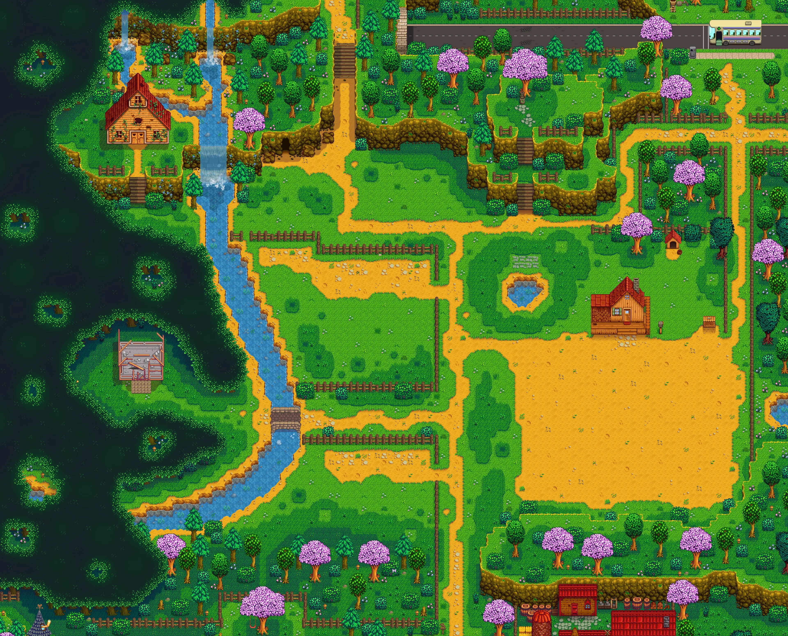

# 宝可梦游戏素材目录

这里只存图片和素材说明。源码、数据库、账号与会话不在这个公开仓库。

**当前索引覆盖 1,581 张图片：1,053 张已索引原件 + 30 张人物图集候选 + 498 张静态背图候选。** 另有 37 张隔离原件未公开。索引覆盖当前公库图片，不代表全部历史素材已找齐。 图片按用途与动作命名，SHA-256 用于校验，归档未改动图片字节。

## 怎么找

- **人物图集候选（30 张）**：[Ruby](characters/ruby/)、[Emerald](characters/emerald/)、[Ruby／Sapphire 同外观别名](characters/ruby-sapphire-aliases/)；逐件上游仓库、固定提交和原路径见 [首批来源索引](assets.json)。
- **静态背图候选（498 张）**：[普通](pokemon/candidates/back/normal/default-static/)、[闪光](pokemon/candidates/back/shiny/default-static/)；来源和哈希见 [#1 两张](pokemon/candidates/back/README-dex-00001.md) 与 [其余 496 张](pokemon/candidates/back/static-back-historical-249-sources.json)。
- **已索引原件（1,053 张）**：见 [首批索引中的 5 张原件](assets.json)、[精灵／道具](pokemon-assets.json)、[历史人物／场景](historical-assets.json)、[历史上传参考](reference-assets.json)。

- `maps/tiles/`：地图地块（2张）
- `ui/backgrounds/`：登录、游戏世界背景（2张）
- `ui/fallbacks/`：商店商品缺图兜底（1张）
- `characters/ruby/`：Ruby男女主动作图集（12张）
- `characters/emerald/`：Emerald男女主动作图集（14张）
- `characters/ruby-sapphire-aliases/`：另一上游版本的同外观图集（4张，不是4个新人）

## 新增1019张精灵与道具分类

逐图信息见 [pokemon-assets.json](pokemon-assets.json)，目录内包含逐图中文说明及预览。

- [items/pokeapi-icons](items/pokeapi-icons/README.md)：1张
- [pokemon/sprites/back/normal/default-static](pokemon/sprites/back/normal/default-static/README.md)：135张
- [pokemon/sprites/back/normal/gen5-black-white-animated](pokemon/sprites/back/normal/gen5-black-white-animated/README.md)：1张
- [pokemon/sprites/back/shiny/default-static](pokemon/sprites/back/shiny/default-static/README.md)：135张
- [pokemon/sprites/front/normal/default-static](pokemon/sprites/front/normal/default-static/README.md)：238张
- [pokemon/sprites/front/normal/gen5-black-white-animated](pokemon/sprites/front/normal/gen5-black-white-animated/README.md)：140张
- [pokemon/sprites/front/shiny/default-static](pokemon/sprites/front/shiny/default-static/README.md)：234张
- [pokemon/sprites/front/shiny/gen5-black-white-animated](pokemon/sprites/front/shiny/gen5-black-white-animated/README.md)：135张

## 新增26张历史人物与场景素材

- [battle/backgrounds/cave](battle/backgrounds/cave/README.md)：2张
- [battle/backgrounds/tall-grass](battle/backgrounds/tall-grass/README.md)：2张
- [battle/backgrounds/water](battle/backgrounds/water/README.md)：2张
- [characters/historical-male/walk/down](characters/historical-male/walk/down/README.md)：3张
- [characters/historical-male/walk/left](characters/historical-male/walk/left/README.md)：3张
- [characters/historical-male/walk/right](characters/historical-male/walk/right/README.md)：3张
- [characters/historical-male/walk/up](characters/historical-male/walk/up/README.md)：3张
- [maps/atlases](maps/atlases/README.md)：1张
- [maps/tree-parts](maps/tree-parts/README.md)：4张
- [references/game-scenes](references/game-scenes/README.md)：3张

源路径引用不等于当前运行正确；其中3张是场景/拼图参考，不冒充已验收战斗底图。见[逐图记录](historical-assets.json)。

## 使用约定
- 接入用固定commit链接，不用会漂移的main地址。旧版本图片链接仍可追溯。
- 图集须裁格，`normal.png`包含多种动作，不将其误称单独行走图。冲浪图只有人物层，水面/坐骑组合另需规则。
- 来源、原版本、尺寸、帧格信息、哈希与接入状态详见[机器可读清单](assets.json)。
- 来源标注不等于开放许可。第三方作品权利归相应权利人所有，未宣称原创、官方合作或开放再分发授权。

## 首批35张：名称、用途与预览

### 普通草地块

- 文件：[maps/tiles/grass.png](maps/tiles/grass.png)
- 用途：地图普通地面及编辑器绘制
- 状态：已接入自有应用静态路径；尚未切为本库新直链
- 尺寸：16 × 16；大小：1678 B
- SHA256：`062c8d7700176008b9eae17bf2709c2d04ed893a3d5e2e4ca4e3db16214e170b`
- 来源：原项目提供；miaoda-conversation-file.cdn.bcebos.com / file-7oue52qn241s.png，创作者未核实

### 高草地块

- 文件：[maps/tiles/tall-grass.png](maps/tiles/tall-grass.png)
- 用途：地图高草外观；不以图片本身推断遇敌规则
- 状态：已接入自有应用静态路径；尚未切为本库新直链
- 尺寸：16 × 16；大小：1896 B
- SHA256：`524bad8022d383681f58bb1fc2ff3fd9a30ef588f6484f114c4bc07cdf617f14`
- 来源：原项目提供；miaoda-conversation-file.cdn.bcebos.com / file-7oujz3l2ps00.png，创作者未核实

### 登录与找回密码背景

- 文件：[ui/backgrounds/login-and-password-recovery.jpg](ui/backgrounds/login-and-password-recovery.jpg)
- 用途：登录页和找回密码页共用
- 状态：待接入
- 尺寸：1344 × 768；大小：961784 B
- SHA256：`36be7c6b21b1525d05acc60b1359da91e6ce8769d4783f6e92dcce95930c38fe`
- 来源：原项目提供；miaoda-conversation-file.cdn.bcebos.com / file-7zhb0r12iubk.jpg，创作者未核实

### 商店商品缺图兜底

- 文件：[ui/fallbacks/shop-item.jpg](ui/fallbacks/shop-item.jpg)
- 用途：商品图缺失或加载失败时的既有兜底，不是商店背景
- 状态：待接入
- 尺寸：3840 × 3104；大小：4887508 B
- SHA256：`663feb1594714a082dd3d3d7016f0cd956725ee1e2b0d2ca7610ee199bfa7e94`
- 来源：原项目提供；miaoda-site-img.cdn.bcebos.com / baidu_image_search_7a231caa-2ceb-410c-9ac3-2fc526ee0b54.jpg，创作者未核实

### 游戏世界背景

- 文件：[ui/backgrounds/game-world.jpg](ui/backgrounds/game-world.jpg)
- 用途：GameWorld既有背景用途；不是地块布局或战斗场景
- 状态：待接入
- 尺寸：2688 × 1536；大小：3074356 B
- SHA256：`c7f29dec225629775ab76d18569ffe12ce906f6b0e0767a8c79af2af69dc2903`
- 来源：原项目提供；miaoda-conversation-file.cdn.bcebos.com / file-7zjrlorc3dog.jpg，创作者未核实

### Emerald 男主布兰登 · 行走

- 文件：[characters/emerald/brendan/walking.png](characters/emerald/brendan/walking.png)
- 用途：人物原始动作图集，须按源格裁切后播放，不可当整张人物直接显示
- 状态：候选；仅本地预览，未接入游戏
- 尺寸：144 × 32；大小：796 B
- SHA256：`f33ec07a5fd17f4422455f8bc55cd3d3522fa65c3bf740ecbdc00da705eaa0d1`
- 来源：[pret/pokeemerald](https://github.com/pret/pokeemerald/blob/731ad5bfd6e6f265508d0efcca0ba42f9dcf5881/graphics/object_events/pics/people/brendan/walking.png)（固定版本 `731ad5bfd6e6f265508d0efcca0ba42f9dcf5881`）

### Emerald 男主布兰登 · 跑步

- 文件：[characters/emerald/brendan/running.png](characters/emerald/brendan/running.png)
- 用途：人物原始动作图集，须按源格裁切后播放，不可当整张人物直接显示
- 状态：候选；仅本地预览，未接入游戏
- 尺寸：144 × 32；大小：793 B
- SHA256：`231bf06e0c45cd1eb14e2039bd63cbbfc735ff646c7e3b8986c22b423a7a6896`
- 来源：[pret/pokeemerald](https://github.com/pret/pokeemerald/blob/731ad5bfd6e6f265508d0efcca0ba42f9dcf5881/graphics/object_events/pics/people/brendan/running.png)（固定版本 `731ad5bfd6e6f265508d0efcca0ba42f9dcf5881`）

### Emerald 男主布兰登 · 高速自行车

- 文件：[characters/emerald/brendan/mach_bike.png](characters/emerald/brendan/mach_bike.png)
- 用途：人物原始动作图集，须按源格裁切后播放，不可当整张人物直接显示
- 状态：候选；仅本地预览，未接入游戏
- 尺寸：288 × 32；大小：1049 B
- SHA256：`8eec0becaea834b8fc82f28613b770baefda40e2db69661876fe0e0c7a65409d`
- 来源：[pret/pokeemerald](https://github.com/pret/pokeemerald/blob/731ad5bfd6e6f265508d0efcca0ba42f9dcf5881/graphics/object_events/pics/people/brendan/mach_bike.png)（固定版本 `731ad5bfd6e6f265508d0efcca0ba42f9dcf5881`）

### Emerald 男主布兰登 · 技巧自行车

- 文件：[characters/emerald/brendan/acro_bike.png](characters/emerald/brendan/acro_bike.png)
- 用途：人物原始动作图集，须按源格裁切后播放，不可当整张人物直接显示
- 状态：候选；仅本地预览，未接入游戏；当前仅原格展示，业务动作待核
- 尺寸：864 × 32；大小：2465 B
- SHA256：`a98ec5dbcc21fbcae1fbcb83420de67028eabe8f85717bd146fab6ca4169a245`
- 来源：[pret/pokeemerald](https://github.com/pret/pokeemerald/blob/731ad5bfd6e6f265508d0efcca0ba42f9dcf5881/graphics/object_events/pics/people/brendan/acro_bike.png)（固定版本 `731ad5bfd6e6f265508d0efcca0ba42f9dcf5881`）

### Emerald 男主布兰登 · 冲浪人物层

- 文件：[characters/emerald/brendan/surfing.png](characters/emerald/brendan/surfing.png)
- 用途：人物原始动作图集，须按源格裁切后播放，不可当整张人物直接显示
- 状态：候选；仅本地预览，未接入游戏
- 尺寸：192 × 32；大小：768 B
- SHA256：`96816922552b6ea5479abbf6dba0a44a255e7c3a4a3fa563c9f573a8dfa827a6`
- 来源：[pret/pokeemerald](https://github.com/pret/pokeemerald/blob/731ad5bfd6e6f265508d0efcca0ba42f9dcf5881/graphics/object_events/pics/people/brendan/surfing.png)（固定版本 `731ad5bfd6e6f265508d0efcca0ba42f9dcf5881`）

### Emerald 男主布兰登 · 钓鱼

- 文件：[characters/emerald/brendan/fishing.png](characters/emerald/brendan/fishing.png)
- 用途：人物原始动作图集，须按源格裁切后播放，不可当整张人物直接显示
- 状态：候选；仅本地预览，未接入游戏
- 尺寸：384 × 32；大小：1470 B
- SHA256：`8483ae7fdfe62c7ddc7c166f926d8cc5a07cf167d10cc65584be35ed68b0f191`
- 来源：[pret/pokeemerald](https://github.com/pret/pokeemerald/blob/731ad5bfd6e6f265508d0efcca0ba42f9dcf5881/graphics/object_events/pics/people/brendan/fishing.png)（固定版本 `731ad5bfd6e6f265508d0efcca0ba42f9dcf5881`）

### Emerald 男主布兰登 · 浇水

- 文件：[characters/emerald/brendan/watering.png](characters/emerald/brendan/watering.png)
- 用途：人物原始动作图集，须按源格裁切后播放，不可当整张人物直接显示
- 状态：候选；仅本地预览，未接入游戏；当前仅原格展示，业务动作待核
- 尺寸：192 × 32；大小：641 B
- SHA256：`2d1a7ed94b86a2ce291e1df2dfc0ae00cb3b3a76e0a4c7e9d98053e1369f9955`
- 来源：[pret/pokeemerald](https://github.com/pret/pokeemerald/blob/731ad5bfd6e6f265508d0efcca0ba42f9dcf5881/graphics/object_events/pics/people/brendan/watering.png)（固定版本 `731ad5bfd6e6f265508d0efcca0ba42f9dcf5881`）

### Ruby/Sapphire来源别名 男主布兰登 · 行走

- 文件：[characters/ruby-sapphire-aliases/brendan/walking.png](characters/ruby-sapphire-aliases/brendan/walking.png)
- 用途：人物原始动作图集，须按源格裁切后播放，不可当整张人物直接显示；同外观来源别名，不计作新增角色
- 状态：候选；仅本地预览，未接入游戏
- 尺寸：144 × 32；大小：783 B
- SHA256：`9792a6ed4b83f8aa286d1042e9faf0614c759fb5c7d2548ab8fc13e46511a57d`
- 来源：[pret/pokeemerald](https://github.com/pret/pokeemerald/blob/731ad5bfd6e6f265508d0efcca0ba42f9dcf5881/graphics/object_events/pics/people/ruby_sapphire_brendan/walking.png)（固定版本 `731ad5bfd6e6f265508d0efcca0ba42f9dcf5881`）

### Ruby/Sapphire来源别名 男主布兰登 · 跑步

- 文件：[characters/ruby-sapphire-aliases/brendan/running.png](characters/ruby-sapphire-aliases/brendan/running.png)
- 用途：人物原始动作图集，须按源格裁切后播放，不可当整张人物直接显示；同外观来源别名，不计作新增角色
- 状态：候选；仅本地预览，未接入游戏
- 尺寸：144 × 32；大小：783 B
- SHA256：`ad6d6eeaaca509cb00c8b051b2a3f82d4bf1da341b145f938c1f2c57d73e9e27`
- 来源：[pret/pokeemerald](https://github.com/pret/pokeemerald/blob/731ad5bfd6e6f265508d0efcca0ba42f9dcf5881/graphics/object_events/pics/people/ruby_sapphire_brendan/running.png)（固定版本 `731ad5bfd6e6f265508d0efcca0ba42f9dcf5881`）

### Emerald 女主小遥 · 行走

- 文件：[characters/emerald/may/walking.png](characters/emerald/may/walking.png)
- 用途：人物原始动作图集，须按源格裁切后播放，不可当整张人物直接显示
- 状态：候选；仅本地预览，未接入游戏
- 尺寸：144 × 32；大小：771 B
- SHA256：`7f185cda9854f7812545c306795b454dc750be440e582974518ba8a63c9b7e87`
- 来源：[pret/pokeemerald](https://github.com/pret/pokeemerald/blob/731ad5bfd6e6f265508d0efcca0ba42f9dcf5881/graphics/object_events/pics/people/may/walking.png)（固定版本 `731ad5bfd6e6f265508d0efcca0ba42f9dcf5881`）

### Emerald 女主小遥 · 跑步

- 文件：[characters/emerald/may/running.png](characters/emerald/may/running.png)
- 用途：人物原始动作图集，须按源格裁切后播放，不可当整张人物直接显示
- 状态：候选；仅本地预览，未接入游戏
- 尺寸：144 × 32；大小：848 B
- SHA256：`502d64cc79413b113761cb78e56ae8d9a08a093a5fc4599f46986dd44016a987`
- 来源：[pret/pokeemerald](https://github.com/pret/pokeemerald/blob/731ad5bfd6e6f265508d0efcca0ba42f9dcf5881/graphics/object_events/pics/people/may/running.png)（固定版本 `731ad5bfd6e6f265508d0efcca0ba42f9dcf5881`）

### Emerald 女主小遥 · 高速自行车

- 文件：[characters/emerald/may/mach_bike.png](characters/emerald/may/mach_bike.png)
- 用途：人物原始动作图集，须按源格裁切后播放，不可当整张人物直接显示
- 状态：候选；仅本地预览，未接入游戏
- 尺寸：288 × 32；大小：1106 B
- SHA256：`0b99cdfd6514e3ffa980d1a3d4606ba33ff6c4835090d1be588a293a0674a737`
- 来源：[pret/pokeemerald](https://github.com/pret/pokeemerald/blob/731ad5bfd6e6f265508d0efcca0ba42f9dcf5881/graphics/object_events/pics/people/may/mach_bike.png)（固定版本 `731ad5bfd6e6f265508d0efcca0ba42f9dcf5881`）

### Emerald 女主小遥 · 技巧自行车

- 文件：[characters/emerald/may/acro_bike.png](characters/emerald/may/acro_bike.png)
- 用途：人物原始动作图集，须按源格裁切后播放，不可当整张人物直接显示
- 状态：候选；仅本地预览，未接入游戏；当前仅原格展示，业务动作待核
- 尺寸：864 × 32；大小：2513 B
- SHA256：`f95ca561a02592c32f0f1ee6044db1f25fb8f32052c87bbdcf715f728a549624`
- 来源：[pret/pokeemerald](https://github.com/pret/pokeemerald/blob/731ad5bfd6e6f265508d0efcca0ba42f9dcf5881/graphics/object_events/pics/people/may/acro_bike.png)（固定版本 `731ad5bfd6e6f265508d0efcca0ba42f9dcf5881`）

### Emerald 女主小遥 · 冲浪人物层

- 文件：[characters/emerald/may/surfing.png](characters/emerald/may/surfing.png)
- 用途：人物原始动作图集，须按源格裁切后播放，不可当整张人物直接显示
- 状态：候选；仅本地预览，未接入游戏
- 尺寸：192 × 32；大小：758 B
- SHA256：`29be49cebc9fb5f0e94a1b9ec9a92b136ee44b97dfa085952a92a9dec90d6e7b`
- 来源：[pret/pokeemerald](https://github.com/pret/pokeemerald/blob/731ad5bfd6e6f265508d0efcca0ba42f9dcf5881/graphics/object_events/pics/people/may/surfing.png)（固定版本 `731ad5bfd6e6f265508d0efcca0ba42f9dcf5881`）

### Emerald 女主小遥 · 钓鱼

- 文件：[characters/emerald/may/fishing.png](characters/emerald/may/fishing.png)
- 用途：人物原始动作图集，须按源格裁切后播放，不可当整张人物直接显示
- 状态：候选；仅本地预览，未接入游戏
- 尺寸：384 × 32；大小：1524 B
- SHA256：`cd55247ba4472e9138d33b5ee4cc19754faec142540285af15a91ca0355977f5`
- 来源：[pret/pokeemerald](https://github.com/pret/pokeemerald/blob/731ad5bfd6e6f265508d0efcca0ba42f9dcf5881/graphics/object_events/pics/people/may/fishing.png)（固定版本 `731ad5bfd6e6f265508d0efcca0ba42f9dcf5881`）

### Emerald 女主小遥 · 浇水

- 文件：[characters/emerald/may/watering.png](characters/emerald/may/watering.png)
- 用途：人物原始动作图集，须按源格裁切后播放，不可当整张人物直接显示
- 状态：候选；仅本地预览，未接入游戏；当前仅原格展示，业务动作待核
- 尺寸：192 × 32；大小：659 B
- SHA256：`126c11549328e77174109178043f6fdc1e1debb8b83c3863c97497655ebe08a8`
- 来源：[pret/pokeemerald](https://github.com/pret/pokeemerald/blob/731ad5bfd6e6f265508d0efcca0ba42f9dcf5881/graphics/object_events/pics/people/may/watering.png)（固定版本 `731ad5bfd6e6f265508d0efcca0ba42f9dcf5881`）

### Ruby/Sapphire来源别名 女主小遥 · 行走

- 文件：[characters/ruby-sapphire-aliases/may/walking.png](characters/ruby-sapphire-aliases/may/walking.png)
- 用途：人物原始动作图集，须按源格裁切后播放，不可当整张人物直接显示；同外观来源别名，不计作新增角色
- 状态：候选；仅本地预览，未接入游戏
- 尺寸：144 × 32；大小：745 B
- SHA256：`ee189388b766de8327777da7962a4ffcdc8204cbd184d761e0c1b0a2017c2334`
- 来源：[pret/pokeemerald](https://github.com/pret/pokeemerald/blob/731ad5bfd6e6f265508d0efcca0ba42f9dcf5881/graphics/object_events/pics/people/ruby_sapphire_may/walking.png)（固定版本 `731ad5bfd6e6f265508d0efcca0ba42f9dcf5881`）

### Ruby/Sapphire来源别名 女主小遥 · 跑步

- 文件：[characters/ruby-sapphire-aliases/may/running.png](characters/ruby-sapphire-aliases/may/running.png)
- 用途：人物原始动作图集，须按源格裁切后播放，不可当整张人物直接显示；同外观来源别名，不计作新增角色
- 状态：候选；仅本地预览，未接入游戏
- 尺寸：144 × 32；大小：846 B
- SHA256：`1a07051b2ad5aa110d16f513311188e154ff39ac31a0619c07048fc21a94b200`
- 来源：[pret/pokeemerald](https://github.com/pret/pokeemerald/blob/731ad5bfd6e6f265508d0efcca0ba42f9dcf5881/graphics/object_events/pics/people/ruby_sapphire_may/running.png)（固定版本 `731ad5bfd6e6f265508d0efcca0ba42f9dcf5881`）

### Ruby 男主布兰登 · 站立、行走与跑步混合图集

- 文件：[characters/ruby/brendan/normal.png](characters/ruby/brendan/normal.png)
- 用途：人物原始动作图集，须按源格裁切后播放，不可当整张人物直接显示
- 状态：候选；仅本地预览，未接入游戏
- 尺寸：288 × 32；大小：1235 B
- SHA256：`a6bd25b78904f02ea725c2b267dd673eb8c3559a1b238aeb76801de2c4f060e8`
- 来源：[pret/pokeruby](https://github.com/pret/pokeruby/blob/5784633ce4ef7ade1a7f2d2d0c288e3d5e6cdd7f/graphics/object_events/pics/people/brendan/normal.png)（固定版本 `5784633ce4ef7ade1a7f2d2d0c288e3d5e6cdd7f`）

### Ruby 男主布兰登 · 高速自行车

- 文件：[characters/ruby/brendan/mach_bike.png](characters/ruby/brendan/mach_bike.png)
- 用途：人物原始动作图集，须按源格裁切后播放，不可当整张人物直接显示
- 状态：候选；仅本地预览，未接入游戏
- 尺寸：288 × 32；大小：1036 B
- SHA256：`0dd9fd1643cd4329eaf2521ecfae52f8ae24c7d8166f1c8af96093bb21a76794`
- 来源：[pret/pokeruby](https://github.com/pret/pokeruby/blob/5784633ce4ef7ade1a7f2d2d0c288e3d5e6cdd7f/graphics/object_events/pics/people/brendan/mach_bike.png)（固定版本 `5784633ce4ef7ade1a7f2d2d0c288e3d5e6cdd7f`）

### Ruby 男主布兰登 · 技巧自行车

- 文件：[characters/ruby/brendan/acro_bike.png](characters/ruby/brendan/acro_bike.png)
- 用途：人物原始动作图集，须按源格裁切后播放，不可当整张人物直接显示
- 状态：候选；仅本地预览，未接入游戏；当前仅原格展示，业务动作待核
- 尺寸：864 × 32；大小：2403 B
- SHA256：`1b5a96ef3d4a0bcf550be46105a14ec72dc31835b2b5591819d8263c1dbbe958`
- 来源：[pret/pokeruby](https://github.com/pret/pokeruby/blob/5784633ce4ef7ade1a7f2d2d0c288e3d5e6cdd7f/graphics/object_events/pics/people/brendan/acro_bike.png)（固定版本 `5784633ce4ef7ade1a7f2d2d0c288e3d5e6cdd7f`）

### Ruby 男主布兰登 · 冲浪人物层

- 文件：[characters/ruby/brendan/surfing.png](characters/ruby/brendan/surfing.png)
- 用途：人物原始动作图集，须按源格裁切后播放，不可当整张人物直接显示
- 状态：候选；仅本地预览，未接入游戏
- 尺寸：192 × 32；大小：750 B
- SHA256：`f82f5d1f388e7bb83481baecf8ae9e817258bcde884ae598330c5f72bcef336a`
- 来源：[pret/pokeruby](https://github.com/pret/pokeruby/blob/5784633ce4ef7ade1a7f2d2d0c288e3d5e6cdd7f/graphics/object_events/pics/people/brendan/surfing.png)（固定版本 `5784633ce4ef7ade1a7f2d2d0c288e3d5e6cdd7f`）

### Ruby 男主布兰登 · 钓鱼

- 文件：[characters/ruby/brendan/fishing.png](characters/ruby/brendan/fishing.png)
- 用途：人物原始动作图集，须按源格裁切后播放，不可当整张人物直接显示
- 状态：候选；仅本地预览，未接入游戏
- 尺寸：384 × 32；大小：1476 B
- SHA256：`2910eb7446ad5097984c0acd2ae261df0aea502a3f6645366ed427cfbbf5ae85`
- 来源：[pret/pokeruby](https://github.com/pret/pokeruby/blob/5784633ce4ef7ade1a7f2d2d0c288e3d5e6cdd7f/graphics/object_events/pics/people/brendan/fishing.png)（固定版本 `5784633ce4ef7ade1a7f2d2d0c288e3d5e6cdd7f`）

### Ruby 男主布兰登 · 浇水

- 文件：[characters/ruby/brendan/watering.png](characters/ruby/brendan/watering.png)
- 用途：人物原始动作图集，须按源格裁切后播放，不可当整张人物直接显示
- 状态：候选；仅本地预览，未接入游戏；当前仅原格展示，业务动作待核
- 尺寸：192 × 32；大小：630 B
- SHA256：`f6d2cdd4cdd93cf82711287c22f745d7f2d17775b7a5ed25a1fe454c4c3e18fb`
- 来源：[pret/pokeruby](https://github.com/pret/pokeruby/blob/5784633ce4ef7ade1a7f2d2d0c288e3d5e6cdd7f/graphics/object_events/pics/people/brendan/watering.png)（固定版本 `5784633ce4ef7ade1a7f2d2d0c288e3d5e6cdd7f`）

### Ruby 女主小遥 · 站立、行走与跑步混合图集

- 文件：[characters/ruby/may/normal.png](characters/ruby/may/normal.png)
- 用途：人物原始动作图集，须按源格裁切后播放，不可当整张人物直接显示
- 状态：候选；仅本地预览，未接入游戏
- 尺寸：288 × 32；大小：1244 B
- SHA256：`9fc1e463f8d581459da84aa33722a6fbc5005987c9259f16aee08623cfcb0556`
- 来源：[pret/pokeruby](https://github.com/pret/pokeruby/blob/5784633ce4ef7ade1a7f2d2d0c288e3d5e6cdd7f/graphics/object_events/pics/people/may/normal.png)（固定版本 `5784633ce4ef7ade1a7f2d2d0c288e3d5e6cdd7f`）

### Ruby 女主小遥 · 高速自行车

- 文件：[characters/ruby/may/mach_bike.png](characters/ruby/may/mach_bike.png)
- 用途：人物原始动作图集，须按源格裁切后播放，不可当整张人物直接显示
- 状态：候选；仅本地预览，未接入游戏
- 尺寸：288 × 32；大小：1089 B
- SHA256：`92c22f15264345e3809b6974e4781cd93eb0151155aaf3eeea10582ce2c0471f`
- 来源：[pret/pokeruby](https://github.com/pret/pokeruby/blob/5784633ce4ef7ade1a7f2d2d0c288e3d5e6cdd7f/graphics/object_events/pics/people/may/mach_bike.png)（固定版本 `5784633ce4ef7ade1a7f2d2d0c288e3d5e6cdd7f`）

### Ruby 女主小遥 · 技巧自行车

- 文件：[characters/ruby/may/acro_bike.png](characters/ruby/may/acro_bike.png)
- 用途：人物原始动作图集，须按源格裁切后播放，不可当整张人物直接显示
- 状态：候选；仅本地预览，未接入游戏；当前仅原格展示，业务动作待核
- 尺寸：864 × 32；大小：2433 B
- SHA256：`66a932b22032bbac333deb5fa7119ad5c172ce71b25034d2463b616583ae1ff8`
- 来源：[pret/pokeruby](https://github.com/pret/pokeruby/blob/5784633ce4ef7ade1a7f2d2d0c288e3d5e6cdd7f/graphics/object_events/pics/people/may/acro_bike.png)（固定版本 `5784633ce4ef7ade1a7f2d2d0c288e3d5e6cdd7f`）

### Ruby 女主小遥 · 冲浪人物层

- 文件：[characters/ruby/may/surfing.png](characters/ruby/may/surfing.png)
- 用途：人物原始动作图集，须按源格裁切后播放，不可当整张人物直接显示
- 状态：候选；仅本地预览，未接入游戏
- 尺寸：192 × 32；大小：749 B
- SHA256：`3c6d08f17ccf69ca8eea9594f8837aed27bcc22d17e8d259a0eea30e07fd1f81`
- 来源：[pret/pokeruby](https://github.com/pret/pokeruby/blob/5784633ce4ef7ade1a7f2d2d0c288e3d5e6cdd7f/graphics/object_events/pics/people/may/surfing.png)（固定版本 `5784633ce4ef7ade1a7f2d2d0c288e3d5e6cdd7f`）

### Ruby 女主小遥 · 钓鱼

- 文件：[characters/ruby/may/fishing.png](characters/ruby/may/fishing.png)
- 用途：人物原始动作图集，须按源格裁切后播放，不可当整张人物直接显示
- 状态：候选；仅本地预览，未接入游戏
- 尺寸：384 × 32；大小：1497 B
- SHA256：`c965ad7d3693cc19190de608c3a3bbf51a8553d4eab060b1cd3f28f360d6f4bb`
- 来源：[pret/pokeruby](https://github.com/pret/pokeruby/blob/5784633ce4ef7ade1a7f2d2d0c288e3d5e6cdd7f/graphics/object_events/pics/people/may/fishing.png)（固定版本 `5784633ce4ef7ade1a7f2d2d0c288e3d5e6cdd7f`）

### Ruby 女主小遥 · 浇水

- 文件：[characters/ruby/may/watering.png](characters/ruby/may/watering.png)
- 用途：人物原始动作图集，须按源格裁切后播放，不可当整张人物直接显示
- 状态：候选；仅本地预览，未接入游戏；当前仅原格展示，业务动作待核
- 尺寸：192 × 32；大小：647 B
- SHA256：`6f8440f2ca2f3cb561fd3815b06cc3850f9cdace77d278f6c0a666a912f8f3f7`
- 来源：[pret/pokeruby](https://github.com/pret/pokeruby/blob/5784633ce4ef7ade1a7f2d2d0c288e3d5e6cdd7f/graphics/object_events/pics/people/may/watering.png)（固定版本 `5784633ce4ef7ade1a7f2d2d0c288e3d5e6cdd7f`）

### 编号与原图含义
“原图”仅表示源文件字节未重绘，不代表原项目历史实际使用已确认。PokeAPI编号0仅是来源路径编号，物种未确认。

## 补充3张历史上传参考

- [会话明确要求替换高草丛战斗背景；历史上传渐变底图，未证最终接入。与已发布水域白天图像素不同。](battle/backgrounds/tall-grass/tall-grass-upload-gradient--50acc7ecf934.png)
- [会话用于说明32×32小图标规格；实体为单帧妙蛙种子PNG，非GIF、非已接入图标。](references/pokemon-icons/bulbasaur-static-icon-example--66473c0e25d0.png)
- [会话用于说明纯白椭圆地面；仅设计参考，非已验证贴图或遮罩。](references/battle-ground/battle-white-ellipse-reference--85357e0eac0b.png)

见 [reference-assets.json](reference-assets.json)。37张隔离文件含诊断/布局界面截图、UI文档示例与来源待核插画，未作为游戏素材公开。
