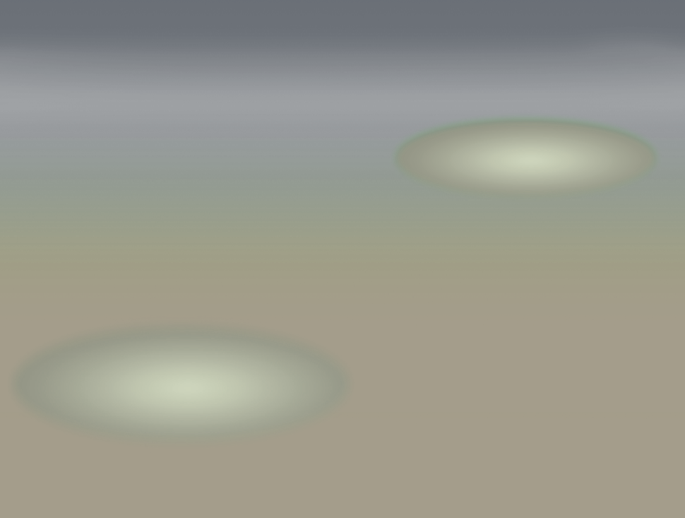
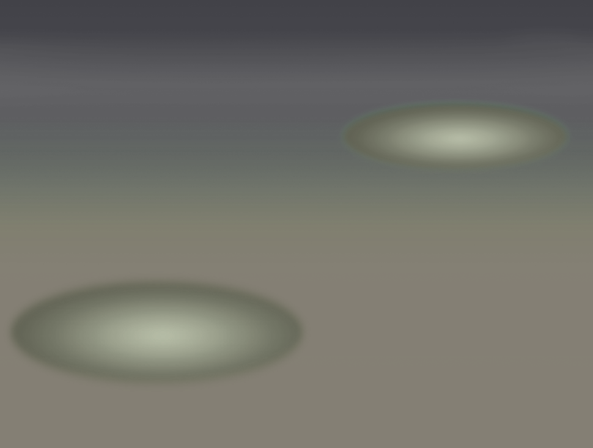

# 历史素材：battle/backgrounds/cave

这是已核源文件的归档，不表示当前游戏接入或组合方式已经验收。

## 历史洞穴白天战斗回退底图；画面为带双椭圆站位的渐变背景，未验证当前接入

- 文件：[cave-day-gradient-plane--8d98e2ac2f4e.png](cave-day-gradient-plane--8d98e2ac2f4e.png)
- 尺寸：970×733；帧数：1
- SHA256：`8d98e2ac2f4ec94091882cf2846be573d0d33cff9bbf82fea2abe5ae498b991e`
- 来源：历史项目素材；去敏来源记录见根目录 historical-assets.json。
- 状态：历史文件已核，运行接入未验证；参考拼图不冒充可直接运行战斗底图。

## 历史洞穴夜晚战斗回退底图；画面为带双椭圆站位的渐变背景，未验证当前接入

- 文件：[cave-night-gradient-plane--3d25eed6b1d3.png](cave-night-gradient-plane--3d25eed6b1d3.png)
- 尺寸：970×733；帧数：1
- SHA256：`3d25eed6b1d338d327d5abe90ae646f98dc83490c45775ee7d4c1f9797789d22`
- 来源：历史项目素材；去敏来源记录见根目录 historical-assets.json。
- 状态：历史文件已核，运行接入未验证；参考拼图不冒充可直接运行战斗底图。

