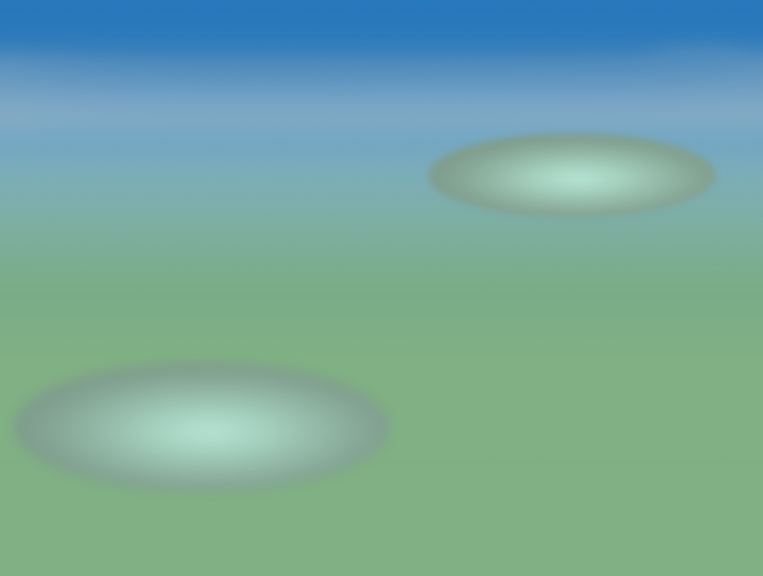

# 历史素材：battle/backgrounds/tall-grass

这是已核源文件的归档，不表示当前游戏接入或组合方式已经验收。

## 历史高草丛白天战斗回退底图；画面为带双椭圆站位的渐变背景，未验证当前接入

- 文件：[tall-grass-day-gradient-plane--9bde497c2399.png](tall-grass-day-gradient-plane--9bde497c2399.png)
- 尺寸：970×733；帧数：1
- SHA256：`9bde497c2399a38671fec1e821870873d4d5426de22fb97bcf7c1cdecb244f1c`
- 来源：历史项目素材；去敏来源记录见根目录 historical-assets.json。
- 状态：历史文件已核，运行接入未验证；参考拼图不冒充可直接运行战斗底图。

## 历史高草丛夜晚战斗回退底图；画面为带双椭圆站位的渐变背景，未验证当前接入

- 文件：[tall-grass-night-gradient-plane--5268f2895486.png](tall-grass-night-gradient-plane--5268f2895486.png)
- 尺寸：970×733；帧数：1
- SHA256：`5268f28954860bf4b65624e47da75546ba0437a40cd431076b4ee5c227d443c5`
- 来源：历史项目素材；去敏来源记录见根目录 historical-assets.json。
- 状态：历史文件已核，运行接入未验证；参考拼图不冒充可直接运行战斗底图。

## 会话明确要求替换高草丛战斗背景；历史上传渐变底图，未证最终接入。与已发布水域白天图像素不同。

- 文件：[tall-grass-upload-gradient--50acc7ecf934.png](tall-grass-upload-gradient--50acc7ecf934.png)
- 尺寸：970×733；单帧PNG。
- SHA256：`50acc7ecf93448506bd1c8de0a972e6ecde28652601c24a89dea28f2d455c351`
- 状态：源文件已归档，运行接入未验证。
- 来源：原项目会话上传；去敏来源见 reference-assets.json；许可记录NOASSERTION。
