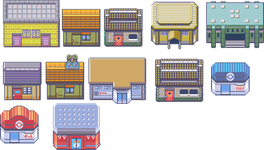

# 历史素材：maps/atlases

这是已核源文件的归档，不表示当前游戏接入或组合方式已经验收。

## 439×250历史建筑裁剪源图；裁剪矩形、瓦片覆盖与地图布局未核

- 文件：[buildings-original-439x250--b48c189b76d3.png](buildings-original-439x250--b48c189b76d3.png)
- 尺寸：439×250；帧数：1
- SHA256：`b48c189b76d32f524ec2366cb6392ead5cfbd32fca5ca8999bda8829f4dd39bd`
- 来源：历史项目素材；去敏来源记录见根目录 historical-assets.json。
- 状态：历史文件已核，运行接入未验证；参考拼图不冒充可直接运行战斗底图。

