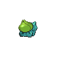

# 妙蛙种子 #001：静态背面候选

**Candidate, not recovered original.** 上游补齐候选；没有证据表明原项目曾上传或使用这一对。未接入运行或数据库。

来源：PokeAPI/sprites，固定 commit `1dd55c0436d2a5b6e324c0b780e1b1b416fbfb64`。许可记录：NOASSERTION，不作额外许可声明。

## 普通静态背面

- [固定上游原路径](https://raw.githubusercontent.com/PokeAPI/sprites/1dd55c0436d2a5b6e324c0b780e1b1b416fbfb64/sprites/pokemon/back/1.png)；96×96 单帧透明 PNG，423 B。
- SHA-256：`d7070e94a8857a86072d87137f985555dd810cf415f87493aa71f7006e19e345`；Git blob：`aa7cbd24b0068a728141da9673217cc6b6b9a9f8`。

## 闪光静态背面

- [固定上游原路径](https://raw.githubusercontent.com/PokeAPI/sprites/1dd55c0436d2a5b6e324c0b780e1b1b416fbfb64/sprites/pokemon/back/shiny/1.png)；96×96 单帧透明 PNG，426 B。
- SHA-256：`b852585a6bcabe80013bbbf93d8cdda71287c814e93066dfd62b389ded70ddb0`；Git blob：`cacca1c02c8eb09da3fccbc04d8e80b8cad3b126`。
