# pokemon/sprites/back/normal/default-static

共 135 张，均按原来源路径识别；已备份不等于已接入游戏。编号为PokeAPI编号，不是业务数据库主键。

### 宝可梦API ID 252 · 背面 · 普通 · 默认静态来源

- 文件：[pokemon-id-00252-back-normal-default-static--60f733454ee5.png](pokemon-id-00252-back-normal-default-static--60f733454ee5.png)
- 用途：背面普通宝可梦图像；身份和变体来自PokeAPI路径，不作为原应用已经接入的证明。
- 尺寸：96 × 96，帧数：1
- SHA256：`60f733454ee52890188872cfa5c1c63791f494712f585ed6c422b5064f8a1bed`
- 来源：[PokeAPI/sprites](https://raw.githubusercontent.com/PokeAPI/sprites/master/sprites/pokemon/back/252.png)；取得版本：`1dd55c0436d2a5b6e324c0b780e1b1b416fbfb64`

### 宝可梦API ID 253 · 背面 · 普通 · 默认静态来源

- 文件：[pokemon-id-00253-back-normal-default-static--6b30bd8c0412.png](pokemon-id-00253-back-normal-default-static--6b30bd8c0412.png)
- 用途：背面普通宝可梦图像；身份和变体来自PokeAPI路径，不作为原应用已经接入的证明。
- 尺寸：96 × 96，帧数：1
- SHA256：`6b30bd8c04123cb9bff895a8f41f85245295c6814877d100f4336329e3e7ce2f`
- 来源：[PokeAPI/sprites](https://raw.githubusercontent.com/PokeAPI/sprites/master/sprites/pokemon/back/253.png)；取得版本：`1dd55c0436d2a5b6e324c0b780e1b1b416fbfb64`

### 宝可梦API ID 254 · 背面 · 普通 · 默认静态来源

- 文件：[pokemon-id-00254-back-normal-default-static--ed4401320c0b.png](pokemon-id-00254-back-normal-default-static--ed4401320c0b.png)
- 用途：背面普通宝可梦图像；身份和变体来自PokeAPI路径，不作为原应用已经接入的证明。
- 尺寸：96 × 96，帧数：1
- SHA256：`ed4401320c0b911ab09c292570df3ee6e50341f68ebddb25de9122f8a6e5e507`
- 来源：[PokeAPI/sprites](https://raw.githubusercontent.com/PokeAPI/sprites/master/sprites/pokemon/back/254.png)；取得版本：`1dd55c0436d2a5b6e324c0b780e1b1b416fbfb64`

### 宝可梦API ID 255 · 背面 · 普通 · 默认静态来源

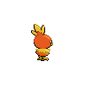

- 文件：[pokemon-id-00255-back-normal-default-static--6e6f70e09d06.png](pokemon-id-00255-back-normal-default-static--6e6f70e09d06.png)
- 用途：背面普通宝可梦图像；身份和变体来自PokeAPI路径，不作为原应用已经接入的证明。
- 尺寸：96 × 96，帧数：1
- SHA256：`6e6f70e09d0614a23818d036e0eb8370c6ec2d1f073afcfa3e9d1d2668349e90`
- 来源：[PokeAPI/sprites](https://raw.githubusercontent.com/PokeAPI/sprites/master/sprites/pokemon/back/255.png)；取得版本：`1dd55c0436d2a5b6e324c0b780e1b1b416fbfb64`

### 宝可梦API ID 256 · 背面 · 普通 · 默认静态来源

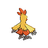

- 文件：[pokemon-id-00256-back-normal-default-static--4f3b2679b6a1.png](pokemon-id-00256-back-normal-default-static--4f3b2679b6a1.png)
- 用途：背面普通宝可梦图像；身份和变体来自PokeAPI路径，不作为原应用已经接入的证明。
- 尺寸：96 × 96，帧数：1
- SHA256：`4f3b2679b6a16c695cda1ca0fb1de029f468064c4df862b87a5c972cd3aac67b`
- 来源：[PokeAPI/sprites](https://raw.githubusercontent.com/PokeAPI/sprites/master/sprites/pokemon/back/256.png)；取得版本：`1dd55c0436d2a5b6e324c0b780e1b1b416fbfb64`

### 宝可梦API ID 257 · 背面 · 普通 · 默认静态来源

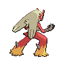

- 文件：[pokemon-id-00257-back-normal-default-static--cb13a53bd8e9.png](pokemon-id-00257-back-normal-default-static--cb13a53bd8e9.png)
- 用途：背面普通宝可梦图像；身份和变体来自PokeAPI路径，不作为原应用已经接入的证明。
- 尺寸：96 × 96，帧数：1
- SHA256：`cb13a53bd8e9a1eb5fed90d2e5c04124c69f4bc18b1a726bfd72c482ec0d75c5`
- 来源：[PokeAPI/sprites](https://raw.githubusercontent.com/PokeAPI/sprites/master/sprites/pokemon/back/257.png)；取得版本：`1dd55c0436d2a5b6e324c0b780e1b1b416fbfb64`

### 宝可梦API ID 258 · 背面 · 普通 · 默认静态来源

- 文件：[pokemon-id-00258-back-normal-default-static--b907740b7def.png](pokemon-id-00258-back-normal-default-static--b907740b7def.png)
- 用途：背面普通宝可梦图像；身份和变体来自PokeAPI路径，不作为原应用已经接入的证明。
- 尺寸：96 × 96，帧数：1
- SHA256：`b907740b7defc30a216dc54aa44785f1cfe31fa2357cec77ee045c07389a821c`
- 来源：[PokeAPI/sprites](https://raw.githubusercontent.com/PokeAPI/sprites/master/sprites/pokemon/back/258.png)；取得版本：`1dd55c0436d2a5b6e324c0b780e1b1b416fbfb64`

### 宝可梦API ID 259 · 背面 · 普通 · 默认静态来源

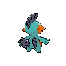

- 文件：[pokemon-id-00259-back-normal-default-static--9d1bf260fe3f.png](pokemon-id-00259-back-normal-default-static--9d1bf260fe3f.png)
- 用途：背面普通宝可梦图像；身份和变体来自PokeAPI路径，不作为原应用已经接入的证明。
- 尺寸：96 × 96，帧数：1
- SHA256：`9d1bf260fe3f15735a5b61df30b0524fdb9c8fc7de47e2c0d393d9dd8b646d38`
- 来源：[PokeAPI/sprites](https://raw.githubusercontent.com/PokeAPI/sprites/master/sprites/pokemon/back/259.png)；取得版本：`1dd55c0436d2a5b6e324c0b780e1b1b416fbfb64`

### 宝可梦API ID 260 · 背面 · 普通 · 默认静态来源

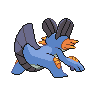

- 文件：[pokemon-id-00260-back-normal-default-static--9a066b7a0bd7.png](pokemon-id-00260-back-normal-default-static--9a066b7a0bd7.png)
- 用途：背面普通宝可梦图像；身份和变体来自PokeAPI路径，不作为原应用已经接入的证明。
- 尺寸：96 × 96，帧数：1
- SHA256：`9a066b7a0bd736f74be441a77e7d53774afce30fb9e4fc140635fa9e96aa9299`
- 来源：[PokeAPI/sprites](https://raw.githubusercontent.com/PokeAPI/sprites/master/sprites/pokemon/back/260.png)；取得版本：`1dd55c0436d2a5b6e324c0b780e1b1b416fbfb64`

### 宝可梦API ID 261 · 背面 · 普通 · 默认静态来源

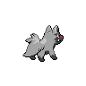

- 文件：[pokemon-id-00261-back-normal-default-static--f9e500e2524b.png](pokemon-id-00261-back-normal-default-static--f9e500e2524b.png)
- 用途：背面普通宝可梦图像；身份和变体来自PokeAPI路径，不作为原应用已经接入的证明。
- 尺寸：96 × 96，帧数：1
- SHA256：`f9e500e2524bfeeae3e4067fce297208f9bf07ec6fda0d8754fc29a2ccff8eb7`
- 来源：[PokeAPI/sprites](https://raw.githubusercontent.com/PokeAPI/sprites/master/sprites/pokemon/back/261.png)；取得版本：`1dd55c0436d2a5b6e324c0b780e1b1b416fbfb64`

### 宝可梦API ID 262 · 背面 · 普通 · 默认静态来源

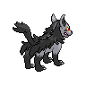

- 文件：[pokemon-id-00262-back-normal-default-static--5682990d9b8f.png](pokemon-id-00262-back-normal-default-static--5682990d9b8f.png)
- 用途：背面普通宝可梦图像；身份和变体来自PokeAPI路径，不作为原应用已经接入的证明。
- 尺寸：96 × 96，帧数：1
- SHA256：`5682990d9b8f2dcbff2576785a5ef5d1be434af94681c71bdf2c527f8b85576b`
- 来源：[PokeAPI/sprites](https://raw.githubusercontent.com/PokeAPI/sprites/master/sprites/pokemon/back/262.png)；取得版本：`1dd55c0436d2a5b6e324c0b780e1b1b416fbfb64`

### 宝可梦API ID 263 · 背面 · 普通 · 默认静态来源

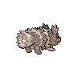

- 文件：[pokemon-id-00263-back-normal-default-static--b1eac17fc5f8.png](pokemon-id-00263-back-normal-default-static--b1eac17fc5f8.png)
- 用途：背面普通宝可梦图像；身份和变体来自PokeAPI路径，不作为原应用已经接入的证明。
- 尺寸：96 × 96，帧数：1
- SHA256：`b1eac17fc5f86966c482d8e548a51e7d080831c7aba248cf4d5b3860f889d641`
- 来源：[PokeAPI/sprites](https://raw.githubusercontent.com/PokeAPI/sprites/master/sprites/pokemon/back/263.png)；取得版本：`1dd55c0436d2a5b6e324c0b780e1b1b416fbfb64`

### 宝可梦API ID 264 · 背面 · 普通 · 默认静态来源

- 文件：[pokemon-id-00264-back-normal-default-static--1181d51cd020.png](pokemon-id-00264-back-normal-default-static--1181d51cd020.png)
- 用途：背面普通宝可梦图像；身份和变体来自PokeAPI路径，不作为原应用已经接入的证明。
- 尺寸：96 × 96，帧数：1
- SHA256：`1181d51cd020a84b5fd64301292b21424835732cd030905d90e3991930d56855`
- 来源：[PokeAPI/sprites](https://raw.githubusercontent.com/PokeAPI/sprites/master/sprites/pokemon/back/264.png)；取得版本：`1dd55c0436d2a5b6e324c0b780e1b1b416fbfb64`

### 宝可梦API ID 265 · 背面 · 普通 · 默认静态来源

- 文件：[pokemon-id-00265-back-normal-default-static--b9c81cd46475.png](pokemon-id-00265-back-normal-default-static--b9c81cd46475.png)
- 用途：背面普通宝可梦图像；身份和变体来自PokeAPI路径，不作为原应用已经接入的证明。
- 尺寸：96 × 96，帧数：1
- SHA256：`b9c81cd46475b9b1dd20efa560baea19b67b6c5b3a8f7bf3b5c356db6211b671`
- 来源：[PokeAPI/sprites](https://raw.githubusercontent.com/PokeAPI/sprites/master/sprites/pokemon/back/265.png)；取得版本：`1dd55c0436d2a5b6e324c0b780e1b1b416fbfb64`

### 宝可梦API ID 266 · 背面 · 普通 · 默认静态来源

- 文件：[pokemon-id-00266-back-normal-default-static--fa4816c522bf.png](pokemon-id-00266-back-normal-default-static--fa4816c522bf.png)
- 用途：背面普通宝可梦图像；身份和变体来自PokeAPI路径，不作为原应用已经接入的证明。
- 尺寸：96 × 96，帧数：1
- SHA256：`fa4816c522bfe20e1c7b683f1c02c7125082f8669bd52aa58db820cf4e075d8f`
- 来源：[PokeAPI/sprites](https://raw.githubusercontent.com/PokeAPI/sprites/master/sprites/pokemon/back/266.png)；取得版本：`1dd55c0436d2a5b6e324c0b780e1b1b416fbfb64`

### 宝可梦API ID 267 · 背面 · 普通 · 默认静态来源

- 文件：[pokemon-id-00267-back-normal-default-static--459b9c4bb9aa.png](pokemon-id-00267-back-normal-default-static--459b9c4bb9aa.png)
- 用途：背面普通宝可梦图像；身份和变体来自PokeAPI路径，不作为原应用已经接入的证明。
- 尺寸：96 × 96，帧数：1
- SHA256：`459b9c4bb9aa05cab8d728a9e0ead28e819a5a086ed524c11f8694d88ccdb749`
- 来源：[PokeAPI/sprites](https://raw.githubusercontent.com/PokeAPI/sprites/master/sprites/pokemon/back/267.png)；取得版本：`1dd55c0436d2a5b6e324c0b780e1b1b416fbfb64`

### 宝可梦API ID 268 · 背面 · 普通 · 默认静态来源

- 文件：[pokemon-id-00268-back-normal-default-static--ad3a071b19cc.png](pokemon-id-00268-back-normal-default-static--ad3a071b19cc.png)
- 用途：背面普通宝可梦图像；身份和变体来自PokeAPI路径，不作为原应用已经接入的证明。
- 尺寸：96 × 96，帧数：1
- SHA256：`ad3a071b19cc7e98e7d6f01c286aab50cd2c8effed1c0f33c559b29827fedd02`
- 来源：[PokeAPI/sprites](https://raw.githubusercontent.com/PokeAPI/sprites/master/sprites/pokemon/back/268.png)；取得版本：`1dd55c0436d2a5b6e324c0b780e1b1b416fbfb64`

### 宝可梦API ID 269 · 背面 · 普通 · 默认静态来源

- 文件：[pokemon-id-00269-back-normal-default-static--93bf89c0b833.png](pokemon-id-00269-back-normal-default-static--93bf89c0b833.png)
- 用途：背面普通宝可梦图像；身份和变体来自PokeAPI路径，不作为原应用已经接入的证明。
- 尺寸：96 × 96，帧数：1
- SHA256：`93bf89c0b833c3c9dbdf4c90d41551b7b22f97fab0d14b2a48a643c3e28487ca`
- 来源：[PokeAPI/sprites](https://raw.githubusercontent.com/PokeAPI/sprites/master/sprites/pokemon/back/269.png)；取得版本：`1dd55c0436d2a5b6e324c0b780e1b1b416fbfb64`

### 宝可梦API ID 270 · 背面 · 普通 · 默认静态来源

- 文件：[pokemon-id-00270-back-normal-default-static--f9b9c200c276.png](pokemon-id-00270-back-normal-default-static--f9b9c200c276.png)
- 用途：背面普通宝可梦图像；身份和变体来自PokeAPI路径，不作为原应用已经接入的证明。
- 尺寸：96 × 96，帧数：1
- SHA256：`f9b9c200c276c96ca3298378ac0d8b9c68875247da8f1b80b60e07f023295ad7`
- 来源：[PokeAPI/sprites](https://raw.githubusercontent.com/PokeAPI/sprites/master/sprites/pokemon/back/270.png)；取得版本：`1dd55c0436d2a5b6e324c0b780e1b1b416fbfb64`

### 宝可梦API ID 271 · 背面 · 普通 · 默认静态来源

- 文件：[pokemon-id-00271-back-normal-default-static--66b9335d92a9.png](pokemon-id-00271-back-normal-default-static--66b9335d92a9.png)
- 用途：背面普通宝可梦图像；身份和变体来自PokeAPI路径，不作为原应用已经接入的证明。
- 尺寸：96 × 96，帧数：1
- SHA256：`66b9335d92a924f4047a5c7a95d453c6675e5e28483cc00552cb61bd77075440`
- 来源：[PokeAPI/sprites](https://raw.githubusercontent.com/PokeAPI/sprites/master/sprites/pokemon/back/271.png)；取得版本：`1dd55c0436d2a5b6e324c0b780e1b1b416fbfb64`

### 宝可梦API ID 272 · 背面 · 普通 · 默认静态来源

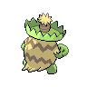

- 文件：[pokemon-id-00272-back-normal-default-static--d48612a0a214.png](pokemon-id-00272-back-normal-default-static--d48612a0a214.png)
- 用途：背面普通宝可梦图像；身份和变体来自PokeAPI路径，不作为原应用已经接入的证明。
- 尺寸：96 × 96，帧数：1
- SHA256：`d48612a0a21441fa62716e79f2dc25cb7b5895787d228a39e81cf1885eabd310`
- 来源：[PokeAPI/sprites](https://raw.githubusercontent.com/PokeAPI/sprites/master/sprites/pokemon/back/272.png)；取得版本：`1dd55c0436d2a5b6e324c0b780e1b1b416fbfb64`

### 宝可梦API ID 273 · 背面 · 普通 · 默认静态来源

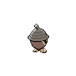

- 文件：[pokemon-id-00273-back-normal-default-static--cda31c822692.png](pokemon-id-00273-back-normal-default-static--cda31c822692.png)
- 用途：背面普通宝可梦图像；身份和变体来自PokeAPI路径，不作为原应用已经接入的证明。
- 尺寸：96 × 96，帧数：1
- SHA256：`cda31c822692add14ae81cb9c51c75fe4dd36f7643fc90fd0c3257bffba43783`
- 来源：[PokeAPI/sprites](https://raw.githubusercontent.com/PokeAPI/sprites/master/sprites/pokemon/back/273.png)；取得版本：`1dd55c0436d2a5b6e324c0b780e1b1b416fbfb64`

### 宝可梦API ID 274 · 背面 · 普通 · 默认静态来源

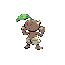

- 文件：[pokemon-id-00274-back-normal-default-static--a2fe99c8991b.png](pokemon-id-00274-back-normal-default-static--a2fe99c8991b.png)
- 用途：背面普通宝可梦图像；身份和变体来自PokeAPI路径，不作为原应用已经接入的证明。
- 尺寸：96 × 96，帧数：1
- SHA256：`a2fe99c8991bc0b8fe0216a298f888dafba692035d96452229709ed6a693ae89`
- 来源：[PokeAPI/sprites](https://raw.githubusercontent.com/PokeAPI/sprites/master/sprites/pokemon/back/274.png)；取得版本：`1dd55c0436d2a5b6e324c0b780e1b1b416fbfb64`

### 宝可梦API ID 275 · 背面 · 普通 · 默认静态来源

- 文件：[pokemon-id-00275-back-normal-default-static--96fb2307a91b.png](pokemon-id-00275-back-normal-default-static--96fb2307a91b.png)
- 用途：背面普通宝可梦图像；身份和变体来自PokeAPI路径，不作为原应用已经接入的证明。
- 尺寸：96 × 96，帧数：1
- SHA256：`96fb2307a91b75b14f8c73b3ba7f2eaa21ac36b1b6d047847052b464dc2d93a7`
- 来源：[PokeAPI/sprites](https://raw.githubusercontent.com/PokeAPI/sprites/master/sprites/pokemon/back/275.png)；取得版本：`1dd55c0436d2a5b6e324c0b780e1b1b416fbfb64`

### 宝可梦API ID 276 · 背面 · 普通 · 默认静态来源

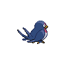

- 文件：[pokemon-id-00276-back-normal-default-static--c074edebbbe4.png](pokemon-id-00276-back-normal-default-static--c074edebbbe4.png)
- 用途：背面普通宝可梦图像；身份和变体来自PokeAPI路径，不作为原应用已经接入的证明。
- 尺寸：96 × 96，帧数：1
- SHA256：`c074edebbbe413ab5ed64d9965afc061d9a5acca909a25851a18264964981567`
- 来源：[PokeAPI/sprites](https://raw.githubusercontent.com/PokeAPI/sprites/master/sprites/pokemon/back/276.png)；取得版本：`1dd55c0436d2a5b6e324c0b780e1b1b416fbfb64`

### 宝可梦API ID 277 · 背面 · 普通 · 默认静态来源

- 文件：[pokemon-id-00277-back-normal-default-static--51ca010616c2.png](pokemon-id-00277-back-normal-default-static--51ca010616c2.png)
- 用途：背面普通宝可梦图像；身份和变体来自PokeAPI路径，不作为原应用已经接入的证明。
- 尺寸：96 × 96，帧数：1
- SHA256：`51ca010616c211149a28638a506f3f65829276f85e9b21abaaeb9ddc34cfba81`
- 来源：[PokeAPI/sprites](https://raw.githubusercontent.com/PokeAPI/sprites/master/sprites/pokemon/back/277.png)；取得版本：`1dd55c0436d2a5b6e324c0b780e1b1b416fbfb64`

### 宝可梦API ID 278 · 背面 · 普通 · 默认静态来源

- 文件：[pokemon-id-00278-back-normal-default-static--3a01528c4b2e.png](pokemon-id-00278-back-normal-default-static--3a01528c4b2e.png)
- 用途：背面普通宝可梦图像；身份和变体来自PokeAPI路径，不作为原应用已经接入的证明。
- 尺寸：96 × 96，帧数：1
- SHA256：`3a01528c4b2ea3c8662abcf0546e7938aa88c4b131002e94a5afa4aaee2ac3f9`
- 来源：[PokeAPI/sprites](https://raw.githubusercontent.com/PokeAPI/sprites/master/sprites/pokemon/back/278.png)；取得版本：`1dd55c0436d2a5b6e324c0b780e1b1b416fbfb64`

### 宝可梦API ID 279 · 背面 · 普通 · 默认静态来源

- 文件：[pokemon-id-00279-back-normal-default-static--b9da03406ac2.png](pokemon-id-00279-back-normal-default-static--b9da03406ac2.png)
- 用途：背面普通宝可梦图像；身份和变体来自PokeAPI路径，不作为原应用已经接入的证明。
- 尺寸：96 × 96，帧数：1
- SHA256：`b9da03406ac2140b174cbc43752da6097a9a0ed08edd87068673da80a975eded`
- 来源：[PokeAPI/sprites](https://raw.githubusercontent.com/PokeAPI/sprites/master/sprites/pokemon/back/279.png)；取得版本：`1dd55c0436d2a5b6e324c0b780e1b1b416fbfb64`

### 宝可梦API ID 280 · 背面 · 普通 · 默认静态来源

- 文件：[pokemon-id-00280-back-normal-default-static--62705c1f0aa5.png](pokemon-id-00280-back-normal-default-static--62705c1f0aa5.png)
- 用途：背面普通宝可梦图像；身份和变体来自PokeAPI路径，不作为原应用已经接入的证明。
- 尺寸：96 × 96，帧数：1
- SHA256：`62705c1f0aa5086744ce621fb2810bc2d4d9246b32a53d938ed17749a4b5a8af`
- 来源：[PokeAPI/sprites](https://raw.githubusercontent.com/PokeAPI/sprites/master/sprites/pokemon/back/280.png)；取得版本：`1dd55c0436d2a5b6e324c0b780e1b1b416fbfb64`

### 宝可梦API ID 281 · 背面 · 普通 · 默认静态来源

- 文件：[pokemon-id-00281-back-normal-default-static--0b83c8188f39.png](pokemon-id-00281-back-normal-default-static--0b83c8188f39.png)
- 用途：背面普通宝可梦图像；身份和变体来自PokeAPI路径，不作为原应用已经接入的证明。
- 尺寸：96 × 96，帧数：1
- SHA256：`0b83c8188f39a4b3233ac8c9f37378d7aaede6e35ff8e40052da3e135e397fcf`
- 来源：[PokeAPI/sprites](https://raw.githubusercontent.com/PokeAPI/sprites/master/sprites/pokemon/back/281.png)；取得版本：`1dd55c0436d2a5b6e324c0b780e1b1b416fbfb64`

### 宝可梦API ID 282 · 背面 · 普通 · 默认静态来源

- 文件：[pokemon-id-00282-back-normal-default-static--ed6f5937f9dc.png](pokemon-id-00282-back-normal-default-static--ed6f5937f9dc.png)
- 用途：背面普通宝可梦图像；身份和变体来自PokeAPI路径，不作为原应用已经接入的证明。
- 尺寸：96 × 96，帧数：1
- SHA256：`ed6f5937f9dcb5dd1900b6b41992bcbf7c9f4a1acfe1b51a04cd52fddbb440aa`
- 来源：[PokeAPI/sprites](https://raw.githubusercontent.com/PokeAPI/sprites/master/sprites/pokemon/back/282.png)；取得版本：`1dd55c0436d2a5b6e324c0b780e1b1b416fbfb64`

### 宝可梦API ID 283 · 背面 · 普通 · 默认静态来源

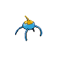

- 文件：[pokemon-id-00283-back-normal-default-static--a63aab50630a.png](pokemon-id-00283-back-normal-default-static--a63aab50630a.png)
- 用途：背面普通宝可梦图像；身份和变体来自PokeAPI路径，不作为原应用已经接入的证明。
- 尺寸：96 × 96，帧数：1
- SHA256：`a63aab50630ae296a7c4119a356eaa1bd2620cf94e215195e2981d4b5bad3b78`
- 来源：[PokeAPI/sprites](https://raw.githubusercontent.com/PokeAPI/sprites/master/sprites/pokemon/back/283.png)；取得版本：`1dd55c0436d2a5b6e324c0b780e1b1b416fbfb64`

### 宝可梦API ID 284 · 背面 · 普通 · 默认静态来源

- 文件：[pokemon-id-00284-back-normal-default-static--15497911037c.png](pokemon-id-00284-back-normal-default-static--15497911037c.png)
- 用途：背面普通宝可梦图像；身份和变体来自PokeAPI路径，不作为原应用已经接入的证明。
- 尺寸：96 × 96，帧数：1
- SHA256：`15497911037cf09c10278f5f300893c1757ee72788b2998591f76d2d0e85da84`
- 来源：[PokeAPI/sprites](https://raw.githubusercontent.com/PokeAPI/sprites/master/sprites/pokemon/back/284.png)；取得版本：`1dd55c0436d2a5b6e324c0b780e1b1b416fbfb64`

### 宝可梦API ID 285 · 背面 · 普通 · 默认静态来源

- 文件：[pokemon-id-00285-back-normal-default-static--d6354728c95e.png](pokemon-id-00285-back-normal-default-static--d6354728c95e.png)
- 用途：背面普通宝可梦图像；身份和变体来自PokeAPI路径，不作为原应用已经接入的证明。
- 尺寸：96 × 96，帧数：1
- SHA256：`d6354728c95e7ca4df14af31d7680e29d0629904760825be0e5c5a2fc4cd2c08`
- 来源：[PokeAPI/sprites](https://raw.githubusercontent.com/PokeAPI/sprites/master/sprites/pokemon/back/285.png)；取得版本：`1dd55c0436d2a5b6e324c0b780e1b1b416fbfb64`

### 宝可梦API ID 286 · 背面 · 普通 · 默认静态来源

- 文件：[pokemon-id-00286-back-normal-default-static--f5eb63b439b6.png](pokemon-id-00286-back-normal-default-static--f5eb63b439b6.png)
- 用途：背面普通宝可梦图像；身份和变体来自PokeAPI路径，不作为原应用已经接入的证明。
- 尺寸：96 × 96，帧数：1
- SHA256：`f5eb63b439b651b863070b048a09e9f19b36a711a559ab9bf8e47c08736381be`
- 来源：[PokeAPI/sprites](https://raw.githubusercontent.com/PokeAPI/sprites/master/sprites/pokemon/back/286.png)；取得版本：`1dd55c0436d2a5b6e324c0b780e1b1b416fbfb64`

### 宝可梦API ID 287 · 背面 · 普通 · 默认静态来源

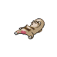

- 文件：[pokemon-id-00287-back-normal-default-static--9fe66c9bc776.png](pokemon-id-00287-back-normal-default-static--9fe66c9bc776.png)
- 用途：背面普通宝可梦图像；身份和变体来自PokeAPI路径，不作为原应用已经接入的证明。
- 尺寸：96 × 96，帧数：1
- SHA256：`9fe66c9bc776fc42e034e89a8bd56d4082e4bcf599081fd82ff10996799a8a2e`
- 来源：[PokeAPI/sprites](https://raw.githubusercontent.com/PokeAPI/sprites/master/sprites/pokemon/back/287.png)；取得版本：`1dd55c0436d2a5b6e324c0b780e1b1b416fbfb64`

### 宝可梦API ID 288 · 背面 · 普通 · 默认静态来源

- 文件：[pokemon-id-00288-back-normal-default-static--7d9a4213fd82.png](pokemon-id-00288-back-normal-default-static--7d9a4213fd82.png)
- 用途：背面普通宝可梦图像；身份和变体来自PokeAPI路径，不作为原应用已经接入的证明。
- 尺寸：96 × 96，帧数：1
- SHA256：`7d9a4213fd82f54b86c42b9bcf5a1f6ba82bd6ede045a9d79eb129c2c4c8c1ab`
- 来源：[PokeAPI/sprites](https://raw.githubusercontent.com/PokeAPI/sprites/master/sprites/pokemon/back/288.png)；取得版本：`1dd55c0436d2a5b6e324c0b780e1b1b416fbfb64`

### 宝可梦API ID 289 · 背面 · 普通 · 默认静态来源

- 文件：[pokemon-id-00289-back-normal-default-static--e94542ec70ea.png](pokemon-id-00289-back-normal-default-static--e94542ec70ea.png)
- 用途：背面普通宝可梦图像；身份和变体来自PokeAPI路径，不作为原应用已经接入的证明。
- 尺寸：96 × 96，帧数：1
- SHA256：`e94542ec70eacdaff2c4d1d4df8997ec6ffe04dcdc14538852c70e04178abdf8`
- 来源：[PokeAPI/sprites](https://raw.githubusercontent.com/PokeAPI/sprites/master/sprites/pokemon/back/289.png)；取得版本：`1dd55c0436d2a5b6e324c0b780e1b1b416fbfb64`

### 宝可梦API ID 290 · 背面 · 普通 · 默认静态来源

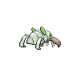

- 文件：[pokemon-id-00290-back-normal-default-static--c9a2dfe7a7ec.png](pokemon-id-00290-back-normal-default-static--c9a2dfe7a7ec.png)
- 用途：背面普通宝可梦图像；身份和变体来自PokeAPI路径，不作为原应用已经接入的证明。
- 尺寸：96 × 96，帧数：1
- SHA256：`c9a2dfe7a7ec3707dd73fba9f2d50b118b1b8f30e3e25a71a95ad14d00bd194e`
- 来源：[PokeAPI/sprites](https://raw.githubusercontent.com/PokeAPI/sprites/master/sprites/pokemon/back/290.png)；取得版本：`1dd55c0436d2a5b6e324c0b780e1b1b416fbfb64`

### 宝可梦API ID 291 · 背面 · 普通 · 默认静态来源

- 文件：[pokemon-id-00291-back-normal-default-static--d5adb3731f2a.png](pokemon-id-00291-back-normal-default-static--d5adb3731f2a.png)
- 用途：背面普通宝可梦图像；身份和变体来自PokeAPI路径，不作为原应用已经接入的证明。
- 尺寸：96 × 96，帧数：1
- SHA256：`d5adb3731f2ad3de59e94e071886525d7295522c5c92d9cb23ad655b6215e6f9`
- 来源：[PokeAPI/sprites](https://raw.githubusercontent.com/PokeAPI/sprites/master/sprites/pokemon/back/291.png)；取得版本：`1dd55c0436d2a5b6e324c0b780e1b1b416fbfb64`

### 宝可梦API ID 292 · 背面 · 普通 · 默认静态来源

- 文件：[pokemon-id-00292-back-normal-default-static--8a98119296ca.png](pokemon-id-00292-back-normal-default-static--8a98119296ca.png)
- 用途：背面普通宝可梦图像；身份和变体来自PokeAPI路径，不作为原应用已经接入的证明。
- 尺寸：96 × 96，帧数：1
- SHA256：`8a98119296ca07652a87a08fa23f8025595ff2bad27c64aaf79d2297b9de5b58`
- 来源：[PokeAPI/sprites](https://raw.githubusercontent.com/PokeAPI/sprites/master/sprites/pokemon/back/292.png)；取得版本：`1dd55c0436d2a5b6e324c0b780e1b1b416fbfb64`

### 宝可梦API ID 293 · 背面 · 普通 · 默认静态来源

- 文件：[pokemon-id-00293-back-normal-default-static--cac5137fa204.png](pokemon-id-00293-back-normal-default-static--cac5137fa204.png)
- 用途：背面普通宝可梦图像；身份和变体来自PokeAPI路径，不作为原应用已经接入的证明。
- 尺寸：96 × 96，帧数：1
- SHA256：`cac5137fa204568dc23405cfbed387c3de2e8d0de06a6e4798daa1c91ea03b62`
- 来源：[PokeAPI/sprites](https://raw.githubusercontent.com/PokeAPI/sprites/master/sprites/pokemon/back/293.png)；取得版本：`1dd55c0436d2a5b6e324c0b780e1b1b416fbfb64`

### 宝可梦API ID 294 · 背面 · 普通 · 默认静态来源

- 文件：[pokemon-id-00294-back-normal-default-static--536209bbf5e1.png](pokemon-id-00294-back-normal-default-static--536209bbf5e1.png)
- 用途：背面普通宝可梦图像；身份和变体来自PokeAPI路径，不作为原应用已经接入的证明。
- 尺寸：96 × 96，帧数：1
- SHA256：`536209bbf5e10ea1c16c9b3824ded9e3c9faf2edf3a7176879647029f64f2b90`
- 来源：[PokeAPI/sprites](https://raw.githubusercontent.com/PokeAPI/sprites/master/sprites/pokemon/back/294.png)；取得版本：`1dd55c0436d2a5b6e324c0b780e1b1b416fbfb64`

### 宝可梦API ID 295 · 背面 · 普通 · 默认静态来源

- 文件：[pokemon-id-00295-back-normal-default-static--2b10d62f418e.png](pokemon-id-00295-back-normal-default-static--2b10d62f418e.png)
- 用途：背面普通宝可梦图像；身份和变体来自PokeAPI路径，不作为原应用已经接入的证明。
- 尺寸：96 × 96，帧数：1
- SHA256：`2b10d62f418e56ab118908315109e6eaf5cd3085b001c955042864865f8567bb`
- 来源：[PokeAPI/sprites](https://raw.githubusercontent.com/PokeAPI/sprites/master/sprites/pokemon/back/295.png)；取得版本：`1dd55c0436d2a5b6e324c0b780e1b1b416fbfb64`

### 宝可梦API ID 296 · 背面 · 普通 · 默认静态来源

- 文件：[pokemon-id-00296-back-normal-default-static--9660145bac74.png](pokemon-id-00296-back-normal-default-static--9660145bac74.png)
- 用途：背面普通宝可梦图像；身份和变体来自PokeAPI路径，不作为原应用已经接入的证明。
- 尺寸：96 × 96，帧数：1
- SHA256：`9660145bac743a2e48c1dc52449028f37bc2df6ddc8061f5a697b79cd5b4871c`
- 来源：[PokeAPI/sprites](https://raw.githubusercontent.com/PokeAPI/sprites/master/sprites/pokemon/back/296.png)；取得版本：`1dd55c0436d2a5b6e324c0b780e1b1b416fbfb64`

### 宝可梦API ID 297 · 背面 · 普通 · 默认静态来源

- 文件：[pokemon-id-00297-back-normal-default-static--ff608c7a9657.png](pokemon-id-00297-back-normal-default-static--ff608c7a9657.png)
- 用途：背面普通宝可梦图像；身份和变体来自PokeAPI路径，不作为原应用已经接入的证明。
- 尺寸：96 × 96，帧数：1
- SHA256：`ff608c7a9657884b592047ad79aafe51c9ffb61a358cfd5d15453c59d9556b86`
- 来源：[PokeAPI/sprites](https://raw.githubusercontent.com/PokeAPI/sprites/master/sprites/pokemon/back/297.png)；取得版本：`1dd55c0436d2a5b6e324c0b780e1b1b416fbfb64`

### 宝可梦API ID 298 · 背面 · 普通 · 默认静态来源

- 文件：[pokemon-id-00298-back-normal-default-static--960ee2a7a325.png](pokemon-id-00298-back-normal-default-static--960ee2a7a325.png)
- 用途：背面普通宝可梦图像；身份和变体来自PokeAPI路径，不作为原应用已经接入的证明。
- 尺寸：96 × 96，帧数：1
- SHA256：`960ee2a7a325388e80b3c429abcc8f322f137d997629436e2d4c6aa859446989`
- 来源：[PokeAPI/sprites](https://raw.githubusercontent.com/PokeAPI/sprites/master/sprites/pokemon/back/298.png)；取得版本：`1dd55c0436d2a5b6e324c0b780e1b1b416fbfb64`

### 宝可梦API ID 299 · 背面 · 普通 · 默认静态来源

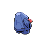

- 文件：[pokemon-id-00299-back-normal-default-static--0570ba263c64.png](pokemon-id-00299-back-normal-default-static--0570ba263c64.png)
- 用途：背面普通宝可梦图像；身份和变体来自PokeAPI路径，不作为原应用已经接入的证明。
- 尺寸：96 × 96，帧数：1
- SHA256：`0570ba263c64e753b4f1088cfbcb2fb6ab31f4e40126a3ac5ce2bbe74b781e2f`
- 来源：[PokeAPI/sprites](https://raw.githubusercontent.com/PokeAPI/sprites/master/sprites/pokemon/back/299.png)；取得版本：`1dd55c0436d2a5b6e324c0b780e1b1b416fbfb64`

### 宝可梦API ID 300 · 背面 · 普通 · 默认静态来源

- 文件：[pokemon-id-00300-back-normal-default-static--e68b7c1a65e9.png](pokemon-id-00300-back-normal-default-static--e68b7c1a65e9.png)
- 用途：背面普通宝可梦图像；身份和变体来自PokeAPI路径，不作为原应用已经接入的证明。
- 尺寸：96 × 96，帧数：1
- SHA256：`e68b7c1a65e968ca03c1b035fdac780cdfcde4c09f0b91cd479784ba4d6afa89`
- 来源：[PokeAPI/sprites](https://raw.githubusercontent.com/PokeAPI/sprites/master/sprites/pokemon/back/300.png)；取得版本：`1dd55c0436d2a5b6e324c0b780e1b1b416fbfb64`

### 宝可梦API ID 301 · 背面 · 普通 · 默认静态来源

- 文件：[pokemon-id-00301-back-normal-default-static--6b86646dd68f.png](pokemon-id-00301-back-normal-default-static--6b86646dd68f.png)
- 用途：背面普通宝可梦图像；身份和变体来自PokeAPI路径，不作为原应用已经接入的证明。
- 尺寸：96 × 96，帧数：1
- SHA256：`6b86646dd68f7ab64a0bc7995ba53588c36fdd4929c9161099bd62260ab5ca8f`
- 来源：[PokeAPI/sprites](https://raw.githubusercontent.com/PokeAPI/sprites/master/sprites/pokemon/back/301.png)；取得版本：`1dd55c0436d2a5b6e324c0b780e1b1b416fbfb64`

### 宝可梦API ID 302 · 背面 · 普通 · 默认静态来源

- 文件：[pokemon-id-00302-back-normal-default-static--ad94fe6badce.png](pokemon-id-00302-back-normal-default-static--ad94fe6badce.png)
- 用途：背面普通宝可梦图像；身份和变体来自PokeAPI路径，不作为原应用已经接入的证明。
- 尺寸：96 × 96，帧数：1
- SHA256：`ad94fe6badce229e912f2e1c9bb92833ab140003ef1eb3ab65ec43a7abc27d7b`
- 来源：[PokeAPI/sprites](https://raw.githubusercontent.com/PokeAPI/sprites/master/sprites/pokemon/back/302.png)；取得版本：`1dd55c0436d2a5b6e324c0b780e1b1b416fbfb64`

### 宝可梦API ID 303 · 背面 · 普通 · 默认静态来源

- 文件：[pokemon-id-00303-back-normal-default-static--2488d7836c3f.png](pokemon-id-00303-back-normal-default-static--2488d7836c3f.png)
- 用途：背面普通宝可梦图像；身份和变体来自PokeAPI路径，不作为原应用已经接入的证明。
- 尺寸：96 × 96，帧数：1
- SHA256：`2488d7836c3f8e032f3a9437b75b1b7226883c68250795a12cd2a52b7ab5158e`
- 来源：[PokeAPI/sprites](https://raw.githubusercontent.com/PokeAPI/sprites/master/sprites/pokemon/back/303.png)；取得版本：`1dd55c0436d2a5b6e324c0b780e1b1b416fbfb64`

### 宝可梦API ID 304 · 背面 · 普通 · 默认静态来源

- 文件：[pokemon-id-00304-back-normal-default-static--c419bfcd8bec.png](pokemon-id-00304-back-normal-default-static--c419bfcd8bec.png)
- 用途：背面普通宝可梦图像；身份和变体来自PokeAPI路径，不作为原应用已经接入的证明。
- 尺寸：96 × 96，帧数：1
- SHA256：`c419bfcd8bec3ee8338a7ae0df6b56cf8d99337f08b9bb1cfe9fe021ec08899c`
- 来源：[PokeAPI/sprites](https://raw.githubusercontent.com/PokeAPI/sprites/master/sprites/pokemon/back/304.png)；取得版本：`1dd55c0436d2a5b6e324c0b780e1b1b416fbfb64`

### 宝可梦API ID 305 · 背面 · 普通 · 默认静态来源

- 文件：[pokemon-id-00305-back-normal-default-static--a311fffcfb1f.png](pokemon-id-00305-back-normal-default-static--a311fffcfb1f.png)
- 用途：背面普通宝可梦图像；身份和变体来自PokeAPI路径，不作为原应用已经接入的证明。
- 尺寸：96 × 96，帧数：1
- SHA256：`a311fffcfb1f79001d990bc2f56599708bc75de8659399a7eaf21ad864f6c4e3`
- 来源：[PokeAPI/sprites](https://raw.githubusercontent.com/PokeAPI/sprites/master/sprites/pokemon/back/305.png)；取得版本：`1dd55c0436d2a5b6e324c0b780e1b1b416fbfb64`

### 宝可梦API ID 306 · 背面 · 普通 · 默认静态来源

- 文件：[pokemon-id-00306-back-normal-default-static--5cd93ed38590.png](pokemon-id-00306-back-normal-default-static--5cd93ed38590.png)
- 用途：背面普通宝可梦图像；身份和变体来自PokeAPI路径，不作为原应用已经接入的证明。
- 尺寸：96 × 96，帧数：1
- SHA256：`5cd93ed3859001f0865ae9ae9c71bed9d91c18b048acb8747bb6d32fe875d7d1`
- 来源：[PokeAPI/sprites](https://raw.githubusercontent.com/PokeAPI/sprites/master/sprites/pokemon/back/306.png)；取得版本：`1dd55c0436d2a5b6e324c0b780e1b1b416fbfb64`

### 宝可梦API ID 307 · 背面 · 普通 · 默认静态来源

- 文件：[pokemon-id-00307-back-normal-default-static--2b78b1af9843.png](pokemon-id-00307-back-normal-default-static--2b78b1af9843.png)
- 用途：背面普通宝可梦图像；身份和变体来自PokeAPI路径，不作为原应用已经接入的证明。
- 尺寸：96 × 96，帧数：1
- SHA256：`2b78b1af9843fa3b99b468e8508d4811d92a817a0630ab1a69cb913f00b5e704`
- 来源：[PokeAPI/sprites](https://raw.githubusercontent.com/PokeAPI/sprites/master/sprites/pokemon/back/307.png)；取得版本：`1dd55c0436d2a5b6e324c0b780e1b1b416fbfb64`

### 宝可梦API ID 308 · 背面 · 普通 · 默认静态来源

- 文件：[pokemon-id-00308-back-normal-default-static--840f1b369c9e.png](pokemon-id-00308-back-normal-default-static--840f1b369c9e.png)
- 用途：背面普通宝可梦图像；身份和变体来自PokeAPI路径，不作为原应用已经接入的证明。
- 尺寸：96 × 96，帧数：1
- SHA256：`840f1b369c9ee5df3d033bc6164e83be8604bc3af907d0711c251247184a282a`
- 来源：[PokeAPI/sprites](https://raw.githubusercontent.com/PokeAPI/sprites/master/sprites/pokemon/back/308.png)；取得版本：`1dd55c0436d2a5b6e324c0b780e1b1b416fbfb64`

### 宝可梦API ID 309 · 背面 · 普通 · 默认静态来源

- 文件：[pokemon-id-00309-back-normal-default-static--7c5ed2874a36.png](pokemon-id-00309-back-normal-default-static--7c5ed2874a36.png)
- 用途：背面普通宝可梦图像；身份和变体来自PokeAPI路径，不作为原应用已经接入的证明。
- 尺寸：96 × 96，帧数：1
- SHA256：`7c5ed2874a36f29ea8274a9a1d7ab3f2a37959b6a3ff44d878790237dac92759`
- 来源：[PokeAPI/sprites](https://raw.githubusercontent.com/PokeAPI/sprites/master/sprites/pokemon/back/309.png)；取得版本：`1dd55c0436d2a5b6e324c0b780e1b1b416fbfb64`

### 宝可梦API ID 310 · 背面 · 普通 · 默认静态来源

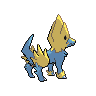

- 文件：[pokemon-id-00310-back-normal-default-static--f9e5244d304f.png](pokemon-id-00310-back-normal-default-static--f9e5244d304f.png)
- 用途：背面普通宝可梦图像；身份和变体来自PokeAPI路径，不作为原应用已经接入的证明。
- 尺寸：96 × 96，帧数：1
- SHA256：`f9e5244d304ffb4341df8299f50dc17ca056dfaf3aede8dd3000870da5acb5c8`
- 来源：[PokeAPI/sprites](https://raw.githubusercontent.com/PokeAPI/sprites/master/sprites/pokemon/back/310.png)；取得版本：`1dd55c0436d2a5b6e324c0b780e1b1b416fbfb64`

### 宝可梦API ID 311 · 背面 · 普通 · 默认静态来源

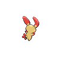

- 文件：[pokemon-id-00311-back-normal-default-static--5db0da0df97c.png](pokemon-id-00311-back-normal-default-static--5db0da0df97c.png)
- 用途：背面普通宝可梦图像；身份和变体来自PokeAPI路径，不作为原应用已经接入的证明。
- 尺寸：96 × 96，帧数：1
- SHA256：`5db0da0df97c6798b8b437d5ad7a2725a1ac7832b33913789b5cf6dc8a78036a`
- 来源：[PokeAPI/sprites](https://raw.githubusercontent.com/PokeAPI/sprites/master/sprites/pokemon/back/311.png)；取得版本：`1dd55c0436d2a5b6e324c0b780e1b1b416fbfb64`

### 宝可梦API ID 312 · 背面 · 普通 · 默认静态来源

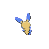

- 文件：[pokemon-id-00312-back-normal-default-static--8075df3dfdf7.png](pokemon-id-00312-back-normal-default-static--8075df3dfdf7.png)
- 用途：背面普通宝可梦图像；身份和变体来自PokeAPI路径，不作为原应用已经接入的证明。
- 尺寸：96 × 96，帧数：1
- SHA256：`8075df3dfdf73133b596e9c0ce54126dd15ca7a2a36f3c769e3d69be95d306a8`
- 来源：[PokeAPI/sprites](https://raw.githubusercontent.com/PokeAPI/sprites/master/sprites/pokemon/back/312.png)；取得版本：`1dd55c0436d2a5b6e324c0b780e1b1b416fbfb64`

### 宝可梦API ID 313 · 背面 · 普通 · 默认静态来源

- 文件：[pokemon-id-00313-back-normal-default-static--e78670b2f68e.png](pokemon-id-00313-back-normal-default-static--e78670b2f68e.png)
- 用途：背面普通宝可梦图像；身份和变体来自PokeAPI路径，不作为原应用已经接入的证明。
- 尺寸：96 × 96，帧数：1
- SHA256：`e78670b2f68e307484e727a7a0ebf5a4c8b8e02301b7b23c92a5f1748fbfc617`
- 来源：[PokeAPI/sprites](https://raw.githubusercontent.com/PokeAPI/sprites/master/sprites/pokemon/back/313.png)；取得版本：`1dd55c0436d2a5b6e324c0b780e1b1b416fbfb64`

### 宝可梦API ID 314 · 背面 · 普通 · 默认静态来源

- 文件：[pokemon-id-00314-back-normal-default-static--bb1a02901647.png](pokemon-id-00314-back-normal-default-static--bb1a02901647.png)
- 用途：背面普通宝可梦图像；身份和变体来自PokeAPI路径，不作为原应用已经接入的证明。
- 尺寸：96 × 96，帧数：1
- SHA256：`bb1a0290164715e752cdf3d817340f508a2b33e513b5c4eae6a472fc754fbeb7`
- 来源：[PokeAPI/sprites](https://raw.githubusercontent.com/PokeAPI/sprites/master/sprites/pokemon/back/314.png)；取得版本：`1dd55c0436d2a5b6e324c0b780e1b1b416fbfb64`

### 宝可梦API ID 315 · 背面 · 普通 · 默认静态来源

- 文件：[pokemon-id-00315-back-normal-default-static--0073076836c7.png](pokemon-id-00315-back-normal-default-static--0073076836c7.png)
- 用途：背面普通宝可梦图像；身份和变体来自PokeAPI路径，不作为原应用已经接入的证明。
- 尺寸：96 × 96，帧数：1
- SHA256：`0073076836c7fb1e8207fe928f9219df6612286fcb01ef2ebceeb566a2a5569a`
- 来源：[PokeAPI/sprites](https://raw.githubusercontent.com/PokeAPI/sprites/master/sprites/pokemon/back/315.png)；取得版本：`1dd55c0436d2a5b6e324c0b780e1b1b416fbfb64`

### 宝可梦API ID 316 · 背面 · 普通 · 默认静态来源

- 文件：[pokemon-id-00316-back-normal-default-static--080279c7fba3.png](pokemon-id-00316-back-normal-default-static--080279c7fba3.png)
- 用途：背面普通宝可梦图像；身份和变体来自PokeAPI路径，不作为原应用已经接入的证明。
- 尺寸：96 × 96，帧数：1
- SHA256：`080279c7fba3da5ca8f5f88f3e00795d26b996f343ed1e845d707e976b407e92`
- 来源：[PokeAPI/sprites](https://raw.githubusercontent.com/PokeAPI/sprites/master/sprites/pokemon/back/316.png)；取得版本：`1dd55c0436d2a5b6e324c0b780e1b1b416fbfb64`

### 宝可梦API ID 317 · 背面 · 普通 · 默认静态来源

- 文件：[pokemon-id-00317-back-normal-default-static--ed2546ddb502.png](pokemon-id-00317-back-normal-default-static--ed2546ddb502.png)
- 用途：背面普通宝可梦图像；身份和变体来自PokeAPI路径，不作为原应用已经接入的证明。
- 尺寸：96 × 96，帧数：1
- SHA256：`ed2546ddb502d721c0c6dfef20a9534bb19ea17f63449fbf31485187abcc01e9`
- 来源：[PokeAPI/sprites](https://raw.githubusercontent.com/PokeAPI/sprites/master/sprites/pokemon/back/317.png)；取得版本：`1dd55c0436d2a5b6e324c0b780e1b1b416fbfb64`

### 宝可梦API ID 318 · 背面 · 普通 · 默认静态来源

- 文件：[pokemon-id-00318-back-normal-default-static--6c3479aacdf4.png](pokemon-id-00318-back-normal-default-static--6c3479aacdf4.png)
- 用途：背面普通宝可梦图像；身份和变体来自PokeAPI路径，不作为原应用已经接入的证明。
- 尺寸：96 × 96，帧数：1
- SHA256：`6c3479aacdf40905acf4e17cf973022df956570e0a472166f9834123c09bf7dd`
- 来源：[PokeAPI/sprites](https://raw.githubusercontent.com/PokeAPI/sprites/master/sprites/pokemon/back/318.png)；取得版本：`1dd55c0436d2a5b6e324c0b780e1b1b416fbfb64`

### 宝可梦API ID 319 · 背面 · 普通 · 默认静态来源

- 文件：[pokemon-id-00319-back-normal-default-static--c3cc14ef3b31.png](pokemon-id-00319-back-normal-default-static--c3cc14ef3b31.png)
- 用途：背面普通宝可梦图像；身份和变体来自PokeAPI路径，不作为原应用已经接入的证明。
- 尺寸：96 × 96，帧数：1
- SHA256：`c3cc14ef3b3191ae3eccd04ee37e8df25b5a9927811bb6d8023b0e67dc1eb97e`
- 来源：[PokeAPI/sprites](https://raw.githubusercontent.com/PokeAPI/sprites/master/sprites/pokemon/back/319.png)；取得版本：`1dd55c0436d2a5b6e324c0b780e1b1b416fbfb64`

### 宝可梦API ID 320 · 背面 · 普通 · 默认静态来源

- 文件：[pokemon-id-00320-back-normal-default-static--e85d25d20969.png](pokemon-id-00320-back-normal-default-static--e85d25d20969.png)
- 用途：背面普通宝可梦图像；身份和变体来自PokeAPI路径，不作为原应用已经接入的证明。
- 尺寸：96 × 96，帧数：1
- SHA256：`e85d25d20969b9d18ee7c92f90dea0864b238f3e27559f888ebf1c5b9e3a29ab`
- 来源：[PokeAPI/sprites](https://raw.githubusercontent.com/PokeAPI/sprites/master/sprites/pokemon/back/320.png)；取得版本：`1dd55c0436d2a5b6e324c0b780e1b1b416fbfb64`

### 宝可梦API ID 321 · 背面 · 普通 · 默认静态来源

- 文件：[pokemon-id-00321-back-normal-default-static--47c90362c5f5.png](pokemon-id-00321-back-normal-default-static--47c90362c5f5.png)
- 用途：背面普通宝可梦图像；身份和变体来自PokeAPI路径，不作为原应用已经接入的证明。
- 尺寸：96 × 96，帧数：1
- SHA256：`47c90362c5f5b231c77b3fa2b344f6e1654b856e2339b1230737ec53bdbd7a67`
- 来源：[PokeAPI/sprites](https://raw.githubusercontent.com/PokeAPI/sprites/master/sprites/pokemon/back/321.png)；取得版本：`1dd55c0436d2a5b6e324c0b780e1b1b416fbfb64`

### 宝可梦API ID 322 · 背面 · 普通 · 默认静态来源

- 文件：[pokemon-id-00322-back-normal-default-static--a9598789176f.png](pokemon-id-00322-back-normal-default-static--a9598789176f.png)
- 用途：背面普通宝可梦图像；身份和变体来自PokeAPI路径，不作为原应用已经接入的证明。
- 尺寸：96 × 96，帧数：1
- SHA256：`a9598789176f28533728dee571ce8a77b581e5448f68ce6e5b6336733c65712e`
- 来源：[PokeAPI/sprites](https://raw.githubusercontent.com/PokeAPI/sprites/master/sprites/pokemon/back/322.png)；取得版本：`1dd55c0436d2a5b6e324c0b780e1b1b416fbfb64`

### 宝可梦API ID 323 · 背面 · 普通 · 默认静态来源

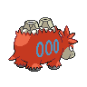

- 文件：[pokemon-id-00323-back-normal-default-static--0cc738463c36.png](pokemon-id-00323-back-normal-default-static--0cc738463c36.png)
- 用途：背面普通宝可梦图像；身份和变体来自PokeAPI路径，不作为原应用已经接入的证明。
- 尺寸：96 × 96，帧数：1
- SHA256：`0cc738463c369e8d05fa2483e5140b91bd0423a0eaa06584a4babc1bcf4dd823`
- 来源：[PokeAPI/sprites](https://raw.githubusercontent.com/PokeAPI/sprites/master/sprites/pokemon/back/323.png)；取得版本：`1dd55c0436d2a5b6e324c0b780e1b1b416fbfb64`

### 宝可梦API ID 324 · 背面 · 普通 · 默认静态来源

- 文件：[pokemon-id-00324-back-normal-default-static--977ac31002be.png](pokemon-id-00324-back-normal-default-static--977ac31002be.png)
- 用途：背面普通宝可梦图像；身份和变体来自PokeAPI路径，不作为原应用已经接入的证明。
- 尺寸：96 × 96，帧数：1
- SHA256：`977ac31002bee18a9bd4f5b3b9490ee5a57adfd8fdc2cc4ac640450e720850fd`
- 来源：[PokeAPI/sprites](https://raw.githubusercontent.com/PokeAPI/sprites/master/sprites/pokemon/back/324.png)；取得版本：`1dd55c0436d2a5b6e324c0b780e1b1b416fbfb64`

### 宝可梦API ID 325 · 背面 · 普通 · 默认静态来源

- 文件：[pokemon-id-00325-back-normal-default-static--134531a11f05.png](pokemon-id-00325-back-normal-default-static--134531a11f05.png)
- 用途：背面普通宝可梦图像；身份和变体来自PokeAPI路径，不作为原应用已经接入的证明。
- 尺寸：96 × 96，帧数：1
- SHA256：`134531a11f05fe258ae69c4ff4abdd0933d662adac9c68109ac234d8a6edcbdc`
- 来源：[PokeAPI/sprites](https://raw.githubusercontent.com/PokeAPI/sprites/master/sprites/pokemon/back/325.png)；取得版本：`1dd55c0436d2a5b6e324c0b780e1b1b416fbfb64`

### 宝可梦API ID 326 · 背面 · 普通 · 默认静态来源

- 文件：[pokemon-id-00326-back-normal-default-static--b1b77aba331e.png](pokemon-id-00326-back-normal-default-static--b1b77aba331e.png)
- 用途：背面普通宝可梦图像；身份和变体来自PokeAPI路径，不作为原应用已经接入的证明。
- 尺寸：96 × 96，帧数：1
- SHA256：`b1b77aba331e5fb06de906c28abc61bdee0b0fb3c82b13f1e77519f8dc046386`
- 来源：[PokeAPI/sprites](https://raw.githubusercontent.com/PokeAPI/sprites/master/sprites/pokemon/back/326.png)；取得版本：`1dd55c0436d2a5b6e324c0b780e1b1b416fbfb64`

### 宝可梦API ID 327 · 背面 · 普通 · 默认静态来源

- 文件：[pokemon-id-00327-back-normal-default-static--394afc361caa.png](pokemon-id-00327-back-normal-default-static--394afc361caa.png)
- 用途：背面普通宝可梦图像；身份和变体来自PokeAPI路径，不作为原应用已经接入的证明。
- 尺寸：96 × 96，帧数：1
- SHA256：`394afc361caa527ed913f10c66c4b85fc754272cbd6595ca40dc99524b9877d3`
- 来源：[PokeAPI/sprites](https://raw.githubusercontent.com/PokeAPI/sprites/master/sprites/pokemon/back/327.png)；取得版本：`1dd55c0436d2a5b6e324c0b780e1b1b416fbfb64`

### 宝可梦API ID 328 · 背面 · 普通 · 默认静态来源

- 文件：[pokemon-id-00328-back-normal-default-static--8646821a85fd.png](pokemon-id-00328-back-normal-default-static--8646821a85fd.png)
- 用途：背面普通宝可梦图像；身份和变体来自PokeAPI路径，不作为原应用已经接入的证明。
- 尺寸：96 × 96，帧数：1
- SHA256：`8646821a85fdd22a60b8d9b43e3167128e243da86b21d798fb2ef4751349c2f6`
- 来源：[PokeAPI/sprites](https://raw.githubusercontent.com/PokeAPI/sprites/master/sprites/pokemon/back/328.png)；取得版本：`1dd55c0436d2a5b6e324c0b780e1b1b416fbfb64`

### 宝可梦API ID 329 · 背面 · 普通 · 默认静态来源

- 文件：[pokemon-id-00329-back-normal-default-static--b1d6b013d333.png](pokemon-id-00329-back-normal-default-static--b1d6b013d333.png)
- 用途：背面普通宝可梦图像；身份和变体来自PokeAPI路径，不作为原应用已经接入的证明。
- 尺寸：96 × 96，帧数：1
- SHA256：`b1d6b013d333e7d17cd8ac0738210fbf65f364f7f847dc40e2bb73368f8dc1e9`
- 来源：[PokeAPI/sprites](https://raw.githubusercontent.com/PokeAPI/sprites/master/sprites/pokemon/back/329.png)；取得版本：`1dd55c0436d2a5b6e324c0b780e1b1b416fbfb64`

### 宝可梦API ID 330 · 背面 · 普通 · 默认静态来源

- 文件：[pokemon-id-00330-back-normal-default-static--fb3e84b00501.png](pokemon-id-00330-back-normal-default-static--fb3e84b00501.png)
- 用途：背面普通宝可梦图像；身份和变体来自PokeAPI路径，不作为原应用已经接入的证明。
- 尺寸：96 × 96，帧数：1
- SHA256：`fb3e84b005012a1a216d64b54a64394d3c94cb6ff525225e8658ade334a82083`
- 来源：[PokeAPI/sprites](https://raw.githubusercontent.com/PokeAPI/sprites/master/sprites/pokemon/back/330.png)；取得版本：`1dd55c0436d2a5b6e324c0b780e1b1b416fbfb64`

### 宝可梦API ID 331 · 背面 · 普通 · 默认静态来源

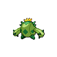

- 文件：[pokemon-id-00331-back-normal-default-static--f2a9830407d3.png](pokemon-id-00331-back-normal-default-static--f2a9830407d3.png)
- 用途：背面普通宝可梦图像；身份和变体来自PokeAPI路径，不作为原应用已经接入的证明。
- 尺寸：96 × 96，帧数：1
- SHA256：`f2a9830407d3188c68d3f4f0bb7681438a4c79767a5f42cda73aab01b6f11447`
- 来源：[PokeAPI/sprites](https://raw.githubusercontent.com/PokeAPI/sprites/master/sprites/pokemon/back/331.png)；取得版本：`1dd55c0436d2a5b6e324c0b780e1b1b416fbfb64`

### 宝可梦API ID 332 · 背面 · 普通 · 默认静态来源

- 文件：[pokemon-id-00332-back-normal-default-static--31a11fa5f720.png](pokemon-id-00332-back-normal-default-static--31a11fa5f720.png)
- 用途：背面普通宝可梦图像；身份和变体来自PokeAPI路径，不作为原应用已经接入的证明。
- 尺寸：96 × 96，帧数：1
- SHA256：`31a11fa5f7206ab94bf3cf3364d3a659a1c0ca8502a96d0f2cf8ceff01114796`
- 来源：[PokeAPI/sprites](https://raw.githubusercontent.com/PokeAPI/sprites/master/sprites/pokemon/back/332.png)；取得版本：`1dd55c0436d2a5b6e324c0b780e1b1b416fbfb64`

### 宝可梦API ID 333 · 背面 · 普通 · 默认静态来源

- 文件：[pokemon-id-00333-back-normal-default-static--0ca6650a2343.png](pokemon-id-00333-back-normal-default-static--0ca6650a2343.png)
- 用途：背面普通宝可梦图像；身份和变体来自PokeAPI路径，不作为原应用已经接入的证明。
- 尺寸：96 × 96，帧数：1
- SHA256：`0ca6650a23433c391c51954eafc6e82cc8636f28ff8f240a85db4dbf67129b68`
- 来源：[PokeAPI/sprites](https://raw.githubusercontent.com/PokeAPI/sprites/master/sprites/pokemon/back/333.png)；取得版本：`1dd55c0436d2a5b6e324c0b780e1b1b416fbfb64`

### 宝可梦API ID 334 · 背面 · 普通 · 默认静态来源

- 文件：[pokemon-id-00334-back-normal-default-static--bde25b82ac44.png](pokemon-id-00334-back-normal-default-static--bde25b82ac44.png)
- 用途：背面普通宝可梦图像；身份和变体来自PokeAPI路径，不作为原应用已经接入的证明。
- 尺寸：96 × 96，帧数：1
- SHA256：`bde25b82ac44f111443290c5aa1722f09d32271ef94a094697bcb713a025fc03`
- 来源：[PokeAPI/sprites](https://raw.githubusercontent.com/PokeAPI/sprites/master/sprites/pokemon/back/334.png)；取得版本：`1dd55c0436d2a5b6e324c0b780e1b1b416fbfb64`

### 宝可梦API ID 335 · 背面 · 普通 · 默认静态来源

- 文件：[pokemon-id-00335-back-normal-default-static--d7e2bba49380.png](pokemon-id-00335-back-normal-default-static--d7e2bba49380.png)
- 用途：背面普通宝可梦图像；身份和变体来自PokeAPI路径，不作为原应用已经接入的证明。
- 尺寸：96 × 96，帧数：1
- SHA256：`d7e2bba49380cf5e87a48943c6f749178cd071ae0f7d2d9323580d8fe8f566c1`
- 来源：[PokeAPI/sprites](https://raw.githubusercontent.com/PokeAPI/sprites/master/sprites/pokemon/back/335.png)；取得版本：`1dd55c0436d2a5b6e324c0b780e1b1b416fbfb64`

### 宝可梦API ID 336 · 背面 · 普通 · 默认静态来源

- 文件：[pokemon-id-00336-back-normal-default-static--8e752ca68250.png](pokemon-id-00336-back-normal-default-static--8e752ca68250.png)
- 用途：背面普通宝可梦图像；身份和变体来自PokeAPI路径，不作为原应用已经接入的证明。
- 尺寸：96 × 96，帧数：1
- SHA256：`8e752ca68250f5142a9fe3e18dc323dfb06529a1ed8ff484b5439991b59e7655`
- 来源：[PokeAPI/sprites](https://raw.githubusercontent.com/PokeAPI/sprites/master/sprites/pokemon/back/336.png)；取得版本：`1dd55c0436d2a5b6e324c0b780e1b1b416fbfb64`

### 宝可梦API ID 337 · 背面 · 普通 · 默认静态来源

- 文件：[pokemon-id-00337-back-normal-default-static--613676f46b61.png](pokemon-id-00337-back-normal-default-static--613676f46b61.png)
- 用途：背面普通宝可梦图像；身份和变体来自PokeAPI路径，不作为原应用已经接入的证明。
- 尺寸：96 × 96，帧数：1
- SHA256：`613676f46b61e1b6ba928ebb2018468e96106f5ea6dc1bb6b7f1812850ff7a17`
- 来源：[PokeAPI/sprites](https://raw.githubusercontent.com/PokeAPI/sprites/master/sprites/pokemon/back/337.png)；取得版本：`1dd55c0436d2a5b6e324c0b780e1b1b416fbfb64`

### 宝可梦API ID 338 · 背面 · 普通 · 默认静态来源

- 文件：[pokemon-id-00338-back-normal-default-static--711f6b4772f9.png](pokemon-id-00338-back-normal-default-static--711f6b4772f9.png)
- 用途：背面普通宝可梦图像；身份和变体来自PokeAPI路径，不作为原应用已经接入的证明。
- 尺寸：96 × 96，帧数：1
- SHA256：`711f6b4772f9ba39b4f21452fbc982a6e5cc88460bba71abac0c4466ba46b6f5`
- 来源：[PokeAPI/sprites](https://raw.githubusercontent.com/PokeAPI/sprites/master/sprites/pokemon/back/338.png)；取得版本：`1dd55c0436d2a5b6e324c0b780e1b1b416fbfb64`

### 宝可梦API ID 339 · 背面 · 普通 · 默认静态来源

- 文件：[pokemon-id-00339-back-normal-default-static--3fa0fa32f6b2.png](pokemon-id-00339-back-normal-default-static--3fa0fa32f6b2.png)
- 用途：背面普通宝可梦图像；身份和变体来自PokeAPI路径，不作为原应用已经接入的证明。
- 尺寸：96 × 96，帧数：1
- SHA256：`3fa0fa32f6b2a71db43523353b785b2a89bf20efb35a5b0722b5b5cef97c7cfd`
- 来源：[PokeAPI/sprites](https://raw.githubusercontent.com/PokeAPI/sprites/master/sprites/pokemon/back/339.png)；取得版本：`1dd55c0436d2a5b6e324c0b780e1b1b416fbfb64`

### 宝可梦API ID 340 · 背面 · 普通 · 默认静态来源

- 文件：[pokemon-id-00340-back-normal-default-static--8a051589a8d1.png](pokemon-id-00340-back-normal-default-static--8a051589a8d1.png)
- 用途：背面普通宝可梦图像；身份和变体来自PokeAPI路径，不作为原应用已经接入的证明。
- 尺寸：96 × 96，帧数：1
- SHA256：`8a051589a8d13cca8432642c177453f89fb811607dc75ef2798f361c21546f6e`
- 来源：[PokeAPI/sprites](https://raw.githubusercontent.com/PokeAPI/sprites/master/sprites/pokemon/back/340.png)；取得版本：`1dd55c0436d2a5b6e324c0b780e1b1b416fbfb64`

### 宝可梦API ID 341 · 背面 · 普通 · 默认静态来源

- 文件：[pokemon-id-00341-back-normal-default-static--abc0a622f916.png](pokemon-id-00341-back-normal-default-static--abc0a622f916.png)
- 用途：背面普通宝可梦图像；身份和变体来自PokeAPI路径，不作为原应用已经接入的证明。
- 尺寸：96 × 96，帧数：1
- SHA256：`abc0a622f91613f96bdf23c25a77d976d96b3f4007c5f8061cd5025dd6e5dee2`
- 来源：[PokeAPI/sprites](https://raw.githubusercontent.com/PokeAPI/sprites/master/sprites/pokemon/back/341.png)；取得版本：`1dd55c0436d2a5b6e324c0b780e1b1b416fbfb64`

### 宝可梦API ID 342 · 背面 · 普通 · 默认静态来源

- 文件：[pokemon-id-00342-back-normal-default-static--462bd6b49468.png](pokemon-id-00342-back-normal-default-static--462bd6b49468.png)
- 用途：背面普通宝可梦图像；身份和变体来自PokeAPI路径，不作为原应用已经接入的证明。
- 尺寸：96 × 96，帧数：1
- SHA256：`462bd6b4946854143ea63b57a14879e3c03c951ea13ef1ce302e1bcd42be4a60`
- 来源：[PokeAPI/sprites](https://raw.githubusercontent.com/PokeAPI/sprites/master/sprites/pokemon/back/342.png)；取得版本：`1dd55c0436d2a5b6e324c0b780e1b1b416fbfb64`

### 宝可梦API ID 343 · 背面 · 普通 · 默认静态来源

- 文件：[pokemon-id-00343-back-normal-default-static--333542519f99.png](pokemon-id-00343-back-normal-default-static--333542519f99.png)
- 用途：背面普通宝可梦图像；身份和变体来自PokeAPI路径，不作为原应用已经接入的证明。
- 尺寸：96 × 96，帧数：1
- SHA256：`333542519f99f2de6fb060986d57c97e338012508d4767315423f4b4ccf2fcfc`
- 来源：[PokeAPI/sprites](https://raw.githubusercontent.com/PokeAPI/sprites/master/sprites/pokemon/back/343.png)；取得版本：`1dd55c0436d2a5b6e324c0b780e1b1b416fbfb64`

### 宝可梦API ID 344 · 背面 · 普通 · 默认静态来源

- 文件：[pokemon-id-00344-back-normal-default-static--4f06a6a3372e.png](pokemon-id-00344-back-normal-default-static--4f06a6a3372e.png)
- 用途：背面普通宝可梦图像；身份和变体来自PokeAPI路径，不作为原应用已经接入的证明。
- 尺寸：96 × 96，帧数：1
- SHA256：`4f06a6a3372eb34ac7e238715bef6943154acc4d637790a2e6f336186fd9e681`
- 来源：[PokeAPI/sprites](https://raw.githubusercontent.com/PokeAPI/sprites/master/sprites/pokemon/back/344.png)；取得版本：`1dd55c0436d2a5b6e324c0b780e1b1b416fbfb64`

### 宝可梦API ID 345 · 背面 · 普通 · 默认静态来源

- 文件：[pokemon-id-00345-back-normal-default-static--0c495383d5a4.png](pokemon-id-00345-back-normal-default-static--0c495383d5a4.png)
- 用途：背面普通宝可梦图像；身份和变体来自PokeAPI路径，不作为原应用已经接入的证明。
- 尺寸：96 × 96，帧数：1
- SHA256：`0c495383d5a446124b7fab43db0002105cdc67e107d30a8cf18be423b48a9c77`
- 来源：[PokeAPI/sprites](https://raw.githubusercontent.com/PokeAPI/sprites/master/sprites/pokemon/back/345.png)；取得版本：`1dd55c0436d2a5b6e324c0b780e1b1b416fbfb64`

### 宝可梦API ID 346 · 背面 · 普通 · 默认静态来源

- 文件：[pokemon-id-00346-back-normal-default-static--a20002c954f3.png](pokemon-id-00346-back-normal-default-static--a20002c954f3.png)
- 用途：背面普通宝可梦图像；身份和变体来自PokeAPI路径，不作为原应用已经接入的证明。
- 尺寸：96 × 96，帧数：1
- SHA256：`a20002c954f38b2289c1bd41fde18f172ddc58a9b6680d4b5f2fffb251c1aa88`
- 来源：[PokeAPI/sprites](https://raw.githubusercontent.com/PokeAPI/sprites/master/sprites/pokemon/back/346.png)；取得版本：`1dd55c0436d2a5b6e324c0b780e1b1b416fbfb64`

### 宝可梦API ID 347 · 背面 · 普通 · 默认静态来源

- 文件：[pokemon-id-00347-back-normal-default-static--906a24be4496.png](pokemon-id-00347-back-normal-default-static--906a24be4496.png)
- 用途：背面普通宝可梦图像；身份和变体来自PokeAPI路径，不作为原应用已经接入的证明。
- 尺寸：96 × 96，帧数：1
- SHA256：`906a24be449678c11d0d125ac3c5cdf59150ebb334073133df4aa71765423fa7`
- 来源：[PokeAPI/sprites](https://raw.githubusercontent.com/PokeAPI/sprites/master/sprites/pokemon/back/347.png)；取得版本：`1dd55c0436d2a5b6e324c0b780e1b1b416fbfb64`

### 宝可梦API ID 348 · 背面 · 普通 · 默认静态来源

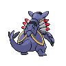

- 文件：[pokemon-id-00348-back-normal-default-static--cc4cb12161f2.png](pokemon-id-00348-back-normal-default-static--cc4cb12161f2.png)
- 用途：背面普通宝可梦图像；身份和变体来自PokeAPI路径，不作为原应用已经接入的证明。
- 尺寸：96 × 96，帧数：1
- SHA256：`cc4cb12161f2f98c652ec605f74fabbdb72c7d5c8a8b3950dc2bd73f52fa5fdd`
- 来源：[PokeAPI/sprites](https://raw.githubusercontent.com/PokeAPI/sprites/master/sprites/pokemon/back/348.png)；取得版本：`1dd55c0436d2a5b6e324c0b780e1b1b416fbfb64`

### 宝可梦API ID 349 · 背面 · 普通 · 默认静态来源

- 文件：[pokemon-id-00349-back-normal-default-static--362d44512364.png](pokemon-id-00349-back-normal-default-static--362d44512364.png)
- 用途：背面普通宝可梦图像；身份和变体来自PokeAPI路径，不作为原应用已经接入的证明。
- 尺寸：96 × 96，帧数：1
- SHA256：`362d44512364502b797a3001cffb12d3850ae70b52c8ee3de6d41ff1cb5ba7a4`
- 来源：[PokeAPI/sprites](https://raw.githubusercontent.com/PokeAPI/sprites/master/sprites/pokemon/back/349.png)；取得版本：`1dd55c0436d2a5b6e324c0b780e1b1b416fbfb64`

### 宝可梦API ID 350 · 背面 · 普通 · 默认静态来源

- 文件：[pokemon-id-00350-back-normal-default-static--5e9f20d589bd.png](pokemon-id-00350-back-normal-default-static--5e9f20d589bd.png)
- 用途：背面普通宝可梦图像；身份和变体来自PokeAPI路径，不作为原应用已经接入的证明。
- 尺寸：96 × 96，帧数：1
- SHA256：`5e9f20d589bd5ffd85cd7a7cdc1241b4e2ddebbc3f4c2a3852732c31e59b223c`
- 来源：[PokeAPI/sprites](https://raw.githubusercontent.com/PokeAPI/sprites/master/sprites/pokemon/back/350.png)；取得版本：`1dd55c0436d2a5b6e324c0b780e1b1b416fbfb64`

### 宝可梦API ID 351 · 背面 · 普通 · 默认静态来源

- 文件：[pokemon-id-00351-back-normal-default-static--e87a1d7bce70.png](pokemon-id-00351-back-normal-default-static--e87a1d7bce70.png)
- 用途：背面普通宝可梦图像；身份和变体来自PokeAPI路径，不作为原应用已经接入的证明。
- 尺寸：96 × 96，帧数：1
- SHA256：`e87a1d7bce705635353153e8e9f71697ad3dd8197d61f405c0ff1f6b4a8c7159`
- 来源：[PokeAPI/sprites](https://raw.githubusercontent.com/PokeAPI/sprites/master/sprites/pokemon/back/351.png)；取得版本：`1dd55c0436d2a5b6e324c0b780e1b1b416fbfb64`

### 宝可梦API ID 352 · 背面 · 普通 · 默认静态来源

- 文件：[pokemon-id-00352-back-normal-default-static--a4c39d5d8217.png](pokemon-id-00352-back-normal-default-static--a4c39d5d8217.png)
- 用途：背面普通宝可梦图像；身份和变体来自PokeAPI路径，不作为原应用已经接入的证明。
- 尺寸：96 × 96，帧数：1
- SHA256：`a4c39d5d82172b67fab98d416829a58c4f10c3c68e9564877bce30dd78bb0c68`
- 来源：[PokeAPI/sprites](https://raw.githubusercontent.com/PokeAPI/sprites/master/sprites/pokemon/back/352.png)；取得版本：`1dd55c0436d2a5b6e324c0b780e1b1b416fbfb64`

### 宝可梦API ID 353 · 背面 · 普通 · 默认静态来源

- 文件：[pokemon-id-00353-back-normal-default-static--d30cc8a5dd37.png](pokemon-id-00353-back-normal-default-static--d30cc8a5dd37.png)
- 用途：背面普通宝可梦图像；身份和变体来自PokeAPI路径，不作为原应用已经接入的证明。
- 尺寸：96 × 96，帧数：1
- SHA256：`d30cc8a5dd37d24141c54196cd79892b04049fcd645be28973eda4584b37fdf3`
- 来源：[PokeAPI/sprites](https://raw.githubusercontent.com/PokeAPI/sprites/master/sprites/pokemon/back/353.png)；取得版本：`1dd55c0436d2a5b6e324c0b780e1b1b416fbfb64`

### 宝可梦API ID 354 · 背面 · 普通 · 默认静态来源

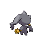

- 文件：[pokemon-id-00354-back-normal-default-static--68e4cf75dbfe.png](pokemon-id-00354-back-normal-default-static--68e4cf75dbfe.png)
- 用途：背面普通宝可梦图像；身份和变体来自PokeAPI路径，不作为原应用已经接入的证明。
- 尺寸：96 × 96，帧数：1
- SHA256：`68e4cf75dbfea8ba111172fd52698e6696995777fb4e1fc40843cfcf2f8b6e0f`
- 来源：[PokeAPI/sprites](https://raw.githubusercontent.com/PokeAPI/sprites/master/sprites/pokemon/back/354.png)；取得版本：`1dd55c0436d2a5b6e324c0b780e1b1b416fbfb64`

### 宝可梦API ID 355 · 背面 · 普通 · 默认静态来源

- 文件：[pokemon-id-00355-back-normal-default-static--3c40be6897ad.png](pokemon-id-00355-back-normal-default-static--3c40be6897ad.png)
- 用途：背面普通宝可梦图像；身份和变体来自PokeAPI路径，不作为原应用已经接入的证明。
- 尺寸：96 × 96，帧数：1
- SHA256：`3c40be6897ad79efddcead74908ac7b638716419c1f0469a9edb525e467cb627`
- 来源：[PokeAPI/sprites](https://raw.githubusercontent.com/PokeAPI/sprites/master/sprites/pokemon/back/355.png)；取得版本：`1dd55c0436d2a5b6e324c0b780e1b1b416fbfb64`

### 宝可梦API ID 356 · 背面 · 普通 · 默认静态来源

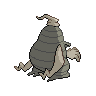

- 文件：[pokemon-id-00356-back-normal-default-static--5b971db6acf6.png](pokemon-id-00356-back-normal-default-static--5b971db6acf6.png)
- 用途：背面普通宝可梦图像；身份和变体来自PokeAPI路径，不作为原应用已经接入的证明。
- 尺寸：96 × 96，帧数：1
- SHA256：`5b971db6acf60ca35ddd899b1c2132d7ac935c4271c6e5cc0f5b6b6b60d7d9a6`
- 来源：[PokeAPI/sprites](https://raw.githubusercontent.com/PokeAPI/sprites/master/sprites/pokemon/back/356.png)；取得版本：`1dd55c0436d2a5b6e324c0b780e1b1b416fbfb64`

### 宝可梦API ID 357 · 背面 · 普通 · 默认静态来源

- 文件：[pokemon-id-00357-back-normal-default-static--bba6a010c43f.png](pokemon-id-00357-back-normal-default-static--bba6a010c43f.png)
- 用途：背面普通宝可梦图像；身份和变体来自PokeAPI路径，不作为原应用已经接入的证明。
- 尺寸：96 × 96，帧数：1
- SHA256：`bba6a010c43f2d36f4ba3001f4397b1c2b205a0f1ee94e6f23e50149edfc61c5`
- 来源：[PokeAPI/sprites](https://raw.githubusercontent.com/PokeAPI/sprites/master/sprites/pokemon/back/357.png)；取得版本：`1dd55c0436d2a5b6e324c0b780e1b1b416fbfb64`

### 宝可梦API ID 358 · 背面 · 普通 · 默认静态来源

- 文件：[pokemon-id-00358-back-normal-default-static--6aa60401ca7f.png](pokemon-id-00358-back-normal-default-static--6aa60401ca7f.png)
- 用途：背面普通宝可梦图像；身份和变体来自PokeAPI路径，不作为原应用已经接入的证明。
- 尺寸：96 × 96，帧数：1
- SHA256：`6aa60401ca7fa6e0a00b319432f5c66be483e482f108c044cf8f3e010c75f04b`
- 来源：[PokeAPI/sprites](https://raw.githubusercontent.com/PokeAPI/sprites/master/sprites/pokemon/back/358.png)；取得版本：`1dd55c0436d2a5b6e324c0b780e1b1b416fbfb64`

### 宝可梦API ID 359 · 背面 · 普通 · 默认静态来源

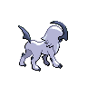

- 文件：[pokemon-id-00359-back-normal-default-static--6f4e19e3db71.png](pokemon-id-00359-back-normal-default-static--6f4e19e3db71.png)
- 用途：背面普通宝可梦图像；身份和变体来自PokeAPI路径，不作为原应用已经接入的证明。
- 尺寸：96 × 96，帧数：1
- SHA256：`6f4e19e3db71b0718db2a5300c81c9c4f604a50ee2ea9d827148e354a0db6e6b`
- 来源：[PokeAPI/sprites](https://raw.githubusercontent.com/PokeAPI/sprites/master/sprites/pokemon/back/359.png)；取得版本：`1dd55c0436d2a5b6e324c0b780e1b1b416fbfb64`

### 宝可梦API ID 360 · 背面 · 普通 · 默认静态来源

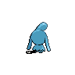

- 文件：[pokemon-id-00360-back-normal-default-static--7f1eda3bf533.png](pokemon-id-00360-back-normal-default-static--7f1eda3bf533.png)
- 用途：背面普通宝可梦图像；身份和变体来自PokeAPI路径，不作为原应用已经接入的证明。
- 尺寸：96 × 96，帧数：1
- SHA256：`7f1eda3bf533fca6126918723d2ca32095b53ecd34a11b12e7b0f5134eb25a2c`
- 来源：[PokeAPI/sprites](https://raw.githubusercontent.com/PokeAPI/sprites/master/sprites/pokemon/back/360.png)；取得版本：`1dd55c0436d2a5b6e324c0b780e1b1b416fbfb64`

### 宝可梦API ID 361 · 背面 · 普通 · 默认静态来源

- 文件：[pokemon-id-00361-back-normal-default-static--7927f1371e72.png](pokemon-id-00361-back-normal-default-static--7927f1371e72.png)
- 用途：背面普通宝可梦图像；身份和变体来自PokeAPI路径，不作为原应用已经接入的证明。
- 尺寸：96 × 96，帧数：1
- SHA256：`7927f1371e728e1cfb575bd8691530060f9a9ba70484095ce38bf9f1855fe433`
- 来源：[PokeAPI/sprites](https://raw.githubusercontent.com/PokeAPI/sprites/master/sprites/pokemon/back/361.png)；取得版本：`1dd55c0436d2a5b6e324c0b780e1b1b416fbfb64`

### 宝可梦API ID 362 · 背面 · 普通 · 默认静态来源

- 文件：[pokemon-id-00362-back-normal-default-static--89de77de0927.png](pokemon-id-00362-back-normal-default-static--89de77de0927.png)
- 用途：背面普通宝可梦图像；身份和变体来自PokeAPI路径，不作为原应用已经接入的证明。
- 尺寸：96 × 96，帧数：1
- SHA256：`89de77de09270347bd5994a05b54e990705bd9c74c9ab24068d4ab8ad9474260`
- 来源：[PokeAPI/sprites](https://raw.githubusercontent.com/PokeAPI/sprites/master/sprites/pokemon/back/362.png)；取得版本：`1dd55c0436d2a5b6e324c0b780e1b1b416fbfb64`

### 宝可梦API ID 363 · 背面 · 普通 · 默认静态来源

- 文件：[pokemon-id-00363-back-normal-default-static--381c61f91744.png](pokemon-id-00363-back-normal-default-static--381c61f91744.png)
- 用途：背面普通宝可梦图像；身份和变体来自PokeAPI路径，不作为原应用已经接入的证明。
- 尺寸：96 × 96，帧数：1
- SHA256：`381c61f9174448b91d24c23831d175e478d076ceac041a7d62804ffdc89e3bce`
- 来源：[PokeAPI/sprites](https://raw.githubusercontent.com/PokeAPI/sprites/master/sprites/pokemon/back/363.png)；取得版本：`1dd55c0436d2a5b6e324c0b780e1b1b416fbfb64`

### 宝可梦API ID 364 · 背面 · 普通 · 默认静态来源

- 文件：[pokemon-id-00364-back-normal-default-static--178e1bf0432f.png](pokemon-id-00364-back-normal-default-static--178e1bf0432f.png)
- 用途：背面普通宝可梦图像；身份和变体来自PokeAPI路径，不作为原应用已经接入的证明。
- 尺寸：96 × 96，帧数：1
- SHA256：`178e1bf0432fe0da3eb3e21d3e8ae15dda6212bdc799ae288c96c733abc5058a`
- 来源：[PokeAPI/sprites](https://raw.githubusercontent.com/PokeAPI/sprites/master/sprites/pokemon/back/364.png)；取得版本：`1dd55c0436d2a5b6e324c0b780e1b1b416fbfb64`

### 宝可梦API ID 365 · 背面 · 普通 · 默认静态来源

- 文件：[pokemon-id-00365-back-normal-default-static--670e96260ce7.png](pokemon-id-00365-back-normal-default-static--670e96260ce7.png)
- 用途：背面普通宝可梦图像；身份和变体来自PokeAPI路径，不作为原应用已经接入的证明。
- 尺寸：96 × 96，帧数：1
- SHA256：`670e96260ce78a08f5179ffb3757fc7318065b5b47b0386ec679c69f2ba21049`
- 来源：[PokeAPI/sprites](https://raw.githubusercontent.com/PokeAPI/sprites/master/sprites/pokemon/back/365.png)；取得版本：`1dd55c0436d2a5b6e324c0b780e1b1b416fbfb64`

### 宝可梦API ID 366 · 背面 · 普通 · 默认静态来源

- 文件：[pokemon-id-00366-back-normal-default-static--038425f93418.png](pokemon-id-00366-back-normal-default-static--038425f93418.png)
- 用途：背面普通宝可梦图像；身份和变体来自PokeAPI路径，不作为原应用已经接入的证明。
- 尺寸：96 × 96，帧数：1
- SHA256：`038425f93418ed55bfcdfa1782b63af0537d11241ee1e8189517cee84a1eb1fe`
- 来源：[PokeAPI/sprites](https://raw.githubusercontent.com/PokeAPI/sprites/master/sprites/pokemon/back/366.png)；取得版本：`1dd55c0436d2a5b6e324c0b780e1b1b416fbfb64`

### 宝可梦API ID 367 · 背面 · 普通 · 默认静态来源

- 文件：[pokemon-id-00367-back-normal-default-static--a1beb1458f76.png](pokemon-id-00367-back-normal-default-static--a1beb1458f76.png)
- 用途：背面普通宝可梦图像；身份和变体来自PokeAPI路径，不作为原应用已经接入的证明。
- 尺寸：96 × 96，帧数：1
- SHA256：`a1beb1458f765bf9cbd30c1e7ec97a0e501bb3f52320ab9bac8e05297eac290a`
- 来源：[PokeAPI/sprites](https://raw.githubusercontent.com/PokeAPI/sprites/master/sprites/pokemon/back/367.png)；取得版本：`1dd55c0436d2a5b6e324c0b780e1b1b416fbfb64`

### 宝可梦API ID 368 · 背面 · 普通 · 默认静态来源

- 文件：[pokemon-id-00368-back-normal-default-static--51fb0e8aa67f.png](pokemon-id-00368-back-normal-default-static--51fb0e8aa67f.png)
- 用途：背面普通宝可梦图像；身份和变体来自PokeAPI路径，不作为原应用已经接入的证明。
- 尺寸：96 × 96，帧数：1
- SHA256：`51fb0e8aa67ff2ce4eac37a4ba7db83aa731e312a3194a57e1425b87f160c051`
- 来源：[PokeAPI/sprites](https://raw.githubusercontent.com/PokeAPI/sprites/master/sprites/pokemon/back/368.png)；取得版本：`1dd55c0436d2a5b6e324c0b780e1b1b416fbfb64`

### 宝可梦API ID 369 · 背面 · 普通 · 默认静态来源

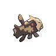

- 文件：[pokemon-id-00369-back-normal-default-static--3f40f2360056.png](pokemon-id-00369-back-normal-default-static--3f40f2360056.png)
- 用途：背面普通宝可梦图像；身份和变体来自PokeAPI路径，不作为原应用已经接入的证明。
- 尺寸：96 × 96，帧数：1
- SHA256：`3f40f2360056544a3366d4d4aec950e14b23129b3759730ccf40f6854270fd29`
- 来源：[PokeAPI/sprites](https://raw.githubusercontent.com/PokeAPI/sprites/master/sprites/pokemon/back/369.png)；取得版本：`1dd55c0436d2a5b6e324c0b780e1b1b416fbfb64`

### 宝可梦API ID 370 · 背面 · 普通 · 默认静态来源

- 文件：[pokemon-id-00370-back-normal-default-static--0ef1435abf1d.png](pokemon-id-00370-back-normal-default-static--0ef1435abf1d.png)
- 用途：背面普通宝可梦图像；身份和变体来自PokeAPI路径，不作为原应用已经接入的证明。
- 尺寸：96 × 96，帧数：1
- SHA256：`0ef1435abf1db32d89feef8d69b6d9434888ed7426b3948675e10bcdc7bc7508`
- 来源：[PokeAPI/sprites](https://raw.githubusercontent.com/PokeAPI/sprites/master/sprites/pokemon/back/370.png)；取得版本：`1dd55c0436d2a5b6e324c0b780e1b1b416fbfb64`

### 宝可梦API ID 371 · 背面 · 普通 · 默认静态来源

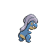

- 文件：[pokemon-id-00371-back-normal-default-static--135591417340.png](pokemon-id-00371-back-normal-default-static--135591417340.png)
- 用途：背面普通宝可梦图像；身份和变体来自PokeAPI路径，不作为原应用已经接入的证明。
- 尺寸：96 × 96，帧数：1
- SHA256：`1355914173403549f51dd8f55dff13ddf97e3a5fb2b796005b04a42e45611662`
- 来源：[PokeAPI/sprites](https://raw.githubusercontent.com/PokeAPI/sprites/master/sprites/pokemon/back/371.png)；取得版本：`1dd55c0436d2a5b6e324c0b780e1b1b416fbfb64`

### 宝可梦API ID 372 · 背面 · 普通 · 默认静态来源

- 文件：[pokemon-id-00372-back-normal-default-static--a8758bf170e9.png](pokemon-id-00372-back-normal-default-static--a8758bf170e9.png)
- 用途：背面普通宝可梦图像；身份和变体来自PokeAPI路径，不作为原应用已经接入的证明。
- 尺寸：96 × 96，帧数：1
- SHA256：`a8758bf170e9e122c19b775b46f2e7e3c951a4f01bb35cbc079d241d90f1c61c`
- 来源：[PokeAPI/sprites](https://raw.githubusercontent.com/PokeAPI/sprites/master/sprites/pokemon/back/372.png)；取得版本：`1dd55c0436d2a5b6e324c0b780e1b1b416fbfb64`

### 宝可梦API ID 373 · 背面 · 普通 · 默认静态来源

- 文件：[pokemon-id-00373-back-normal-default-static--e02b51902c2f.png](pokemon-id-00373-back-normal-default-static--e02b51902c2f.png)
- 用途：背面普通宝可梦图像；身份和变体来自PokeAPI路径，不作为原应用已经接入的证明。
- 尺寸：96 × 96，帧数：1
- SHA256：`e02b51902c2f15a9b95fb47d18e48801401aca5eea2329a8bb1db0d7796fbe2c`
- 来源：[PokeAPI/sprites](https://raw.githubusercontent.com/PokeAPI/sprites/master/sprites/pokemon/back/373.png)；取得版本：`1dd55c0436d2a5b6e324c0b780e1b1b416fbfb64`

### 宝可梦API ID 374 · 背面 · 普通 · 默认静态来源

- 文件：[pokemon-id-00374-back-normal-default-static--f2a7323c07df.png](pokemon-id-00374-back-normal-default-static--f2a7323c07df.png)
- 用途：背面普通宝可梦图像；身份和变体来自PokeAPI路径，不作为原应用已经接入的证明。
- 尺寸：96 × 96，帧数：1
- SHA256：`f2a7323c07df8a5479aa1b37248976a3204cb0096454d91b4635efd80fc1c41e`
- 来源：[PokeAPI/sprites](https://raw.githubusercontent.com/PokeAPI/sprites/master/sprites/pokemon/back/374.png)；取得版本：`1dd55c0436d2a5b6e324c0b780e1b1b416fbfb64`

### 宝可梦API ID 375 · 背面 · 普通 · 默认静态来源

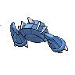

- 文件：[pokemon-id-00375-back-normal-default-static--727b6ea0f0e7.png](pokemon-id-00375-back-normal-default-static--727b6ea0f0e7.png)
- 用途：背面普通宝可梦图像；身份和变体来自PokeAPI路径，不作为原应用已经接入的证明。
- 尺寸：96 × 96，帧数：1
- SHA256：`727b6ea0f0e7ff006fa6624ab8f1540e0db74dba36e7f4b8cd3d5b1c3bccb95a`
- 来源：[PokeAPI/sprites](https://raw.githubusercontent.com/PokeAPI/sprites/master/sprites/pokemon/back/375.png)；取得版本：`1dd55c0436d2a5b6e324c0b780e1b1b416fbfb64`

### 宝可梦API ID 376 · 背面 · 普通 · 默认静态来源

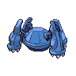

- 文件：[pokemon-id-00376-back-normal-default-static--010243bc1d60.png](pokemon-id-00376-back-normal-default-static--010243bc1d60.png)
- 用途：背面普通宝可梦图像；身份和变体来自PokeAPI路径，不作为原应用已经接入的证明。
- 尺寸：96 × 96，帧数：1
- SHA256：`010243bc1d601daa788a77c8fc23fc932a4abe642e65b2b720a646190aff015e`
- 来源：[PokeAPI/sprites](https://raw.githubusercontent.com/PokeAPI/sprites/master/sprites/pokemon/back/376.png)；取得版本：`1dd55c0436d2a5b6e324c0b780e1b1b416fbfb64`

### 宝可梦API ID 377 · 背面 · 普通 · 默认静态来源

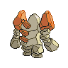

- 文件：[pokemon-id-00377-back-normal-default-static--51c270dc535a.png](pokemon-id-00377-back-normal-default-static--51c270dc535a.png)
- 用途：背面普通宝可梦图像；身份和变体来自PokeAPI路径，不作为原应用已经接入的证明。
- 尺寸：96 × 96，帧数：1
- SHA256：`51c270dc535ad54787d8910e8fca5c688d3e945c9db36202ec36d9eb09dbf684`
- 来源：[PokeAPI/sprites](https://raw.githubusercontent.com/PokeAPI/sprites/master/sprites/pokemon/back/377.png)；取得版本：`1dd55c0436d2a5b6e324c0b780e1b1b416fbfb64`

### 宝可梦API ID 378 · 背面 · 普通 · 默认静态来源

- 文件：[pokemon-id-00378-back-normal-default-static--f6fc7231d2fd.png](pokemon-id-00378-back-normal-default-static--f6fc7231d2fd.png)
- 用途：背面普通宝可梦图像；身份和变体来自PokeAPI路径，不作为原应用已经接入的证明。
- 尺寸：96 × 96，帧数：1
- SHA256：`f6fc7231d2fdcb448f0107740b9e8d454f1918967c6be03f5c53a5268081d76e`
- 来源：[PokeAPI/sprites](https://raw.githubusercontent.com/PokeAPI/sprites/master/sprites/pokemon/back/378.png)；取得版本：`1dd55c0436d2a5b6e324c0b780e1b1b416fbfb64`

### 宝可梦API ID 379 · 背面 · 普通 · 默认静态来源

- 文件：[pokemon-id-00379-back-normal-default-static--7392e5a8422d.png](pokemon-id-00379-back-normal-default-static--7392e5a8422d.png)
- 用途：背面普通宝可梦图像；身份和变体来自PokeAPI路径，不作为原应用已经接入的证明。
- 尺寸：96 × 96，帧数：1
- SHA256：`7392e5a8422dc4bd6c091ccb1141882ce96d4e583de82fb94a80f3ed226b8a38`
- 来源：[PokeAPI/sprites](https://raw.githubusercontent.com/PokeAPI/sprites/master/sprites/pokemon/back/379.png)；取得版本：`1dd55c0436d2a5b6e324c0b780e1b1b416fbfb64`

### 宝可梦API ID 380 · 背面 · 普通 · 默认静态来源

- 文件：[pokemon-id-00380-back-normal-default-static--d73aeac9474f.png](pokemon-id-00380-back-normal-default-static--d73aeac9474f.png)
- 用途：背面普通宝可梦图像；身份和变体来自PokeAPI路径，不作为原应用已经接入的证明。
- 尺寸：96 × 96，帧数：1
- SHA256：`d73aeac9474f040e330555eec75ebc927b3182126233a5f4dc12ad554d554176`
- 来源：[PokeAPI/sprites](https://raw.githubusercontent.com/PokeAPI/sprites/master/sprites/pokemon/back/380.png)；取得版本：`1dd55c0436d2a5b6e324c0b780e1b1b416fbfb64`

### 宝可梦API ID 381 · 背面 · 普通 · 默认静态来源

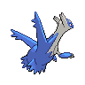

- 文件：[pokemon-id-00381-back-normal-default-static--b920be1eabfd.png](pokemon-id-00381-back-normal-default-static--b920be1eabfd.png)
- 用途：背面普通宝可梦图像；身份和变体来自PokeAPI路径，不作为原应用已经接入的证明。
- 尺寸：96 × 96，帧数：1
- SHA256：`b920be1eabfd27df082c1cbb7781c68631ab9a023eb7975f978d94bf7f6e1bf5`
- 来源：[PokeAPI/sprites](https://raw.githubusercontent.com/PokeAPI/sprites/master/sprites/pokemon/back/381.png)；取得版本：`1dd55c0436d2a5b6e324c0b780e1b1b416fbfb64`

### 宝可梦API ID 382 · 背面 · 普通 · 默认静态来源

- 文件：[pokemon-id-00382-back-normal-default-static--e592f6afecba.png](pokemon-id-00382-back-normal-default-static--e592f6afecba.png)
- 用途：背面普通宝可梦图像；身份和变体来自PokeAPI路径，不作为原应用已经接入的证明。
- 尺寸：96 × 96，帧数：1
- SHA256：`e592f6afecbabb4a38e73f8adcb9539aa92dfd5e0a12a9009239fb52729f69c7`
- 来源：[PokeAPI/sprites](https://raw.githubusercontent.com/PokeAPI/sprites/master/sprites/pokemon/back/382.png)；取得版本：`1dd55c0436d2a5b6e324c0b780e1b1b416fbfb64`

### 宝可梦API ID 383 · 背面 · 普通 · 默认静态来源

- 文件：[pokemon-id-00383-back-normal-default-static--155dae9a6aa9.png](pokemon-id-00383-back-normal-default-static--155dae9a6aa9.png)
- 用途：背面普通宝可梦图像；身份和变体来自PokeAPI路径，不作为原应用已经接入的证明。
- 尺寸：96 × 96，帧数：1
- SHA256：`155dae9a6aa914347e79c944c26b2954196e088ab807c80e348f5e82ef0f63e8`
- 来源：[PokeAPI/sprites](https://raw.githubusercontent.com/PokeAPI/sprites/master/sprites/pokemon/back/383.png)；取得版本：`1dd55c0436d2a5b6e324c0b780e1b1b416fbfb64`

### 宝可梦API ID 384 · 背面 · 普通 · 默认静态来源

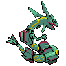

- 文件：[pokemon-id-00384-back-normal-default-static--1bfd4fee91e0.png](pokemon-id-00384-back-normal-default-static--1bfd4fee91e0.png)
- 用途：背面普通宝可梦图像；身份和变体来自PokeAPI路径，不作为原应用已经接入的证明。
- 尺寸：96 × 96，帧数：1
- SHA256：`1bfd4fee91e09cc5cdd8b4a9f1ad95ec54ea04aa84e7e66c0af6431cf59ea2d2`
- 来源：[PokeAPI/sprites](https://raw.githubusercontent.com/PokeAPI/sprites/master/sprites/pokemon/back/384.png)；取得版本：`1dd55c0436d2a5b6e324c0b780e1b1b416fbfb64`

### 宝可梦API ID 385 · 背面 · 普通 · 默认静态来源

- 文件：[pokemon-id-00385-back-normal-default-static--1b429dc2c397.png](pokemon-id-00385-back-normal-default-static--1b429dc2c397.png)
- 用途：背面普通宝可梦图像；身份和变体来自PokeAPI路径，不作为原应用已经接入的证明。
- 尺寸：96 × 96，帧数：1
- SHA256：`1b429dc2c3971331e1e3618ddeb9c35f94de7f0b02b01a1bd1b4d613808a30f9`
- 来源：[PokeAPI/sprites](https://raw.githubusercontent.com/PokeAPI/sprites/master/sprites/pokemon/back/385.png)；取得版本：`1dd55c0436d2a5b6e324c0b780e1b1b416fbfb64`

### 宝可梦API ID 386 · 背面 · 普通 · 默认静态来源

- 文件：[pokemon-id-00386-back-normal-default-static--6b6709488fe0.png](pokemon-id-00386-back-normal-default-static--6b6709488fe0.png)
- 用途：背面普通宝可梦图像；身份和变体来自PokeAPI路径，不作为原应用已经接入的证明。
- 尺寸：96 × 96，帧数：1
- SHA256：`6b6709488fe04742ea0574f483591f465c24d5d55419d309c3406a02d5913308`
- 来源：[PokeAPI/sprites](https://raw.githubusercontent.com/PokeAPI/sprites/master/sprites/pokemon/back/386.png)；取得版本：`1dd55c0436d2a5b6e324c0b780e1b1b416fbfb64`

