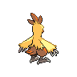

# pokemon/sprites/back/shiny/default-static

共 135 张，均按原来源路径识别；已备份不等于已接入游戏。编号为PokeAPI编号，不是业务数据库主键。

### 宝可梦API ID 252 · 背面 · 闪光 · 默认静态来源

- 文件：[pokemon-id-00252-back-shiny-default-static--ef864d99a40a.png](pokemon-id-00252-back-shiny-default-static--ef864d99a40a.png)
- 用途：背面闪光宝可梦图像；身份和变体来自PokeAPI路径，不作为原应用已经接入的证明。
- 尺寸：96 × 96，帧数：1
- SHA256：`ef864d99a40ade7091011faa7cc2b32f6c65f510c61c3d85af87d8116c45f0fd`
- 来源：[PokeAPI/sprites](https://raw.githubusercontent.com/PokeAPI/sprites/master/sprites/pokemon/back/shiny/252.png)；取得版本：`1dd55c0436d2a5b6e324c0b780e1b1b416fbfb64`

### 宝可梦API ID 253 · 背面 · 闪光 · 默认静态来源

- 文件：[pokemon-id-00253-back-shiny-default-static--03adb30c2cd4.png](pokemon-id-00253-back-shiny-default-static--03adb30c2cd4.png)
- 用途：背面闪光宝可梦图像；身份和变体来自PokeAPI路径，不作为原应用已经接入的证明。
- 尺寸：96 × 96，帧数：1
- SHA256：`03adb30c2cd42715044941a8b8ac623264306f9e63ffafd29658c0d13d49ee3f`
- 来源：[PokeAPI/sprites](https://raw.githubusercontent.com/PokeAPI/sprites/master/sprites/pokemon/back/shiny/253.png)；取得版本：`1dd55c0436d2a5b6e324c0b780e1b1b416fbfb64`

### 宝可梦API ID 254 · 背面 · 闪光 · 默认静态来源

- 文件：[pokemon-id-00254-back-shiny-default-static--24c2aedc9512.png](pokemon-id-00254-back-shiny-default-static--24c2aedc9512.png)
- 用途：背面闪光宝可梦图像；身份和变体来自PokeAPI路径，不作为原应用已经接入的证明。
- 尺寸：96 × 96，帧数：1
- SHA256：`24c2aedc95127c84843455bea0909f55737eac4e93853be1c9f6c0b8ccc6acb4`
- 来源：[PokeAPI/sprites](https://raw.githubusercontent.com/PokeAPI/sprites/master/sprites/pokemon/back/shiny/254.png)；取得版本：`1dd55c0436d2a5b6e324c0b780e1b1b416fbfb64`

### 宝可梦API ID 255 · 背面 · 闪光 · 默认静态来源

- 文件：[pokemon-id-00255-back-shiny-default-static--a773edfdeb7c.png](pokemon-id-00255-back-shiny-default-static--a773edfdeb7c.png)
- 用途：背面闪光宝可梦图像；身份和变体来自PokeAPI路径，不作为原应用已经接入的证明。
- 尺寸：96 × 96，帧数：1
- SHA256：`a773edfdeb7cfc9bd38a05322d3670bac5d2d98b867ea7eedcb886e003518cd8`
- 来源：[PokeAPI/sprites](https://raw.githubusercontent.com/PokeAPI/sprites/master/sprites/pokemon/back/shiny/255.png)；取得版本：`1dd55c0436d2a5b6e324c0b780e1b1b416fbfb64`

### 宝可梦API ID 256 · 背面 · 闪光 · 默认静态来源

- 文件：[pokemon-id-00256-back-shiny-default-static--dee6cc00651d.png](pokemon-id-00256-back-shiny-default-static--dee6cc00651d.png)
- 用途：背面闪光宝可梦图像；身份和变体来自PokeAPI路径，不作为原应用已经接入的证明。
- 尺寸：96 × 96，帧数：1
- SHA256：`dee6cc00651d40ea711b497209bad36a1b6f8dd30f43b38d618c9bafef511140`
- 来源：[PokeAPI/sprites](https://raw.githubusercontent.com/PokeAPI/sprites/master/sprites/pokemon/back/shiny/256.png)；取得版本：`1dd55c0436d2a5b6e324c0b780e1b1b416fbfb64`

### 宝可梦API ID 257 · 背面 · 闪光 · 默认静态来源

- 文件：[pokemon-id-00257-back-shiny-default-static--82482f516f18.png](pokemon-id-00257-back-shiny-default-static--82482f516f18.png)
- 用途：背面闪光宝可梦图像；身份和变体来自PokeAPI路径，不作为原应用已经接入的证明。
- 尺寸：96 × 96，帧数：1
- SHA256：`82482f516f1853cd79f9a3365d5ce9d537796a2795caca50ea58fed360575909`
- 来源：[PokeAPI/sprites](https://raw.githubusercontent.com/PokeAPI/sprites/master/sprites/pokemon/back/shiny/257.png)；取得版本：`1dd55c0436d2a5b6e324c0b780e1b1b416fbfb64`

### 宝可梦API ID 258 · 背面 · 闪光 · 默认静态来源

- 文件：[pokemon-id-00258-back-shiny-default-static--f8daabc110cd.png](pokemon-id-00258-back-shiny-default-static--f8daabc110cd.png)
- 用途：背面闪光宝可梦图像；身份和变体来自PokeAPI路径，不作为原应用已经接入的证明。
- 尺寸：96 × 96，帧数：1
- SHA256：`f8daabc110cd0438c96c69d3e74d3b73901ca3dfc6d819f3f1a19a44008ec7e5`
- 来源：[PokeAPI/sprites](https://raw.githubusercontent.com/PokeAPI/sprites/master/sprites/pokemon/back/shiny/258.png)；取得版本：`1dd55c0436d2a5b6e324c0b780e1b1b416fbfb64`

### 宝可梦API ID 259 · 背面 · 闪光 · 默认静态来源

- 文件：[pokemon-id-00259-back-shiny-default-static--3d300fefa269.png](pokemon-id-00259-back-shiny-default-static--3d300fefa269.png)
- 用途：背面闪光宝可梦图像；身份和变体来自PokeAPI路径，不作为原应用已经接入的证明。
- 尺寸：96 × 96，帧数：1
- SHA256：`3d300fefa2696b1122b34d7138f3d91bd91fc19a3f5922043f7592d6d0cd3db1`
- 来源：[PokeAPI/sprites](https://raw.githubusercontent.com/PokeAPI/sprites/master/sprites/pokemon/back/shiny/259.png)；取得版本：`1dd55c0436d2a5b6e324c0b780e1b1b416fbfb64`

### 宝可梦API ID 260 · 背面 · 闪光 · 默认静态来源

- 文件：[pokemon-id-00260-back-shiny-default-static--8e93a0b3d9f0.png](pokemon-id-00260-back-shiny-default-static--8e93a0b3d9f0.png)
- 用途：背面闪光宝可梦图像；身份和变体来自PokeAPI路径，不作为原应用已经接入的证明。
- 尺寸：96 × 96，帧数：1
- SHA256：`8e93a0b3d9f046fd311baaf8604d634e9298b7ac0b859163b526edb69d1e1672`
- 来源：[PokeAPI/sprites](https://raw.githubusercontent.com/PokeAPI/sprites/master/sprites/pokemon/back/shiny/260.png)；取得版本：`1dd55c0436d2a5b6e324c0b780e1b1b416fbfb64`

### 宝可梦API ID 261 · 背面 · 闪光 · 默认静态来源

- 文件：[pokemon-id-00261-back-shiny-default-static--b2ddea237c17.png](pokemon-id-00261-back-shiny-default-static--b2ddea237c17.png)
- 用途：背面闪光宝可梦图像；身份和变体来自PokeAPI路径，不作为原应用已经接入的证明。
- 尺寸：96 × 96，帧数：1
- SHA256：`b2ddea237c173927ecd27d0484c82337dd23675848a0bd7761d6a69d876020bc`
- 来源：[PokeAPI/sprites](https://raw.githubusercontent.com/PokeAPI/sprites/master/sprites/pokemon/back/shiny/261.png)；取得版本：`1dd55c0436d2a5b6e324c0b780e1b1b416fbfb64`

### 宝可梦API ID 262 · 背面 · 闪光 · 默认静态来源

- 文件：[pokemon-id-00262-back-shiny-default-static--1df06f54dffd.png](pokemon-id-00262-back-shiny-default-static--1df06f54dffd.png)
- 用途：背面闪光宝可梦图像；身份和变体来自PokeAPI路径，不作为原应用已经接入的证明。
- 尺寸：96 × 96，帧数：1
- SHA256：`1df06f54dffd6f70942b3a78f8513521a83b4082ff4270d72f784d6621d51b9e`
- 来源：[PokeAPI/sprites](https://raw.githubusercontent.com/PokeAPI/sprites/master/sprites/pokemon/back/shiny/262.png)；取得版本：`1dd55c0436d2a5b6e324c0b780e1b1b416fbfb64`

### 宝可梦API ID 263 · 背面 · 闪光 · 默认静态来源

- 文件：[pokemon-id-00263-back-shiny-default-static--1e3cbcf4b57b.png](pokemon-id-00263-back-shiny-default-static--1e3cbcf4b57b.png)
- 用途：背面闪光宝可梦图像；身份和变体来自PokeAPI路径，不作为原应用已经接入的证明。
- 尺寸：96 × 96，帧数：1
- SHA256：`1e3cbcf4b57b3150089cc4d935659b552002dc024257eaae08ec8fa48bfe3466`
- 来源：[PokeAPI/sprites](https://raw.githubusercontent.com/PokeAPI/sprites/master/sprites/pokemon/back/shiny/263.png)；取得版本：`1dd55c0436d2a5b6e324c0b780e1b1b416fbfb64`

### 宝可梦API ID 264 · 背面 · 闪光 · 默认静态来源

- 文件：[pokemon-id-00264-back-shiny-default-static--0ee5644ad8a0.png](pokemon-id-00264-back-shiny-default-static--0ee5644ad8a0.png)
- 用途：背面闪光宝可梦图像；身份和变体来自PokeAPI路径，不作为原应用已经接入的证明。
- 尺寸：96 × 96，帧数：1
- SHA256：`0ee5644ad8a01c888e2713d2d00d13a01cae41444012aacdcd1cba2b74dbed96`
- 来源：[PokeAPI/sprites](https://raw.githubusercontent.com/PokeAPI/sprites/master/sprites/pokemon/back/shiny/264.png)；取得版本：`1dd55c0436d2a5b6e324c0b780e1b1b416fbfb64`

### 宝可梦API ID 265 · 背面 · 闪光 · 默认静态来源

- 文件：[pokemon-id-00265-back-shiny-default-static--b2d801141fe6.png](pokemon-id-00265-back-shiny-default-static--b2d801141fe6.png)
- 用途：背面闪光宝可梦图像；身份和变体来自PokeAPI路径，不作为原应用已经接入的证明。
- 尺寸：96 × 96，帧数：1
- SHA256：`b2d801141fe646a4ce5fe02462e42dbcf910592e3ddcdbab7ebe99c0a326bd00`
- 来源：[PokeAPI/sprites](https://raw.githubusercontent.com/PokeAPI/sprites/master/sprites/pokemon/back/shiny/265.png)；取得版本：`1dd55c0436d2a5b6e324c0b780e1b1b416fbfb64`

### 宝可梦API ID 266 · 背面 · 闪光 · 默认静态来源

- 文件：[pokemon-id-00266-back-shiny-default-static--4f0d992bd296.png](pokemon-id-00266-back-shiny-default-static--4f0d992bd296.png)
- 用途：背面闪光宝可梦图像；身份和变体来自PokeAPI路径，不作为原应用已经接入的证明。
- 尺寸：96 × 96，帧数：1
- SHA256：`4f0d992bd296db214aebac930dae75efd276c8ceb85d77940d6d683e513416ef`
- 来源：[PokeAPI/sprites](https://raw.githubusercontent.com/PokeAPI/sprites/master/sprites/pokemon/back/shiny/266.png)；取得版本：`1dd55c0436d2a5b6e324c0b780e1b1b416fbfb64`

### 宝可梦API ID 267 · 背面 · 闪光 · 默认静态来源

- 文件：[pokemon-id-00267-back-shiny-default-static--471649aebba2.png](pokemon-id-00267-back-shiny-default-static--471649aebba2.png)
- 用途：背面闪光宝可梦图像；身份和变体来自PokeAPI路径，不作为原应用已经接入的证明。
- 尺寸：96 × 96，帧数：1
- SHA256：`471649aebba2a8d9ae8f8ac1043882a52c6ea76287396f628502a58c09e42197`
- 来源：[PokeAPI/sprites](https://raw.githubusercontent.com/PokeAPI/sprites/master/sprites/pokemon/back/shiny/267.png)；取得版本：`1dd55c0436d2a5b6e324c0b780e1b1b416fbfb64`

### 宝可梦API ID 268 · 背面 · 闪光 · 默认静态来源

- 文件：[pokemon-id-00268-back-shiny-default-static--820e28b1c2c3.png](pokemon-id-00268-back-shiny-default-static--820e28b1c2c3.png)
- 用途：背面闪光宝可梦图像；身份和变体来自PokeAPI路径，不作为原应用已经接入的证明。
- 尺寸：96 × 96，帧数：1
- SHA256：`820e28b1c2c39e8ba62b8fd6848a779abfeb3b73f507988867e4acd7fdbf643b`
- 来源：[PokeAPI/sprites](https://raw.githubusercontent.com/PokeAPI/sprites/master/sprites/pokemon/back/shiny/268.png)；取得版本：`1dd55c0436d2a5b6e324c0b780e1b1b416fbfb64`

### 宝可梦API ID 269 · 背面 · 闪光 · 默认静态来源

- 文件：[pokemon-id-00269-back-shiny-default-static--8c1ec0c8401f.png](pokemon-id-00269-back-shiny-default-static--8c1ec0c8401f.png)
- 用途：背面闪光宝可梦图像；身份和变体来自PokeAPI路径，不作为原应用已经接入的证明。
- 尺寸：96 × 96，帧数：1
- SHA256：`8c1ec0c8401f8842b5eba70ca1df998d9fb339c1314577c740cd9cbb1dadf00e`
- 来源：[PokeAPI/sprites](https://raw.githubusercontent.com/PokeAPI/sprites/master/sprites/pokemon/back/shiny/269.png)；取得版本：`1dd55c0436d2a5b6e324c0b780e1b1b416fbfb64`

### 宝可梦API ID 270 · 背面 · 闪光 · 默认静态来源

- 文件：[pokemon-id-00270-back-shiny-default-static--6606f1ebe07e.png](pokemon-id-00270-back-shiny-default-static--6606f1ebe07e.png)
- 用途：背面闪光宝可梦图像；身份和变体来自PokeAPI路径，不作为原应用已经接入的证明。
- 尺寸：96 × 96，帧数：1
- SHA256：`6606f1ebe07e3e2e04aaa1f82b78818c520435b51570a7c3a0beb6f10a2c99c8`
- 来源：[PokeAPI/sprites](https://raw.githubusercontent.com/PokeAPI/sprites/master/sprites/pokemon/back/shiny/270.png)；取得版本：`1dd55c0436d2a5b6e324c0b780e1b1b416fbfb64`

### 宝可梦API ID 271 · 背面 · 闪光 · 默认静态来源

- 文件：[pokemon-id-00271-back-shiny-default-static--737be44aec25.png](pokemon-id-00271-back-shiny-default-static--737be44aec25.png)
- 用途：背面闪光宝可梦图像；身份和变体来自PokeAPI路径，不作为原应用已经接入的证明。
- 尺寸：96 × 96，帧数：1
- SHA256：`737be44aec25429bf72cc84ef2ed28dfdd74f30d30b4faf5cc149ca73e65bf9d`
- 来源：[PokeAPI/sprites](https://raw.githubusercontent.com/PokeAPI/sprites/master/sprites/pokemon/back/shiny/271.png)；取得版本：`1dd55c0436d2a5b6e324c0b780e1b1b416fbfb64`

### 宝可梦API ID 272 · 背面 · 闪光 · 默认静态来源

- 文件：[pokemon-id-00272-back-shiny-default-static--cd04ecad1300.png](pokemon-id-00272-back-shiny-default-static--cd04ecad1300.png)
- 用途：背面闪光宝可梦图像；身份和变体来自PokeAPI路径，不作为原应用已经接入的证明。
- 尺寸：96 × 96，帧数：1
- SHA256：`cd04ecad13005a97aeb472449b67f2329fb9c2cdb407d93530b26aac1e50d8ce`
- 来源：[PokeAPI/sprites](https://raw.githubusercontent.com/PokeAPI/sprites/master/sprites/pokemon/back/shiny/272.png)；取得版本：`1dd55c0436d2a5b6e324c0b780e1b1b416fbfb64`

### 宝可梦API ID 273 · 背面 · 闪光 · 默认静态来源

- 文件：[pokemon-id-00273-back-shiny-default-static--1698a8b1343f.png](pokemon-id-00273-back-shiny-default-static--1698a8b1343f.png)
- 用途：背面闪光宝可梦图像；身份和变体来自PokeAPI路径，不作为原应用已经接入的证明。
- 尺寸：96 × 96，帧数：1
- SHA256：`1698a8b1343fe3b4a5edbccf60ceffaa8afc2bf164918cc872359aaab96ec8c0`
- 来源：[PokeAPI/sprites](https://raw.githubusercontent.com/PokeAPI/sprites/master/sprites/pokemon/back/shiny/273.png)；取得版本：`1dd55c0436d2a5b6e324c0b780e1b1b416fbfb64`

### 宝可梦API ID 274 · 背面 · 闪光 · 默认静态来源

- 文件：[pokemon-id-00274-back-shiny-default-static--719d44ff77e6.png](pokemon-id-00274-back-shiny-default-static--719d44ff77e6.png)
- 用途：背面闪光宝可梦图像；身份和变体来自PokeAPI路径，不作为原应用已经接入的证明。
- 尺寸：96 × 96，帧数：1
- SHA256：`719d44ff77e64d340cc57fbc6374fe644253bb2dbfdf213c851d495885e2fd0e`
- 来源：[PokeAPI/sprites](https://raw.githubusercontent.com/PokeAPI/sprites/master/sprites/pokemon/back/shiny/274.png)；取得版本：`1dd55c0436d2a5b6e324c0b780e1b1b416fbfb64`

### 宝可梦API ID 275 · 背面 · 闪光 · 默认静态来源

- 文件：[pokemon-id-00275-back-shiny-default-static--1f881ce362be.png](pokemon-id-00275-back-shiny-default-static--1f881ce362be.png)
- 用途：背面闪光宝可梦图像；身份和变体来自PokeAPI路径，不作为原应用已经接入的证明。
- 尺寸：96 × 96，帧数：1
- SHA256：`1f881ce362beb015a475e2549e8ca8874e06711ff027a58aacbbb43a8eb10f65`
- 来源：[PokeAPI/sprites](https://raw.githubusercontent.com/PokeAPI/sprites/master/sprites/pokemon/back/shiny/275.png)；取得版本：`1dd55c0436d2a5b6e324c0b780e1b1b416fbfb64`

### 宝可梦API ID 276 · 背面 · 闪光 · 默认静态来源

- 文件：[pokemon-id-00276-back-shiny-default-static--d3a18633f697.png](pokemon-id-00276-back-shiny-default-static--d3a18633f697.png)
- 用途：背面闪光宝可梦图像；身份和变体来自PokeAPI路径，不作为原应用已经接入的证明。
- 尺寸：96 × 96，帧数：1
- SHA256：`d3a18633f6976aed2ad4fa03eefa798b938ea6ce4964a63cf81bdf0b9f5770b3`
- 来源：[PokeAPI/sprites](https://raw.githubusercontent.com/PokeAPI/sprites/master/sprites/pokemon/back/shiny/276.png)；取得版本：`1dd55c0436d2a5b6e324c0b780e1b1b416fbfb64`

### 宝可梦API ID 277 · 背面 · 闪光 · 默认静态来源

- 文件：[pokemon-id-00277-back-shiny-default-static--e97297dc3f18.png](pokemon-id-00277-back-shiny-default-static--e97297dc3f18.png)
- 用途：背面闪光宝可梦图像；身份和变体来自PokeAPI路径，不作为原应用已经接入的证明。
- 尺寸：96 × 96，帧数：1
- SHA256：`e97297dc3f1805798b7d47d6b5bbb42dc06d9706fd3d1a816f431e69cc5ef776`
- 来源：[PokeAPI/sprites](https://raw.githubusercontent.com/PokeAPI/sprites/master/sprites/pokemon/back/shiny/277.png)；取得版本：`1dd55c0436d2a5b6e324c0b780e1b1b416fbfb64`

### 宝可梦API ID 278 · 背面 · 闪光 · 默认静态来源

- 文件：[pokemon-id-00278-back-shiny-default-static--b199cd7818a9.png](pokemon-id-00278-back-shiny-default-static--b199cd7818a9.png)
- 用途：背面闪光宝可梦图像；身份和变体来自PokeAPI路径，不作为原应用已经接入的证明。
- 尺寸：96 × 96，帧数：1
- SHA256：`b199cd7818a90e2dbd6a23f9fd28fa377899a88a2a46bae5efa56f5aca82883a`
- 来源：[PokeAPI/sprites](https://raw.githubusercontent.com/PokeAPI/sprites/master/sprites/pokemon/back/shiny/278.png)；取得版本：`1dd55c0436d2a5b6e324c0b780e1b1b416fbfb64`

### 宝可梦API ID 279 · 背面 · 闪光 · 默认静态来源

- 文件：[pokemon-id-00279-back-shiny-default-static--3f04d20e11b0.png](pokemon-id-00279-back-shiny-default-static--3f04d20e11b0.png)
- 用途：背面闪光宝可梦图像；身份和变体来自PokeAPI路径，不作为原应用已经接入的证明。
- 尺寸：96 × 96，帧数：1
- SHA256：`3f04d20e11b0bde6bdb3e7ffb5f1e5defdd04331547d9ae377951dbc6b7fd458`
- 来源：[PokeAPI/sprites](https://raw.githubusercontent.com/PokeAPI/sprites/master/sprites/pokemon/back/shiny/279.png)；取得版本：`1dd55c0436d2a5b6e324c0b780e1b1b416fbfb64`

### 宝可梦API ID 280 · 背面 · 闪光 · 默认静态来源

- 文件：[pokemon-id-00280-back-shiny-default-static--d35670da9ffd.png](pokemon-id-00280-back-shiny-default-static--d35670da9ffd.png)
- 用途：背面闪光宝可梦图像；身份和变体来自PokeAPI路径，不作为原应用已经接入的证明。
- 尺寸：96 × 96，帧数：1
- SHA256：`d35670da9ffd723be295ceab05697842a22b5c01454908bd33c285dffcff7e3d`
- 来源：[PokeAPI/sprites](https://raw.githubusercontent.com/PokeAPI/sprites/master/sprites/pokemon/back/shiny/280.png)；取得版本：`1dd55c0436d2a5b6e324c0b780e1b1b416fbfb64`

### 宝可梦API ID 281 · 背面 · 闪光 · 默认静态来源

- 文件：[pokemon-id-00281-back-shiny-default-static--5beb63ca40ad.png](pokemon-id-00281-back-shiny-default-static--5beb63ca40ad.png)
- 用途：背面闪光宝可梦图像；身份和变体来自PokeAPI路径，不作为原应用已经接入的证明。
- 尺寸：96 × 96，帧数：1
- SHA256：`5beb63ca40ad7b05d958127d1b982d83cb5bf023f12a48909d9c3bcdf26aa4fb`
- 来源：[PokeAPI/sprites](https://raw.githubusercontent.com/PokeAPI/sprites/master/sprites/pokemon/back/shiny/281.png)；取得版本：`1dd55c0436d2a5b6e324c0b780e1b1b416fbfb64`

### 宝可梦API ID 282 · 背面 · 闪光 · 默认静态来源

- 文件：[pokemon-id-00282-back-shiny-default-static--51828f4fddfa.png](pokemon-id-00282-back-shiny-default-static--51828f4fddfa.png)
- 用途：背面闪光宝可梦图像；身份和变体来自PokeAPI路径，不作为原应用已经接入的证明。
- 尺寸：96 × 96，帧数：1
- SHA256：`51828f4fddfa8785c1e2519a3cd8a59716daec97a0b7cde7b6affac2d2ee3c87`
- 来源：[PokeAPI/sprites](https://raw.githubusercontent.com/PokeAPI/sprites/master/sprites/pokemon/back/shiny/282.png)；取得版本：`1dd55c0436d2a5b6e324c0b780e1b1b416fbfb64`

### 宝可梦API ID 283 · 背面 · 闪光 · 默认静态来源

- 文件：[pokemon-id-00283-back-shiny-default-static--027680f4edc7.png](pokemon-id-00283-back-shiny-default-static--027680f4edc7.png)
- 用途：背面闪光宝可梦图像；身份和变体来自PokeAPI路径，不作为原应用已经接入的证明。
- 尺寸：96 × 96，帧数：1
- SHA256：`027680f4edc781c71f5ec93ada12970262d744268088fd520ee4ea1255c4dd34`
- 来源：[PokeAPI/sprites](https://raw.githubusercontent.com/PokeAPI/sprites/master/sprites/pokemon/back/shiny/283.png)；取得版本：`1dd55c0436d2a5b6e324c0b780e1b1b416fbfb64`

### 宝可梦API ID 284 · 背面 · 闪光 · 默认静态来源

- 文件：[pokemon-id-00284-back-shiny-default-static--320e59ce10e7.png](pokemon-id-00284-back-shiny-default-static--320e59ce10e7.png)
- 用途：背面闪光宝可梦图像；身份和变体来自PokeAPI路径，不作为原应用已经接入的证明。
- 尺寸：96 × 96，帧数：1
- SHA256：`320e59ce10e7cdeae5c7c088bad8c9c4d6769bf837f3f9e2641959414dd79a46`
- 来源：[PokeAPI/sprites](https://raw.githubusercontent.com/PokeAPI/sprites/master/sprites/pokemon/back/shiny/284.png)；取得版本：`1dd55c0436d2a5b6e324c0b780e1b1b416fbfb64`

### 宝可梦API ID 285 · 背面 · 闪光 · 默认静态来源

- 文件：[pokemon-id-00285-back-shiny-default-static--4b943a4abf2d.png](pokemon-id-00285-back-shiny-default-static--4b943a4abf2d.png)
- 用途：背面闪光宝可梦图像；身份和变体来自PokeAPI路径，不作为原应用已经接入的证明。
- 尺寸：96 × 96，帧数：1
- SHA256：`4b943a4abf2d24eb2f8215ca4b7f76ff8ef51f138e14f0aaf40403e1edbe017d`
- 来源：[PokeAPI/sprites](https://raw.githubusercontent.com/PokeAPI/sprites/master/sprites/pokemon/back/shiny/285.png)；取得版本：`1dd55c0436d2a5b6e324c0b780e1b1b416fbfb64`

### 宝可梦API ID 286 · 背面 · 闪光 · 默认静态来源

- 文件：[pokemon-id-00286-back-shiny-default-static--c43c5fb6aafe.png](pokemon-id-00286-back-shiny-default-static--c43c5fb6aafe.png)
- 用途：背面闪光宝可梦图像；身份和变体来自PokeAPI路径，不作为原应用已经接入的证明。
- 尺寸：96 × 96，帧数：1
- SHA256：`c43c5fb6aafeef10be6800dbbc14c5f4ca4e728f2f0abf7d69728e9e12c867a4`
- 来源：[PokeAPI/sprites](https://raw.githubusercontent.com/PokeAPI/sprites/master/sprites/pokemon/back/shiny/286.png)；取得版本：`1dd55c0436d2a5b6e324c0b780e1b1b416fbfb64`

### 宝可梦API ID 287 · 背面 · 闪光 · 默认静态来源

- 文件：[pokemon-id-00287-back-shiny-default-static--09c149a0ee55.png](pokemon-id-00287-back-shiny-default-static--09c149a0ee55.png)
- 用途：背面闪光宝可梦图像；身份和变体来自PokeAPI路径，不作为原应用已经接入的证明。
- 尺寸：96 × 96，帧数：1
- SHA256：`09c149a0ee554b4381ab5c44345f5c2e691520bb4c99836eeea571c349f5591a`
- 来源：[PokeAPI/sprites](https://raw.githubusercontent.com/PokeAPI/sprites/master/sprites/pokemon/back/shiny/287.png)；取得版本：`1dd55c0436d2a5b6e324c0b780e1b1b416fbfb64`

### 宝可梦API ID 288 · 背面 · 闪光 · 默认静态来源

- 文件：[pokemon-id-00288-back-shiny-default-static--83a5022e52d7.png](pokemon-id-00288-back-shiny-default-static--83a5022e52d7.png)
- 用途：背面闪光宝可梦图像；身份和变体来自PokeAPI路径，不作为原应用已经接入的证明。
- 尺寸：96 × 96，帧数：1
- SHA256：`83a5022e52d7f789356ec9070dccfe4a0f47d1ff06ad80d88bb0d375554b7634`
- 来源：[PokeAPI/sprites](https://raw.githubusercontent.com/PokeAPI/sprites/master/sprites/pokemon/back/shiny/288.png)；取得版本：`1dd55c0436d2a5b6e324c0b780e1b1b416fbfb64`

### 宝可梦API ID 289 · 背面 · 闪光 · 默认静态来源

- 文件：[pokemon-id-00289-back-shiny-default-static--9aae692f3ecd.png](pokemon-id-00289-back-shiny-default-static--9aae692f3ecd.png)
- 用途：背面闪光宝可梦图像；身份和变体来自PokeAPI路径，不作为原应用已经接入的证明。
- 尺寸：96 × 96，帧数：1
- SHA256：`9aae692f3ecd0898c8c8af5b004ebb10ce4e3a81400c40a0160b977c2416a450`
- 来源：[PokeAPI/sprites](https://raw.githubusercontent.com/PokeAPI/sprites/master/sprites/pokemon/back/shiny/289.png)；取得版本：`1dd55c0436d2a5b6e324c0b780e1b1b416fbfb64`

### 宝可梦API ID 290 · 背面 · 闪光 · 默认静态来源

- 文件：[pokemon-id-00290-back-shiny-default-static--96c336f89d36.png](pokemon-id-00290-back-shiny-default-static--96c336f89d36.png)
- 用途：背面闪光宝可梦图像；身份和变体来自PokeAPI路径，不作为原应用已经接入的证明。
- 尺寸：96 × 96，帧数：1
- SHA256：`96c336f89d365146ebe377bea4f938877fd86baafd5e47a1f813d4826da3ddf9`
- 来源：[PokeAPI/sprites](https://raw.githubusercontent.com/PokeAPI/sprites/master/sprites/pokemon/back/shiny/290.png)；取得版本：`1dd55c0436d2a5b6e324c0b780e1b1b416fbfb64`

### 宝可梦API ID 291 · 背面 · 闪光 · 默认静态来源

- 文件：[pokemon-id-00291-back-shiny-default-static--cb23d81cc976.png](pokemon-id-00291-back-shiny-default-static--cb23d81cc976.png)
- 用途：背面闪光宝可梦图像；身份和变体来自PokeAPI路径，不作为原应用已经接入的证明。
- 尺寸：96 × 96，帧数：1
- SHA256：`cb23d81cc9765d8ded7d8adb2c38928e5b8d401d9ed839c6008ebf302d6e6555`
- 来源：[PokeAPI/sprites](https://raw.githubusercontent.com/PokeAPI/sprites/master/sprites/pokemon/back/shiny/291.png)；取得版本：`1dd55c0436d2a5b6e324c0b780e1b1b416fbfb64`

### 宝可梦API ID 292 · 背面 · 闪光 · 默认静态来源

- 文件：[pokemon-id-00292-back-shiny-default-static--ab85eb9aba04.png](pokemon-id-00292-back-shiny-default-static--ab85eb9aba04.png)
- 用途：背面闪光宝可梦图像；身份和变体来自PokeAPI路径，不作为原应用已经接入的证明。
- 尺寸：96 × 96，帧数：1
- SHA256：`ab85eb9aba046d4839d3c55895e6720a49be880f6a2359bc59eeb4d055ad65d3`
- 来源：[PokeAPI/sprites](https://raw.githubusercontent.com/PokeAPI/sprites/master/sprites/pokemon/back/shiny/292.png)；取得版本：`1dd55c0436d2a5b6e324c0b780e1b1b416fbfb64`

### 宝可梦API ID 293 · 背面 · 闪光 · 默认静态来源

- 文件：[pokemon-id-00293-back-shiny-default-static--ecdc1644a944.png](pokemon-id-00293-back-shiny-default-static--ecdc1644a944.png)
- 用途：背面闪光宝可梦图像；身份和变体来自PokeAPI路径，不作为原应用已经接入的证明。
- 尺寸：96 × 96，帧数：1
- SHA256：`ecdc1644a9446438ad74dc1c13a7d7c3edcf3209ef676de5dc269ea34e49fdcb`
- 来源：[PokeAPI/sprites](https://raw.githubusercontent.com/PokeAPI/sprites/master/sprites/pokemon/back/shiny/293.png)；取得版本：`1dd55c0436d2a5b6e324c0b780e1b1b416fbfb64`

### 宝可梦API ID 294 · 背面 · 闪光 · 默认静态来源

- 文件：[pokemon-id-00294-back-shiny-default-static--69f66f006e97.png](pokemon-id-00294-back-shiny-default-static--69f66f006e97.png)
- 用途：背面闪光宝可梦图像；身份和变体来自PokeAPI路径，不作为原应用已经接入的证明。
- 尺寸：96 × 96，帧数：1
- SHA256：`69f66f006e97508bbf45d6ec8cee4c6f2d29edd4c9c8c69b24a8abcc5d7eeb37`
- 来源：[PokeAPI/sprites](https://raw.githubusercontent.com/PokeAPI/sprites/master/sprites/pokemon/back/shiny/294.png)；取得版本：`1dd55c0436d2a5b6e324c0b780e1b1b416fbfb64`

### 宝可梦API ID 295 · 背面 · 闪光 · 默认静态来源

- 文件：[pokemon-id-00295-back-shiny-default-static--451121ae8437.png](pokemon-id-00295-back-shiny-default-static--451121ae8437.png)
- 用途：背面闪光宝可梦图像；身份和变体来自PokeAPI路径，不作为原应用已经接入的证明。
- 尺寸：96 × 96，帧数：1
- SHA256：`451121ae84376265b0a0041dce54bbede54a7089fe4854cadb42de06d8d0fd52`
- 来源：[PokeAPI/sprites](https://raw.githubusercontent.com/PokeAPI/sprites/master/sprites/pokemon/back/shiny/295.png)；取得版本：`1dd55c0436d2a5b6e324c0b780e1b1b416fbfb64`

### 宝可梦API ID 296 · 背面 · 闪光 · 默认静态来源

- 文件：[pokemon-id-00296-back-shiny-default-static--18347652fc21.png](pokemon-id-00296-back-shiny-default-static--18347652fc21.png)
- 用途：背面闪光宝可梦图像；身份和变体来自PokeAPI路径，不作为原应用已经接入的证明。
- 尺寸：96 × 96，帧数：1
- SHA256：`18347652fc21dbc65642f7ec4c0bd504cb6cbcb7d99af46f08cb11a83b9379c9`
- 来源：[PokeAPI/sprites](https://raw.githubusercontent.com/PokeAPI/sprites/master/sprites/pokemon/back/shiny/296.png)；取得版本：`1dd55c0436d2a5b6e324c0b780e1b1b416fbfb64`

### 宝可梦API ID 297 · 背面 · 闪光 · 默认静态来源

- 文件：[pokemon-id-00297-back-shiny-default-static--bf4aedb57ef4.png](pokemon-id-00297-back-shiny-default-static--bf4aedb57ef4.png)
- 用途：背面闪光宝可梦图像；身份和变体来自PokeAPI路径，不作为原应用已经接入的证明。
- 尺寸：96 × 96，帧数：1
- SHA256：`bf4aedb57ef40fbc2724759c45dd0fbfe376a3e4116c22caa787ed8ddbbd2aea`
- 来源：[PokeAPI/sprites](https://raw.githubusercontent.com/PokeAPI/sprites/master/sprites/pokemon/back/shiny/297.png)；取得版本：`1dd55c0436d2a5b6e324c0b780e1b1b416fbfb64`

### 宝可梦API ID 298 · 背面 · 闪光 · 默认静态来源

- 文件：[pokemon-id-00298-back-shiny-default-static--742fa9c50178.png](pokemon-id-00298-back-shiny-default-static--742fa9c50178.png)
- 用途：背面闪光宝可梦图像；身份和变体来自PokeAPI路径，不作为原应用已经接入的证明。
- 尺寸：96 × 96，帧数：1
- SHA256：`742fa9c501783652774dafeea7f0d8a49ddbee42b6cda7f4fac66d2bfc10cb64`
- 来源：[PokeAPI/sprites](https://raw.githubusercontent.com/PokeAPI/sprites/master/sprites/pokemon/back/shiny/298.png)；取得版本：`1dd55c0436d2a5b6e324c0b780e1b1b416fbfb64`

### 宝可梦API ID 299 · 背面 · 闪光 · 默认静态来源

- 文件：[pokemon-id-00299-back-shiny-default-static--97182786be96.png](pokemon-id-00299-back-shiny-default-static--97182786be96.png)
- 用途：背面闪光宝可梦图像；身份和变体来自PokeAPI路径，不作为原应用已经接入的证明。
- 尺寸：96 × 96，帧数：1
- SHA256：`97182786be96ecd45d19b68398da08ffbaaaea0594100b47982c7ff23d25e93d`
- 来源：[PokeAPI/sprites](https://raw.githubusercontent.com/PokeAPI/sprites/master/sprites/pokemon/back/shiny/299.png)；取得版本：`1dd55c0436d2a5b6e324c0b780e1b1b416fbfb64`

### 宝可梦API ID 300 · 背面 · 闪光 · 默认静态来源

- 文件：[pokemon-id-00300-back-shiny-default-static--a9da5edc5a5f.png](pokemon-id-00300-back-shiny-default-static--a9da5edc5a5f.png)
- 用途：背面闪光宝可梦图像；身份和变体来自PokeAPI路径，不作为原应用已经接入的证明。
- 尺寸：96 × 96，帧数：1
- SHA256：`a9da5edc5a5fa0c0cc29eb7e7051a7f723928d52df4c57d9694644531c6d7295`
- 来源：[PokeAPI/sprites](https://raw.githubusercontent.com/PokeAPI/sprites/master/sprites/pokemon/back/shiny/300.png)；取得版本：`1dd55c0436d2a5b6e324c0b780e1b1b416fbfb64`

### 宝可梦API ID 301 · 背面 · 闪光 · 默认静态来源

- 文件：[pokemon-id-00301-back-shiny-default-static--27458e40e933.png](pokemon-id-00301-back-shiny-default-static--27458e40e933.png)
- 用途：背面闪光宝可梦图像；身份和变体来自PokeAPI路径，不作为原应用已经接入的证明。
- 尺寸：96 × 96，帧数：1
- SHA256：`27458e40e9335a822f745523c872459d014e352ab1982565f790a2bed574b0aa`
- 来源：[PokeAPI/sprites](https://raw.githubusercontent.com/PokeAPI/sprites/master/sprites/pokemon/back/shiny/301.png)；取得版本：`1dd55c0436d2a5b6e324c0b780e1b1b416fbfb64`

### 宝可梦API ID 302 · 背面 · 闪光 · 默认静态来源

- 文件：[pokemon-id-00302-back-shiny-default-static--32d2874f74e5.png](pokemon-id-00302-back-shiny-default-static--32d2874f74e5.png)
- 用途：背面闪光宝可梦图像；身份和变体来自PokeAPI路径，不作为原应用已经接入的证明。
- 尺寸：96 × 96，帧数：1
- SHA256：`32d2874f74e5a72d8ac39f91982385c80e832197714868fa8913133d5bb5c3f4`
- 来源：[PokeAPI/sprites](https://raw.githubusercontent.com/PokeAPI/sprites/master/sprites/pokemon/back/shiny/302.png)；取得版本：`1dd55c0436d2a5b6e324c0b780e1b1b416fbfb64`

### 宝可梦API ID 303 · 背面 · 闪光 · 默认静态来源

- 文件：[pokemon-id-00303-back-shiny-default-static--46d27eddb0fc.png](pokemon-id-00303-back-shiny-default-static--46d27eddb0fc.png)
- 用途：背面闪光宝可梦图像；身份和变体来自PokeAPI路径，不作为原应用已经接入的证明。
- 尺寸：96 × 96，帧数：1
- SHA256：`46d27eddb0fcad915929115ccc4f6d241824a6e73863415e06cfc101b6eb4d6e`
- 来源：[PokeAPI/sprites](https://raw.githubusercontent.com/PokeAPI/sprites/master/sprites/pokemon/back/shiny/303.png)；取得版本：`1dd55c0436d2a5b6e324c0b780e1b1b416fbfb64`

### 宝可梦API ID 304 · 背面 · 闪光 · 默认静态来源

- 文件：[pokemon-id-00304-back-shiny-default-static--b3ec9cae5303.png](pokemon-id-00304-back-shiny-default-static--b3ec9cae5303.png)
- 用途：背面闪光宝可梦图像；身份和变体来自PokeAPI路径，不作为原应用已经接入的证明。
- 尺寸：96 × 96，帧数：1
- SHA256：`b3ec9cae53037350c35bd04a05b5c832309867dd1b6f9ce3b42bdfa8d79601ad`
- 来源：[PokeAPI/sprites](https://raw.githubusercontent.com/PokeAPI/sprites/master/sprites/pokemon/back/shiny/304.png)；取得版本：`1dd55c0436d2a5b6e324c0b780e1b1b416fbfb64`

### 宝可梦API ID 305 · 背面 · 闪光 · 默认静态来源

- 文件：[pokemon-id-00305-back-shiny-default-static--4e8713b9038c.png](pokemon-id-00305-back-shiny-default-static--4e8713b9038c.png)
- 用途：背面闪光宝可梦图像；身份和变体来自PokeAPI路径，不作为原应用已经接入的证明。
- 尺寸：96 × 96，帧数：1
- SHA256：`4e8713b9038c0a95d2f7de2d4d0529f662cc1bfd9f12eb3fb4c5126fc385fc9a`
- 来源：[PokeAPI/sprites](https://raw.githubusercontent.com/PokeAPI/sprites/master/sprites/pokemon/back/shiny/305.png)；取得版本：`1dd55c0436d2a5b6e324c0b780e1b1b416fbfb64`

### 宝可梦API ID 306 · 背面 · 闪光 · 默认静态来源

- 文件：[pokemon-id-00306-back-shiny-default-static--10e6659fb6e8.png](pokemon-id-00306-back-shiny-default-static--10e6659fb6e8.png)
- 用途：背面闪光宝可梦图像；身份和变体来自PokeAPI路径，不作为原应用已经接入的证明。
- 尺寸：96 × 96，帧数：1
- SHA256：`10e6659fb6e8a353b159e556f24f935ab620401da42a9a8e35b979ea04bf688a`
- 来源：[PokeAPI/sprites](https://raw.githubusercontent.com/PokeAPI/sprites/master/sprites/pokemon/back/shiny/306.png)；取得版本：`1dd55c0436d2a5b6e324c0b780e1b1b416fbfb64`

### 宝可梦API ID 307 · 背面 · 闪光 · 默认静态来源

- 文件：[pokemon-id-00307-back-shiny-default-static--6b380126f5ff.png](pokemon-id-00307-back-shiny-default-static--6b380126f5ff.png)
- 用途：背面闪光宝可梦图像；身份和变体来自PokeAPI路径，不作为原应用已经接入的证明。
- 尺寸：96 × 96，帧数：1
- SHA256：`6b380126f5ffc01a04d2625833436fa9ebc2b6992c8a6645e39ef78655248fc0`
- 来源：[PokeAPI/sprites](https://raw.githubusercontent.com/PokeAPI/sprites/master/sprites/pokemon/back/shiny/307.png)；取得版本：`1dd55c0436d2a5b6e324c0b780e1b1b416fbfb64`

### 宝可梦API ID 308 · 背面 · 闪光 · 默认静态来源

- 文件：[pokemon-id-00308-back-shiny-default-static--c740257c568d.png](pokemon-id-00308-back-shiny-default-static--c740257c568d.png)
- 用途：背面闪光宝可梦图像；身份和变体来自PokeAPI路径，不作为原应用已经接入的证明。
- 尺寸：96 × 96，帧数：1
- SHA256：`c740257c568da417ca0c719a4cb97b56e512f90c649026ce86d0f137650bc381`
- 来源：[PokeAPI/sprites](https://raw.githubusercontent.com/PokeAPI/sprites/master/sprites/pokemon/back/shiny/308.png)；取得版本：`1dd55c0436d2a5b6e324c0b780e1b1b416fbfb64`

### 宝可梦API ID 309 · 背面 · 闪光 · 默认静态来源

- 文件：[pokemon-id-00309-back-shiny-default-static--337118b9a4b0.png](pokemon-id-00309-back-shiny-default-static--337118b9a4b0.png)
- 用途：背面闪光宝可梦图像；身份和变体来自PokeAPI路径，不作为原应用已经接入的证明。
- 尺寸：96 × 96，帧数：1
- SHA256：`337118b9a4b0365a0dd07ab9383999e2ce0d6b553d9a7c3cb2917e9e07bbb0ef`
- 来源：[PokeAPI/sprites](https://raw.githubusercontent.com/PokeAPI/sprites/master/sprites/pokemon/back/shiny/309.png)；取得版本：`1dd55c0436d2a5b6e324c0b780e1b1b416fbfb64`

### 宝可梦API ID 310 · 背面 · 闪光 · 默认静态来源

- 文件：[pokemon-id-00310-back-shiny-default-static--36354f291927.png](pokemon-id-00310-back-shiny-default-static--36354f291927.png)
- 用途：背面闪光宝可梦图像；身份和变体来自PokeAPI路径，不作为原应用已经接入的证明。
- 尺寸：96 × 96，帧数：1
- SHA256：`36354f291927f9c18a8ade3ecdae9d44ec0ea8bbf2b6fb2b3c6a36090095319c`
- 来源：[PokeAPI/sprites](https://raw.githubusercontent.com/PokeAPI/sprites/master/sprites/pokemon/back/shiny/310.png)；取得版本：`1dd55c0436d2a5b6e324c0b780e1b1b416fbfb64`

### 宝可梦API ID 311 · 背面 · 闪光 · 默认静态来源

- 文件：[pokemon-id-00311-back-shiny-default-static--20a0837ff168.png](pokemon-id-00311-back-shiny-default-static--20a0837ff168.png)
- 用途：背面闪光宝可梦图像；身份和变体来自PokeAPI路径，不作为原应用已经接入的证明。
- 尺寸：96 × 96，帧数：1
- SHA256：`20a0837ff1682e7ab2e5053358c6e0f8902954da2746e1a2dfe1ed2a337820d2`
- 来源：[PokeAPI/sprites](https://raw.githubusercontent.com/PokeAPI/sprites/master/sprites/pokemon/back/shiny/311.png)；取得版本：`1dd55c0436d2a5b6e324c0b780e1b1b416fbfb64`

### 宝可梦API ID 312 · 背面 · 闪光 · 默认静态来源

- 文件：[pokemon-id-00312-back-shiny-default-static--56ad3ba1dffc.png](pokemon-id-00312-back-shiny-default-static--56ad3ba1dffc.png)
- 用途：背面闪光宝可梦图像；身份和变体来自PokeAPI路径，不作为原应用已经接入的证明。
- 尺寸：96 × 96，帧数：1
- SHA256：`56ad3ba1dffce81f59d02fb364018249548fdb9048a0db642cf70f43a623e809`
- 来源：[PokeAPI/sprites](https://raw.githubusercontent.com/PokeAPI/sprites/master/sprites/pokemon/back/shiny/312.png)；取得版本：`1dd55c0436d2a5b6e324c0b780e1b1b416fbfb64`

### 宝可梦API ID 313 · 背面 · 闪光 · 默认静态来源

- 文件：[pokemon-id-00313-back-shiny-default-static--e33aae6d5feb.png](pokemon-id-00313-back-shiny-default-static--e33aae6d5feb.png)
- 用途：背面闪光宝可梦图像；身份和变体来自PokeAPI路径，不作为原应用已经接入的证明。
- 尺寸：96 × 96，帧数：1
- SHA256：`e33aae6d5febbd231385faf12ff679b6fcca3787e21e2f5857379d4a653cde09`
- 来源：[PokeAPI/sprites](https://raw.githubusercontent.com/PokeAPI/sprites/master/sprites/pokemon/back/shiny/313.png)；取得版本：`1dd55c0436d2a5b6e324c0b780e1b1b416fbfb64`

### 宝可梦API ID 314 · 背面 · 闪光 · 默认静态来源

- 文件：[pokemon-id-00314-back-shiny-default-static--606a469e9d35.png](pokemon-id-00314-back-shiny-default-static--606a469e9d35.png)
- 用途：背面闪光宝可梦图像；身份和变体来自PokeAPI路径，不作为原应用已经接入的证明。
- 尺寸：96 × 96，帧数：1
- SHA256：`606a469e9d35feea1a533f8df118b62692061d330bb46b41b139a6ee2b6a3584`
- 来源：[PokeAPI/sprites](https://raw.githubusercontent.com/PokeAPI/sprites/master/sprites/pokemon/back/shiny/314.png)；取得版本：`1dd55c0436d2a5b6e324c0b780e1b1b416fbfb64`

### 宝可梦API ID 315 · 背面 · 闪光 · 默认静态来源

- 文件：[pokemon-id-00315-back-shiny-default-static--c0e705fb4139.png](pokemon-id-00315-back-shiny-default-static--c0e705fb4139.png)
- 用途：背面闪光宝可梦图像；身份和变体来自PokeAPI路径，不作为原应用已经接入的证明。
- 尺寸：96 × 96，帧数：1
- SHA256：`c0e705fb41392b5adaa362fa3898ac6e9300edc2796140a5d9df11d0b15b4026`
- 来源：[PokeAPI/sprites](https://raw.githubusercontent.com/PokeAPI/sprites/master/sprites/pokemon/back/shiny/315.png)；取得版本：`1dd55c0436d2a5b6e324c0b780e1b1b416fbfb64`

### 宝可梦API ID 316 · 背面 · 闪光 · 默认静态来源

- 文件：[pokemon-id-00316-back-shiny-default-static--5ca0e769badb.png](pokemon-id-00316-back-shiny-default-static--5ca0e769badb.png)
- 用途：背面闪光宝可梦图像；身份和变体来自PokeAPI路径，不作为原应用已经接入的证明。
- 尺寸：96 × 96，帧数：1
- SHA256：`5ca0e769badb796524238145b09e8e93644b59c2e84d9fd1d05875e4a77d5c8c`
- 来源：[PokeAPI/sprites](https://raw.githubusercontent.com/PokeAPI/sprites/master/sprites/pokemon/back/shiny/316.png)；取得版本：`1dd55c0436d2a5b6e324c0b780e1b1b416fbfb64`

### 宝可梦API ID 317 · 背面 · 闪光 · 默认静态来源

- 文件：[pokemon-id-00317-back-shiny-default-static--5646d478557c.png](pokemon-id-00317-back-shiny-default-static--5646d478557c.png)
- 用途：背面闪光宝可梦图像；身份和变体来自PokeAPI路径，不作为原应用已经接入的证明。
- 尺寸：96 × 96，帧数：1
- SHA256：`5646d478557c84846ec28461cba12fca8cf169e59d059974bb0f3321f81de928`
- 来源：[PokeAPI/sprites](https://raw.githubusercontent.com/PokeAPI/sprites/master/sprites/pokemon/back/shiny/317.png)；取得版本：`1dd55c0436d2a5b6e324c0b780e1b1b416fbfb64`

### 宝可梦API ID 318 · 背面 · 闪光 · 默认静态来源

- 文件：[pokemon-id-00318-back-shiny-default-static--fdf620a8cae5.png](pokemon-id-00318-back-shiny-default-static--fdf620a8cae5.png)
- 用途：背面闪光宝可梦图像；身份和变体来自PokeAPI路径，不作为原应用已经接入的证明。
- 尺寸：96 × 96，帧数：1
- SHA256：`fdf620a8cae5346d17cc7337820efa60969d73eab71129b63ab9e968575c9c02`
- 来源：[PokeAPI/sprites](https://raw.githubusercontent.com/PokeAPI/sprites/master/sprites/pokemon/back/shiny/318.png)；取得版本：`1dd55c0436d2a5b6e324c0b780e1b1b416fbfb64`

### 宝可梦API ID 319 · 背面 · 闪光 · 默认静态来源

- 文件：[pokemon-id-00319-back-shiny-default-static--d9a08748c65a.png](pokemon-id-00319-back-shiny-default-static--d9a08748c65a.png)
- 用途：背面闪光宝可梦图像；身份和变体来自PokeAPI路径，不作为原应用已经接入的证明。
- 尺寸：96 × 96，帧数：1
- SHA256：`d9a08748c65a8be7f3e5dc13481b4f630760c809d20e9eee4131bab8ff6572c5`
- 来源：[PokeAPI/sprites](https://raw.githubusercontent.com/PokeAPI/sprites/master/sprites/pokemon/back/shiny/319.png)；取得版本：`1dd55c0436d2a5b6e324c0b780e1b1b416fbfb64`

### 宝可梦API ID 320 · 背面 · 闪光 · 默认静态来源

- 文件：[pokemon-id-00320-back-shiny-default-static--b2b9caa1f9e7.png](pokemon-id-00320-back-shiny-default-static--b2b9caa1f9e7.png)
- 用途：背面闪光宝可梦图像；身份和变体来自PokeAPI路径，不作为原应用已经接入的证明。
- 尺寸：96 × 96，帧数：1
- SHA256：`b2b9caa1f9e7e2c869d57f569afca6cb48b08843acc3c524cdc6eb18c3cfae21`
- 来源：[PokeAPI/sprites](https://raw.githubusercontent.com/PokeAPI/sprites/master/sprites/pokemon/back/shiny/320.png)；取得版本：`1dd55c0436d2a5b6e324c0b780e1b1b416fbfb64`

### 宝可梦API ID 321 · 背面 · 闪光 · 默认静态来源

- 文件：[pokemon-id-00321-back-shiny-default-static--08a815f2cba7.png](pokemon-id-00321-back-shiny-default-static--08a815f2cba7.png)
- 用途：背面闪光宝可梦图像；身份和变体来自PokeAPI路径，不作为原应用已经接入的证明。
- 尺寸：96 × 96，帧数：1
- SHA256：`08a815f2cba773fffb5192db6f04c238091e53f1a0ae9c8167b80c24fa6254d3`
- 来源：[PokeAPI/sprites](https://raw.githubusercontent.com/PokeAPI/sprites/master/sprites/pokemon/back/shiny/321.png)；取得版本：`1dd55c0436d2a5b6e324c0b780e1b1b416fbfb64`

### 宝可梦API ID 322 · 背面 · 闪光 · 默认静态来源

- 文件：[pokemon-id-00322-back-shiny-default-static--5f115e231442.png](pokemon-id-00322-back-shiny-default-static--5f115e231442.png)
- 用途：背面闪光宝可梦图像；身份和变体来自PokeAPI路径，不作为原应用已经接入的证明。
- 尺寸：96 × 96，帧数：1
- SHA256：`5f115e231442b63c10abcdb7de1da90107f3b6ef32607601456a4f52a08a30a0`
- 来源：[PokeAPI/sprites](https://raw.githubusercontent.com/PokeAPI/sprites/master/sprites/pokemon/back/shiny/322.png)；取得版本：`1dd55c0436d2a5b6e324c0b780e1b1b416fbfb64`

### 宝可梦API ID 323 · 背面 · 闪光 · 默认静态来源

- 文件：[pokemon-id-00323-back-shiny-default-static--4ea9b9639f46.png](pokemon-id-00323-back-shiny-default-static--4ea9b9639f46.png)
- 用途：背面闪光宝可梦图像；身份和变体来自PokeAPI路径，不作为原应用已经接入的证明。
- 尺寸：96 × 96，帧数：1
- SHA256：`4ea9b9639f463637734073daf636581e9165805d03f4085b883b78e42713c5bf`
- 来源：[PokeAPI/sprites](https://raw.githubusercontent.com/PokeAPI/sprites/master/sprites/pokemon/back/shiny/323.png)；取得版本：`1dd55c0436d2a5b6e324c0b780e1b1b416fbfb64`

### 宝可梦API ID 324 · 背面 · 闪光 · 默认静态来源

- 文件：[pokemon-id-00324-back-shiny-default-static--8d368808c8ce.png](pokemon-id-00324-back-shiny-default-static--8d368808c8ce.png)
- 用途：背面闪光宝可梦图像；身份和变体来自PokeAPI路径，不作为原应用已经接入的证明。
- 尺寸：96 × 96，帧数：1
- SHA256：`8d368808c8cebc8a0cad0b7916039b5d1f58a5046517d718932145ed3e22ba3c`
- 来源：[PokeAPI/sprites](https://raw.githubusercontent.com/PokeAPI/sprites/master/sprites/pokemon/back/shiny/324.png)；取得版本：`1dd55c0436d2a5b6e324c0b780e1b1b416fbfb64`

### 宝可梦API ID 325 · 背面 · 闪光 · 默认静态来源

- 文件：[pokemon-id-00325-back-shiny-default-static--d4f7c713152e.png](pokemon-id-00325-back-shiny-default-static--d4f7c713152e.png)
- 用途：背面闪光宝可梦图像；身份和变体来自PokeAPI路径，不作为原应用已经接入的证明。
- 尺寸：96 × 96，帧数：1
- SHA256：`d4f7c713152ec9243ad3951464d4d63d4671647da998697f309c9ef9530e3ee1`
- 来源：[PokeAPI/sprites](https://raw.githubusercontent.com/PokeAPI/sprites/master/sprites/pokemon/back/shiny/325.png)；取得版本：`1dd55c0436d2a5b6e324c0b780e1b1b416fbfb64`

### 宝可梦API ID 326 · 背面 · 闪光 · 默认静态来源

- 文件：[pokemon-id-00326-back-shiny-default-static--1c024ef15f65.png](pokemon-id-00326-back-shiny-default-static--1c024ef15f65.png)
- 用途：背面闪光宝可梦图像；身份和变体来自PokeAPI路径，不作为原应用已经接入的证明。
- 尺寸：96 × 96，帧数：1
- SHA256：`1c024ef15f65684b8793cce8333a93418ed871ef641168af5c6d2f5f487041d9`
- 来源：[PokeAPI/sprites](https://raw.githubusercontent.com/PokeAPI/sprites/master/sprites/pokemon/back/shiny/326.png)；取得版本：`1dd55c0436d2a5b6e324c0b780e1b1b416fbfb64`

### 宝可梦API ID 327 · 背面 · 闪光 · 默认静态来源

- 文件：[pokemon-id-00327-back-shiny-default-static--7e7769df54ba.png](pokemon-id-00327-back-shiny-default-static--7e7769df54ba.png)
- 用途：背面闪光宝可梦图像；身份和变体来自PokeAPI路径，不作为原应用已经接入的证明。
- 尺寸：96 × 96，帧数：1
- SHA256：`7e7769df54baea0a47aad706eb4f6bee63801b0447ca9fa7636fcc18a6cb3f88`
- 来源：[PokeAPI/sprites](https://raw.githubusercontent.com/PokeAPI/sprites/master/sprites/pokemon/back/shiny/327.png)；取得版本：`1dd55c0436d2a5b6e324c0b780e1b1b416fbfb64`

### 宝可梦API ID 328 · 背面 · 闪光 · 默认静态来源

- 文件：[pokemon-id-00328-back-shiny-default-static--59afca843003.png](pokemon-id-00328-back-shiny-default-static--59afca843003.png)
- 用途：背面闪光宝可梦图像；身份和变体来自PokeAPI路径，不作为原应用已经接入的证明。
- 尺寸：96 × 96，帧数：1
- SHA256：`59afca843003b86953d33fbdc5634e853742da60337c6bcf0a283e222da58bd5`
- 来源：[PokeAPI/sprites](https://raw.githubusercontent.com/PokeAPI/sprites/master/sprites/pokemon/back/shiny/328.png)；取得版本：`1dd55c0436d2a5b6e324c0b780e1b1b416fbfb64`

### 宝可梦API ID 329 · 背面 · 闪光 · 默认静态来源

- 文件：[pokemon-id-00329-back-shiny-default-static--0763ea647e33.png](pokemon-id-00329-back-shiny-default-static--0763ea647e33.png)
- 用途：背面闪光宝可梦图像；身份和变体来自PokeAPI路径，不作为原应用已经接入的证明。
- 尺寸：96 × 96，帧数：1
- SHA256：`0763ea647e3314db0923c3d4cac11a23079f870a535a31d981b3c4a77a72ecab`
- 来源：[PokeAPI/sprites](https://raw.githubusercontent.com/PokeAPI/sprites/master/sprites/pokemon/back/shiny/329.png)；取得版本：`1dd55c0436d2a5b6e324c0b780e1b1b416fbfb64`

### 宝可梦API ID 330 · 背面 · 闪光 · 默认静态来源

- 文件：[pokemon-id-00330-back-shiny-default-static--63a071da021b.png](pokemon-id-00330-back-shiny-default-static--63a071da021b.png)
- 用途：背面闪光宝可梦图像；身份和变体来自PokeAPI路径，不作为原应用已经接入的证明。
- 尺寸：96 × 96，帧数：1
- SHA256：`63a071da021b57b3bdb3c3c6ceb0d93c12f296acdbe433d4ebdb8b8b890c8e5b`
- 来源：[PokeAPI/sprites](https://raw.githubusercontent.com/PokeAPI/sprites/master/sprites/pokemon/back/shiny/330.png)；取得版本：`1dd55c0436d2a5b6e324c0b780e1b1b416fbfb64`

### 宝可梦API ID 331 · 背面 · 闪光 · 默认静态来源

- 文件：[pokemon-id-00331-back-shiny-default-static--699bd69f3c8c.png](pokemon-id-00331-back-shiny-default-static--699bd69f3c8c.png)
- 用途：背面闪光宝可梦图像；身份和变体来自PokeAPI路径，不作为原应用已经接入的证明。
- 尺寸：96 × 96，帧数：1
- SHA256：`699bd69f3c8c73a53ec00d8864037156aca36536a9528d1c4bb77986b996c28a`
- 来源：[PokeAPI/sprites](https://raw.githubusercontent.com/PokeAPI/sprites/master/sprites/pokemon/back/shiny/331.png)；取得版本：`1dd55c0436d2a5b6e324c0b780e1b1b416fbfb64`

### 宝可梦API ID 332 · 背面 · 闪光 · 默认静态来源

- 文件：[pokemon-id-00332-back-shiny-default-static--aea3e0fdc132.png](pokemon-id-00332-back-shiny-default-static--aea3e0fdc132.png)
- 用途：背面闪光宝可梦图像；身份和变体来自PokeAPI路径，不作为原应用已经接入的证明。
- 尺寸：96 × 96，帧数：1
- SHA256：`aea3e0fdc132ba6b4341e026ed5ecfa989c2452113e5c6ea8670107723ed4339`
- 来源：[PokeAPI/sprites](https://raw.githubusercontent.com/PokeAPI/sprites/master/sprites/pokemon/back/shiny/332.png)；取得版本：`1dd55c0436d2a5b6e324c0b780e1b1b416fbfb64`

### 宝可梦API ID 333 · 背面 · 闪光 · 默认静态来源

- 文件：[pokemon-id-00333-back-shiny-default-static--a3a50de088dd.png](pokemon-id-00333-back-shiny-default-static--a3a50de088dd.png)
- 用途：背面闪光宝可梦图像；身份和变体来自PokeAPI路径，不作为原应用已经接入的证明。
- 尺寸：96 × 96，帧数：1
- SHA256：`a3a50de088dd09202a556187ca9e88f9caa49ba6de2344bc69fc45394e14a2cd`
- 来源：[PokeAPI/sprites](https://raw.githubusercontent.com/PokeAPI/sprites/master/sprites/pokemon/back/shiny/333.png)；取得版本：`1dd55c0436d2a5b6e324c0b780e1b1b416fbfb64`

### 宝可梦API ID 334 · 背面 · 闪光 · 默认静态来源

- 文件：[pokemon-id-00334-back-shiny-default-static--27861fdf07b4.png](pokemon-id-00334-back-shiny-default-static--27861fdf07b4.png)
- 用途：背面闪光宝可梦图像；身份和变体来自PokeAPI路径，不作为原应用已经接入的证明。
- 尺寸：96 × 96，帧数：1
- SHA256：`27861fdf07b4b0bef5007e968686a356b920e02d68626a9629b715677613ffb6`
- 来源：[PokeAPI/sprites](https://raw.githubusercontent.com/PokeAPI/sprites/master/sprites/pokemon/back/shiny/334.png)；取得版本：`1dd55c0436d2a5b6e324c0b780e1b1b416fbfb64`

### 宝可梦API ID 335 · 背面 · 闪光 · 默认静态来源

- 文件：[pokemon-id-00335-back-shiny-default-static--012c8211f053.png](pokemon-id-00335-back-shiny-default-static--012c8211f053.png)
- 用途：背面闪光宝可梦图像；身份和变体来自PokeAPI路径，不作为原应用已经接入的证明。
- 尺寸：96 × 96，帧数：1
- SHA256：`012c8211f05326d5cc676e076ad088dbfad1faf7ed04145843ea5c67f960b2f6`
- 来源：[PokeAPI/sprites](https://raw.githubusercontent.com/PokeAPI/sprites/master/sprites/pokemon/back/shiny/335.png)；取得版本：`1dd55c0436d2a5b6e324c0b780e1b1b416fbfb64`

### 宝可梦API ID 336 · 背面 · 闪光 · 默认静态来源

- 文件：[pokemon-id-00336-back-shiny-default-static--6d59a0ea3acd.png](pokemon-id-00336-back-shiny-default-static--6d59a0ea3acd.png)
- 用途：背面闪光宝可梦图像；身份和变体来自PokeAPI路径，不作为原应用已经接入的证明。
- 尺寸：96 × 96，帧数：1
- SHA256：`6d59a0ea3acd48e8ca38b1ed0f38c359715a533a8cf0370176475ea14b2a27b7`
- 来源：[PokeAPI/sprites](https://raw.githubusercontent.com/PokeAPI/sprites/master/sprites/pokemon/back/shiny/336.png)；取得版本：`1dd55c0436d2a5b6e324c0b780e1b1b416fbfb64`

### 宝可梦API ID 337 · 背面 · 闪光 · 默认静态来源

- 文件：[pokemon-id-00337-back-shiny-default-static--d4363e28ddf1.png](pokemon-id-00337-back-shiny-default-static--d4363e28ddf1.png)
- 用途：背面闪光宝可梦图像；身份和变体来自PokeAPI路径，不作为原应用已经接入的证明。
- 尺寸：96 × 96，帧数：1
- SHA256：`d4363e28ddf1a63d8e24a1c83d9bad87da1c1cd48854f3af63928333823db167`
- 来源：[PokeAPI/sprites](https://raw.githubusercontent.com/PokeAPI/sprites/master/sprites/pokemon/back/shiny/337.png)；取得版本：`1dd55c0436d2a5b6e324c0b780e1b1b416fbfb64`

### 宝可梦API ID 338 · 背面 · 闪光 · 默认静态来源

- 文件：[pokemon-id-00338-back-shiny-default-static--fe5a89a2ca1f.png](pokemon-id-00338-back-shiny-default-static--fe5a89a2ca1f.png)
- 用途：背面闪光宝可梦图像；身份和变体来自PokeAPI路径，不作为原应用已经接入的证明。
- 尺寸：96 × 96，帧数：1
- SHA256：`fe5a89a2ca1f3e429ed6add5c025a4e22c4c7901bd0e36a89cd53400015edca9`
- 来源：[PokeAPI/sprites](https://raw.githubusercontent.com/PokeAPI/sprites/master/sprites/pokemon/back/shiny/338.png)；取得版本：`1dd55c0436d2a5b6e324c0b780e1b1b416fbfb64`

### 宝可梦API ID 339 · 背面 · 闪光 · 默认静态来源

- 文件：[pokemon-id-00339-back-shiny-default-static--f38f9a8644f4.png](pokemon-id-00339-back-shiny-default-static--f38f9a8644f4.png)
- 用途：背面闪光宝可梦图像；身份和变体来自PokeAPI路径，不作为原应用已经接入的证明。
- 尺寸：96 × 96，帧数：1
- SHA256：`f38f9a8644f45185707f392985bbe74cb422806d9761fee8f6522f622c2989da`
- 来源：[PokeAPI/sprites](https://raw.githubusercontent.com/PokeAPI/sprites/master/sprites/pokemon/back/shiny/339.png)；取得版本：`1dd55c0436d2a5b6e324c0b780e1b1b416fbfb64`

### 宝可梦API ID 340 · 背面 · 闪光 · 默认静态来源

- 文件：[pokemon-id-00340-back-shiny-default-static--30a658f5fd4c.png](pokemon-id-00340-back-shiny-default-static--30a658f5fd4c.png)
- 用途：背面闪光宝可梦图像；身份和变体来自PokeAPI路径，不作为原应用已经接入的证明。
- 尺寸：96 × 96，帧数：1
- SHA256：`30a658f5fd4cc953f44c636a15d98ae95b6909668d7ce03ebf44bee055e114fe`
- 来源：[PokeAPI/sprites](https://raw.githubusercontent.com/PokeAPI/sprites/master/sprites/pokemon/back/shiny/340.png)；取得版本：`1dd55c0436d2a5b6e324c0b780e1b1b416fbfb64`

### 宝可梦API ID 341 · 背面 · 闪光 · 默认静态来源

- 文件：[pokemon-id-00341-back-shiny-default-static--901606cee40f.png](pokemon-id-00341-back-shiny-default-static--901606cee40f.png)
- 用途：背面闪光宝可梦图像；身份和变体来自PokeAPI路径，不作为原应用已经接入的证明。
- 尺寸：96 × 96，帧数：1
- SHA256：`901606cee40fa6b25e0c3f73aa523527340ed243bab5db65349433063c877b06`
- 来源：[PokeAPI/sprites](https://raw.githubusercontent.com/PokeAPI/sprites/master/sprites/pokemon/back/shiny/341.png)；取得版本：`1dd55c0436d2a5b6e324c0b780e1b1b416fbfb64`

### 宝可梦API ID 342 · 背面 · 闪光 · 默认静态来源

- 文件：[pokemon-id-00342-back-shiny-default-static--65cbd6b327a1.png](pokemon-id-00342-back-shiny-default-static--65cbd6b327a1.png)
- 用途：背面闪光宝可梦图像；身份和变体来自PokeAPI路径，不作为原应用已经接入的证明。
- 尺寸：96 × 96，帧数：1
- SHA256：`65cbd6b327a102d071133981b0e26e4e18c660a49ed41ffec45f1aa0560c5499`
- 来源：[PokeAPI/sprites](https://raw.githubusercontent.com/PokeAPI/sprites/master/sprites/pokemon/back/shiny/342.png)；取得版本：`1dd55c0436d2a5b6e324c0b780e1b1b416fbfb64`

### 宝可梦API ID 343 · 背面 · 闪光 · 默认静态来源

- 文件：[pokemon-id-00343-back-shiny-default-static--18180278ee1c.png](pokemon-id-00343-back-shiny-default-static--18180278ee1c.png)
- 用途：背面闪光宝可梦图像；身份和变体来自PokeAPI路径，不作为原应用已经接入的证明。
- 尺寸：96 × 96，帧数：1
- SHA256：`18180278ee1c5f6f6a96c464857e426a1529a463d11a9f295e3aa441e04afec2`
- 来源：[PokeAPI/sprites](https://raw.githubusercontent.com/PokeAPI/sprites/master/sprites/pokemon/back/shiny/343.png)；取得版本：`1dd55c0436d2a5b6e324c0b780e1b1b416fbfb64`

### 宝可梦API ID 344 · 背面 · 闪光 · 默认静态来源

- 文件：[pokemon-id-00344-back-shiny-default-static--1de5432e361f.png](pokemon-id-00344-back-shiny-default-static--1de5432e361f.png)
- 用途：背面闪光宝可梦图像；身份和变体来自PokeAPI路径，不作为原应用已经接入的证明。
- 尺寸：96 × 96，帧数：1
- SHA256：`1de5432e361f822e273c9897f79126cf7da4c6d3a3983adf98d9847fb0fca196`
- 来源：[PokeAPI/sprites](https://raw.githubusercontent.com/PokeAPI/sprites/master/sprites/pokemon/back/shiny/344.png)；取得版本：`1dd55c0436d2a5b6e324c0b780e1b1b416fbfb64`

### 宝可梦API ID 345 · 背面 · 闪光 · 默认静态来源

- 文件：[pokemon-id-00345-back-shiny-default-static--f8e3bede926c.png](pokemon-id-00345-back-shiny-default-static--f8e3bede926c.png)
- 用途：背面闪光宝可梦图像；身份和变体来自PokeAPI路径，不作为原应用已经接入的证明。
- 尺寸：96 × 96，帧数：1
- SHA256：`f8e3bede926c2c233a3b96c2ff6f7a1877baf03d0c588e6c305fc126a7ae29ae`
- 来源：[PokeAPI/sprites](https://raw.githubusercontent.com/PokeAPI/sprites/master/sprites/pokemon/back/shiny/345.png)；取得版本：`1dd55c0436d2a5b6e324c0b780e1b1b416fbfb64`

### 宝可梦API ID 346 · 背面 · 闪光 · 默认静态来源

- 文件：[pokemon-id-00346-back-shiny-default-static--f3a396790fe3.png](pokemon-id-00346-back-shiny-default-static--f3a396790fe3.png)
- 用途：背面闪光宝可梦图像；身份和变体来自PokeAPI路径，不作为原应用已经接入的证明。
- 尺寸：96 × 96，帧数：1
- SHA256：`f3a396790fe3ef72f2b6f7b8d47a3bca81d8ce80e7b18629dd04fea3863c35e7`
- 来源：[PokeAPI/sprites](https://raw.githubusercontent.com/PokeAPI/sprites/master/sprites/pokemon/back/shiny/346.png)；取得版本：`1dd55c0436d2a5b6e324c0b780e1b1b416fbfb64`

### 宝可梦API ID 347 · 背面 · 闪光 · 默认静态来源

- 文件：[pokemon-id-00347-back-shiny-default-static--dff2d0314baa.png](pokemon-id-00347-back-shiny-default-static--dff2d0314baa.png)
- 用途：背面闪光宝可梦图像；身份和变体来自PokeAPI路径，不作为原应用已经接入的证明。
- 尺寸：96 × 96，帧数：1
- SHA256：`dff2d0314baac85cbffb05558e28fe3c456b0bf393a0e13ea8fbeef9192f0be0`
- 来源：[PokeAPI/sprites](https://raw.githubusercontent.com/PokeAPI/sprites/master/sprites/pokemon/back/shiny/347.png)；取得版本：`1dd55c0436d2a5b6e324c0b780e1b1b416fbfb64`

### 宝可梦API ID 348 · 背面 · 闪光 · 默认静态来源

- 文件：[pokemon-id-00348-back-shiny-default-static--923cb4744da5.png](pokemon-id-00348-back-shiny-default-static--923cb4744da5.png)
- 用途：背面闪光宝可梦图像；身份和变体来自PokeAPI路径，不作为原应用已经接入的证明。
- 尺寸：96 × 96，帧数：1
- SHA256：`923cb4744da51df03ac06e9d93a6f470009eb1250375179939cce8805c0786bc`
- 来源：[PokeAPI/sprites](https://raw.githubusercontent.com/PokeAPI/sprites/master/sprites/pokemon/back/shiny/348.png)；取得版本：`1dd55c0436d2a5b6e324c0b780e1b1b416fbfb64`

### 宝可梦API ID 349 · 背面 · 闪光 · 默认静态来源

- 文件：[pokemon-id-00349-back-shiny-default-static--820a3ccdfbd2.png](pokemon-id-00349-back-shiny-default-static--820a3ccdfbd2.png)
- 用途：背面闪光宝可梦图像；身份和变体来自PokeAPI路径，不作为原应用已经接入的证明。
- 尺寸：96 × 96，帧数：1
- SHA256：`820a3ccdfbd2e7f05e01ffa3d7b094626e6db51f8fe0d771fd7fe83842e881ca`
- 来源：[PokeAPI/sprites](https://raw.githubusercontent.com/PokeAPI/sprites/master/sprites/pokemon/back/shiny/349.png)；取得版本：`1dd55c0436d2a5b6e324c0b780e1b1b416fbfb64`

### 宝可梦API ID 350 · 背面 · 闪光 · 默认静态来源

- 文件：[pokemon-id-00350-back-shiny-default-static--1e71ece7511d.png](pokemon-id-00350-back-shiny-default-static--1e71ece7511d.png)
- 用途：背面闪光宝可梦图像；身份和变体来自PokeAPI路径，不作为原应用已经接入的证明。
- 尺寸：96 × 96，帧数：1
- SHA256：`1e71ece7511d939ea5a97d0fff3356cff893fc404feee70d128cc370efc8882a`
- 来源：[PokeAPI/sprites](https://raw.githubusercontent.com/PokeAPI/sprites/master/sprites/pokemon/back/shiny/350.png)；取得版本：`1dd55c0436d2a5b6e324c0b780e1b1b416fbfb64`

### 宝可梦API ID 351 · 背面 · 闪光 · 默认静态来源

- 文件：[pokemon-id-00351-back-shiny-default-static--f4131a679262.png](pokemon-id-00351-back-shiny-default-static--f4131a679262.png)
- 用途：背面闪光宝可梦图像；身份和变体来自PokeAPI路径，不作为原应用已经接入的证明。
- 尺寸：96 × 96，帧数：1
- SHA256：`f4131a679262b4fc453bc936ef38258aa53174cc0eba74ced27f975236cb9f36`
- 来源：[PokeAPI/sprites](https://raw.githubusercontent.com/PokeAPI/sprites/master/sprites/pokemon/back/shiny/351.png)；取得版本：`1dd55c0436d2a5b6e324c0b780e1b1b416fbfb64`

### 宝可梦API ID 352 · 背面 · 闪光 · 默认静态来源

- 文件：[pokemon-id-00352-back-shiny-default-static--f5a069866637.png](pokemon-id-00352-back-shiny-default-static--f5a069866637.png)
- 用途：背面闪光宝可梦图像；身份和变体来自PokeAPI路径，不作为原应用已经接入的证明。
- 尺寸：96 × 96，帧数：1
- SHA256：`f5a0698666376a364a198dc2a7f5ebb3213ab6be7bc416d08332ac6fbe9cbdcd`
- 来源：[PokeAPI/sprites](https://raw.githubusercontent.com/PokeAPI/sprites/master/sprites/pokemon/back/shiny/352.png)；取得版本：`1dd55c0436d2a5b6e324c0b780e1b1b416fbfb64`

### 宝可梦API ID 353 · 背面 · 闪光 · 默认静态来源

- 文件：[pokemon-id-00353-back-shiny-default-static--fd2b85938312.png](pokemon-id-00353-back-shiny-default-static--fd2b85938312.png)
- 用途：背面闪光宝可梦图像；身份和变体来自PokeAPI路径，不作为原应用已经接入的证明。
- 尺寸：96 × 96，帧数：1
- SHA256：`fd2b859383124d3e59a4d92a608467d87b1bcc354292c71406c9ccc92632c1a9`
- 来源：[PokeAPI/sprites](https://raw.githubusercontent.com/PokeAPI/sprites/master/sprites/pokemon/back/shiny/353.png)；取得版本：`1dd55c0436d2a5b6e324c0b780e1b1b416fbfb64`

### 宝可梦API ID 354 · 背面 · 闪光 · 默认静态来源

- 文件：[pokemon-id-00354-back-shiny-default-static--ad8f8c129564.png](pokemon-id-00354-back-shiny-default-static--ad8f8c129564.png)
- 用途：背面闪光宝可梦图像；身份和变体来自PokeAPI路径，不作为原应用已经接入的证明。
- 尺寸：96 × 96，帧数：1
- SHA256：`ad8f8c1295645ca05e79c2b71a1ed4405f97ae28861bc5cab778c7f39b728215`
- 来源：[PokeAPI/sprites](https://raw.githubusercontent.com/PokeAPI/sprites/master/sprites/pokemon/back/shiny/354.png)；取得版本：`1dd55c0436d2a5b6e324c0b780e1b1b416fbfb64`

### 宝可梦API ID 355 · 背面 · 闪光 · 默认静态来源

- 文件：[pokemon-id-00355-back-shiny-default-static--eae0c19302d3.png](pokemon-id-00355-back-shiny-default-static--eae0c19302d3.png)
- 用途：背面闪光宝可梦图像；身份和变体来自PokeAPI路径，不作为原应用已经接入的证明。
- 尺寸：96 × 96，帧数：1
- SHA256：`eae0c19302d301595194b9ae59a9b1d3091a56d9343e1736decab25b89ef2338`
- 来源：[PokeAPI/sprites](https://raw.githubusercontent.com/PokeAPI/sprites/master/sprites/pokemon/back/shiny/355.png)；取得版本：`1dd55c0436d2a5b6e324c0b780e1b1b416fbfb64`

### 宝可梦API ID 356 · 背面 · 闪光 · 默认静态来源

- 文件：[pokemon-id-00356-back-shiny-default-static--ddc4141a419d.png](pokemon-id-00356-back-shiny-default-static--ddc4141a419d.png)
- 用途：背面闪光宝可梦图像；身份和变体来自PokeAPI路径，不作为原应用已经接入的证明。
- 尺寸：96 × 96，帧数：1
- SHA256：`ddc4141a419df94ed6e4d275973ad9d9c84e2e02a8cd6352e826420c936890bb`
- 来源：[PokeAPI/sprites](https://raw.githubusercontent.com/PokeAPI/sprites/master/sprites/pokemon/back/shiny/356.png)；取得版本：`1dd55c0436d2a5b6e324c0b780e1b1b416fbfb64`

### 宝可梦API ID 357 · 背面 · 闪光 · 默认静态来源

- 文件：[pokemon-id-00357-back-shiny-default-static--7badaa81e4fe.png](pokemon-id-00357-back-shiny-default-static--7badaa81e4fe.png)
- 用途：背面闪光宝可梦图像；身份和变体来自PokeAPI路径，不作为原应用已经接入的证明。
- 尺寸：96 × 96，帧数：1
- SHA256：`7badaa81e4fe56d4f26be8170152debbbed9ea2d207b7122c79fac70f318044c`
- 来源：[PokeAPI/sprites](https://raw.githubusercontent.com/PokeAPI/sprites/master/sprites/pokemon/back/shiny/357.png)；取得版本：`1dd55c0436d2a5b6e324c0b780e1b1b416fbfb64`

### 宝可梦API ID 358 · 背面 · 闪光 · 默认静态来源

- 文件：[pokemon-id-00358-back-shiny-default-static--58192039aa93.png](pokemon-id-00358-back-shiny-default-static--58192039aa93.png)
- 用途：背面闪光宝可梦图像；身份和变体来自PokeAPI路径，不作为原应用已经接入的证明。
- 尺寸：96 × 96，帧数：1
- SHA256：`58192039aa937a93b4f642adadf49cd3b7c389f7ed6b41de4e74bd8db3964b19`
- 来源：[PokeAPI/sprites](https://raw.githubusercontent.com/PokeAPI/sprites/master/sprites/pokemon/back/shiny/358.png)；取得版本：`1dd55c0436d2a5b6e324c0b780e1b1b416fbfb64`

### 宝可梦API ID 359 · 背面 · 闪光 · 默认静态来源

- 文件：[pokemon-id-00359-back-shiny-default-static--24931adc2e80.png](pokemon-id-00359-back-shiny-default-static--24931adc2e80.png)
- 用途：背面闪光宝可梦图像；身份和变体来自PokeAPI路径，不作为原应用已经接入的证明。
- 尺寸：96 × 96，帧数：1
- SHA256：`24931adc2e80677119f1834222c7bd229dd9b9de9f1ceaeb5b629db62876ea9f`
- 来源：[PokeAPI/sprites](https://raw.githubusercontent.com/PokeAPI/sprites/master/sprites/pokemon/back/shiny/359.png)；取得版本：`1dd55c0436d2a5b6e324c0b780e1b1b416fbfb64`

### 宝可梦API ID 360 · 背面 · 闪光 · 默认静态来源

- 文件：[pokemon-id-00360-back-shiny-default-static--38509b746f91.png](pokemon-id-00360-back-shiny-default-static--38509b746f91.png)
- 用途：背面闪光宝可梦图像；身份和变体来自PokeAPI路径，不作为原应用已经接入的证明。
- 尺寸：96 × 96，帧数：1
- SHA256：`38509b746f918567567161dcf11c0482b4bceefd113c31ecc718f04bae6e2c78`
- 来源：[PokeAPI/sprites](https://raw.githubusercontent.com/PokeAPI/sprites/master/sprites/pokemon/back/shiny/360.png)；取得版本：`1dd55c0436d2a5b6e324c0b780e1b1b416fbfb64`

### 宝可梦API ID 361 · 背面 · 闪光 · 默认静态来源

- 文件：[pokemon-id-00361-back-shiny-default-static--cffba74e31c6.png](pokemon-id-00361-back-shiny-default-static--cffba74e31c6.png)
- 用途：背面闪光宝可梦图像；身份和变体来自PokeAPI路径，不作为原应用已经接入的证明。
- 尺寸：96 × 96，帧数：1
- SHA256：`cffba74e31c61de5771e819b8af52c6e2a0a5ecba79284a89b5d57860fc0c890`
- 来源：[PokeAPI/sprites](https://raw.githubusercontent.com/PokeAPI/sprites/master/sprites/pokemon/back/shiny/361.png)；取得版本：`1dd55c0436d2a5b6e324c0b780e1b1b416fbfb64`

### 宝可梦API ID 362 · 背面 · 闪光 · 默认静态来源

- 文件：[pokemon-id-00362-back-shiny-default-static--307499575fe8.png](pokemon-id-00362-back-shiny-default-static--307499575fe8.png)
- 用途：背面闪光宝可梦图像；身份和变体来自PokeAPI路径，不作为原应用已经接入的证明。
- 尺寸：96 × 96，帧数：1
- SHA256：`307499575fe8c81644a91bf26651f63c5d50e7cd374df518fc01a0488e596e6b`
- 来源：[PokeAPI/sprites](https://raw.githubusercontent.com/PokeAPI/sprites/master/sprites/pokemon/back/shiny/362.png)；取得版本：`1dd55c0436d2a5b6e324c0b780e1b1b416fbfb64`

### 宝可梦API ID 363 · 背面 · 闪光 · 默认静态来源

- 文件：[pokemon-id-00363-back-shiny-default-static--199afcf163f6.png](pokemon-id-00363-back-shiny-default-static--199afcf163f6.png)
- 用途：背面闪光宝可梦图像；身份和变体来自PokeAPI路径，不作为原应用已经接入的证明。
- 尺寸：96 × 96，帧数：1
- SHA256：`199afcf163f6566b3857dc87ce53089cd955fbca19de385937c28ee51b0ee12a`
- 来源：[PokeAPI/sprites](https://raw.githubusercontent.com/PokeAPI/sprites/master/sprites/pokemon/back/shiny/363.png)；取得版本：`1dd55c0436d2a5b6e324c0b780e1b1b416fbfb64`

### 宝可梦API ID 364 · 背面 · 闪光 · 默认静态来源

- 文件：[pokemon-id-00364-back-shiny-default-static--7aac71e99f85.png](pokemon-id-00364-back-shiny-default-static--7aac71e99f85.png)
- 用途：背面闪光宝可梦图像；身份和变体来自PokeAPI路径，不作为原应用已经接入的证明。
- 尺寸：96 × 96，帧数：1
- SHA256：`7aac71e99f85bcab7e9c81ec84ee8c705a1c762dd90a0484d6b833097c7b7aa2`
- 来源：[PokeAPI/sprites](https://raw.githubusercontent.com/PokeAPI/sprites/master/sprites/pokemon/back/shiny/364.png)；取得版本：`1dd55c0436d2a5b6e324c0b780e1b1b416fbfb64`

### 宝可梦API ID 365 · 背面 · 闪光 · 默认静态来源

- 文件：[pokemon-id-00365-back-shiny-default-static--13ecbb35ad2e.png](pokemon-id-00365-back-shiny-default-static--13ecbb35ad2e.png)
- 用途：背面闪光宝可梦图像；身份和变体来自PokeAPI路径，不作为原应用已经接入的证明。
- 尺寸：96 × 96，帧数：1
- SHA256：`13ecbb35ad2e738a4425fb200684181af8843366d29854dd734f7a1b1b5b0806`
- 来源：[PokeAPI/sprites](https://raw.githubusercontent.com/PokeAPI/sprites/master/sprites/pokemon/back/shiny/365.png)；取得版本：`1dd55c0436d2a5b6e324c0b780e1b1b416fbfb64`

### 宝可梦API ID 366 · 背面 · 闪光 · 默认静态来源

- 文件：[pokemon-id-00366-back-shiny-default-static--a8481c581a92.png](pokemon-id-00366-back-shiny-default-static--a8481c581a92.png)
- 用途：背面闪光宝可梦图像；身份和变体来自PokeAPI路径，不作为原应用已经接入的证明。
- 尺寸：96 × 96，帧数：1
- SHA256：`a8481c581a92135a16dc48af5c94ef560fd84d13ffaf7b65a67922500254bde6`
- 来源：[PokeAPI/sprites](https://raw.githubusercontent.com/PokeAPI/sprites/master/sprites/pokemon/back/shiny/366.png)；取得版本：`1dd55c0436d2a5b6e324c0b780e1b1b416fbfb64`

### 宝可梦API ID 367 · 背面 · 闪光 · 默认静态来源

- 文件：[pokemon-id-00367-back-shiny-default-static--790e1d265e2a.png](pokemon-id-00367-back-shiny-default-static--790e1d265e2a.png)
- 用途：背面闪光宝可梦图像；身份和变体来自PokeAPI路径，不作为原应用已经接入的证明。
- 尺寸：96 × 96，帧数：1
- SHA256：`790e1d265e2a74a68ff6579859c2049f90594faa212d9d270f1888e2ceaaa18c`
- 来源：[PokeAPI/sprites](https://raw.githubusercontent.com/PokeAPI/sprites/master/sprites/pokemon/back/shiny/367.png)；取得版本：`1dd55c0436d2a5b6e324c0b780e1b1b416fbfb64`

### 宝可梦API ID 368 · 背面 · 闪光 · 默认静态来源

- 文件：[pokemon-id-00368-back-shiny-default-static--aeb42320cc34.png](pokemon-id-00368-back-shiny-default-static--aeb42320cc34.png)
- 用途：背面闪光宝可梦图像；身份和变体来自PokeAPI路径，不作为原应用已经接入的证明。
- 尺寸：96 × 96，帧数：1
- SHA256：`aeb42320cc34e2e34f794f72a55543e0ccb956e3906421bba9bad668c884bfab`
- 来源：[PokeAPI/sprites](https://raw.githubusercontent.com/PokeAPI/sprites/master/sprites/pokemon/back/shiny/368.png)；取得版本：`1dd55c0436d2a5b6e324c0b780e1b1b416fbfb64`

### 宝可梦API ID 369 · 背面 · 闪光 · 默认静态来源

- 文件：[pokemon-id-00369-back-shiny-default-static--3fef8a1bc492.png](pokemon-id-00369-back-shiny-default-static--3fef8a1bc492.png)
- 用途：背面闪光宝可梦图像；身份和变体来自PokeAPI路径，不作为原应用已经接入的证明。
- 尺寸：96 × 96，帧数：1
- SHA256：`3fef8a1bc4922347300542bc6240d06a8d1c68b39a4af917fc4342ba9f0ab6e6`
- 来源：[PokeAPI/sprites](https://raw.githubusercontent.com/PokeAPI/sprites/master/sprites/pokemon/back/shiny/369.png)；取得版本：`1dd55c0436d2a5b6e324c0b780e1b1b416fbfb64`

### 宝可梦API ID 370 · 背面 · 闪光 · 默认静态来源

- 文件：[pokemon-id-00370-back-shiny-default-static--484435c567dd.png](pokemon-id-00370-back-shiny-default-static--484435c567dd.png)
- 用途：背面闪光宝可梦图像；身份和变体来自PokeAPI路径，不作为原应用已经接入的证明。
- 尺寸：96 × 96，帧数：1
- SHA256：`484435c567dd63ef3991f6f1d1cc2d87d4477916acdc3867a61bdd164b346d6c`
- 来源：[PokeAPI/sprites](https://raw.githubusercontent.com/PokeAPI/sprites/master/sprites/pokemon/back/shiny/370.png)；取得版本：`1dd55c0436d2a5b6e324c0b780e1b1b416fbfb64`

### 宝可梦API ID 371 · 背面 · 闪光 · 默认静态来源

- 文件：[pokemon-id-00371-back-shiny-default-static--5286108fb1bc.png](pokemon-id-00371-back-shiny-default-static--5286108fb1bc.png)
- 用途：背面闪光宝可梦图像；身份和变体来自PokeAPI路径，不作为原应用已经接入的证明。
- 尺寸：96 × 96，帧数：1
- SHA256：`5286108fb1bcfcd4b3ae65e6bb3b13bf02192f58bf15e3ee6694bead2566b156`
- 来源：[PokeAPI/sprites](https://raw.githubusercontent.com/PokeAPI/sprites/master/sprites/pokemon/back/shiny/371.png)；取得版本：`1dd55c0436d2a5b6e324c0b780e1b1b416fbfb64`

### 宝可梦API ID 372 · 背面 · 闪光 · 默认静态来源

- 文件：[pokemon-id-00372-back-shiny-default-static--d012e342523f.png](pokemon-id-00372-back-shiny-default-static--d012e342523f.png)
- 用途：背面闪光宝可梦图像；身份和变体来自PokeAPI路径，不作为原应用已经接入的证明。
- 尺寸：96 × 96，帧数：1
- SHA256：`d012e342523f721fd2877cc0c22d1a7da099bfc08609522a0d2222621482d3dc`
- 来源：[PokeAPI/sprites](https://raw.githubusercontent.com/PokeAPI/sprites/master/sprites/pokemon/back/shiny/372.png)；取得版本：`1dd55c0436d2a5b6e324c0b780e1b1b416fbfb64`

### 宝可梦API ID 373 · 背面 · 闪光 · 默认静态来源

- 文件：[pokemon-id-00373-back-shiny-default-static--65c11693adc0.png](pokemon-id-00373-back-shiny-default-static--65c11693adc0.png)
- 用途：背面闪光宝可梦图像；身份和变体来自PokeAPI路径，不作为原应用已经接入的证明。
- 尺寸：96 × 96，帧数：1
- SHA256：`65c11693adc07d5a769fbb14faba65b0d6f89fbe24323dad51f8f86e92ae8439`
- 来源：[PokeAPI/sprites](https://raw.githubusercontent.com/PokeAPI/sprites/master/sprites/pokemon/back/shiny/373.png)；取得版本：`1dd55c0436d2a5b6e324c0b780e1b1b416fbfb64`

### 宝可梦API ID 374 · 背面 · 闪光 · 默认静态来源

- 文件：[pokemon-id-00374-back-shiny-default-static--051ae4c46ef3.png](pokemon-id-00374-back-shiny-default-static--051ae4c46ef3.png)
- 用途：背面闪光宝可梦图像；身份和变体来自PokeAPI路径，不作为原应用已经接入的证明。
- 尺寸：96 × 96，帧数：1
- SHA256：`051ae4c46ef3f1ce709fa8b8f4dd6a7135dee3e96881cfac3b8f3f3425ce59f2`
- 来源：[PokeAPI/sprites](https://raw.githubusercontent.com/PokeAPI/sprites/master/sprites/pokemon/back/shiny/374.png)；取得版本：`1dd55c0436d2a5b6e324c0b780e1b1b416fbfb64`

### 宝可梦API ID 375 · 背面 · 闪光 · 默认静态来源

- 文件：[pokemon-id-00375-back-shiny-default-static--97ba9d15d6ef.png](pokemon-id-00375-back-shiny-default-static--97ba9d15d6ef.png)
- 用途：背面闪光宝可梦图像；身份和变体来自PokeAPI路径，不作为原应用已经接入的证明。
- 尺寸：96 × 96，帧数：1
- SHA256：`97ba9d15d6ef5171d4936c2a25b999e546e060219c9c682baded2db73c885595`
- 来源：[PokeAPI/sprites](https://raw.githubusercontent.com/PokeAPI/sprites/master/sprites/pokemon/back/shiny/375.png)；取得版本：`1dd55c0436d2a5b6e324c0b780e1b1b416fbfb64`

### 宝可梦API ID 376 · 背面 · 闪光 · 默认静态来源

- 文件：[pokemon-id-00376-back-shiny-default-static--42401b2662e0.png](pokemon-id-00376-back-shiny-default-static--42401b2662e0.png)
- 用途：背面闪光宝可梦图像；身份和变体来自PokeAPI路径，不作为原应用已经接入的证明。
- 尺寸：96 × 96，帧数：1
- SHA256：`42401b2662e0ad4df0e6f82c42260523673934e24d2de0300e7b7116c07940c0`
- 来源：[PokeAPI/sprites](https://raw.githubusercontent.com/PokeAPI/sprites/master/sprites/pokemon/back/shiny/376.png)；取得版本：`1dd55c0436d2a5b6e324c0b780e1b1b416fbfb64`

### 宝可梦API ID 377 · 背面 · 闪光 · 默认静态来源

- 文件：[pokemon-id-00377-back-shiny-default-static--98dad85ddf69.png](pokemon-id-00377-back-shiny-default-static--98dad85ddf69.png)
- 用途：背面闪光宝可梦图像；身份和变体来自PokeAPI路径，不作为原应用已经接入的证明。
- 尺寸：96 × 96，帧数：1
- SHA256：`98dad85ddf6953dc4a986b1cf091f952422823401617b03c6aa760844c8d77c3`
- 来源：[PokeAPI/sprites](https://raw.githubusercontent.com/PokeAPI/sprites/master/sprites/pokemon/back/shiny/377.png)；取得版本：`1dd55c0436d2a5b6e324c0b780e1b1b416fbfb64`

### 宝可梦API ID 378 · 背面 · 闪光 · 默认静态来源

- 文件：[pokemon-id-00378-back-shiny-default-static--7df5fcee8972.png](pokemon-id-00378-back-shiny-default-static--7df5fcee8972.png)
- 用途：背面闪光宝可梦图像；身份和变体来自PokeAPI路径，不作为原应用已经接入的证明。
- 尺寸：96 × 96，帧数：1
- SHA256：`7df5fcee8972cb422d167adbdc36cef93ffe89bb0b5d082426e601c0b5a036c3`
- 来源：[PokeAPI/sprites](https://raw.githubusercontent.com/PokeAPI/sprites/master/sprites/pokemon/back/shiny/378.png)；取得版本：`1dd55c0436d2a5b6e324c0b780e1b1b416fbfb64`

### 宝可梦API ID 379 · 背面 · 闪光 · 默认静态来源

- 文件：[pokemon-id-00379-back-shiny-default-static--427db0695ce6.png](pokemon-id-00379-back-shiny-default-static--427db0695ce6.png)
- 用途：背面闪光宝可梦图像；身份和变体来自PokeAPI路径，不作为原应用已经接入的证明。
- 尺寸：96 × 96，帧数：1
- SHA256：`427db0695ce6a4d1a50ff9cabe3c2ff05ae403007b84151c382b0ea44b0d01cd`
- 来源：[PokeAPI/sprites](https://raw.githubusercontent.com/PokeAPI/sprites/master/sprites/pokemon/back/shiny/379.png)；取得版本：`1dd55c0436d2a5b6e324c0b780e1b1b416fbfb64`

### 宝可梦API ID 380 · 背面 · 闪光 · 默认静态来源

- 文件：[pokemon-id-00380-back-shiny-default-static--9dc218f012e5.png](pokemon-id-00380-back-shiny-default-static--9dc218f012e5.png)
- 用途：背面闪光宝可梦图像；身份和变体来自PokeAPI路径，不作为原应用已经接入的证明。
- 尺寸：96 × 96，帧数：1
- SHA256：`9dc218f012e57770227c33fa1e1633df41791e36b00f2bd0673c83b760ef4161`
- 来源：[PokeAPI/sprites](https://raw.githubusercontent.com/PokeAPI/sprites/master/sprites/pokemon/back/shiny/380.png)；取得版本：`1dd55c0436d2a5b6e324c0b780e1b1b416fbfb64`

### 宝可梦API ID 381 · 背面 · 闪光 · 默认静态来源

- 文件：[pokemon-id-00381-back-shiny-default-static--09742712f901.png](pokemon-id-00381-back-shiny-default-static--09742712f901.png)
- 用途：背面闪光宝可梦图像；身份和变体来自PokeAPI路径，不作为原应用已经接入的证明。
- 尺寸：96 × 96，帧数：1
- SHA256：`09742712f901ea420b5dd723cd72e0d20cda03863e79e2a84750fcc9dc42bf7a`
- 来源：[PokeAPI/sprites](https://raw.githubusercontent.com/PokeAPI/sprites/master/sprites/pokemon/back/shiny/381.png)；取得版本：`1dd55c0436d2a5b6e324c0b780e1b1b416fbfb64`

### 宝可梦API ID 382 · 背面 · 闪光 · 默认静态来源

- 文件：[pokemon-id-00382-back-shiny-default-static--358c86b62a7b.png](pokemon-id-00382-back-shiny-default-static--358c86b62a7b.png)
- 用途：背面闪光宝可梦图像；身份和变体来自PokeAPI路径，不作为原应用已经接入的证明。
- 尺寸：96 × 96，帧数：1
- SHA256：`358c86b62a7bb4b42216959f845166a154de11ece64cb3771512d27bb1a555e7`
- 来源：[PokeAPI/sprites](https://raw.githubusercontent.com/PokeAPI/sprites/master/sprites/pokemon/back/shiny/382.png)；取得版本：`1dd55c0436d2a5b6e324c0b780e1b1b416fbfb64`

### 宝可梦API ID 383 · 背面 · 闪光 · 默认静态来源

- 文件：[pokemon-id-00383-back-shiny-default-static--3f152cbd8a7f.png](pokemon-id-00383-back-shiny-default-static--3f152cbd8a7f.png)
- 用途：背面闪光宝可梦图像；身份和变体来自PokeAPI路径，不作为原应用已经接入的证明。
- 尺寸：96 × 96，帧数：1
- SHA256：`3f152cbd8a7f0c8eb2a5080dd27164b3a7c68c90db5e996d3f1c2851640e051b`
- 来源：[PokeAPI/sprites](https://raw.githubusercontent.com/PokeAPI/sprites/master/sprites/pokemon/back/shiny/383.png)；取得版本：`1dd55c0436d2a5b6e324c0b780e1b1b416fbfb64`

### 宝可梦API ID 384 · 背面 · 闪光 · 默认静态来源

- 文件：[pokemon-id-00384-back-shiny-default-static--e92e1bdb47ba.png](pokemon-id-00384-back-shiny-default-static--e92e1bdb47ba.png)
- 用途：背面闪光宝可梦图像；身份和变体来自PokeAPI路径，不作为原应用已经接入的证明。
- 尺寸：96 × 96，帧数：1
- SHA256：`e92e1bdb47ba1b7511cf9632e1b26d4a3aff23be089408a1cc5765b10b4988bd`
- 来源：[PokeAPI/sprites](https://raw.githubusercontent.com/PokeAPI/sprites/master/sprites/pokemon/back/shiny/384.png)；取得版本：`1dd55c0436d2a5b6e324c0b780e1b1b416fbfb64`

### 宝可梦API ID 385 · 背面 · 闪光 · 默认静态来源

- 文件：[pokemon-id-00385-back-shiny-default-static--693866ba06a8.png](pokemon-id-00385-back-shiny-default-static--693866ba06a8.png)
- 用途：背面闪光宝可梦图像；身份和变体来自PokeAPI路径，不作为原应用已经接入的证明。
- 尺寸：96 × 96，帧数：1
- SHA256：`693866ba06a88d3adf8bfef90b10628f2d9ed771e95badba1d0cfc5b221b0cec`
- 来源：[PokeAPI/sprites](https://raw.githubusercontent.com/PokeAPI/sprites/master/sprites/pokemon/back/shiny/385.png)；取得版本：`1dd55c0436d2a5b6e324c0b780e1b1b416fbfb64`

### 宝可梦API ID 386 · 背面 · 闪光 · 默认静态来源

- 文件：[pokemon-id-00386-back-shiny-default-static--10e1fb594e4c.png](pokemon-id-00386-back-shiny-default-static--10e1fb594e4c.png)
- 用途：背面闪光宝可梦图像；身份和变体来自PokeAPI路径，不作为原应用已经接入的证明。
- 尺寸：96 × 96，帧数：1
- SHA256：`10e1fb594e4c3e2ac42c67d829541c35f744ed16cf0c1645ed28f4f7bcfd1ba5`
- 来源：[PokeAPI/sprites](https://raw.githubusercontent.com/PokeAPI/sprites/master/sprites/pokemon/back/shiny/386.png)；取得版本：`1dd55c0436d2a5b6e324c0b780e1b1b416fbfb64`

