# pokemon/sprites/front/normal/default-static

共 238 张，均按原来源路径识别；已备份不等于已接入游戏。编号为PokeAPI编号，不是业务数据库主键。

### 宝可梦API ID 0 · 正面 · 普通 · 默认静态来源

- 文件：[pokemon-id-00000-front-normal-default-static--c799c5b7c996.png](pokemon-id-00000-front-normal-default-static--c799c5b7c996.png)
- 用途：正面普通宝可梦图像；身份和变体来自PokeAPI路径，不作为原应用已经接入的证明。
- 尺寸：96 × 96，帧数：1
- SHA256：`c799c5b7c9960cb78f02c1bbeb8ddc030d3ca57cdad3cde15dec0e0ce5a9d2e7`
- 来源：[PokeAPI/sprites](https://raw.githubusercontent.com/PokeAPI/sprites/master/sprites/pokemon/0.png)；取得版本：`1dd55c0436d2a5b6e324c0b780e1b1b416fbfb64`

### 宝可梦API ID 1 · 正面 · 普通 · 默认静态来源

- 文件：[pokemon-id-00001-front-normal-default-static--730726555851.png](pokemon-id-00001-front-normal-default-static--730726555851.png)
- 用途：正面普通宝可梦图像；身份和变体来自PokeAPI路径，不作为原应用已经接入的证明。
- 尺寸：96 × 96，帧数：1
- SHA256：`7307265558511ea080add119ab7e86b9f87aaab4cedef76df2a13290ca5ad8c9`
- 来源：[PokeAPI/sprites](https://raw.githubusercontent.com/PokeAPI/sprites/master/sprites/pokemon/1.png)；取得版本：`1dd55c0436d2a5b6e324c0b780e1b1b416fbfb64`

### 宝可梦API ID 4 · 正面 · 普通 · 默认静态来源

- 文件：[pokemon-id-00004-front-normal-default-static--4e943ded73af.png](pokemon-id-00004-front-normal-default-static--4e943ded73af.png)
- 用途：正面普通宝可梦图像；身份和变体来自PokeAPI路径，不作为原应用已经接入的证明。
- 尺寸：96 × 96，帧数：1
- SHA256：`4e943ded73aff00aa8323800481412cf0912649d640f5ad5021e8e1e2b3e77c6`
- 来源：[PokeAPI/sprites](https://raw.githubusercontent.com/PokeAPI/sprites/master/sprites/pokemon/4.png)；取得版本：`1dd55c0436d2a5b6e324c0b780e1b1b416fbfb64`

### 宝可梦API ID 7 · 正面 · 普通 · 默认静态来源

- 文件：[pokemon-id-00007-front-normal-default-static--1309dd0971ab.png](pokemon-id-00007-front-normal-default-static--1309dd0971ab.png)
- 用途：正面普通宝可梦图像；身份和变体来自PokeAPI路径，不作为原应用已经接入的证明。
- 尺寸：96 × 96，帧数：1
- SHA256：`1309dd0971ab7c5cd1699fa6ead8b00c9d8fa7f39e09313e697b3d31527f0517`
- 来源：[PokeAPI/sprites](https://raw.githubusercontent.com/PokeAPI/sprites/master/sprites/pokemon/7.png)；取得版本：`1dd55c0436d2a5b6e324c0b780e1b1b416fbfb64`

### 宝可梦API ID 152 · 正面 · 普通 · 默认静态来源

- 文件：[pokemon-id-00152-front-normal-default-static--db82c8a887b4.png](pokemon-id-00152-front-normal-default-static--db82c8a887b4.png)
- 用途：正面普通宝可梦图像；身份和变体来自PokeAPI路径，不作为原应用已经接入的证明。
- 尺寸：96 × 96，帧数：1
- SHA256：`db82c8a887b4d2828e3e852f689cffebe2b1a6cfc1732fa5722feebdbbea79c8`
- 来源：[PokeAPI/sprites](https://raw.githubusercontent.com/PokeAPI/sprites/master/sprites/pokemon/152.png)；取得版本：`1dd55c0436d2a5b6e324c0b780e1b1b416fbfb64`

### 宝可梦API ID 153 · 正面 · 普通 · 默认静态来源

- 文件：[pokemon-id-00153-front-normal-default-static--1cc7c12660a3.png](pokemon-id-00153-front-normal-default-static--1cc7c12660a3.png)
- 用途：正面普通宝可梦图像；身份和变体来自PokeAPI路径，不作为原应用已经接入的证明。
- 尺寸：96 × 96，帧数：1
- SHA256：`1cc7c12660a3239c6b9145f18f597229e7238992c9a1bcce22910a3e6430cce1`
- 来源：[PokeAPI/sprites](https://raw.githubusercontent.com/PokeAPI/sprites/master/sprites/pokemon/153.png)；取得版本：`1dd55c0436d2a5b6e324c0b780e1b1b416fbfb64`

### 宝可梦API ID 154 · 正面 · 普通 · 默认静态来源

- 文件：[pokemon-id-00154-front-normal-default-static--9e6d0d23167b.png](pokemon-id-00154-front-normal-default-static--9e6d0d23167b.png)
- 用途：正面普通宝可梦图像；身份和变体来自PokeAPI路径，不作为原应用已经接入的证明。
- 尺寸：96 × 96，帧数：1
- SHA256：`9e6d0d23167b212d7595c46554c7660a550540a84bc2d4b732a78f50e0d14ba7`
- 来源：[PokeAPI/sprites](https://raw.githubusercontent.com/PokeAPI/sprites/master/sprites/pokemon/154.png)；取得版本：`1dd55c0436d2a5b6e324c0b780e1b1b416fbfb64`

### 宝可梦API ID 155 · 正面 · 普通 · 默认静态来源

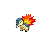

- 文件：[pokemon-id-00155-front-normal-default-static--5ad985b1165c.png](pokemon-id-00155-front-normal-default-static--5ad985b1165c.png)
- 用途：正面普通宝可梦图像；身份和变体来自PokeAPI路径，不作为原应用已经接入的证明。
- 尺寸：96 × 96，帧数：1
- SHA256：`5ad985b1165ca236474bbe92a32c707fa139418a12c57bd397b2a7505e461ec4`
- 来源：[PokeAPI/sprites](https://raw.githubusercontent.com/PokeAPI/sprites/master/sprites/pokemon/155.png)；取得版本：`1dd55c0436d2a5b6e324c0b780e1b1b416fbfb64`

### 宝可梦API ID 156 · 正面 · 普通 · 默认静态来源

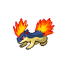

- 文件：[pokemon-id-00156-front-normal-default-static--fdd8d04e03cb.png](pokemon-id-00156-front-normal-default-static--fdd8d04e03cb.png)
- 用途：正面普通宝可梦图像；身份和变体来自PokeAPI路径，不作为原应用已经接入的证明。
- 尺寸：96 × 96，帧数：1
- SHA256：`fdd8d04e03cbac6e66b3cf664ab676c6ad6cb17fd1224cd8a283d54340ade4e5`
- 来源：[PokeAPI/sprites](https://raw.githubusercontent.com/PokeAPI/sprites/master/sprites/pokemon/156.png)；取得版本：`1dd55c0436d2a5b6e324c0b780e1b1b416fbfb64`

### 宝可梦API ID 157 · 正面 · 普通 · 默认静态来源

- 文件：[pokemon-id-00157-front-normal-default-static--7be01ad9ddd3.png](pokemon-id-00157-front-normal-default-static--7be01ad9ddd3.png)
- 用途：正面普通宝可梦图像；身份和变体来自PokeAPI路径，不作为原应用已经接入的证明。
- 尺寸：96 × 96，帧数：1
- SHA256：`7be01ad9ddd3cce31c242347af8d9d3bb683cab44ae5fc153a02421348257918`
- 来源：[PokeAPI/sprites](https://raw.githubusercontent.com/PokeAPI/sprites/master/sprites/pokemon/157.png)；取得版本：`1dd55c0436d2a5b6e324c0b780e1b1b416fbfb64`

### 宝可梦API ID 158 · 正面 · 普通 · 默认静态来源

- 文件：[pokemon-id-00158-front-normal-default-static--861a578a0193.png](pokemon-id-00158-front-normal-default-static--861a578a0193.png)
- 用途：正面普通宝可梦图像；身份和变体来自PokeAPI路径，不作为原应用已经接入的证明。
- 尺寸：96 × 96，帧数：1
- SHA256：`861a578a019380dc82799d4c39d283daeecf46ed8f441b02adb17d617903e4cd`
- 来源：[PokeAPI/sprites](https://raw.githubusercontent.com/PokeAPI/sprites/master/sprites/pokemon/158.png)；取得版本：`1dd55c0436d2a5b6e324c0b780e1b1b416fbfb64`

### 宝可梦API ID 159 · 正面 · 普通 · 默认静态来源

- 文件：[pokemon-id-00159-front-normal-default-static--ac69c44d86ee.png](pokemon-id-00159-front-normal-default-static--ac69c44d86ee.png)
- 用途：正面普通宝可梦图像；身份和变体来自PokeAPI路径，不作为原应用已经接入的证明。
- 尺寸：96 × 96，帧数：1
- SHA256：`ac69c44d86ee9c42a12bc6ced1754df380372bad70c0cd2a339d0ab280a3e063`
- 来源：[PokeAPI/sprites](https://raw.githubusercontent.com/PokeAPI/sprites/master/sprites/pokemon/159.png)；取得版本：`1dd55c0436d2a5b6e324c0b780e1b1b416fbfb64`

### 宝可梦API ID 160 · 正面 · 普通 · 默认静态来源

- 文件：[pokemon-id-00160-front-normal-default-static--2849e4e930dd.png](pokemon-id-00160-front-normal-default-static--2849e4e930dd.png)
- 用途：正面普通宝可梦图像；身份和变体来自PokeAPI路径，不作为原应用已经接入的证明。
- 尺寸：96 × 96，帧数：1
- SHA256：`2849e4e930dd4235afb97c9582f12c95b6cfa638b641d1ad9cccf528a8d805d7`
- 来源：[PokeAPI/sprites](https://raw.githubusercontent.com/PokeAPI/sprites/master/sprites/pokemon/160.png)；取得版本：`1dd55c0436d2a5b6e324c0b780e1b1b416fbfb64`

### 宝可梦API ID 161 · 正面 · 普通 · 默认静态来源

- 文件：[pokemon-id-00161-front-normal-default-static--9dd76edaddf2.png](pokemon-id-00161-front-normal-default-static--9dd76edaddf2.png)
- 用途：正面普通宝可梦图像；身份和变体来自PokeAPI路径，不作为原应用已经接入的证明。
- 尺寸：96 × 96，帧数：1
- SHA256：`9dd76edaddf233d9cb17720266a52d383c0fcb409e9cda5776d275124a8516df`
- 来源：[PokeAPI/sprites](https://raw.githubusercontent.com/PokeAPI/sprites/master/sprites/pokemon/161.png)；取得版本：`1dd55c0436d2a5b6e324c0b780e1b1b416fbfb64`

### 宝可梦API ID 162 · 正面 · 普通 · 默认静态来源

- 文件：[pokemon-id-00162-front-normal-default-static--c5f5a71e1046.png](pokemon-id-00162-front-normal-default-static--c5f5a71e1046.png)
- 用途：正面普通宝可梦图像；身份和变体来自PokeAPI路径，不作为原应用已经接入的证明。
- 尺寸：96 × 96，帧数：1
- SHA256：`c5f5a71e1046897eee227736ef9929d866dd9115ccc209e8fa3fdf9902b0bbe1`
- 来源：[PokeAPI/sprites](https://raw.githubusercontent.com/PokeAPI/sprites/master/sprites/pokemon/162.png)；取得版本：`1dd55c0436d2a5b6e324c0b780e1b1b416fbfb64`

### 宝可梦API ID 163 · 正面 · 普通 · 默认静态来源

- 文件：[pokemon-id-00163-front-normal-default-static--2f8f9b39faf2.png](pokemon-id-00163-front-normal-default-static--2f8f9b39faf2.png)
- 用途：正面普通宝可梦图像；身份和变体来自PokeAPI路径，不作为原应用已经接入的证明。
- 尺寸：96 × 96，帧数：1
- SHA256：`2f8f9b39faf220dfe0a703bfb9a4345e68d70d49fa525771e935689ff27c1bed`
- 来源：[PokeAPI/sprites](https://raw.githubusercontent.com/PokeAPI/sprites/master/sprites/pokemon/163.png)；取得版本：`1dd55c0436d2a5b6e324c0b780e1b1b416fbfb64`

### 宝可梦API ID 164 · 正面 · 普通 · 默认静态来源

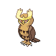

- 文件：[pokemon-id-00164-front-normal-default-static--ba5cb282888d.png](pokemon-id-00164-front-normal-default-static--ba5cb282888d.png)
- 用途：正面普通宝可梦图像；身份和变体来自PokeAPI路径，不作为原应用已经接入的证明。
- 尺寸：96 × 96，帧数：1
- SHA256：`ba5cb282888d1ee6a9c4cd971deef905c1a80478d9ce3eabaa0d8811134cf98c`
- 来源：[PokeAPI/sprites](https://raw.githubusercontent.com/PokeAPI/sprites/master/sprites/pokemon/164.png)；取得版本：`1dd55c0436d2a5b6e324c0b780e1b1b416fbfb64`

### 宝可梦API ID 165 · 正面 · 普通 · 默认静态来源

- 文件：[pokemon-id-00165-front-normal-default-static--5253baa4bca1.png](pokemon-id-00165-front-normal-default-static--5253baa4bca1.png)
- 用途：正面普通宝可梦图像；身份和变体来自PokeAPI路径，不作为原应用已经接入的证明。
- 尺寸：96 × 96，帧数：1
- SHA256：`5253baa4bca13c4d839d5a4453bf4b39b42ebe0a34b605eddb40e9885030a3c3`
- 来源：[PokeAPI/sprites](https://raw.githubusercontent.com/PokeAPI/sprites/master/sprites/pokemon/165.png)；取得版本：`1dd55c0436d2a5b6e324c0b780e1b1b416fbfb64`

### 宝可梦API ID 166 · 正面 · 普通 · 默认静态来源

- 文件：[pokemon-id-00166-front-normal-default-static--009740e7cb98.png](pokemon-id-00166-front-normal-default-static--009740e7cb98.png)
- 用途：正面普通宝可梦图像；身份和变体来自PokeAPI路径，不作为原应用已经接入的证明。
- 尺寸：96 × 96，帧数：1
- SHA256：`009740e7cb98fdfb72925cbc5726c6b4847fe7267715cd2b845d05336404365f`
- 来源：[PokeAPI/sprites](https://raw.githubusercontent.com/PokeAPI/sprites/master/sprites/pokemon/166.png)；取得版本：`1dd55c0436d2a5b6e324c0b780e1b1b416fbfb64`

### 宝可梦API ID 167 · 正面 · 普通 · 默认静态来源

- 文件：[pokemon-id-00167-front-normal-default-static--658bca976a6a.png](pokemon-id-00167-front-normal-default-static--658bca976a6a.png)
- 用途：正面普通宝可梦图像；身份和变体来自PokeAPI路径，不作为原应用已经接入的证明。
- 尺寸：96 × 96，帧数：1
- SHA256：`658bca976a6a9edb0a064af1ea46e6f678d9bdb1044a6ab12059784cac3e5e64`
- 来源：[PokeAPI/sprites](https://raw.githubusercontent.com/PokeAPI/sprites/master/sprites/pokemon/167.png)；取得版本：`1dd55c0436d2a5b6e324c0b780e1b1b416fbfb64`

### 宝可梦API ID 168 · 正面 · 普通 · 默认静态来源

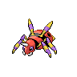

- 文件：[pokemon-id-00168-front-normal-default-static--c88765fb6524.png](pokemon-id-00168-front-normal-default-static--c88765fb6524.png)
- 用途：正面普通宝可梦图像；身份和变体来自PokeAPI路径，不作为原应用已经接入的证明。
- 尺寸：96 × 96，帧数：1
- SHA256：`c88765fb65246405c2bf0b0eefaba4aadaec9fa5dfb6e64af5a54c4f8667c2b0`
- 来源：[PokeAPI/sprites](https://raw.githubusercontent.com/PokeAPI/sprites/master/sprites/pokemon/168.png)；取得版本：`1dd55c0436d2a5b6e324c0b780e1b1b416fbfb64`

### 宝可梦API ID 169 · 正面 · 普通 · 默认静态来源

- 文件：[pokemon-id-00169-front-normal-default-static--1673ea011d86.png](pokemon-id-00169-front-normal-default-static--1673ea011d86.png)
- 用途：正面普通宝可梦图像；身份和变体来自PokeAPI路径，不作为原应用已经接入的证明。
- 尺寸：96 × 96，帧数：1
- SHA256：`1673ea011d86d22bb77a7515a8e7f615695a578fc8a50c61f6a8c0c81d155838`
- 来源：[PokeAPI/sprites](https://raw.githubusercontent.com/PokeAPI/sprites/master/sprites/pokemon/169.png)；取得版本：`1dd55c0436d2a5b6e324c0b780e1b1b416fbfb64`

### 宝可梦API ID 170 · 正面 · 普通 · 默认静态来源

- 文件：[pokemon-id-00170-front-normal-default-static--60bb1a3bae2c.png](pokemon-id-00170-front-normal-default-static--60bb1a3bae2c.png)
- 用途：正面普通宝可梦图像；身份和变体来自PokeAPI路径，不作为原应用已经接入的证明。
- 尺寸：96 × 96，帧数：1
- SHA256：`60bb1a3bae2c5c11d18996e4978f69b23c651fbd0e9319df066924871b761354`
- 来源：[PokeAPI/sprites](https://raw.githubusercontent.com/PokeAPI/sprites/master/sprites/pokemon/170.png)；取得版本：`1dd55c0436d2a5b6e324c0b780e1b1b416fbfb64`

### 宝可梦API ID 171 · 正面 · 普通 · 默认静态来源

- 文件：[pokemon-id-00171-front-normal-default-static--4a09f4e310a7.png](pokemon-id-00171-front-normal-default-static--4a09f4e310a7.png)
- 用途：正面普通宝可梦图像；身份和变体来自PokeAPI路径，不作为原应用已经接入的证明。
- 尺寸：96 × 96，帧数：1
- SHA256：`4a09f4e310a7d73b5b7ba27a1d5ea0251a1ed5a1942bd07f5318e2b3601c520f`
- 来源：[PokeAPI/sprites](https://raw.githubusercontent.com/PokeAPI/sprites/master/sprites/pokemon/171.png)；取得版本：`1dd55c0436d2a5b6e324c0b780e1b1b416fbfb64`

### 宝可梦API ID 172 · 正面 · 普通 · 默认静态来源

- 文件：[pokemon-id-00172-front-normal-default-static--d83111be4894.png](pokemon-id-00172-front-normal-default-static--d83111be4894.png)
- 用途：正面普通宝可梦图像；身份和变体来自PokeAPI路径，不作为原应用已经接入的证明。
- 尺寸：96 × 96，帧数：1
- SHA256：`d83111be4894156e208a271d454ac4319daacf3baa5e7b0536e597295c81b888`
- 来源：[PokeAPI/sprites](https://raw.githubusercontent.com/PokeAPI/sprites/master/sprites/pokemon/172.png)；取得版本：`1dd55c0436d2a5b6e324c0b780e1b1b416fbfb64`

### 宝可梦API ID 173 · 正面 · 普通 · 默认静态来源

- 文件：[pokemon-id-00173-front-normal-default-static--ebeedd346646.png](pokemon-id-00173-front-normal-default-static--ebeedd346646.png)
- 用途：正面普通宝可梦图像；身份和变体来自PokeAPI路径，不作为原应用已经接入的证明。
- 尺寸：96 × 96，帧数：1
- SHA256：`ebeedd3466465aaf874ef2385cca462c8ecc0ed68b154e2dfdd417789f36eac8`
- 来源：[PokeAPI/sprites](https://raw.githubusercontent.com/PokeAPI/sprites/master/sprites/pokemon/173.png)；取得版本：`1dd55c0436d2a5b6e324c0b780e1b1b416fbfb64`

### 宝可梦API ID 174 · 正面 · 普通 · 默认静态来源

- 文件：[pokemon-id-00174-front-normal-default-static--a5a6d04ca30b.png](pokemon-id-00174-front-normal-default-static--a5a6d04ca30b.png)
- 用途：正面普通宝可梦图像；身份和变体来自PokeAPI路径，不作为原应用已经接入的证明。
- 尺寸：96 × 96，帧数：1
- SHA256：`a5a6d04ca30bfb8d5a10db9b9104036f984961b6a7181768359c4e03825b678f`
- 来源：[PokeAPI/sprites](https://raw.githubusercontent.com/PokeAPI/sprites/master/sprites/pokemon/174.png)；取得版本：`1dd55c0436d2a5b6e324c0b780e1b1b416fbfb64`

### 宝可梦API ID 175 · 正面 · 普通 · 默认静态来源

- 文件：[pokemon-id-00175-front-normal-default-static--c6d6e296bc54.png](pokemon-id-00175-front-normal-default-static--c6d6e296bc54.png)
- 用途：正面普通宝可梦图像；身份和变体来自PokeAPI路径，不作为原应用已经接入的证明。
- 尺寸：96 × 96，帧数：1
- SHA256：`c6d6e296bc54d56fb30f5a1632a6b610e679ea468ef8cc9a94eb34ded904757e`
- 来源：[PokeAPI/sprites](https://raw.githubusercontent.com/PokeAPI/sprites/master/sprites/pokemon/175.png)；取得版本：`1dd55c0436d2a5b6e324c0b780e1b1b416fbfb64`

### 宝可梦API ID 176 · 正面 · 普通 · 默认静态来源

- 文件：[pokemon-id-00176-front-normal-default-static--1d06a1984495.png](pokemon-id-00176-front-normal-default-static--1d06a1984495.png)
- 用途：正面普通宝可梦图像；身份和变体来自PokeAPI路径，不作为原应用已经接入的证明。
- 尺寸：96 × 96，帧数：1
- SHA256：`1d06a19844953db338069a41ab9d45c38fe0e7b80e78e79383bbb9d56d804144`
- 来源：[PokeAPI/sprites](https://raw.githubusercontent.com/PokeAPI/sprites/master/sprites/pokemon/176.png)；取得版本：`1dd55c0436d2a5b6e324c0b780e1b1b416fbfb64`

### 宝可梦API ID 177 · 正面 · 普通 · 默认静态来源

- 文件：[pokemon-id-00177-front-normal-default-static--56c9f7bf6cb8.png](pokemon-id-00177-front-normal-default-static--56c9f7bf6cb8.png)
- 用途：正面普通宝可梦图像；身份和变体来自PokeAPI路径，不作为原应用已经接入的证明。
- 尺寸：96 × 96，帧数：1
- SHA256：`56c9f7bf6cb84b53b5db0cb07c96270fdf4e907e4187a5029a221ec58d1e7905`
- 来源：[PokeAPI/sprites](https://raw.githubusercontent.com/PokeAPI/sprites/master/sprites/pokemon/177.png)；取得版本：`1dd55c0436d2a5b6e324c0b780e1b1b416fbfb64`

### 宝可梦API ID 178 · 正面 · 普通 · 默认静态来源

- 文件：[pokemon-id-00178-front-normal-default-static--ef001b7d9277.png](pokemon-id-00178-front-normal-default-static--ef001b7d9277.png)
- 用途：正面普通宝可梦图像；身份和变体来自PokeAPI路径，不作为原应用已经接入的证明。
- 尺寸：96 × 96，帧数：1
- SHA256：`ef001b7d9277dacbb9a9f149b1ccb6f45f8504bc0529369467b82c80b86faae4`
- 来源：[PokeAPI/sprites](https://raw.githubusercontent.com/PokeAPI/sprites/master/sprites/pokemon/178.png)；取得版本：`1dd55c0436d2a5b6e324c0b780e1b1b416fbfb64`

### 宝可梦API ID 179 · 正面 · 普通 · 默认静态来源

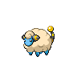

- 文件：[pokemon-id-00179-front-normal-default-static--ba0305d83c6e.png](pokemon-id-00179-front-normal-default-static--ba0305d83c6e.png)
- 用途：正面普通宝可梦图像；身份和变体来自PokeAPI路径，不作为原应用已经接入的证明。
- 尺寸：96 × 96，帧数：1
- SHA256：`ba0305d83c6e697f62726272afa28b65129065bb798a14531c581f037d8ae463`
- 来源：[PokeAPI/sprites](https://raw.githubusercontent.com/PokeAPI/sprites/master/sprites/pokemon/179.png)；取得版本：`1dd55c0436d2a5b6e324c0b780e1b1b416fbfb64`

### 宝可梦API ID 180 · 正面 · 普通 · 默认静态来源

- 文件：[pokemon-id-00180-front-normal-default-static--caa131bdc76e.png](pokemon-id-00180-front-normal-default-static--caa131bdc76e.png)
- 用途：正面普通宝可梦图像；身份和变体来自PokeAPI路径，不作为原应用已经接入的证明。
- 尺寸：96 × 96，帧数：1
- SHA256：`caa131bdc76e4df1626a850c3d68605492366b62fd9d89ce8ccf9b81cff38c32`
- 来源：[PokeAPI/sprites](https://raw.githubusercontent.com/PokeAPI/sprites/master/sprites/pokemon/180.png)；取得版本：`1dd55c0436d2a5b6e324c0b780e1b1b416fbfb64`

### 宝可梦API ID 181 · 正面 · 普通 · 默认静态来源

- 文件：[pokemon-id-00181-front-normal-default-static--731acc5f1ad1.png](pokemon-id-00181-front-normal-default-static--731acc5f1ad1.png)
- 用途：正面普通宝可梦图像；身份和变体来自PokeAPI路径，不作为原应用已经接入的证明。
- 尺寸：96 × 96，帧数：1
- SHA256：`731acc5f1ad15a26a2dc851c8bfbbf5eb7c2d5ad53f3af1cf178e980f0723997`
- 来源：[PokeAPI/sprites](https://raw.githubusercontent.com/PokeAPI/sprites/master/sprites/pokemon/181.png)；取得版本：`1dd55c0436d2a5b6e324c0b780e1b1b416fbfb64`

### 宝可梦API ID 182 · 正面 · 普通 · 默认静态来源

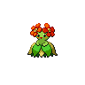

- 文件：[pokemon-id-00182-front-normal-default-static--f73f9a92220b.png](pokemon-id-00182-front-normal-default-static--f73f9a92220b.png)
- 用途：正面普通宝可梦图像；身份和变体来自PokeAPI路径，不作为原应用已经接入的证明。
- 尺寸：96 × 96，帧数：1
- SHA256：`f73f9a92220bf040f81ac7046124110072b5065f7799ea1050606e7099ef8ff0`
- 来源：[PokeAPI/sprites](https://raw.githubusercontent.com/PokeAPI/sprites/master/sprites/pokemon/182.png)；取得版本：`1dd55c0436d2a5b6e324c0b780e1b1b416fbfb64`

### 宝可梦API ID 183 · 正面 · 普通 · 默认静态来源

- 文件：[pokemon-id-00183-front-normal-default-static--9e33771cca9e.png](pokemon-id-00183-front-normal-default-static--9e33771cca9e.png)
- 用途：正面普通宝可梦图像；身份和变体来自PokeAPI路径，不作为原应用已经接入的证明。
- 尺寸：96 × 96，帧数：1
- SHA256：`9e33771cca9e7ca75708718cdc4c88ccfdacc92c92f10cb320b3c653ec52ec8f`
- 来源：[PokeAPI/sprites](https://raw.githubusercontent.com/PokeAPI/sprites/master/sprites/pokemon/183.png)；取得版本：`1dd55c0436d2a5b6e324c0b780e1b1b416fbfb64`

### 宝可梦API ID 184 · 正面 · 普通 · 默认静态来源

- 文件：[pokemon-id-00184-front-normal-default-static--d7d092901d81.png](pokemon-id-00184-front-normal-default-static--d7d092901d81.png)
- 用途：正面普通宝可梦图像；身份和变体来自PokeAPI路径，不作为原应用已经接入的证明。
- 尺寸：96 × 96，帧数：1
- SHA256：`d7d092901d81370ff6d9ec903c0c26145152dd03c2dc1c78ae5520b1918b1d0a`
- 来源：[PokeAPI/sprites](https://raw.githubusercontent.com/PokeAPI/sprites/master/sprites/pokemon/184.png)；取得版本：`1dd55c0436d2a5b6e324c0b780e1b1b416fbfb64`

### 宝可梦API ID 185 · 正面 · 普通 · 默认静态来源

- 文件：[pokemon-id-00185-front-normal-default-static--ea66d544b7a1.png](pokemon-id-00185-front-normal-default-static--ea66d544b7a1.png)
- 用途：正面普通宝可梦图像；身份和变体来自PokeAPI路径，不作为原应用已经接入的证明。
- 尺寸：96 × 96，帧数：1
- SHA256：`ea66d544b7a18063b863811797fce6d47cfae0ce6ea44e0109b86bd7f2fcac92`
- 来源：[PokeAPI/sprites](https://raw.githubusercontent.com/PokeAPI/sprites/master/sprites/pokemon/185.png)；取得版本：`1dd55c0436d2a5b6e324c0b780e1b1b416fbfb64`

### 宝可梦API ID 186 · 正面 · 普通 · 默认静态来源

- 文件：[pokemon-id-00186-front-normal-default-static--f4eb8a5b7303.png](pokemon-id-00186-front-normal-default-static--f4eb8a5b7303.png)
- 用途：正面普通宝可梦图像；身份和变体来自PokeAPI路径，不作为原应用已经接入的证明。
- 尺寸：96 × 96，帧数：1
- SHA256：`f4eb8a5b73031203f25dbe9ed92b22c9f0132a6510478bfb40cd249f323460d6`
- 来源：[PokeAPI/sprites](https://raw.githubusercontent.com/PokeAPI/sprites/master/sprites/pokemon/186.png)；取得版本：`1dd55c0436d2a5b6e324c0b780e1b1b416fbfb64`

### 宝可梦API ID 187 · 正面 · 普通 · 默认静态来源

- 文件：[pokemon-id-00187-front-normal-default-static--d0d723c0f9f5.png](pokemon-id-00187-front-normal-default-static--d0d723c0f9f5.png)
- 用途：正面普通宝可梦图像；身份和变体来自PokeAPI路径，不作为原应用已经接入的证明。
- 尺寸：96 × 96，帧数：1
- SHA256：`d0d723c0f9f5db6c826bce0494ca7a0e47d3e215e10bb649bb5f409b740f2e8e`
- 来源：[PokeAPI/sprites](https://raw.githubusercontent.com/PokeAPI/sprites/master/sprites/pokemon/187.png)；取得版本：`1dd55c0436d2a5b6e324c0b780e1b1b416fbfb64`

### 宝可梦API ID 188 · 正面 · 普通 · 默认静态来源

- 文件：[pokemon-id-00188-front-normal-default-static--2c2c6460c4de.png](pokemon-id-00188-front-normal-default-static--2c2c6460c4de.png)
- 用途：正面普通宝可梦图像；身份和变体来自PokeAPI路径，不作为原应用已经接入的证明。
- 尺寸：96 × 96，帧数：1
- SHA256：`2c2c6460c4dee2e65f9d17d0a893aa608f0fb974054f5adc7c69aaf466e58495`
- 来源：[PokeAPI/sprites](https://raw.githubusercontent.com/PokeAPI/sprites/master/sprites/pokemon/188.png)；取得版本：`1dd55c0436d2a5b6e324c0b780e1b1b416fbfb64`

### 宝可梦API ID 189 · 正面 · 普通 · 默认静态来源

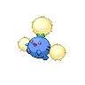

- 文件：[pokemon-id-00189-front-normal-default-static--cc08b2e906e5.png](pokemon-id-00189-front-normal-default-static--cc08b2e906e5.png)
- 用途：正面普通宝可梦图像；身份和变体来自PokeAPI路径，不作为原应用已经接入的证明。
- 尺寸：96 × 96，帧数：1
- SHA256：`cc08b2e906e536fcc3cf5c67cdb14d20f9081a1f70e3df4dbb306f26ca4dd650`
- 来源：[PokeAPI/sprites](https://raw.githubusercontent.com/PokeAPI/sprites/master/sprites/pokemon/189.png)；取得版本：`1dd55c0436d2a5b6e324c0b780e1b1b416fbfb64`

### 宝可梦API ID 190 · 正面 · 普通 · 默认静态来源

- 文件：[pokemon-id-00190-front-normal-default-static--c23d7d3d0ed8.png](pokemon-id-00190-front-normal-default-static--c23d7d3d0ed8.png)
- 用途：正面普通宝可梦图像；身份和变体来自PokeAPI路径，不作为原应用已经接入的证明。
- 尺寸：96 × 96，帧数：1
- SHA256：`c23d7d3d0ed81176e5c85a5e1561cc90197abd1370f5a2e00d58e601873cbbff`
- 来源：[PokeAPI/sprites](https://raw.githubusercontent.com/PokeAPI/sprites/master/sprites/pokemon/190.png)；取得版本：`1dd55c0436d2a5b6e324c0b780e1b1b416fbfb64`

### 宝可梦API ID 191 · 正面 · 普通 · 默认静态来源

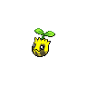

- 文件：[pokemon-id-00191-front-normal-default-static--e61dbad62ea6.png](pokemon-id-00191-front-normal-default-static--e61dbad62ea6.png)
- 用途：正面普通宝可梦图像；身份和变体来自PokeAPI路径，不作为原应用已经接入的证明。
- 尺寸：96 × 96，帧数：1
- SHA256：`e61dbad62ea694d98bd50fd8aec8fc537bbb612515e064ff693ed929e758bad0`
- 来源：[PokeAPI/sprites](https://raw.githubusercontent.com/PokeAPI/sprites/master/sprites/pokemon/191.png)；取得版本：`1dd55c0436d2a5b6e324c0b780e1b1b416fbfb64`

### 宝可梦API ID 192 · 正面 · 普通 · 默认静态来源

- 文件：[pokemon-id-00192-front-normal-default-static--8d4fb2032a70.png](pokemon-id-00192-front-normal-default-static--8d4fb2032a70.png)
- 用途：正面普通宝可梦图像；身份和变体来自PokeAPI路径，不作为原应用已经接入的证明。
- 尺寸：96 × 96，帧数：1
- SHA256：`8d4fb2032a709ffc8000b0f914ed9b12f11ee1329ca4ff7bdc4340a4eb6c3317`
- 来源：[PokeAPI/sprites](https://raw.githubusercontent.com/PokeAPI/sprites/master/sprites/pokemon/192.png)；取得版本：`1dd55c0436d2a5b6e324c0b780e1b1b416fbfb64`

### 宝可梦API ID 193 · 正面 · 普通 · 默认静态来源

- 文件：[pokemon-id-00193-front-normal-default-static--ad08e2d8cdc4.png](pokemon-id-00193-front-normal-default-static--ad08e2d8cdc4.png)
- 用途：正面普通宝可梦图像；身份和变体来自PokeAPI路径，不作为原应用已经接入的证明。
- 尺寸：96 × 96，帧数：1
- SHA256：`ad08e2d8cdc428f40abc2a0a8c53e8307cd029704516d6cf42ee40e712e6f3f9`
- 来源：[PokeAPI/sprites](https://raw.githubusercontent.com/PokeAPI/sprites/master/sprites/pokemon/193.png)；取得版本：`1dd55c0436d2a5b6e324c0b780e1b1b416fbfb64`

### 宝可梦API ID 194 · 正面 · 普通 · 默认静态来源

- 文件：[pokemon-id-00194-front-normal-default-static--75fd4dbf556a.png](pokemon-id-00194-front-normal-default-static--75fd4dbf556a.png)
- 用途：正面普通宝可梦图像；身份和变体来自PokeAPI路径，不作为原应用已经接入的证明。
- 尺寸：96 × 96，帧数：1
- SHA256：`75fd4dbf556a5a7ccd97214d03fc7c554bc2b56270e62624883abca46d9fd562`
- 来源：[PokeAPI/sprites](https://raw.githubusercontent.com/PokeAPI/sprites/master/sprites/pokemon/194.png)；取得版本：`1dd55c0436d2a5b6e324c0b780e1b1b416fbfb64`

### 宝可梦API ID 195 · 正面 · 普通 · 默认静态来源

- 文件：[pokemon-id-00195-front-normal-default-static--f9312525ce85.png](pokemon-id-00195-front-normal-default-static--f9312525ce85.png)
- 用途：正面普通宝可梦图像；身份和变体来自PokeAPI路径，不作为原应用已经接入的证明。
- 尺寸：96 × 96，帧数：1
- SHA256：`f9312525ce857cf90d18c21a223c8bfd0493751f7505a0c2ef7c2d476d26e383`
- 来源：[PokeAPI/sprites](https://raw.githubusercontent.com/PokeAPI/sprites/master/sprites/pokemon/195.png)；取得版本：`1dd55c0436d2a5b6e324c0b780e1b1b416fbfb64`

### 宝可梦API ID 196 · 正面 · 普通 · 默认静态来源

- 文件：[pokemon-id-00196-front-normal-default-static--445986a03a7f.png](pokemon-id-00196-front-normal-default-static--445986a03a7f.png)
- 用途：正面普通宝可梦图像；身份和变体来自PokeAPI路径，不作为原应用已经接入的证明。
- 尺寸：96 × 96，帧数：1
- SHA256：`445986a03a7fd22b72d1d675317e3ec550ae2d4b24c1394c3ef3bbac4df31056`
- 来源：[PokeAPI/sprites](https://raw.githubusercontent.com/PokeAPI/sprites/master/sprites/pokemon/196.png)；取得版本：`1dd55c0436d2a5b6e324c0b780e1b1b416fbfb64`

### 宝可梦API ID 197 · 正面 · 普通 · 默认静态来源

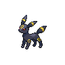

- 文件：[pokemon-id-00197-front-normal-default-static--72df4ab24222.png](pokemon-id-00197-front-normal-default-static--72df4ab24222.png)
- 用途：正面普通宝可梦图像；身份和变体来自PokeAPI路径，不作为原应用已经接入的证明。
- 尺寸：96 × 96，帧数：1
- SHA256：`72df4ab24222b470e2d145c0c747b704a4abca4042d739e645a0e37ef7eeaf5c`
- 来源：[PokeAPI/sprites](https://raw.githubusercontent.com/PokeAPI/sprites/master/sprites/pokemon/197.png)；取得版本：`1dd55c0436d2a5b6e324c0b780e1b1b416fbfb64`

### 宝可梦API ID 198 · 正面 · 普通 · 默认静态来源

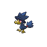

- 文件：[pokemon-id-00198-front-normal-default-static--cbd8eed863d8.png](pokemon-id-00198-front-normal-default-static--cbd8eed863d8.png)
- 用途：正面普通宝可梦图像；身份和变体来自PokeAPI路径，不作为原应用已经接入的证明。
- 尺寸：96 × 96，帧数：1
- SHA256：`cbd8eed863d84b2a73cb5095e8b89f55e49317dec4c26246511335d24fe12269`
- 来源：[PokeAPI/sprites](https://raw.githubusercontent.com/PokeAPI/sprites/master/sprites/pokemon/198.png)；取得版本：`1dd55c0436d2a5b6e324c0b780e1b1b416fbfb64`

### 宝可梦API ID 199 · 正面 · 普通 · 默认静态来源

- 文件：[pokemon-id-00199-front-normal-default-static--ffb59038b5a3.png](pokemon-id-00199-front-normal-default-static--ffb59038b5a3.png)
- 用途：正面普通宝可梦图像；身份和变体来自PokeAPI路径，不作为原应用已经接入的证明。
- 尺寸：96 × 96，帧数：1
- SHA256：`ffb59038b5a3e825fb05061e5d40ede1ccb6e6607d6a8c454622cde977165c65`
- 来源：[PokeAPI/sprites](https://raw.githubusercontent.com/PokeAPI/sprites/master/sprites/pokemon/199.png)；取得版本：`1dd55c0436d2a5b6e324c0b780e1b1b416fbfb64`

### 宝可梦API ID 201 · 正面 · 普通 · 默认静态来源

- 文件：[pokemon-id-00201-front-normal-default-static--f75c23d3c771.png](pokemon-id-00201-front-normal-default-static--f75c23d3c771.png)
- 用途：正面普通宝可梦图像；身份和变体来自PokeAPI路径，不作为原应用已经接入的证明。
- 尺寸：96 × 96，帧数：1
- SHA256：`f75c23d3c7717c325083edc902470d4007d8e491647320b75f9fdfc8d1f446ad`
- 来源：[PokeAPI/sprites](https://raw.githubusercontent.com/PokeAPI/sprites/master/sprites/pokemon/201.png)；取得版本：`1dd55c0436d2a5b6e324c0b780e1b1b416fbfb64`

### 宝可梦API ID 202 · 正面 · 普通 · 默认静态来源

- 文件：[pokemon-id-00202-front-normal-default-static--98d0c6efba8b.png](pokemon-id-00202-front-normal-default-static--98d0c6efba8b.png)
- 用途：正面普通宝可梦图像；身份和变体来自PokeAPI路径，不作为原应用已经接入的证明。
- 尺寸：96 × 96，帧数：1
- SHA256：`98d0c6efba8b2019f371f1a4a2469a2233868ee5705e89343dfae7ed826e5390`
- 来源：[PokeAPI/sprites](https://raw.githubusercontent.com/PokeAPI/sprites/master/sprites/pokemon/202.png)；取得版本：`1dd55c0436d2a5b6e324c0b780e1b1b416fbfb64`

### 宝可梦API ID 203 · 正面 · 普通 · 默认静态来源

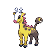

- 文件：[pokemon-id-00203-front-normal-default-static--d71ff6f9e771.png](pokemon-id-00203-front-normal-default-static--d71ff6f9e771.png)
- 用途：正面普通宝可梦图像；身份和变体来自PokeAPI路径，不作为原应用已经接入的证明。
- 尺寸：96 × 96，帧数：1
- SHA256：`d71ff6f9e77135c1487b40c5817229ad7a71a93850fba5573ca526548705f505`
- 来源：[PokeAPI/sprites](https://raw.githubusercontent.com/PokeAPI/sprites/master/sprites/pokemon/203.png)；取得版本：`1dd55c0436d2a5b6e324c0b780e1b1b416fbfb64`

### 宝可梦API ID 204 · 正面 · 普通 · 默认静态来源

- 文件：[pokemon-id-00204-front-normal-default-static--40e0bdbaa232.png](pokemon-id-00204-front-normal-default-static--40e0bdbaa232.png)
- 用途：正面普通宝可梦图像；身份和变体来自PokeAPI路径，不作为原应用已经接入的证明。
- 尺寸：96 × 96，帧数：1
- SHA256：`40e0bdbaa232367c1f0ca76210918d1fa6663b7110ec13f0664b7e29da8af83d`
- 来源：[PokeAPI/sprites](https://raw.githubusercontent.com/PokeAPI/sprites/master/sprites/pokemon/204.png)；取得版本：`1dd55c0436d2a5b6e324c0b780e1b1b416fbfb64`

### 宝可梦API ID 205 · 正面 · 普通 · 默认静态来源

- 文件：[pokemon-id-00205-front-normal-default-static--551d7961c6aa.png](pokemon-id-00205-front-normal-default-static--551d7961c6aa.png)
- 用途：正面普通宝可梦图像；身份和变体来自PokeAPI路径，不作为原应用已经接入的证明。
- 尺寸：96 × 96，帧数：1
- SHA256：`551d7961c6aa78b6a0b4ac8a1116ccadfc106a3934346f460d6a743509f6c66a`
- 来源：[PokeAPI/sprites](https://raw.githubusercontent.com/PokeAPI/sprites/master/sprites/pokemon/205.png)；取得版本：`1dd55c0436d2a5b6e324c0b780e1b1b416fbfb64`

### 宝可梦API ID 206 · 正面 · 普通 · 默认静态来源

- 文件：[pokemon-id-00206-front-normal-default-static--04b95d3c7ba2.png](pokemon-id-00206-front-normal-default-static--04b95d3c7ba2.png)
- 用途：正面普通宝可梦图像；身份和变体来自PokeAPI路径，不作为原应用已经接入的证明。
- 尺寸：96 × 96，帧数：1
- SHA256：`04b95d3c7ba20e8bd944bebabd22e626747b77be8d18ecdf89ae751bf4ffe37b`
- 来源：[PokeAPI/sprites](https://raw.githubusercontent.com/PokeAPI/sprites/master/sprites/pokemon/206.png)；取得版本：`1dd55c0436d2a5b6e324c0b780e1b1b416fbfb64`

### 宝可梦API ID 207 · 正面 · 普通 · 默认静态来源

- 文件：[pokemon-id-00207-front-normal-default-static--fa7852ef66d1.png](pokemon-id-00207-front-normal-default-static--fa7852ef66d1.png)
- 用途：正面普通宝可梦图像；身份和变体来自PokeAPI路径，不作为原应用已经接入的证明。
- 尺寸：96 × 96，帧数：1
- SHA256：`fa7852ef66d16858b6587ee797c444b85ef0d78f895cc3a872480239174df7d1`
- 来源：[PokeAPI/sprites](https://raw.githubusercontent.com/PokeAPI/sprites/master/sprites/pokemon/207.png)；取得版本：`1dd55c0436d2a5b6e324c0b780e1b1b416fbfb64`

### 宝可梦API ID 208 · 正面 · 普通 · 默认静态来源

- 文件：[pokemon-id-00208-front-normal-default-static--61aa353c28eb.png](pokemon-id-00208-front-normal-default-static--61aa353c28eb.png)
- 用途：正面普通宝可梦图像；身份和变体来自PokeAPI路径，不作为原应用已经接入的证明。
- 尺寸：96 × 96，帧数：1
- SHA256：`61aa353c28ebfbffab36319e31d6825f36454dca7c715ec796b72f7d7102db51`
- 来源：[PokeAPI/sprites](https://raw.githubusercontent.com/PokeAPI/sprites/master/sprites/pokemon/208.png)；取得版本：`1dd55c0436d2a5b6e324c0b780e1b1b416fbfb64`

### 宝可梦API ID 209 · 正面 · 普通 · 默认静态来源

- 文件：[pokemon-id-00209-front-normal-default-static--7d5334f20c06.png](pokemon-id-00209-front-normal-default-static--7d5334f20c06.png)
- 用途：正面普通宝可梦图像；身份和变体来自PokeAPI路径，不作为原应用已经接入的证明。
- 尺寸：96 × 96，帧数：1
- SHA256：`7d5334f20c065a8ea9ce79957224f8c68c3305389aace9b1d885565a06554a30`
- 来源：[PokeAPI/sprites](https://raw.githubusercontent.com/PokeAPI/sprites/master/sprites/pokemon/209.png)；取得版本：`1dd55c0436d2a5b6e324c0b780e1b1b416fbfb64`

### 宝可梦API ID 210 · 正面 · 普通 · 默认静态来源

- 文件：[pokemon-id-00210-front-normal-default-static--d15f698b0e9e.png](pokemon-id-00210-front-normal-default-static--d15f698b0e9e.png)
- 用途：正面普通宝可梦图像；身份和变体来自PokeAPI路径，不作为原应用已经接入的证明。
- 尺寸：96 × 96，帧数：1
- SHA256：`d15f698b0e9e780becc122757c93b9cd83f315d1b4ac6167900dccd6e963e988`
- 来源：[PokeAPI/sprites](https://raw.githubusercontent.com/PokeAPI/sprites/master/sprites/pokemon/210.png)；取得版本：`1dd55c0436d2a5b6e324c0b780e1b1b416fbfb64`

### 宝可梦API ID 211 · 正面 · 普通 · 默认静态来源

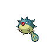

- 文件：[pokemon-id-00211-front-normal-default-static--e12215e9998e.png](pokemon-id-00211-front-normal-default-static--e12215e9998e.png)
- 用途：正面普通宝可梦图像；身份和变体来自PokeAPI路径，不作为原应用已经接入的证明。
- 尺寸：96 × 96，帧数：1
- SHA256：`e12215e9998ee36a0098b147ce3d3795dca79d9483e619c223d2b17d98a4a13f`
- 来源：[PokeAPI/sprites](https://raw.githubusercontent.com/PokeAPI/sprites/master/sprites/pokemon/211.png)；取得版本：`1dd55c0436d2a5b6e324c0b780e1b1b416fbfb64`

### 宝可梦API ID 212 · 正面 · 普通 · 默认静态来源

- 文件：[pokemon-id-00212-front-normal-default-static--50dd851a200e.png](pokemon-id-00212-front-normal-default-static--50dd851a200e.png)
- 用途：正面普通宝可梦图像；身份和变体来自PokeAPI路径，不作为原应用已经接入的证明。
- 尺寸：96 × 96，帧数：1
- SHA256：`50dd851a200ed14de0d37342b391c4ee6a9e2a9f10d5fec3dc051534aeb4e86e`
- 来源：[PokeAPI/sprites](https://raw.githubusercontent.com/PokeAPI/sprites/master/sprites/pokemon/212.png)；取得版本：`1dd55c0436d2a5b6e324c0b780e1b1b416fbfb64`

### 宝可梦API ID 213 · 正面 · 普通 · 默认静态来源

- 文件：[pokemon-id-00213-front-normal-default-static--f98d67517bdd.png](pokemon-id-00213-front-normal-default-static--f98d67517bdd.png)
- 用途：正面普通宝可梦图像；身份和变体来自PokeAPI路径，不作为原应用已经接入的证明。
- 尺寸：96 × 96，帧数：1
- SHA256：`f98d67517bdd7304ee6a0768e7bc2c02d3415010a0c4a161ad00130a69735906`
- 来源：[PokeAPI/sprites](https://raw.githubusercontent.com/PokeAPI/sprites/master/sprites/pokemon/213.png)；取得版本：`1dd55c0436d2a5b6e324c0b780e1b1b416fbfb64`

### 宝可梦API ID 214 · 正面 · 普通 · 默认静态来源

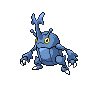

- 文件：[pokemon-id-00214-front-normal-default-static--61064e7a06b3.png](pokemon-id-00214-front-normal-default-static--61064e7a06b3.png)
- 用途：正面普通宝可梦图像；身份和变体来自PokeAPI路径，不作为原应用已经接入的证明。
- 尺寸：96 × 96，帧数：1
- SHA256：`61064e7a06b3f3bb6793d32f96673b3759074cf865ae245a4454269c2d4ce4b0`
- 来源：[PokeAPI/sprites](https://raw.githubusercontent.com/PokeAPI/sprites/master/sprites/pokemon/214.png)；取得版本：`1dd55c0436d2a5b6e324c0b780e1b1b416fbfb64`

### 宝可梦API ID 215 · 正面 · 普通 · 默认静态来源

- 文件：[pokemon-id-00215-front-normal-default-static--df25baf9ea6f.png](pokemon-id-00215-front-normal-default-static--df25baf9ea6f.png)
- 用途：正面普通宝可梦图像；身份和变体来自PokeAPI路径，不作为原应用已经接入的证明。
- 尺寸：96 × 96，帧数：1
- SHA256：`df25baf9ea6f41a8125d1ea7099d581ba7bb9cf08816eb43111a108bd528fe20`
- 来源：[PokeAPI/sprites](https://raw.githubusercontent.com/PokeAPI/sprites/master/sprites/pokemon/215.png)；取得版本：`1dd55c0436d2a5b6e324c0b780e1b1b416fbfb64`

### 宝可梦API ID 216 · 正面 · 普通 · 默认静态来源

- 文件：[pokemon-id-00216-front-normal-default-static--6c1cccd5d7a9.png](pokemon-id-00216-front-normal-default-static--6c1cccd5d7a9.png)
- 用途：正面普通宝可梦图像；身份和变体来自PokeAPI路径，不作为原应用已经接入的证明。
- 尺寸：96 × 96，帧数：1
- SHA256：`6c1cccd5d7a91a50b579545802e9e2f33ab235362f026415787a845f8be671fd`
- 来源：[PokeAPI/sprites](https://raw.githubusercontent.com/PokeAPI/sprites/master/sprites/pokemon/216.png)；取得版本：`1dd55c0436d2a5b6e324c0b780e1b1b416fbfb64`

### 宝可梦API ID 217 · 正面 · 普通 · 默认静态来源

- 文件：[pokemon-id-00217-front-normal-default-static--9f2d4291a976.png](pokemon-id-00217-front-normal-default-static--9f2d4291a976.png)
- 用途：正面普通宝可梦图像；身份和变体来自PokeAPI路径，不作为原应用已经接入的证明。
- 尺寸：96 × 96，帧数：1
- SHA256：`9f2d4291a976258ae8d106ccef09f6f2225a48b17bc808154ba19484c350738e`
- 来源：[PokeAPI/sprites](https://raw.githubusercontent.com/PokeAPI/sprites/master/sprites/pokemon/217.png)；取得版本：`1dd55c0436d2a5b6e324c0b780e1b1b416fbfb64`

### 宝可梦API ID 218 · 正面 · 普通 · 默认静态来源

- 文件：[pokemon-id-00218-front-normal-default-static--c5d34d76be4b.png](pokemon-id-00218-front-normal-default-static--c5d34d76be4b.png)
- 用途：正面普通宝可梦图像；身份和变体来自PokeAPI路径，不作为原应用已经接入的证明。
- 尺寸：96 × 96，帧数：1
- SHA256：`c5d34d76be4bfc97942602d835ef51859c61821519f4fb9a0b4b54ed1a00587c`
- 来源：[PokeAPI/sprites](https://raw.githubusercontent.com/PokeAPI/sprites/master/sprites/pokemon/218.png)；取得版本：`1dd55c0436d2a5b6e324c0b780e1b1b416fbfb64`

### 宝可梦API ID 219 · 正面 · 普通 · 默认静态来源

- 文件：[pokemon-id-00219-front-normal-default-static--35db179bb94d.png](pokemon-id-00219-front-normal-default-static--35db179bb94d.png)
- 用途：正面普通宝可梦图像；身份和变体来自PokeAPI路径，不作为原应用已经接入的证明。
- 尺寸：96 × 96，帧数：1
- SHA256：`35db179bb94dd4fcba3d5a3140be2b033607189be36a75edc392ef16baeb64e5`
- 来源：[PokeAPI/sprites](https://raw.githubusercontent.com/PokeAPI/sprites/master/sprites/pokemon/219.png)；取得版本：`1dd55c0436d2a5b6e324c0b780e1b1b416fbfb64`

### 宝可梦API ID 220 · 正面 · 普通 · 默认静态来源

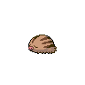

- 文件：[pokemon-id-00220-front-normal-default-static--a9bac7b36435.png](pokemon-id-00220-front-normal-default-static--a9bac7b36435.png)
- 用途：正面普通宝可梦图像；身份和变体来自PokeAPI路径，不作为原应用已经接入的证明。
- 尺寸：96 × 96，帧数：1
- SHA256：`a9bac7b3643501e53c77935d5abb2e83ded7eba968095710c65c051883f8f0b9`
- 来源：[PokeAPI/sprites](https://raw.githubusercontent.com/PokeAPI/sprites/master/sprites/pokemon/220.png)；取得版本：`1dd55c0436d2a5b6e324c0b780e1b1b416fbfb64`

### 宝可梦API ID 221 · 正面 · 普通 · 默认静态来源

- 文件：[pokemon-id-00221-front-normal-default-static--8772ab66d534.png](pokemon-id-00221-front-normal-default-static--8772ab66d534.png)
- 用途：正面普通宝可梦图像；身份和变体来自PokeAPI路径，不作为原应用已经接入的证明。
- 尺寸：96 × 96，帧数：1
- SHA256：`8772ab66d534564021bfc201699c30bd84b11fcc75ffc7fb7a1bb95a4e87ede8`
- 来源：[PokeAPI/sprites](https://raw.githubusercontent.com/PokeAPI/sprites/master/sprites/pokemon/221.png)；取得版本：`1dd55c0436d2a5b6e324c0b780e1b1b416fbfb64`

### 宝可梦API ID 222 · 正面 · 普通 · 默认静态来源

- 文件：[pokemon-id-00222-front-normal-default-static--0a343a429e66.png](pokemon-id-00222-front-normal-default-static--0a343a429e66.png)
- 用途：正面普通宝可梦图像；身份和变体来自PokeAPI路径，不作为原应用已经接入的证明。
- 尺寸：96 × 96，帧数：1
- SHA256：`0a343a429e66e1e18766dd97760f808dbf2f21ccaa5dd4519d668abe8e92ca82`
- 来源：[PokeAPI/sprites](https://raw.githubusercontent.com/PokeAPI/sprites/master/sprites/pokemon/222.png)；取得版本：`1dd55c0436d2a5b6e324c0b780e1b1b416fbfb64`

### 宝可梦API ID 223 · 正面 · 普通 · 默认静态来源

- 文件：[pokemon-id-00223-front-normal-default-static--d7e983a7990b.png](pokemon-id-00223-front-normal-default-static--d7e983a7990b.png)
- 用途：正面普通宝可梦图像；身份和变体来自PokeAPI路径，不作为原应用已经接入的证明。
- 尺寸：96 × 96，帧数：1
- SHA256：`d7e983a7990bc007a789e7361250b07ee711bc8abf3aad5b902ba039e570544c`
- 来源：[PokeAPI/sprites](https://raw.githubusercontent.com/PokeAPI/sprites/master/sprites/pokemon/223.png)；取得版本：`1dd55c0436d2a5b6e324c0b780e1b1b416fbfb64`

### 宝可梦API ID 224 · 正面 · 普通 · 默认静态来源

- 文件：[pokemon-id-00224-front-normal-default-static--4259655bb803.png](pokemon-id-00224-front-normal-default-static--4259655bb803.png)
- 用途：正面普通宝可梦图像；身份和变体来自PokeAPI路径，不作为原应用已经接入的证明。
- 尺寸：96 × 96，帧数：1
- SHA256：`4259655bb803ee470981d8274ad6d73abad7399b450313d251373a7d59d8a15e`
- 来源：[PokeAPI/sprites](https://raw.githubusercontent.com/PokeAPI/sprites/master/sprites/pokemon/224.png)；取得版本：`1dd55c0436d2a5b6e324c0b780e1b1b416fbfb64`

### 宝可梦API ID 225 · 正面 · 普通 · 默认静态来源

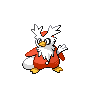

- 文件：[pokemon-id-00225-front-normal-default-static--8935e46983dc.png](pokemon-id-00225-front-normal-default-static--8935e46983dc.png)
- 用途：正面普通宝可梦图像；身份和变体来自PokeAPI路径，不作为原应用已经接入的证明。
- 尺寸：96 × 96，帧数：1
- SHA256：`8935e46983dcfceb165c64c666f53d8223c3ff718c36ccfb123225d6ec843312`
- 来源：[PokeAPI/sprites](https://raw.githubusercontent.com/PokeAPI/sprites/master/sprites/pokemon/225.png)；取得版本：`1dd55c0436d2a5b6e324c0b780e1b1b416fbfb64`

### 宝可梦API ID 226 · 正面 · 普通 · 默认静态来源

- 文件：[pokemon-id-00226-front-normal-default-static--4e4030c38ba4.png](pokemon-id-00226-front-normal-default-static--4e4030c38ba4.png)
- 用途：正面普通宝可梦图像；身份和变体来自PokeAPI路径，不作为原应用已经接入的证明。
- 尺寸：96 × 96，帧数：1
- SHA256：`4e4030c38ba4ebe740d8cd8f084d3710587947aa941d477643f33bd2e47de43e`
- 来源：[PokeAPI/sprites](https://raw.githubusercontent.com/PokeAPI/sprites/master/sprites/pokemon/226.png)；取得版本：`1dd55c0436d2a5b6e324c0b780e1b1b416fbfb64`

### 宝可梦API ID 227 · 正面 · 普通 · 默认静态来源

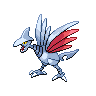

- 文件：[pokemon-id-00227-front-normal-default-static--6dd115778fcf.png](pokemon-id-00227-front-normal-default-static--6dd115778fcf.png)
- 用途：正面普通宝可梦图像；身份和变体来自PokeAPI路径，不作为原应用已经接入的证明。
- 尺寸：96 × 96，帧数：1
- SHA256：`6dd115778fcf5974b2d098c288be64bc91195a46149d00504bfc56032b6411c3`
- 来源：[PokeAPI/sprites](https://raw.githubusercontent.com/PokeAPI/sprites/master/sprites/pokemon/227.png)；取得版本：`1dd55c0436d2a5b6e324c0b780e1b1b416fbfb64`

### 宝可梦API ID 228 · 正面 · 普通 · 默认静态来源

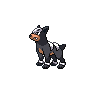

- 文件：[pokemon-id-00228-front-normal-default-static--22c0f4d63c9a.png](pokemon-id-00228-front-normal-default-static--22c0f4d63c9a.png)
- 用途：正面普通宝可梦图像；身份和变体来自PokeAPI路径，不作为原应用已经接入的证明。
- 尺寸：96 × 96，帧数：1
- SHA256：`22c0f4d63c9a906c3153e5b9a0329023ad47b9bcb57b347561cf4cbec36f4130`
- 来源：[PokeAPI/sprites](https://raw.githubusercontent.com/PokeAPI/sprites/master/sprites/pokemon/228.png)；取得版本：`1dd55c0436d2a5b6e324c0b780e1b1b416fbfb64`

### 宝可梦API ID 229 · 正面 · 普通 · 默认静态来源

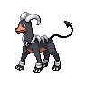

- 文件：[pokemon-id-00229-front-normal-default-static--bbbaa1e9b11a.png](pokemon-id-00229-front-normal-default-static--bbbaa1e9b11a.png)
- 用途：正面普通宝可梦图像；身份和变体来自PokeAPI路径，不作为原应用已经接入的证明。
- 尺寸：96 × 96，帧数：1
- SHA256：`bbbaa1e9b11a8ddd90198bcd4c27561f41e95659dbe2a50bd1fc3f6d6c0e5b59`
- 来源：[PokeAPI/sprites](https://raw.githubusercontent.com/PokeAPI/sprites/master/sprites/pokemon/229.png)；取得版本：`1dd55c0436d2a5b6e324c0b780e1b1b416fbfb64`

### 宝可梦API ID 230 · 正面 · 普通 · 默认静态来源

- 文件：[pokemon-id-00230-front-normal-default-static--f99605bd0b96.png](pokemon-id-00230-front-normal-default-static--f99605bd0b96.png)
- 用途：正面普通宝可梦图像；身份和变体来自PokeAPI路径，不作为原应用已经接入的证明。
- 尺寸：96 × 96，帧数：1
- SHA256：`f99605bd0b9617c2fcefeee6830c81ac5789f60129a7edd40dc2213b5fe2eff1`
- 来源：[PokeAPI/sprites](https://raw.githubusercontent.com/PokeAPI/sprites/master/sprites/pokemon/230.png)；取得版本：`1dd55c0436d2a5b6e324c0b780e1b1b416fbfb64`

### 宝可梦API ID 231 · 正面 · 普通 · 默认静态来源

- 文件：[pokemon-id-00231-front-normal-default-static--f84aa5cedc9f.png](pokemon-id-00231-front-normal-default-static--f84aa5cedc9f.png)
- 用途：正面普通宝可梦图像；身份和变体来自PokeAPI路径，不作为原应用已经接入的证明。
- 尺寸：96 × 96，帧数：1
- SHA256：`f84aa5cedc9f857f0d418de3815161376b45b3575f47041aed3fe79cd83ca900`
- 来源：[PokeAPI/sprites](https://raw.githubusercontent.com/PokeAPI/sprites/master/sprites/pokemon/231.png)；取得版本：`1dd55c0436d2a5b6e324c0b780e1b1b416fbfb64`

### 宝可梦API ID 232 · 正面 · 普通 · 默认静态来源

- 文件：[pokemon-id-00232-front-normal-default-static--8e0d50fdffd0.png](pokemon-id-00232-front-normal-default-static--8e0d50fdffd0.png)
- 用途：正面普通宝可梦图像；身份和变体来自PokeAPI路径，不作为原应用已经接入的证明。
- 尺寸：96 × 96，帧数：1
- SHA256：`8e0d50fdffd0559f9f07c17358266144fc027703945358f6cc59816c2ff02900`
- 来源：[PokeAPI/sprites](https://raw.githubusercontent.com/PokeAPI/sprites/master/sprites/pokemon/232.png)；取得版本：`1dd55c0436d2a5b6e324c0b780e1b1b416fbfb64`

### 宝可梦API ID 233 · 正面 · 普通 · 默认静态来源

- 文件：[pokemon-id-00233-front-normal-default-static--59a42bcc1b42.png](pokemon-id-00233-front-normal-default-static--59a42bcc1b42.png)
- 用途：正面普通宝可梦图像；身份和变体来自PokeAPI路径，不作为原应用已经接入的证明。
- 尺寸：96 × 96，帧数：1
- SHA256：`59a42bcc1b421c14fc843555d6af4e8c5f6c06198b5bb821617f69e8760aa3b3`
- 来源：[PokeAPI/sprites](https://raw.githubusercontent.com/PokeAPI/sprites/master/sprites/pokemon/233.png)；取得版本：`1dd55c0436d2a5b6e324c0b780e1b1b416fbfb64`

### 宝可梦API ID 234 · 正面 · 普通 · 默认静态来源

- 文件：[pokemon-id-00234-front-normal-default-static--a17abefc65f1.png](pokemon-id-00234-front-normal-default-static--a17abefc65f1.png)
- 用途：正面普通宝可梦图像；身份和变体来自PokeAPI路径，不作为原应用已经接入的证明。
- 尺寸：96 × 96，帧数：1
- SHA256：`a17abefc65f11fe9ed5f9f219ffd442335db0d7886e7fee3c93360c6203390d3`
- 来源：[PokeAPI/sprites](https://raw.githubusercontent.com/PokeAPI/sprites/master/sprites/pokemon/234.png)；取得版本：`1dd55c0436d2a5b6e324c0b780e1b1b416fbfb64`

### 宝可梦API ID 235 · 正面 · 普通 · 默认静态来源

- 文件：[pokemon-id-00235-front-normal-default-static--a5bf656a5958.png](pokemon-id-00235-front-normal-default-static--a5bf656a5958.png)
- 用途：正面普通宝可梦图像；身份和变体来自PokeAPI路径，不作为原应用已经接入的证明。
- 尺寸：96 × 96，帧数：1
- SHA256：`a5bf656a5958c30575680992beabb31227df24ac4fec7bfeb4efa6d99cd74c55`
- 来源：[PokeAPI/sprites](https://raw.githubusercontent.com/PokeAPI/sprites/master/sprites/pokemon/235.png)；取得版本：`1dd55c0436d2a5b6e324c0b780e1b1b416fbfb64`

### 宝可梦API ID 236 · 正面 · 普通 · 默认静态来源

- 文件：[pokemon-id-00236-front-normal-default-static--05a018017e67.png](pokemon-id-00236-front-normal-default-static--05a018017e67.png)
- 用途：正面普通宝可梦图像；身份和变体来自PokeAPI路径，不作为原应用已经接入的证明。
- 尺寸：96 × 96，帧数：1
- SHA256：`05a018017e6786f08dc8b4da40de4103544f3145d9be2dfed9cfe0a563c2617a`
- 来源：[PokeAPI/sprites](https://raw.githubusercontent.com/PokeAPI/sprites/master/sprites/pokemon/236.png)；取得版本：`1dd55c0436d2a5b6e324c0b780e1b1b416fbfb64`

### 宝可梦API ID 237 · 正面 · 普通 · 默认静态来源

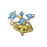

- 文件：[pokemon-id-00237-front-normal-default-static--3e358ac65c23.png](pokemon-id-00237-front-normal-default-static--3e358ac65c23.png)
- 用途：正面普通宝可梦图像；身份和变体来自PokeAPI路径，不作为原应用已经接入的证明。
- 尺寸：96 × 96，帧数：1
- SHA256：`3e358ac65c23dfcdeea00ac7a421d76a7edcd45222fe73f5954544a83a70b8d0`
- 来源：[PokeAPI/sprites](https://raw.githubusercontent.com/PokeAPI/sprites/master/sprites/pokemon/237.png)；取得版本：`1dd55c0436d2a5b6e324c0b780e1b1b416fbfb64`

### 宝可梦API ID 238 · 正面 · 普通 · 默认静态来源

- 文件：[pokemon-id-00238-front-normal-default-static--b42c6e853037.png](pokemon-id-00238-front-normal-default-static--b42c6e853037.png)
- 用途：正面普通宝可梦图像；身份和变体来自PokeAPI路径，不作为原应用已经接入的证明。
- 尺寸：96 × 96，帧数：1
- SHA256：`b42c6e8530375877c865a0394e10ec7dae06c7deff5904253b4bbb47c859834e`
- 来源：[PokeAPI/sprites](https://raw.githubusercontent.com/PokeAPI/sprites/master/sprites/pokemon/238.png)；取得版本：`1dd55c0436d2a5b6e324c0b780e1b1b416fbfb64`

### 宝可梦API ID 239 · 正面 · 普通 · 默认静态来源

- 文件：[pokemon-id-00239-front-normal-default-static--7ad2543207fa.png](pokemon-id-00239-front-normal-default-static--7ad2543207fa.png)
- 用途：正面普通宝可梦图像；身份和变体来自PokeAPI路径，不作为原应用已经接入的证明。
- 尺寸：96 × 96，帧数：1
- SHA256：`7ad2543207fa80e974a6462740cfa5a12d4fab467cdbe69286c3b56a63f2bc77`
- 来源：[PokeAPI/sprites](https://raw.githubusercontent.com/PokeAPI/sprites/master/sprites/pokemon/239.png)；取得版本：`1dd55c0436d2a5b6e324c0b780e1b1b416fbfb64`

### 宝可梦API ID 240 · 正面 · 普通 · 默认静态来源

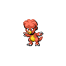

- 文件：[pokemon-id-00240-front-normal-default-static--ba020ddaa6eb.png](pokemon-id-00240-front-normal-default-static--ba020ddaa6eb.png)
- 用途：正面普通宝可梦图像；身份和变体来自PokeAPI路径，不作为原应用已经接入的证明。
- 尺寸：96 × 96，帧数：1
- SHA256：`ba020ddaa6ebe130ed96807ce8a3931e799639272b00348a75e6288514395c12`
- 来源：[PokeAPI/sprites](https://raw.githubusercontent.com/PokeAPI/sprites/master/sprites/pokemon/240.png)；取得版本：`1dd55c0436d2a5b6e324c0b780e1b1b416fbfb64`

### 宝可梦API ID 241 · 正面 · 普通 · 默认静态来源

- 文件：[pokemon-id-00241-front-normal-default-static--090bba4e313d.png](pokemon-id-00241-front-normal-default-static--090bba4e313d.png)
- 用途：正面普通宝可梦图像；身份和变体来自PokeAPI路径，不作为原应用已经接入的证明。
- 尺寸：96 × 96，帧数：1
- SHA256：`090bba4e313d608b12eec8ee2def8a2821565312e79c18936fd755988081c258`
- 来源：[PokeAPI/sprites](https://raw.githubusercontent.com/PokeAPI/sprites/master/sprites/pokemon/241.png)；取得版本：`1dd55c0436d2a5b6e324c0b780e1b1b416fbfb64`

### 宝可梦API ID 242 · 正面 · 普通 · 默认静态来源

- 文件：[pokemon-id-00242-front-normal-default-static--eebf2d67ebad.png](pokemon-id-00242-front-normal-default-static--eebf2d67ebad.png)
- 用途：正面普通宝可梦图像；身份和变体来自PokeAPI路径，不作为原应用已经接入的证明。
- 尺寸：96 × 96，帧数：1
- SHA256：`eebf2d67ebadab3d5e251fd41b500e3835829232af75ddde58dfd5fba79f8fbb`
- 来源：[PokeAPI/sprites](https://raw.githubusercontent.com/PokeAPI/sprites/master/sprites/pokemon/242.png)；取得版本：`1dd55c0436d2a5b6e324c0b780e1b1b416fbfb64`

### 宝可梦API ID 243 · 正面 · 普通 · 默认静态来源

- 文件：[pokemon-id-00243-front-normal-default-static--f0c64d337e0a.png](pokemon-id-00243-front-normal-default-static--f0c64d337e0a.png)
- 用途：正面普通宝可梦图像；身份和变体来自PokeAPI路径，不作为原应用已经接入的证明。
- 尺寸：96 × 96，帧数：1
- SHA256：`f0c64d337e0a035964c69a1db302f3ad9efcb93c4eb5e0cedfd1de700e811ca6`
- 来源：[PokeAPI/sprites](https://raw.githubusercontent.com/PokeAPI/sprites/master/sprites/pokemon/243.png)；取得版本：`1dd55c0436d2a5b6e324c0b780e1b1b416fbfb64`

### 宝可梦API ID 244 · 正面 · 普通 · 默认静态来源

- 文件：[pokemon-id-00244-front-normal-default-static--9c383d3d33ca.png](pokemon-id-00244-front-normal-default-static--9c383d3d33ca.png)
- 用途：正面普通宝可梦图像；身份和变体来自PokeAPI路径，不作为原应用已经接入的证明。
- 尺寸：96 × 96，帧数：1
- SHA256：`9c383d3d33ca389f45a7550e27e9d21a46af6dda64b0276750bee321665202d4`
- 来源：[PokeAPI/sprites](https://raw.githubusercontent.com/PokeAPI/sprites/master/sprites/pokemon/244.png)；取得版本：`1dd55c0436d2a5b6e324c0b780e1b1b416fbfb64`

### 宝可梦API ID 245 · 正面 · 普通 · 默认静态来源

- 文件：[pokemon-id-00245-front-normal-default-static--44bc616b649a.png](pokemon-id-00245-front-normal-default-static--44bc616b649a.png)
- 用途：正面普通宝可梦图像；身份和变体来自PokeAPI路径，不作为原应用已经接入的证明。
- 尺寸：96 × 96，帧数：1
- SHA256：`44bc616b649a3c5a57711c441523d3abddcaa14361574d38fa5d9cad8d4247d9`
- 来源：[PokeAPI/sprites](https://raw.githubusercontent.com/PokeAPI/sprites/master/sprites/pokemon/245.png)；取得版本：`1dd55c0436d2a5b6e324c0b780e1b1b416fbfb64`

### 宝可梦API ID 246 · 正面 · 普通 · 默认静态来源

- 文件：[pokemon-id-00246-front-normal-default-static--3db5dabe76ee.png](pokemon-id-00246-front-normal-default-static--3db5dabe76ee.png)
- 用途：正面普通宝可梦图像；身份和变体来自PokeAPI路径，不作为原应用已经接入的证明。
- 尺寸：96 × 96，帧数：1
- SHA256：`3db5dabe76ee64395dc52660e9ad9f3dd4e9ebc74b33757b13aa544e5a607f3c`
- 来源：[PokeAPI/sprites](https://raw.githubusercontent.com/PokeAPI/sprites/master/sprites/pokemon/246.png)；取得版本：`1dd55c0436d2a5b6e324c0b780e1b1b416fbfb64`

### 宝可梦API ID 247 · 正面 · 普通 · 默认静态来源

- 文件：[pokemon-id-00247-front-normal-default-static--a59e6df931d8.png](pokemon-id-00247-front-normal-default-static--a59e6df931d8.png)
- 用途：正面普通宝可梦图像；身份和变体来自PokeAPI路径，不作为原应用已经接入的证明。
- 尺寸：96 × 96，帧数：1
- SHA256：`a59e6df931d83525f01fb11caba12f5a0079cff425d49eab9e6cf8171f19000d`
- 来源：[PokeAPI/sprites](https://raw.githubusercontent.com/PokeAPI/sprites/master/sprites/pokemon/247.png)；取得版本：`1dd55c0436d2a5b6e324c0b780e1b1b416fbfb64`

### 宝可梦API ID 248 · 正面 · 普通 · 默认静态来源

- 文件：[pokemon-id-00248-front-normal-default-static--92f4a1aaf82f.png](pokemon-id-00248-front-normal-default-static--92f4a1aaf82f.png)
- 用途：正面普通宝可梦图像；身份和变体来自PokeAPI路径，不作为原应用已经接入的证明。
- 尺寸：96 × 96，帧数：1
- SHA256：`92f4a1aaf82fb405720db5c0826acbc626a450a171a2c5ef533b3c23a09981ea`
- 来源：[PokeAPI/sprites](https://raw.githubusercontent.com/PokeAPI/sprites/master/sprites/pokemon/248.png)；取得版本：`1dd55c0436d2a5b6e324c0b780e1b1b416fbfb64`

### 宝可梦API ID 249 · 正面 · 普通 · 默认静态来源

- 文件：[pokemon-id-00249-front-normal-default-static--9e4cf8a68e70.png](pokemon-id-00249-front-normal-default-static--9e4cf8a68e70.png)
- 用途：正面普通宝可梦图像；身份和变体来自PokeAPI路径，不作为原应用已经接入的证明。
- 尺寸：96 × 96，帧数：1
- SHA256：`9e4cf8a68e70df5f4894fcbe1a462d98fbf79bc6a9d6c9f5d58716056bd444af`
- 来源：[PokeAPI/sprites](https://raw.githubusercontent.com/PokeAPI/sprites/master/sprites/pokemon/249.png)；取得版本：`1dd55c0436d2a5b6e324c0b780e1b1b416fbfb64`

### 宝可梦API ID 250 · 正面 · 普通 · 默认静态来源

- 文件：[pokemon-id-00250-front-normal-default-static--820f7733f223.png](pokemon-id-00250-front-normal-default-static--820f7733f223.png)
- 用途：正面普通宝可梦图像；身份和变体来自PokeAPI路径，不作为原应用已经接入的证明。
- 尺寸：96 × 96，帧数：1
- SHA256：`820f7733f223f6f93279c48ca93116213ae94a0433f0721e584349b975d14f1b`
- 来源：[PokeAPI/sprites](https://raw.githubusercontent.com/PokeAPI/sprites/master/sprites/pokemon/250.png)；取得版本：`1dd55c0436d2a5b6e324c0b780e1b1b416fbfb64`

### 宝可梦API ID 251 · 正面 · 普通 · 默认静态来源

- 文件：[pokemon-id-00251-front-normal-default-static--004fce671894.png](pokemon-id-00251-front-normal-default-static--004fce671894.png)
- 用途：正面普通宝可梦图像；身份和变体来自PokeAPI路径，不作为原应用已经接入的证明。
- 尺寸：96 × 96，帧数：1
- SHA256：`004fce671894609bdbb92df123e9c3aa87b4a7f0e3e0eefddde264e1d7488202`
- 来源：[PokeAPI/sprites](https://raw.githubusercontent.com/PokeAPI/sprites/master/sprites/pokemon/251.png)；取得版本：`1dd55c0436d2a5b6e324c0b780e1b1b416fbfb64`

### 宝可梦API ID 252 · 正面 · 普通 · 默认静态来源

- 文件：[pokemon-id-00252-front-normal-default-static--b11641205ce4.png](pokemon-id-00252-front-normal-default-static--b11641205ce4.png)
- 用途：正面普通宝可梦图像；身份和变体来自PokeAPI路径，不作为原应用已经接入的证明。
- 尺寸：96 × 96，帧数：1
- SHA256：`b11641205ce4de7c97fd3a003ffd93c59407b9f347d9d4abb0c41881bf225233`
- 来源：[PokeAPI/sprites](https://raw.githubusercontent.com/PokeAPI/sprites/master/sprites/pokemon/252.png)；取得版本：`1dd55c0436d2a5b6e324c0b780e1b1b416fbfb64`

### 宝可梦API ID 253 · 正面 · 普通 · 默认静态来源

- 文件：[pokemon-id-00253-front-normal-default-static--9ff40ade01ee.png](pokemon-id-00253-front-normal-default-static--9ff40ade01ee.png)
- 用途：正面普通宝可梦图像；身份和变体来自PokeAPI路径，不作为原应用已经接入的证明。
- 尺寸：96 × 96，帧数：1
- SHA256：`9ff40ade01ee5b693b5ca9784231fd289f93bcbaa6640809518f048eeee361fb`
- 来源：[PokeAPI/sprites](https://raw.githubusercontent.com/PokeAPI/sprites/master/sprites/pokemon/253.png)；取得版本：`1dd55c0436d2a5b6e324c0b780e1b1b416fbfb64`

### 宝可梦API ID 254 · 正面 · 普通 · 默认静态来源

- 文件：[pokemon-id-00254-front-normal-default-static--fb92a03e132e.png](pokemon-id-00254-front-normal-default-static--fb92a03e132e.png)
- 用途：正面普通宝可梦图像；身份和变体来自PokeAPI路径，不作为原应用已经接入的证明。
- 尺寸：96 × 96，帧数：1
- SHA256：`fb92a03e132e57463976cbb4c28429aad744c569b4fb4a74f7e6486988b60d36`
- 来源：[PokeAPI/sprites](https://raw.githubusercontent.com/PokeAPI/sprites/master/sprites/pokemon/254.png)；取得版本：`1dd55c0436d2a5b6e324c0b780e1b1b416fbfb64`

### 宝可梦API ID 255 · 正面 · 普通 · 默认静态来源

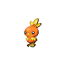

- 文件：[pokemon-id-00255-front-normal-default-static--a51086a27e1d.png](pokemon-id-00255-front-normal-default-static--a51086a27e1d.png)
- 用途：正面普通宝可梦图像；身份和变体来自PokeAPI路径，不作为原应用已经接入的证明。
- 尺寸：96 × 96，帧数：1
- SHA256：`a51086a27e1dbf165311d7a275b1a95a9c5cde8bc6a935669f4d7b5bfc040ac4`
- 来源：[PokeAPI/sprites](https://raw.githubusercontent.com/PokeAPI/sprites/master/sprites/pokemon/255.png)；取得版本：`1dd55c0436d2a5b6e324c0b780e1b1b416fbfb64`

### 宝可梦API ID 256 · 正面 · 普通 · 默认静态来源

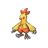

- 文件：[pokemon-id-00256-front-normal-default-static--b183801cdaf4.png](pokemon-id-00256-front-normal-default-static--b183801cdaf4.png)
- 用途：正面普通宝可梦图像；身份和变体来自PokeAPI路径，不作为原应用已经接入的证明。
- 尺寸：96 × 96，帧数：1
- SHA256：`b183801cdaf4a0be3abfc20f64d07d97a3c5de4f7fd26ed9afa85652f13a24d5`
- 来源：[PokeAPI/sprites](https://raw.githubusercontent.com/PokeAPI/sprites/master/sprites/pokemon/256.png)；取得版本：`1dd55c0436d2a5b6e324c0b780e1b1b416fbfb64`

### 宝可梦API ID 257 · 正面 · 普通 · 默认静态来源

- 文件：[pokemon-id-00257-front-normal-default-static--3b310181ab42.png](pokemon-id-00257-front-normal-default-static--3b310181ab42.png)
- 用途：正面普通宝可梦图像；身份和变体来自PokeAPI路径，不作为原应用已经接入的证明。
- 尺寸：96 × 96，帧数：1
- SHA256：`3b310181ab42b7f7cb13ca6d168d4e82d8f25bf455dc69e3d0414f2138105c6e`
- 来源：[PokeAPI/sprites](https://raw.githubusercontent.com/PokeAPI/sprites/master/sprites/pokemon/257.png)；取得版本：`1dd55c0436d2a5b6e324c0b780e1b1b416fbfb64`

### 宝可梦API ID 258 · 正面 · 普通 · 默认静态来源

- 文件：[pokemon-id-00258-front-normal-default-static--27aa6f6a6d37.png](pokemon-id-00258-front-normal-default-static--27aa6f6a6d37.png)
- 用途：正面普通宝可梦图像；身份和变体来自PokeAPI路径，不作为原应用已经接入的证明。
- 尺寸：96 × 96，帧数：1
- SHA256：`27aa6f6a6d376d173109f4c29786ad66bcf2f17bf6a26a45725225652e0cef76`
- 来源：[PokeAPI/sprites](https://raw.githubusercontent.com/PokeAPI/sprites/master/sprites/pokemon/258.png)；取得版本：`1dd55c0436d2a5b6e324c0b780e1b1b416fbfb64`

### 宝可梦API ID 259 · 正面 · 普通 · 默认静态来源

- 文件：[pokemon-id-00259-front-normal-default-static--bec1f7592960.png](pokemon-id-00259-front-normal-default-static--bec1f7592960.png)
- 用途：正面普通宝可梦图像；身份和变体来自PokeAPI路径，不作为原应用已经接入的证明。
- 尺寸：96 × 96，帧数：1
- SHA256：`bec1f7592960e701097a494199a00c170527a899e377c11704cb2efdc834a0b6`
- 来源：[PokeAPI/sprites](https://raw.githubusercontent.com/PokeAPI/sprites/master/sprites/pokemon/259.png)；取得版本：`1dd55c0436d2a5b6e324c0b780e1b1b416fbfb64`

### 宝可梦API ID 260 · 正面 · 普通 · 默认静态来源

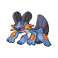

- 文件：[pokemon-id-00260-front-normal-default-static--2ffd66c02c1a.png](pokemon-id-00260-front-normal-default-static--2ffd66c02c1a.png)
- 用途：正面普通宝可梦图像；身份和变体来自PokeAPI路径，不作为原应用已经接入的证明。
- 尺寸：96 × 96，帧数：1
- SHA256：`2ffd66c02c1af9a69df1d7db62a929e3dfa8e71a3df4afa4b6df4a1f434a9c4f`
- 来源：[PokeAPI/sprites](https://raw.githubusercontent.com/PokeAPI/sprites/master/sprites/pokemon/260.png)；取得版本：`1dd55c0436d2a5b6e324c0b780e1b1b416fbfb64`

### 宝可梦API ID 261 · 正面 · 普通 · 默认静态来源

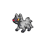

- 文件：[pokemon-id-00261-front-normal-default-static--982b942d9d62.png](pokemon-id-00261-front-normal-default-static--982b942d9d62.png)
- 用途：正面普通宝可梦图像；身份和变体来自PokeAPI路径，不作为原应用已经接入的证明。
- 尺寸：96 × 96，帧数：1
- SHA256：`982b942d9d6260462f38e284a078fdaf9d6b2cb83d18c63ea53375587b8828c5`
- 来源：[PokeAPI/sprites](https://raw.githubusercontent.com/PokeAPI/sprites/master/sprites/pokemon/261.png)；取得版本：`1dd55c0436d2a5b6e324c0b780e1b1b416fbfb64`

### 宝可梦API ID 262 · 正面 · 普通 · 默认静态来源

- 文件：[pokemon-id-00262-front-normal-default-static--740df01d2e2b.png](pokemon-id-00262-front-normal-default-static--740df01d2e2b.png)
- 用途：正面普通宝可梦图像；身份和变体来自PokeAPI路径，不作为原应用已经接入的证明。
- 尺寸：96 × 96，帧数：1
- SHA256：`740df01d2e2b00ca4d884423015a3e832473261e776db55b91275d692c0fd886`
- 来源：[PokeAPI/sprites](https://raw.githubusercontent.com/PokeAPI/sprites/master/sprites/pokemon/262.png)；取得版本：`1dd55c0436d2a5b6e324c0b780e1b1b416fbfb64`

### 宝可梦API ID 263 · 正面 · 普通 · 默认静态来源

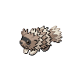

- 文件：[pokemon-id-00263-front-normal-default-static--033d894165ed.png](pokemon-id-00263-front-normal-default-static--033d894165ed.png)
- 用途：正面普通宝可梦图像；身份和变体来自PokeAPI路径，不作为原应用已经接入的证明。
- 尺寸：96 × 96，帧数：1
- SHA256：`033d894165ed0bafc8998537c70fcee14bd3330258745f6f56175bf65599dfb3`
- 来源：[PokeAPI/sprites](https://raw.githubusercontent.com/PokeAPI/sprites/master/sprites/pokemon/263.png)；取得版本：`1dd55c0436d2a5b6e324c0b780e1b1b416fbfb64`

### 宝可梦API ID 264 · 正面 · 普通 · 默认静态来源

- 文件：[pokemon-id-00264-front-normal-default-static--3ffa6b93d0de.png](pokemon-id-00264-front-normal-default-static--3ffa6b93d0de.png)
- 用途：正面普通宝可梦图像；身份和变体来自PokeAPI路径，不作为原应用已经接入的证明。
- 尺寸：96 × 96，帧数：1
- SHA256：`3ffa6b93d0de79c9d9b1139eb399177983fb293400828a499956568cb8d7de5a`
- 来源：[PokeAPI/sprites](https://raw.githubusercontent.com/PokeAPI/sprites/master/sprites/pokemon/264.png)；取得版本：`1dd55c0436d2a5b6e324c0b780e1b1b416fbfb64`

### 宝可梦API ID 265 · 正面 · 普通 · 默认静态来源

- 文件：[pokemon-id-00265-front-normal-default-static--424609a5f9d0.png](pokemon-id-00265-front-normal-default-static--424609a5f9d0.png)
- 用途：正面普通宝可梦图像；身份和变体来自PokeAPI路径，不作为原应用已经接入的证明。
- 尺寸：96 × 96，帧数：1
- SHA256：`424609a5f9d0570c1562c1e8028c581d620080c3c1b976ab1d82539e506f014b`
- 来源：[PokeAPI/sprites](https://raw.githubusercontent.com/PokeAPI/sprites/master/sprites/pokemon/265.png)；取得版本：`1dd55c0436d2a5b6e324c0b780e1b1b416fbfb64`

### 宝可梦API ID 266 · 正面 · 普通 · 默认静态来源

- 文件：[pokemon-id-00266-front-normal-default-static--5f9d5bb56f92.png](pokemon-id-00266-front-normal-default-static--5f9d5bb56f92.png)
- 用途：正面普通宝可梦图像；身份和变体来自PokeAPI路径，不作为原应用已经接入的证明。
- 尺寸：96 × 96，帧数：1
- SHA256：`5f9d5bb56f9295f8d46d6053d6a8981e6e1514893a90bb1f3ed1fa30ab8fbce8`
- 来源：[PokeAPI/sprites](https://raw.githubusercontent.com/PokeAPI/sprites/master/sprites/pokemon/266.png)；取得版本：`1dd55c0436d2a5b6e324c0b780e1b1b416fbfb64`

### 宝可梦API ID 267 · 正面 · 普通 · 默认静态来源

- 文件：[pokemon-id-00267-front-normal-default-static--5ba58d0c9a8c.png](pokemon-id-00267-front-normal-default-static--5ba58d0c9a8c.png)
- 用途：正面普通宝可梦图像；身份和变体来自PokeAPI路径，不作为原应用已经接入的证明。
- 尺寸：96 × 96，帧数：1
- SHA256：`5ba58d0c9a8c24c49663c59cbcfc6574257667930734480ea4093545282919c2`
- 来源：[PokeAPI/sprites](https://raw.githubusercontent.com/PokeAPI/sprites/master/sprites/pokemon/267.png)；取得版本：`1dd55c0436d2a5b6e324c0b780e1b1b416fbfb64`

### 宝可梦API ID 268 · 正面 · 普通 · 默认静态来源

- 文件：[pokemon-id-00268-front-normal-default-static--392734f8375c.png](pokemon-id-00268-front-normal-default-static--392734f8375c.png)
- 用途：正面普通宝可梦图像；身份和变体来自PokeAPI路径，不作为原应用已经接入的证明。
- 尺寸：96 × 96，帧数：1
- SHA256：`392734f8375c4ed7d0483165bd9295eba90afc359457a2215181d720f93f4422`
- 来源：[PokeAPI/sprites](https://raw.githubusercontent.com/PokeAPI/sprites/master/sprites/pokemon/268.png)；取得版本：`1dd55c0436d2a5b6e324c0b780e1b1b416fbfb64`

### 宝可梦API ID 269 · 正面 · 普通 · 默认静态来源

- 文件：[pokemon-id-00269-front-normal-default-static--8b4b28f49d9e.png](pokemon-id-00269-front-normal-default-static--8b4b28f49d9e.png)
- 用途：正面普通宝可梦图像；身份和变体来自PokeAPI路径，不作为原应用已经接入的证明。
- 尺寸：96 × 96，帧数：1
- SHA256：`8b4b28f49d9e7de414bb19bf131935d074881546bb04f4eb5738954584b6c453`
- 来源：[PokeAPI/sprites](https://raw.githubusercontent.com/PokeAPI/sprites/master/sprites/pokemon/269.png)；取得版本：`1dd55c0436d2a5b6e324c0b780e1b1b416fbfb64`

### 宝可梦API ID 270 · 正面 · 普通 · 默认静态来源

- 文件：[pokemon-id-00270-front-normal-default-static--0507efe246b5.png](pokemon-id-00270-front-normal-default-static--0507efe246b5.png)
- 用途：正面普通宝可梦图像；身份和变体来自PokeAPI路径，不作为原应用已经接入的证明。
- 尺寸：96 × 96，帧数：1
- SHA256：`0507efe246b54cd29c61171034f5948bfd2987b486801ef8f022a63c38ba12e1`
- 来源：[PokeAPI/sprites](https://raw.githubusercontent.com/PokeAPI/sprites/master/sprites/pokemon/270.png)；取得版本：`1dd55c0436d2a5b6e324c0b780e1b1b416fbfb64`

### 宝可梦API ID 271 · 正面 · 普通 · 默认静态来源

- 文件：[pokemon-id-00271-front-normal-default-static--93002ba89440.png](pokemon-id-00271-front-normal-default-static--93002ba89440.png)
- 用途：正面普通宝可梦图像；身份和变体来自PokeAPI路径，不作为原应用已经接入的证明。
- 尺寸：96 × 96，帧数：1
- SHA256：`93002ba89440b27cda59c7c134d20027ac9629614d1a7e6fe2b19ab0cbbc6a8f`
- 来源：[PokeAPI/sprites](https://raw.githubusercontent.com/PokeAPI/sprites/master/sprites/pokemon/271.png)；取得版本：`1dd55c0436d2a5b6e324c0b780e1b1b416fbfb64`

### 宝可梦API ID 272 · 正面 · 普通 · 默认静态来源

- 文件：[pokemon-id-00272-front-normal-default-static--82f07ae1a6bb.png](pokemon-id-00272-front-normal-default-static--82f07ae1a6bb.png)
- 用途：正面普通宝可梦图像；身份和变体来自PokeAPI路径，不作为原应用已经接入的证明。
- 尺寸：96 × 96，帧数：1
- SHA256：`82f07ae1a6bb9d208e90b4b836da1c4ca52f072484068d1b632b926bd74a2345`
- 来源：[PokeAPI/sprites](https://raw.githubusercontent.com/PokeAPI/sprites/master/sprites/pokemon/272.png)；取得版本：`1dd55c0436d2a5b6e324c0b780e1b1b416fbfb64`

### 宝可梦API ID 273 · 正面 · 普通 · 默认静态来源

- 文件：[pokemon-id-00273-front-normal-default-static--1d90ee9fbefb.png](pokemon-id-00273-front-normal-default-static--1d90ee9fbefb.png)
- 用途：正面普通宝可梦图像；身份和变体来自PokeAPI路径，不作为原应用已经接入的证明。
- 尺寸：96 × 96，帧数：1
- SHA256：`1d90ee9fbefbfaa9d6b375609b6079bc5b6f8d14838261a48c4ed1293bfa618c`
- 来源：[PokeAPI/sprites](https://raw.githubusercontent.com/PokeAPI/sprites/master/sprites/pokemon/273.png)；取得版本：`1dd55c0436d2a5b6e324c0b780e1b1b416fbfb64`

### 宝可梦API ID 274 · 正面 · 普通 · 默认静态来源

- 文件：[pokemon-id-00274-front-normal-default-static--bd8082f6e2e1.png](pokemon-id-00274-front-normal-default-static--bd8082f6e2e1.png)
- 用途：正面普通宝可梦图像；身份和变体来自PokeAPI路径，不作为原应用已经接入的证明。
- 尺寸：96 × 96，帧数：1
- SHA256：`bd8082f6e2e1df668777ecf24133070af74ed3ad031ab882b925de29a13ecb1c`
- 来源：[PokeAPI/sprites](https://raw.githubusercontent.com/PokeAPI/sprites/master/sprites/pokemon/274.png)；取得版本：`1dd55c0436d2a5b6e324c0b780e1b1b416fbfb64`

### 宝可梦API ID 275 · 正面 · 普通 · 默认静态来源

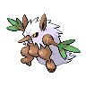

- 文件：[pokemon-id-00275-front-normal-default-static--31bb06c81fad.png](pokemon-id-00275-front-normal-default-static--31bb06c81fad.png)
- 用途：正面普通宝可梦图像；身份和变体来自PokeAPI路径，不作为原应用已经接入的证明。
- 尺寸：96 × 96，帧数：1
- SHA256：`31bb06c81fadaa9d7a3dc60908c642ab34d00163842aa2f8bd8eaac8dc7b10f0`
- 来源：[PokeAPI/sprites](https://raw.githubusercontent.com/PokeAPI/sprites/master/sprites/pokemon/275.png)；取得版本：`1dd55c0436d2a5b6e324c0b780e1b1b416fbfb64`

### 宝可梦API ID 276 · 正面 · 普通 · 默认静态来源

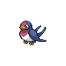

- 文件：[pokemon-id-00276-front-normal-default-static--b45818151855.png](pokemon-id-00276-front-normal-default-static--b45818151855.png)
- 用途：正面普通宝可梦图像；身份和变体来自PokeAPI路径，不作为原应用已经接入的证明。
- 尺寸：96 × 96，帧数：1
- SHA256：`b4581815185582e7d05ef8766f17bdb13c372da9179c2c13b3b6db9a94778f02`
- 来源：[PokeAPI/sprites](https://raw.githubusercontent.com/PokeAPI/sprites/master/sprites/pokemon/276.png)；取得版本：`1dd55c0436d2a5b6e324c0b780e1b1b416fbfb64`

### 宝可梦API ID 277 · 正面 · 普通 · 默认静态来源

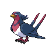

- 文件：[pokemon-id-00277-front-normal-default-static--a450d795c882.png](pokemon-id-00277-front-normal-default-static--a450d795c882.png)
- 用途：正面普通宝可梦图像；身份和变体来自PokeAPI路径，不作为原应用已经接入的证明。
- 尺寸：96 × 96，帧数：1
- SHA256：`a450d795c88215275772cf32e8613cf670916aa740b553d83c0c8b588c083087`
- 来源：[PokeAPI/sprites](https://raw.githubusercontent.com/PokeAPI/sprites/master/sprites/pokemon/277.png)；取得版本：`1dd55c0436d2a5b6e324c0b780e1b1b416fbfb64`

### 宝可梦API ID 278 · 正面 · 普通 · 默认静态来源

- 文件：[pokemon-id-00278-front-normal-default-static--959c86d401cb.png](pokemon-id-00278-front-normal-default-static--959c86d401cb.png)
- 用途：正面普通宝可梦图像；身份和变体来自PokeAPI路径，不作为原应用已经接入的证明。
- 尺寸：96 × 96，帧数：1
- SHA256：`959c86d401cb09354710dfe2483089c53ae8d5cb9164591527900238e1b8a391`
- 来源：[PokeAPI/sprites](https://raw.githubusercontent.com/PokeAPI/sprites/master/sprites/pokemon/278.png)；取得版本：`1dd55c0436d2a5b6e324c0b780e1b1b416fbfb64`

### 宝可梦API ID 279 · 正面 · 普通 · 默认静态来源

- 文件：[pokemon-id-00279-front-normal-default-static--12d64f19c2dd.png](pokemon-id-00279-front-normal-default-static--12d64f19c2dd.png)
- 用途：正面普通宝可梦图像；身份和变体来自PokeAPI路径，不作为原应用已经接入的证明。
- 尺寸：96 × 96，帧数：1
- SHA256：`12d64f19c2dd35dcf21ee65418cee9749139cabc4b3a1b070b3673269e62367d`
- 来源：[PokeAPI/sprites](https://raw.githubusercontent.com/PokeAPI/sprites/master/sprites/pokemon/279.png)；取得版本：`1dd55c0436d2a5b6e324c0b780e1b1b416fbfb64`

### 宝可梦API ID 280 · 正面 · 普通 · 默认静态来源

- 文件：[pokemon-id-00280-front-normal-default-static--b8a0cc4ff47f.png](pokemon-id-00280-front-normal-default-static--b8a0cc4ff47f.png)
- 用途：正面普通宝可梦图像；身份和变体来自PokeAPI路径，不作为原应用已经接入的证明。
- 尺寸：96 × 96，帧数：1
- SHA256：`b8a0cc4ff47f7af19b0c68fe139a0396ad50c2d06219897020334665fcf529e7`
- 来源：[PokeAPI/sprites](https://raw.githubusercontent.com/PokeAPI/sprites/master/sprites/pokemon/280.png)；取得版本：`1dd55c0436d2a5b6e324c0b780e1b1b416fbfb64`

### 宝可梦API ID 281 · 正面 · 普通 · 默认静态来源

- 文件：[pokemon-id-00281-front-normal-default-static--c5a628df21e0.png](pokemon-id-00281-front-normal-default-static--c5a628df21e0.png)
- 用途：正面普通宝可梦图像；身份和变体来自PokeAPI路径，不作为原应用已经接入的证明。
- 尺寸：96 × 96，帧数：1
- SHA256：`c5a628df21e09e076dc3e3951e64508378f5461cd9c4826dc293608fc5d1c284`
- 来源：[PokeAPI/sprites](https://raw.githubusercontent.com/PokeAPI/sprites/master/sprites/pokemon/281.png)；取得版本：`1dd55c0436d2a5b6e324c0b780e1b1b416fbfb64`

### 宝可梦API ID 282 · 正面 · 普通 · 默认静态来源

- 文件：[pokemon-id-00282-front-normal-default-static--702fbd5d9b7c.png](pokemon-id-00282-front-normal-default-static--702fbd5d9b7c.png)
- 用途：正面普通宝可梦图像；身份和变体来自PokeAPI路径，不作为原应用已经接入的证明。
- 尺寸：96 × 96，帧数：1
- SHA256：`702fbd5d9b7c2c87f4f2e4b276f3d4f8f58f21f924b767d8fac9da10b95e2cea`
- 来源：[PokeAPI/sprites](https://raw.githubusercontent.com/PokeAPI/sprites/master/sprites/pokemon/282.png)；取得版本：`1dd55c0436d2a5b6e324c0b780e1b1b416fbfb64`

### 宝可梦API ID 283 · 正面 · 普通 · 默认静态来源

- 文件：[pokemon-id-00283-front-normal-default-static--3dbbdc85441e.png](pokemon-id-00283-front-normal-default-static--3dbbdc85441e.png)
- 用途：正面普通宝可梦图像；身份和变体来自PokeAPI路径，不作为原应用已经接入的证明。
- 尺寸：96 × 96，帧数：1
- SHA256：`3dbbdc85441e202fb29141a76dfbaa6c4c112c1dc3733cdf6c743d012d57e09b`
- 来源：[PokeAPI/sprites](https://raw.githubusercontent.com/PokeAPI/sprites/master/sprites/pokemon/283.png)；取得版本：`1dd55c0436d2a5b6e324c0b780e1b1b416fbfb64`

### 宝可梦API ID 284 · 正面 · 普通 · 默认静态来源

- 文件：[pokemon-id-00284-front-normal-default-static--9753f1c4ff63.png](pokemon-id-00284-front-normal-default-static--9753f1c4ff63.png)
- 用途：正面普通宝可梦图像；身份和变体来自PokeAPI路径，不作为原应用已经接入的证明。
- 尺寸：96 × 96，帧数：1
- SHA256：`9753f1c4ff634641ae425911580daa26645ce0fac57ed2df4e9a1bacf426fc17`
- 来源：[PokeAPI/sprites](https://raw.githubusercontent.com/PokeAPI/sprites/master/sprites/pokemon/284.png)；取得版本：`1dd55c0436d2a5b6e324c0b780e1b1b416fbfb64`

### 宝可梦API ID 285 · 正面 · 普通 · 默认静态来源

- 文件：[pokemon-id-00285-front-normal-default-static--ea7e167a9745.png](pokemon-id-00285-front-normal-default-static--ea7e167a9745.png)
- 用途：正面普通宝可梦图像；身份和变体来自PokeAPI路径，不作为原应用已经接入的证明。
- 尺寸：96 × 96，帧数：1
- SHA256：`ea7e167a97452e9611d09728c0108bc6d1ca2c42a6e5d99fb2c971cf1a1eb8b6`
- 来源：[PokeAPI/sprites](https://raw.githubusercontent.com/PokeAPI/sprites/master/sprites/pokemon/285.png)；取得版本：`1dd55c0436d2a5b6e324c0b780e1b1b416fbfb64`

### 宝可梦API ID 286 · 正面 · 普通 · 默认静态来源

- 文件：[pokemon-id-00286-front-normal-default-static--d2721b50d178.png](pokemon-id-00286-front-normal-default-static--d2721b50d178.png)
- 用途：正面普通宝可梦图像；身份和变体来自PokeAPI路径，不作为原应用已经接入的证明。
- 尺寸：96 × 96，帧数：1
- SHA256：`d2721b50d1780d995d66aad031487cc85a8c2f0036defe3f894f77ff19b9f029`
- 来源：[PokeAPI/sprites](https://raw.githubusercontent.com/PokeAPI/sprites/master/sprites/pokemon/286.png)；取得版本：`1dd55c0436d2a5b6e324c0b780e1b1b416fbfb64`

### 宝可梦API ID 287 · 正面 · 普通 · 默认静态来源

- 文件：[pokemon-id-00287-front-normal-default-static--f4f39b3074c4.png](pokemon-id-00287-front-normal-default-static--f4f39b3074c4.png)
- 用途：正面普通宝可梦图像；身份和变体来自PokeAPI路径，不作为原应用已经接入的证明。
- 尺寸：96 × 96，帧数：1
- SHA256：`f4f39b3074c4415a6dbcc6ebc6e36697e385d1ba2d4ed0f3a830f7680af819cc`
- 来源：[PokeAPI/sprites](https://raw.githubusercontent.com/PokeAPI/sprites/master/sprites/pokemon/287.png)；取得版本：`1dd55c0436d2a5b6e324c0b780e1b1b416fbfb64`

### 宝可梦API ID 288 · 正面 · 普通 · 默认静态来源

- 文件：[pokemon-id-00288-front-normal-default-static--bd64b434beb1.png](pokemon-id-00288-front-normal-default-static--bd64b434beb1.png)
- 用途：正面普通宝可梦图像；身份和变体来自PokeAPI路径，不作为原应用已经接入的证明。
- 尺寸：96 × 96，帧数：1
- SHA256：`bd64b434beb1236343cc8f99eb7641ef61ea7eae5ab2a6da0e18325b1208a1ac`
- 来源：[PokeAPI/sprites](https://raw.githubusercontent.com/PokeAPI/sprites/master/sprites/pokemon/288.png)；取得版本：`1dd55c0436d2a5b6e324c0b780e1b1b416fbfb64`

### 宝可梦API ID 289 · 正面 · 普通 · 默认静态来源

- 文件：[pokemon-id-00289-front-normal-default-static--eb2efc79fc51.png](pokemon-id-00289-front-normal-default-static--eb2efc79fc51.png)
- 用途：正面普通宝可梦图像；身份和变体来自PokeAPI路径，不作为原应用已经接入的证明。
- 尺寸：96 × 96，帧数：1
- SHA256：`eb2efc79fc51dd493e9b7b23b252b31a9946bb25bda873ce8291dd57e29dc414`
- 来源：[PokeAPI/sprites](https://raw.githubusercontent.com/PokeAPI/sprites/master/sprites/pokemon/289.png)；取得版本：`1dd55c0436d2a5b6e324c0b780e1b1b416fbfb64`

### 宝可梦API ID 290 · 正面 · 普通 · 默认静态来源

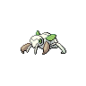

- 文件：[pokemon-id-00290-front-normal-default-static--c06d4471a603.png](pokemon-id-00290-front-normal-default-static--c06d4471a603.png)
- 用途：正面普通宝可梦图像；身份和变体来自PokeAPI路径，不作为原应用已经接入的证明。
- 尺寸：96 × 96，帧数：1
- SHA256：`c06d4471a603fe4b8be5b0a2ca56a5cce3d353f49c77b13690b91c024b473d8e`
- 来源：[PokeAPI/sprites](https://raw.githubusercontent.com/PokeAPI/sprites/master/sprites/pokemon/290.png)；取得版本：`1dd55c0436d2a5b6e324c0b780e1b1b416fbfb64`

### 宝可梦API ID 291 · 正面 · 普通 · 默认静态来源

- 文件：[pokemon-id-00291-front-normal-default-static--2ecb0149e0d8.png](pokemon-id-00291-front-normal-default-static--2ecb0149e0d8.png)
- 用途：正面普通宝可梦图像；身份和变体来自PokeAPI路径，不作为原应用已经接入的证明。
- 尺寸：96 × 96，帧数：1
- SHA256：`2ecb0149e0d88763f79ed219f50f6ba94be8edf6c409b1a901c0217eda02a00e`
- 来源：[PokeAPI/sprites](https://raw.githubusercontent.com/PokeAPI/sprites/master/sprites/pokemon/291.png)；取得版本：`1dd55c0436d2a5b6e324c0b780e1b1b416fbfb64`

### 宝可梦API ID 292 · 正面 · 普通 · 默认静态来源

- 文件：[pokemon-id-00292-front-normal-default-static--fae31977a5f6.png](pokemon-id-00292-front-normal-default-static--fae31977a5f6.png)
- 用途：正面普通宝可梦图像；身份和变体来自PokeAPI路径，不作为原应用已经接入的证明。
- 尺寸：96 × 96，帧数：1
- SHA256：`fae31977a5f6a3733ec3ff07b78113496eb4305a68d8a2f2437bb4e919556e5e`
- 来源：[PokeAPI/sprites](https://raw.githubusercontent.com/PokeAPI/sprites/master/sprites/pokemon/292.png)；取得版本：`1dd55c0436d2a5b6e324c0b780e1b1b416fbfb64`

### 宝可梦API ID 293 · 正面 · 普通 · 默认静态来源

- 文件：[pokemon-id-00293-front-normal-default-static--5f9e2ddb018d.png](pokemon-id-00293-front-normal-default-static--5f9e2ddb018d.png)
- 用途：正面普通宝可梦图像；身份和变体来自PokeAPI路径，不作为原应用已经接入的证明。
- 尺寸：96 × 96，帧数：1
- SHA256：`5f9e2ddb018d4aec24c78f1b55a5e7e482e930bafa6b8b9d15c02105d8936824`
- 来源：[PokeAPI/sprites](https://raw.githubusercontent.com/PokeAPI/sprites/master/sprites/pokemon/293.png)；取得版本：`1dd55c0436d2a5b6e324c0b780e1b1b416fbfb64`

### 宝可梦API ID 294 · 正面 · 普通 · 默认静态来源

- 文件：[pokemon-id-00294-front-normal-default-static--fdadee09226d.png](pokemon-id-00294-front-normal-default-static--fdadee09226d.png)
- 用途：正面普通宝可梦图像；身份和变体来自PokeAPI路径，不作为原应用已经接入的证明。
- 尺寸：96 × 96，帧数：1
- SHA256：`fdadee09226d356d44daf73ed8f661da194fc40cbb9f31df13cd17c30cb041c4`
- 来源：[PokeAPI/sprites](https://raw.githubusercontent.com/PokeAPI/sprites/master/sprites/pokemon/294.png)；取得版本：`1dd55c0436d2a5b6e324c0b780e1b1b416fbfb64`

### 宝可梦API ID 295 · 正面 · 普通 · 默认静态来源

- 文件：[pokemon-id-00295-front-normal-default-static--185a4398ecff.png](pokemon-id-00295-front-normal-default-static--185a4398ecff.png)
- 用途：正面普通宝可梦图像；身份和变体来自PokeAPI路径，不作为原应用已经接入的证明。
- 尺寸：96 × 96，帧数：1
- SHA256：`185a4398ecff97e1f088c6938b4a64bc2b5630044048dfb82e349b72c35d6839`
- 来源：[PokeAPI/sprites](https://raw.githubusercontent.com/PokeAPI/sprites/master/sprites/pokemon/295.png)；取得版本：`1dd55c0436d2a5b6e324c0b780e1b1b416fbfb64`

### 宝可梦API ID 296 · 正面 · 普通 · 默认静态来源

- 文件：[pokemon-id-00296-front-normal-default-static--b6d9f8ab08ec.png](pokemon-id-00296-front-normal-default-static--b6d9f8ab08ec.png)
- 用途：正面普通宝可梦图像；身份和变体来自PokeAPI路径，不作为原应用已经接入的证明。
- 尺寸：96 × 96，帧数：1
- SHA256：`b6d9f8ab08ecde302abfea2a94151af3bf7eefa1e6613fe87a5ed0ce480b3dbe`
- 来源：[PokeAPI/sprites](https://raw.githubusercontent.com/PokeAPI/sprites/master/sprites/pokemon/296.png)；取得版本：`1dd55c0436d2a5b6e324c0b780e1b1b416fbfb64`

### 宝可梦API ID 297 · 正面 · 普通 · 默认静态来源

- 文件：[pokemon-id-00297-front-normal-default-static--5922d2694a87.png](pokemon-id-00297-front-normal-default-static--5922d2694a87.png)
- 用途：正面普通宝可梦图像；身份和变体来自PokeAPI路径，不作为原应用已经接入的证明。
- 尺寸：96 × 96，帧数：1
- SHA256：`5922d2694a8707a357d7d768161b7feb89a255c1e00378f88a9734391e634682`
- 来源：[PokeAPI/sprites](https://raw.githubusercontent.com/PokeAPI/sprites/master/sprites/pokemon/297.png)；取得版本：`1dd55c0436d2a5b6e324c0b780e1b1b416fbfb64`

### 宝可梦API ID 298 · 正面 · 普通 · 默认静态来源

- 文件：[pokemon-id-00298-front-normal-default-static--a868f1a27f64.png](pokemon-id-00298-front-normal-default-static--a868f1a27f64.png)
- 用途：正面普通宝可梦图像；身份和变体来自PokeAPI路径，不作为原应用已经接入的证明。
- 尺寸：96 × 96，帧数：1
- SHA256：`a868f1a27f6415a3e91e1cac40161008cc0b65dd48fef6ca4c40a818b21da6de`
- 来源：[PokeAPI/sprites](https://raw.githubusercontent.com/PokeAPI/sprites/master/sprites/pokemon/298.png)；取得版本：`1dd55c0436d2a5b6e324c0b780e1b1b416fbfb64`

### 宝可梦API ID 299 · 正面 · 普通 · 默认静态来源

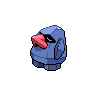

- 文件：[pokemon-id-00299-front-normal-default-static--b9f6e396298a.png](pokemon-id-00299-front-normal-default-static--b9f6e396298a.png)
- 用途：正面普通宝可梦图像；身份和变体来自PokeAPI路径，不作为原应用已经接入的证明。
- 尺寸：96 × 96，帧数：1
- SHA256：`b9f6e396298a38cbb5689c8b88f93b75fb8d634b1cf40232d7be196af13981e8`
- 来源：[PokeAPI/sprites](https://raw.githubusercontent.com/PokeAPI/sprites/master/sprites/pokemon/299.png)；取得版本：`1dd55c0436d2a5b6e324c0b780e1b1b416fbfb64`

### 宝可梦API ID 300 · 正面 · 普通 · 默认静态来源

- 文件：[pokemon-id-00300-front-normal-default-static--a7d08619f095.png](pokemon-id-00300-front-normal-default-static--a7d08619f095.png)
- 用途：正面普通宝可梦图像；身份和变体来自PokeAPI路径，不作为原应用已经接入的证明。
- 尺寸：96 × 96，帧数：1
- SHA256：`a7d08619f095e59b2026b432f8a54949551ca3f55298aa8096bf9ae6c624bff9`
- 来源：[PokeAPI/sprites](https://raw.githubusercontent.com/PokeAPI/sprites/master/sprites/pokemon/300.png)；取得版本：`1dd55c0436d2a5b6e324c0b780e1b1b416fbfb64`

### 宝可梦API ID 301 · 正面 · 普通 · 默认静态来源

- 文件：[pokemon-id-00301-front-normal-default-static--f2cf34a7e0dd.png](pokemon-id-00301-front-normal-default-static--f2cf34a7e0dd.png)
- 用途：正面普通宝可梦图像；身份和变体来自PokeAPI路径，不作为原应用已经接入的证明。
- 尺寸：96 × 96，帧数：1
- SHA256：`f2cf34a7e0dd1414c82ad7f09c9c9e997afec47d35c3f59846d4a8c8d3edae48`
- 来源：[PokeAPI/sprites](https://raw.githubusercontent.com/PokeAPI/sprites/master/sprites/pokemon/301.png)；取得版本：`1dd55c0436d2a5b6e324c0b780e1b1b416fbfb64`

### 宝可梦API ID 302 · 正面 · 普通 · 默认静态来源

- 文件：[pokemon-id-00302-front-normal-default-static--0580531dc8fb.png](pokemon-id-00302-front-normal-default-static--0580531dc8fb.png)
- 用途：正面普通宝可梦图像；身份和变体来自PokeAPI路径，不作为原应用已经接入的证明。
- 尺寸：96 × 96，帧数：1
- SHA256：`0580531dc8fb6d289386e4cf9d53d015460eaa2eb31888c20cc1b8df42b34b94`
- 来源：[PokeAPI/sprites](https://raw.githubusercontent.com/PokeAPI/sprites/master/sprites/pokemon/302.png)；取得版本：`1dd55c0436d2a5b6e324c0b780e1b1b416fbfb64`

### 宝可梦API ID 303 · 正面 · 普通 · 默认静态来源

- 文件：[pokemon-id-00303-front-normal-default-static--9fba6a740890.png](pokemon-id-00303-front-normal-default-static--9fba6a740890.png)
- 用途：正面普通宝可梦图像；身份和变体来自PokeAPI路径，不作为原应用已经接入的证明。
- 尺寸：96 × 96，帧数：1
- SHA256：`9fba6a7408901606f41d04290c72b41a4e8dda9d20b9ca9afecc1869f18b1348`
- 来源：[PokeAPI/sprites](https://raw.githubusercontent.com/PokeAPI/sprites/master/sprites/pokemon/303.png)；取得版本：`1dd55c0436d2a5b6e324c0b780e1b1b416fbfb64`

### 宝可梦API ID 304 · 正面 · 普通 · 默认静态来源

- 文件：[pokemon-id-00304-front-normal-default-static--a2c2046cbe1d.png](pokemon-id-00304-front-normal-default-static--a2c2046cbe1d.png)
- 用途：正面普通宝可梦图像；身份和变体来自PokeAPI路径，不作为原应用已经接入的证明。
- 尺寸：96 × 96，帧数：1
- SHA256：`a2c2046cbe1dbeb849787c7a0e93215a41fa7024c596f63a416b719029c6ddca`
- 来源：[PokeAPI/sprites](https://raw.githubusercontent.com/PokeAPI/sprites/master/sprites/pokemon/304.png)；取得版本：`1dd55c0436d2a5b6e324c0b780e1b1b416fbfb64`

### 宝可梦API ID 305 · 正面 · 普通 · 默认静态来源

- 文件：[pokemon-id-00305-front-normal-default-static--e8ef1a67c1d4.png](pokemon-id-00305-front-normal-default-static--e8ef1a67c1d4.png)
- 用途：正面普通宝可梦图像；身份和变体来自PokeAPI路径，不作为原应用已经接入的证明。
- 尺寸：96 × 96，帧数：1
- SHA256：`e8ef1a67c1d482c893f226a03bda11950a0952b00f1840f8308bb7e1b313ea7c`
- 来源：[PokeAPI/sprites](https://raw.githubusercontent.com/PokeAPI/sprites/master/sprites/pokemon/305.png)；取得版本：`1dd55c0436d2a5b6e324c0b780e1b1b416fbfb64`

### 宝可梦API ID 306 · 正面 · 普通 · 默认静态来源

- 文件：[pokemon-id-00306-front-normal-default-static--b6db65b3b1f6.png](pokemon-id-00306-front-normal-default-static--b6db65b3b1f6.png)
- 用途：正面普通宝可梦图像；身份和变体来自PokeAPI路径，不作为原应用已经接入的证明。
- 尺寸：96 × 96，帧数：1
- SHA256：`b6db65b3b1f6ccabb0e1efd91525a3dfe6965fd11d88ed50113bc96d5b949303`
- 来源：[PokeAPI/sprites](https://raw.githubusercontent.com/PokeAPI/sprites/master/sprites/pokemon/306.png)；取得版本：`1dd55c0436d2a5b6e324c0b780e1b1b416fbfb64`

### 宝可梦API ID 307 · 正面 · 普通 · 默认静态来源

- 文件：[pokemon-id-00307-front-normal-default-static--124c484e2e8c.png](pokemon-id-00307-front-normal-default-static--124c484e2e8c.png)
- 用途：正面普通宝可梦图像；身份和变体来自PokeAPI路径，不作为原应用已经接入的证明。
- 尺寸：96 × 96，帧数：1
- SHA256：`124c484e2e8c1fea95999812db64fb639350a2e337300fa082a49833252e4174`
- 来源：[PokeAPI/sprites](https://raw.githubusercontent.com/PokeAPI/sprites/master/sprites/pokemon/307.png)；取得版本：`1dd55c0436d2a5b6e324c0b780e1b1b416fbfb64`

### 宝可梦API ID 308 · 正面 · 普通 · 默认静态来源

- 文件：[pokemon-id-00308-front-normal-default-static--363c7071f27e.png](pokemon-id-00308-front-normal-default-static--363c7071f27e.png)
- 用途：正面普通宝可梦图像；身份和变体来自PokeAPI路径，不作为原应用已经接入的证明。
- 尺寸：96 × 96，帧数：1
- SHA256：`363c7071f27ec4ceb0ddd5d09fd8fb665ce013aabe11b632bfcce639473aa566`
- 来源：[PokeAPI/sprites](https://raw.githubusercontent.com/PokeAPI/sprites/master/sprites/pokemon/308.png)；取得版本：`1dd55c0436d2a5b6e324c0b780e1b1b416fbfb64`

### 宝可梦API ID 309 · 正面 · 普通 · 默认静态来源

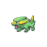

- 文件：[pokemon-id-00309-front-normal-default-static--84b2199df395.png](pokemon-id-00309-front-normal-default-static--84b2199df395.png)
- 用途：正面普通宝可梦图像；身份和变体来自PokeAPI路径，不作为原应用已经接入的证明。
- 尺寸：96 × 96，帧数：1
- SHA256：`84b2199df395bb5031ff7a8ba70da3cdd789c984ac55e52891da488939699a96`
- 来源：[PokeAPI/sprites](https://raw.githubusercontent.com/PokeAPI/sprites/master/sprites/pokemon/309.png)；取得版本：`1dd55c0436d2a5b6e324c0b780e1b1b416fbfb64`

### 宝可梦API ID 310 · 正面 · 普通 · 默认静态来源

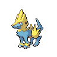

- 文件：[pokemon-id-00310-front-normal-default-static--505989c11c36.png](pokemon-id-00310-front-normal-default-static--505989c11c36.png)
- 用途：正面普通宝可梦图像；身份和变体来自PokeAPI路径，不作为原应用已经接入的证明。
- 尺寸：96 × 96，帧数：1
- SHA256：`505989c11c3626ead06ec3b0060bb50a54a21f147ecc046b2e68c10404c7318b`
- 来源：[PokeAPI/sprites](https://raw.githubusercontent.com/PokeAPI/sprites/master/sprites/pokemon/310.png)；取得版本：`1dd55c0436d2a5b6e324c0b780e1b1b416fbfb64`

### 宝可梦API ID 311 · 正面 · 普通 · 默认静态来源

- 文件：[pokemon-id-00311-front-normal-default-static--5adf97b4b8f7.png](pokemon-id-00311-front-normal-default-static--5adf97b4b8f7.png)
- 用途：正面普通宝可梦图像；身份和变体来自PokeAPI路径，不作为原应用已经接入的证明。
- 尺寸：96 × 96，帧数：1
- SHA256：`5adf97b4b8f73cc90164cccdf9abc43d440e07b26192e2f065d73dc6e5d742df`
- 来源：[PokeAPI/sprites](https://raw.githubusercontent.com/PokeAPI/sprites/master/sprites/pokemon/311.png)；取得版本：`1dd55c0436d2a5b6e324c0b780e1b1b416fbfb64`

### 宝可梦API ID 312 · 正面 · 普通 · 默认静态来源

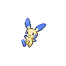

- 文件：[pokemon-id-00312-front-normal-default-static--dddfa5bc9150.png](pokemon-id-00312-front-normal-default-static--dddfa5bc9150.png)
- 用途：正面普通宝可梦图像；身份和变体来自PokeAPI路径，不作为原应用已经接入的证明。
- 尺寸：96 × 96，帧数：1
- SHA256：`dddfa5bc9150ba03f584aa67f7b2c16d09bacc38c276b26d4c06cde565e6ac0f`
- 来源：[PokeAPI/sprites](https://raw.githubusercontent.com/PokeAPI/sprites/master/sprites/pokemon/312.png)；取得版本：`1dd55c0436d2a5b6e324c0b780e1b1b416fbfb64`

### 宝可梦API ID 313 · 正面 · 普通 · 默认静态来源

- 文件：[pokemon-id-00313-front-normal-default-static--b35dcf5abb77.png](pokemon-id-00313-front-normal-default-static--b35dcf5abb77.png)
- 用途：正面普通宝可梦图像；身份和变体来自PokeAPI路径，不作为原应用已经接入的证明。
- 尺寸：96 × 96，帧数：1
- SHA256：`b35dcf5abb7793227cd7b73727f86ffbefa038703b8857343e9aa69eb4b70257`
- 来源：[PokeAPI/sprites](https://raw.githubusercontent.com/PokeAPI/sprites/master/sprites/pokemon/313.png)；取得版本：`1dd55c0436d2a5b6e324c0b780e1b1b416fbfb64`

### 宝可梦API ID 314 · 正面 · 普通 · 默认静态来源

- 文件：[pokemon-id-00314-front-normal-default-static--e26b3cfbb1ed.png](pokemon-id-00314-front-normal-default-static--e26b3cfbb1ed.png)
- 用途：正面普通宝可梦图像；身份和变体来自PokeAPI路径，不作为原应用已经接入的证明。
- 尺寸：96 × 96，帧数：1
- SHA256：`e26b3cfbb1ed8b5b4e13fdc431708de4ce58c1fc85a5af1d9fd7aadb41fd37e8`
- 来源：[PokeAPI/sprites](https://raw.githubusercontent.com/PokeAPI/sprites/master/sprites/pokemon/314.png)；取得版本：`1dd55c0436d2a5b6e324c0b780e1b1b416fbfb64`

### 宝可梦API ID 315 · 正面 · 普通 · 默认静态来源

- 文件：[pokemon-id-00315-front-normal-default-static--958ed5c76501.png](pokemon-id-00315-front-normal-default-static--958ed5c76501.png)
- 用途：正面普通宝可梦图像；身份和变体来自PokeAPI路径，不作为原应用已经接入的证明。
- 尺寸：96 × 96，帧数：1
- SHA256：`958ed5c7650181a88768e8a2cda55025d86fb83888412202fadd9c5e0d404d89`
- 来源：[PokeAPI/sprites](https://raw.githubusercontent.com/PokeAPI/sprites/master/sprites/pokemon/315.png)；取得版本：`1dd55c0436d2a5b6e324c0b780e1b1b416fbfb64`

### 宝可梦API ID 316 · 正面 · 普通 · 默认静态来源

- 文件：[pokemon-id-00316-front-normal-default-static--66b9a3fb23ca.png](pokemon-id-00316-front-normal-default-static--66b9a3fb23ca.png)
- 用途：正面普通宝可梦图像；身份和变体来自PokeAPI路径，不作为原应用已经接入的证明。
- 尺寸：96 × 96，帧数：1
- SHA256：`66b9a3fb23ca868ce456d5b450838f3df5978a7ffc2e85cca7351a85e65e6b97`
- 来源：[PokeAPI/sprites](https://raw.githubusercontent.com/PokeAPI/sprites/master/sprites/pokemon/316.png)；取得版本：`1dd55c0436d2a5b6e324c0b780e1b1b416fbfb64`

### 宝可梦API ID 317 · 正面 · 普通 · 默认静态来源

- 文件：[pokemon-id-00317-front-normal-default-static--fe8aeb3d6919.png](pokemon-id-00317-front-normal-default-static--fe8aeb3d6919.png)
- 用途：正面普通宝可梦图像；身份和变体来自PokeAPI路径，不作为原应用已经接入的证明。
- 尺寸：96 × 96，帧数：1
- SHA256：`fe8aeb3d6919570eb682cfefb6a981ffafe27a900886f9437fc9b1f10eeced3b`
- 来源：[PokeAPI/sprites](https://raw.githubusercontent.com/PokeAPI/sprites/master/sprites/pokemon/317.png)；取得版本：`1dd55c0436d2a5b6e324c0b780e1b1b416fbfb64`

### 宝可梦API ID 318 · 正面 · 普通 · 默认静态来源

- 文件：[pokemon-id-00318-front-normal-default-static--7af20a544f5f.png](pokemon-id-00318-front-normal-default-static--7af20a544f5f.png)
- 用途：正面普通宝可梦图像；身份和变体来自PokeAPI路径，不作为原应用已经接入的证明。
- 尺寸：96 × 96，帧数：1
- SHA256：`7af20a544f5f3939af7a50543b93f0774f51eae45c0d0bfc24d37ad805644f2a`
- 来源：[PokeAPI/sprites](https://raw.githubusercontent.com/PokeAPI/sprites/master/sprites/pokemon/318.png)；取得版本：`1dd55c0436d2a5b6e324c0b780e1b1b416fbfb64`

### 宝可梦API ID 319 · 正面 · 普通 · 默认静态来源

- 文件：[pokemon-id-00319-front-normal-default-static--dcad0a713e1c.png](pokemon-id-00319-front-normal-default-static--dcad0a713e1c.png)
- 用途：正面普通宝可梦图像；身份和变体来自PokeAPI路径，不作为原应用已经接入的证明。
- 尺寸：96 × 96，帧数：1
- SHA256：`dcad0a713e1c74e982d777bd4c2ba8ea035d1db88028da6a736172cee3950026`
- 来源：[PokeAPI/sprites](https://raw.githubusercontent.com/PokeAPI/sprites/master/sprites/pokemon/319.png)；取得版本：`1dd55c0436d2a5b6e324c0b780e1b1b416fbfb64`

### 宝可梦API ID 320 · 正面 · 普通 · 默认静态来源

- 文件：[pokemon-id-00320-front-normal-default-static--75ea72bd3f5a.png](pokemon-id-00320-front-normal-default-static--75ea72bd3f5a.png)
- 用途：正面普通宝可梦图像；身份和变体来自PokeAPI路径，不作为原应用已经接入的证明。
- 尺寸：96 × 96，帧数：1
- SHA256：`75ea72bd3f5a481627f6508b056d21dbebea84cc5efad0f50270e48276e0d206`
- 来源：[PokeAPI/sprites](https://raw.githubusercontent.com/PokeAPI/sprites/master/sprites/pokemon/320.png)；取得版本：`1dd55c0436d2a5b6e324c0b780e1b1b416fbfb64`

### 宝可梦API ID 321 · 正面 · 普通 · 默认静态来源

- 文件：[pokemon-id-00321-front-normal-default-static--6032aae8da4e.png](pokemon-id-00321-front-normal-default-static--6032aae8da4e.png)
- 用途：正面普通宝可梦图像；身份和变体来自PokeAPI路径，不作为原应用已经接入的证明。
- 尺寸：96 × 96，帧数：1
- SHA256：`6032aae8da4e82c02f48eb6f7dde23f8bd3f17ec090baa1a0e01e31ab7db5a6e`
- 来源：[PokeAPI/sprites](https://raw.githubusercontent.com/PokeAPI/sprites/master/sprites/pokemon/321.png)；取得版本：`1dd55c0436d2a5b6e324c0b780e1b1b416fbfb64`

### 宝可梦API ID 322 · 正面 · 普通 · 默认静态来源

- 文件：[pokemon-id-00322-front-normal-default-static--3fea53b428eb.png](pokemon-id-00322-front-normal-default-static--3fea53b428eb.png)
- 用途：正面普通宝可梦图像；身份和变体来自PokeAPI路径，不作为原应用已经接入的证明。
- 尺寸：96 × 96，帧数：1
- SHA256：`3fea53b428eb1ac44d3e4c9261b19446299f454b79f20649cd3e72644c0db0e3`
- 来源：[PokeAPI/sprites](https://raw.githubusercontent.com/PokeAPI/sprites/master/sprites/pokemon/322.png)；取得版本：`1dd55c0436d2a5b6e324c0b780e1b1b416fbfb64`

### 宝可梦API ID 323 · 正面 · 普通 · 默认静态来源

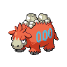

- 文件：[pokemon-id-00323-front-normal-default-static--ff0826e011a9.png](pokemon-id-00323-front-normal-default-static--ff0826e011a9.png)
- 用途：正面普通宝可梦图像；身份和变体来自PokeAPI路径，不作为原应用已经接入的证明。
- 尺寸：96 × 96，帧数：1
- SHA256：`ff0826e011a95f5cc2bb7358e96d19cf3cb39bfb12b3577e6c4edd984107de00`
- 来源：[PokeAPI/sprites](https://raw.githubusercontent.com/PokeAPI/sprites/master/sprites/pokemon/323.png)；取得版本：`1dd55c0436d2a5b6e324c0b780e1b1b416fbfb64`

### 宝可梦API ID 324 · 正面 · 普通 · 默认静态来源

- 文件：[pokemon-id-00324-front-normal-default-static--f679c46f081c.png](pokemon-id-00324-front-normal-default-static--f679c46f081c.png)
- 用途：正面普通宝可梦图像；身份和变体来自PokeAPI路径，不作为原应用已经接入的证明。
- 尺寸：96 × 96，帧数：1
- SHA256：`f679c46f081ce5c4554336e04aa74f4a1539625543ec0f5b9b3c779abce15125`
- 来源：[PokeAPI/sprites](https://raw.githubusercontent.com/PokeAPI/sprites/master/sprites/pokemon/324.png)；取得版本：`1dd55c0436d2a5b6e324c0b780e1b1b416fbfb64`

### 宝可梦API ID 325 · 正面 · 普通 · 默认静态来源

- 文件：[pokemon-id-00325-front-normal-default-static--b9d4f9dda56a.png](pokemon-id-00325-front-normal-default-static--b9d4f9dda56a.png)
- 用途：正面普通宝可梦图像；身份和变体来自PokeAPI路径，不作为原应用已经接入的证明。
- 尺寸：96 × 96，帧数：1
- SHA256：`b9d4f9dda56aa0815b3ad2b1d3ef7997f0098fe35b18d2aa9f4736b70162547e`
- 来源：[PokeAPI/sprites](https://raw.githubusercontent.com/PokeAPI/sprites/master/sprites/pokemon/325.png)；取得版本：`1dd55c0436d2a5b6e324c0b780e1b1b416fbfb64`

### 宝可梦API ID 326 · 正面 · 普通 · 默认静态来源

- 文件：[pokemon-id-00326-front-normal-default-static--e738b113e72e.png](pokemon-id-00326-front-normal-default-static--e738b113e72e.png)
- 用途：正面普通宝可梦图像；身份和变体来自PokeAPI路径，不作为原应用已经接入的证明。
- 尺寸：96 × 96，帧数：1
- SHA256：`e738b113e72e13b24f7c4321b21193c791bc2e0d9ef427096ba13fa900faec59`
- 来源：[PokeAPI/sprites](https://raw.githubusercontent.com/PokeAPI/sprites/master/sprites/pokemon/326.png)；取得版本：`1dd55c0436d2a5b6e324c0b780e1b1b416fbfb64`

### 宝可梦API ID 327 · 正面 · 普通 · 默认静态来源

- 文件：[pokemon-id-00327-front-normal-default-static--cdc03066a99e.png](pokemon-id-00327-front-normal-default-static--cdc03066a99e.png)
- 用途：正面普通宝可梦图像；身份和变体来自PokeAPI路径，不作为原应用已经接入的证明。
- 尺寸：96 × 96，帧数：1
- SHA256：`cdc03066a99ea7309c56cee6b7ae2ecab6a8ee226d9482fafaaf77cc6a9200a7`
- 来源：[PokeAPI/sprites](https://raw.githubusercontent.com/PokeAPI/sprites/master/sprites/pokemon/327.png)；取得版本：`1dd55c0436d2a5b6e324c0b780e1b1b416fbfb64`

### 宝可梦API ID 328 · 正面 · 普通 · 默认静态来源

- 文件：[pokemon-id-00328-front-normal-default-static--619bc5668818.png](pokemon-id-00328-front-normal-default-static--619bc5668818.png)
- 用途：正面普通宝可梦图像；身份和变体来自PokeAPI路径，不作为原应用已经接入的证明。
- 尺寸：96 × 96，帧数：1
- SHA256：`619bc5668818009c5b3ea0ebc9f3ab280a7d23662884d43741e0880f632e66d2`
- 来源：[PokeAPI/sprites](https://raw.githubusercontent.com/PokeAPI/sprites/master/sprites/pokemon/328.png)；取得版本：`1dd55c0436d2a5b6e324c0b780e1b1b416fbfb64`

### 宝可梦API ID 329 · 正面 · 普通 · 默认静态来源

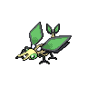

- 文件：[pokemon-id-00329-front-normal-default-static--9bb8bc831648.png](pokemon-id-00329-front-normal-default-static--9bb8bc831648.png)
- 用途：正面普通宝可梦图像；身份和变体来自PokeAPI路径，不作为原应用已经接入的证明。
- 尺寸：96 × 96，帧数：1
- SHA256：`9bb8bc831648240945cfe851896e270150b74431097a0f6430b09fedfface000`
- 来源：[PokeAPI/sprites](https://raw.githubusercontent.com/PokeAPI/sprites/master/sprites/pokemon/329.png)；取得版本：`1dd55c0436d2a5b6e324c0b780e1b1b416fbfb64`

### 宝可梦API ID 330 · 正面 · 普通 · 默认静态来源

- 文件：[pokemon-id-00330-front-normal-default-static--390b8cc274d6.png](pokemon-id-00330-front-normal-default-static--390b8cc274d6.png)
- 用途：正面普通宝可梦图像；身份和变体来自PokeAPI路径，不作为原应用已经接入的证明。
- 尺寸：96 × 96，帧数：1
- SHA256：`390b8cc274d671c11445f5fd427efbaef5d48c00460c2437aaab41f47e587c43`
- 来源：[PokeAPI/sprites](https://raw.githubusercontent.com/PokeAPI/sprites/master/sprites/pokemon/330.png)；取得版本：`1dd55c0436d2a5b6e324c0b780e1b1b416fbfb64`

### 宝可梦API ID 331 · 正面 · 普通 · 默认静态来源

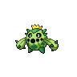

- 文件：[pokemon-id-00331-front-normal-default-static--43ed35962885.png](pokemon-id-00331-front-normal-default-static--43ed35962885.png)
- 用途：正面普通宝可梦图像；身份和变体来自PokeAPI路径，不作为原应用已经接入的证明。
- 尺寸：96 × 96，帧数：1
- SHA256：`43ed3596288531ef28faa70c82021966057751411f28bc33499365fd02ca12ed`
- 来源：[PokeAPI/sprites](https://raw.githubusercontent.com/PokeAPI/sprites/master/sprites/pokemon/331.png)；取得版本：`1dd55c0436d2a5b6e324c0b780e1b1b416fbfb64`

### 宝可梦API ID 332 · 正面 · 普通 · 默认静态来源

- 文件：[pokemon-id-00332-front-normal-default-static--66522012bd41.png](pokemon-id-00332-front-normal-default-static--66522012bd41.png)
- 用途：正面普通宝可梦图像；身份和变体来自PokeAPI路径，不作为原应用已经接入的证明。
- 尺寸：96 × 96，帧数：1
- SHA256：`66522012bd41f9e376854ed88ca6dba51ab7991584f1a8032cf063781b0af288`
- 来源：[PokeAPI/sprites](https://raw.githubusercontent.com/PokeAPI/sprites/master/sprites/pokemon/332.png)；取得版本：`1dd55c0436d2a5b6e324c0b780e1b1b416fbfb64`

### 宝可梦API ID 333 · 正面 · 普通 · 默认静态来源

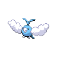

- 文件：[pokemon-id-00333-front-normal-default-static--2e6c1bb6de4b.png](pokemon-id-00333-front-normal-default-static--2e6c1bb6de4b.png)
- 用途：正面普通宝可梦图像；身份和变体来自PokeAPI路径，不作为原应用已经接入的证明。
- 尺寸：96 × 96，帧数：1
- SHA256：`2e6c1bb6de4bad197c4bab5df47aaf8eb6a080b19fd96ccc27242986272a57f1`
- 来源：[PokeAPI/sprites](https://raw.githubusercontent.com/PokeAPI/sprites/master/sprites/pokemon/333.png)；取得版本：`1dd55c0436d2a5b6e324c0b780e1b1b416fbfb64`

### 宝可梦API ID 334 · 正面 · 普通 · 默认静态来源

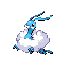

- 文件：[pokemon-id-00334-front-normal-default-static--8b361606c2a8.png](pokemon-id-00334-front-normal-default-static--8b361606c2a8.png)
- 用途：正面普通宝可梦图像；身份和变体来自PokeAPI路径，不作为原应用已经接入的证明。
- 尺寸：96 × 96，帧数：1
- SHA256：`8b361606c2a8b3b44b1928778c86e374a6d28b4878a837dd4afd591d28b71592`
- 来源：[PokeAPI/sprites](https://raw.githubusercontent.com/PokeAPI/sprites/master/sprites/pokemon/334.png)；取得版本：`1dd55c0436d2a5b6e324c0b780e1b1b416fbfb64`

### 宝可梦API ID 335 · 正面 · 普通 · 默认静态来源

- 文件：[pokemon-id-00335-front-normal-default-static--4229ca9af92c.png](pokemon-id-00335-front-normal-default-static--4229ca9af92c.png)
- 用途：正面普通宝可梦图像；身份和变体来自PokeAPI路径，不作为原应用已经接入的证明。
- 尺寸：96 × 96，帧数：1
- SHA256：`4229ca9af92c5e5394f031c062c47ec395870d9d8f95664578194e59c3b1969a`
- 来源：[PokeAPI/sprites](https://raw.githubusercontent.com/PokeAPI/sprites/master/sprites/pokemon/335.png)；取得版本：`1dd55c0436d2a5b6e324c0b780e1b1b416fbfb64`

### 宝可梦API ID 336 · 正面 · 普通 · 默认静态来源

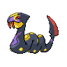

- 文件：[pokemon-id-00336-front-normal-default-static--4ca03f9cc0f4.png](pokemon-id-00336-front-normal-default-static--4ca03f9cc0f4.png)
- 用途：正面普通宝可梦图像；身份和变体来自PokeAPI路径，不作为原应用已经接入的证明。
- 尺寸：96 × 96，帧数：1
- SHA256：`4ca03f9cc0f4a2e4c84e752598ffdff664950a8bc5a5c12bede9bea3e6bc4f59`
- 来源：[PokeAPI/sprites](https://raw.githubusercontent.com/PokeAPI/sprites/master/sprites/pokemon/336.png)；取得版本：`1dd55c0436d2a5b6e324c0b780e1b1b416fbfb64`

### 宝可梦API ID 337 · 正面 · 普通 · 默认静态来源

- 文件：[pokemon-id-00337-front-normal-default-static--d6112fc26939.png](pokemon-id-00337-front-normal-default-static--d6112fc26939.png)
- 用途：正面普通宝可梦图像；身份和变体来自PokeAPI路径，不作为原应用已经接入的证明。
- 尺寸：96 × 96，帧数：1
- SHA256：`d6112fc26939f88d7cd639c9275b44d7ab39a1f3fab5e44d293c0fd6f42e5d97`
- 来源：[PokeAPI/sprites](https://raw.githubusercontent.com/PokeAPI/sprites/master/sprites/pokemon/337.png)；取得版本：`1dd55c0436d2a5b6e324c0b780e1b1b416fbfb64`

### 宝可梦API ID 338 · 正面 · 普通 · 默认静态来源

- 文件：[pokemon-id-00338-front-normal-default-static--c824706d09e7.png](pokemon-id-00338-front-normal-default-static--c824706d09e7.png)
- 用途：正面普通宝可梦图像；身份和变体来自PokeAPI路径，不作为原应用已经接入的证明。
- 尺寸：96 × 96，帧数：1
- SHA256：`c824706d09e79ea6e50ae545bdba2116b58e9dff4b4dec3cfb0fe0ab94c2bee1`
- 来源：[PokeAPI/sprites](https://raw.githubusercontent.com/PokeAPI/sprites/master/sprites/pokemon/338.png)；取得版本：`1dd55c0436d2a5b6e324c0b780e1b1b416fbfb64`

### 宝可梦API ID 339 · 正面 · 普通 · 默认静态来源

- 文件：[pokemon-id-00339-front-normal-default-static--8383c70eedd6.png](pokemon-id-00339-front-normal-default-static--8383c70eedd6.png)
- 用途：正面普通宝可梦图像；身份和变体来自PokeAPI路径，不作为原应用已经接入的证明。
- 尺寸：96 × 96，帧数：1
- SHA256：`8383c70eedd6536fe0da6f2e43a6b08c0539b7604461452a2c597b452c08f562`
- 来源：[PokeAPI/sprites](https://raw.githubusercontent.com/PokeAPI/sprites/master/sprites/pokemon/339.png)；取得版本：`1dd55c0436d2a5b6e324c0b780e1b1b416fbfb64`

### 宝可梦API ID 340 · 正面 · 普通 · 默认静态来源

- 文件：[pokemon-id-00340-front-normal-default-static--6c78fa508818.png](pokemon-id-00340-front-normal-default-static--6c78fa508818.png)
- 用途：正面普通宝可梦图像；身份和变体来自PokeAPI路径，不作为原应用已经接入的证明。
- 尺寸：96 × 96，帧数：1
- SHA256：`6c78fa508818d7326d885984ea33f52c0dc41965de1b5f63150e1ed7d13a19c2`
- 来源：[PokeAPI/sprites](https://raw.githubusercontent.com/PokeAPI/sprites/master/sprites/pokemon/340.png)；取得版本：`1dd55c0436d2a5b6e324c0b780e1b1b416fbfb64`

### 宝可梦API ID 341 · 正面 · 普通 · 默认静态来源

- 文件：[pokemon-id-00341-front-normal-default-static--a5ee0c39b892.png](pokemon-id-00341-front-normal-default-static--a5ee0c39b892.png)
- 用途：正面普通宝可梦图像；身份和变体来自PokeAPI路径，不作为原应用已经接入的证明。
- 尺寸：96 × 96，帧数：1
- SHA256：`a5ee0c39b8924d6be46ae647fedd65a1ba48b22fe0841c09ff54af8dcd1f5888`
- 来源：[PokeAPI/sprites](https://raw.githubusercontent.com/PokeAPI/sprites/master/sprites/pokemon/341.png)；取得版本：`1dd55c0436d2a5b6e324c0b780e1b1b416fbfb64`

### 宝可梦API ID 342 · 正面 · 普通 · 默认静态来源

- 文件：[pokemon-id-00342-front-normal-default-static--8f585a04104f.png](pokemon-id-00342-front-normal-default-static--8f585a04104f.png)
- 用途：正面普通宝可梦图像；身份和变体来自PokeAPI路径，不作为原应用已经接入的证明。
- 尺寸：96 × 96，帧数：1
- SHA256：`8f585a04104f3d91e695a188a53cf07541cbe1a762c4a2dcd631b0361876815f`
- 来源：[PokeAPI/sprites](https://raw.githubusercontent.com/PokeAPI/sprites/master/sprites/pokemon/342.png)；取得版本：`1dd55c0436d2a5b6e324c0b780e1b1b416fbfb64`

### 宝可梦API ID 343 · 正面 · 普通 · 默认静态来源

- 文件：[pokemon-id-00343-front-normal-default-static--2eb501cbff58.png](pokemon-id-00343-front-normal-default-static--2eb501cbff58.png)
- 用途：正面普通宝可梦图像；身份和变体来自PokeAPI路径，不作为原应用已经接入的证明。
- 尺寸：96 × 96，帧数：1
- SHA256：`2eb501cbff58e38fad206415bf405db086fec13b0038e07f4356e4729fe42412`
- 来源：[PokeAPI/sprites](https://raw.githubusercontent.com/PokeAPI/sprites/master/sprites/pokemon/343.png)；取得版本：`1dd55c0436d2a5b6e324c0b780e1b1b416fbfb64`

### 宝可梦API ID 344 · 正面 · 普通 · 默认静态来源

- 文件：[pokemon-id-00344-front-normal-default-static--ae50c266de27.png](pokemon-id-00344-front-normal-default-static--ae50c266de27.png)
- 用途：正面普通宝可梦图像；身份和变体来自PokeAPI路径，不作为原应用已经接入的证明。
- 尺寸：96 × 96，帧数：1
- SHA256：`ae50c266de27495539f73593930f929f8e337aba4b183461085440655fec7f85`
- 来源：[PokeAPI/sprites](https://raw.githubusercontent.com/PokeAPI/sprites/master/sprites/pokemon/344.png)；取得版本：`1dd55c0436d2a5b6e324c0b780e1b1b416fbfb64`

### 宝可梦API ID 345 · 正面 · 普通 · 默认静态来源

- 文件：[pokemon-id-00345-front-normal-default-static--67749c7778d4.png](pokemon-id-00345-front-normal-default-static--67749c7778d4.png)
- 用途：正面普通宝可梦图像；身份和变体来自PokeAPI路径，不作为原应用已经接入的证明。
- 尺寸：96 × 96，帧数：1
- SHA256：`67749c7778d4dbc6786c3cbb740b137c8ddb469fc28470dc450fda9a3e4471db`
- 来源：[PokeAPI/sprites](https://raw.githubusercontent.com/PokeAPI/sprites/master/sprites/pokemon/345.png)；取得版本：`1dd55c0436d2a5b6e324c0b780e1b1b416fbfb64`

### 宝可梦API ID 346 · 正面 · 普通 · 默认静态来源

- 文件：[pokemon-id-00346-front-normal-default-static--d32b6eef29fa.png](pokemon-id-00346-front-normal-default-static--d32b6eef29fa.png)
- 用途：正面普通宝可梦图像；身份和变体来自PokeAPI路径，不作为原应用已经接入的证明。
- 尺寸：96 × 96，帧数：1
- SHA256：`d32b6eef29fa3dd36bac1e7bf4f4adf3cf372a51a5268359f39863a0817a1d3c`
- 来源：[PokeAPI/sprites](https://raw.githubusercontent.com/PokeAPI/sprites/master/sprites/pokemon/346.png)；取得版本：`1dd55c0436d2a5b6e324c0b780e1b1b416fbfb64`

### 宝可梦API ID 347 · 正面 · 普通 · 默认静态来源

- 文件：[pokemon-id-00347-front-normal-default-static--17e245c60f95.png](pokemon-id-00347-front-normal-default-static--17e245c60f95.png)
- 用途：正面普通宝可梦图像；身份和变体来自PokeAPI路径，不作为原应用已经接入的证明。
- 尺寸：96 × 96，帧数：1
- SHA256：`17e245c60f95d2f29355184088c754cff3f7a708d72fbf32a43f672eda47b17e`
- 来源：[PokeAPI/sprites](https://raw.githubusercontent.com/PokeAPI/sprites/master/sprites/pokemon/347.png)；取得版本：`1dd55c0436d2a5b6e324c0b780e1b1b416fbfb64`

### 宝可梦API ID 348 · 正面 · 普通 · 默认静态来源

- 文件：[pokemon-id-00348-front-normal-default-static--63e52340ebbf.png](pokemon-id-00348-front-normal-default-static--63e52340ebbf.png)
- 用途：正面普通宝可梦图像；身份和变体来自PokeAPI路径，不作为原应用已经接入的证明。
- 尺寸：96 × 96，帧数：1
- SHA256：`63e52340ebbf51dea32e921a5a723ecf2fa8f858277484c61b646a0050813a24`
- 来源：[PokeAPI/sprites](https://raw.githubusercontent.com/PokeAPI/sprites/master/sprites/pokemon/348.png)；取得版本：`1dd55c0436d2a5b6e324c0b780e1b1b416fbfb64`

### 宝可梦API ID 349 · 正面 · 普通 · 默认静态来源

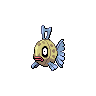

- 文件：[pokemon-id-00349-front-normal-default-static--3b53972fc822.png](pokemon-id-00349-front-normal-default-static--3b53972fc822.png)
- 用途：正面普通宝可梦图像；身份和变体来自PokeAPI路径，不作为原应用已经接入的证明。
- 尺寸：96 × 96，帧数：1
- SHA256：`3b53972fc82212454fee6042b037a34a3acecc3cef03a8c3225a1f6e241aecc7`
- 来源：[PokeAPI/sprites](https://raw.githubusercontent.com/PokeAPI/sprites/master/sprites/pokemon/349.png)；取得版本：`1dd55c0436d2a5b6e324c0b780e1b1b416fbfb64`

### 宝可梦API ID 350 · 正面 · 普通 · 默认静态来源

- 文件：[pokemon-id-00350-front-normal-default-static--97d8c6e9d7d5.png](pokemon-id-00350-front-normal-default-static--97d8c6e9d7d5.png)
- 用途：正面普通宝可梦图像；身份和变体来自PokeAPI路径，不作为原应用已经接入的证明。
- 尺寸：96 × 96，帧数：1
- SHA256：`97d8c6e9d7d5766e240f16a811bb15d71b37d5a10d680daacf18763b3f9ab78b`
- 来源：[PokeAPI/sprites](https://raw.githubusercontent.com/PokeAPI/sprites/master/sprites/pokemon/350.png)；取得版本：`1dd55c0436d2a5b6e324c0b780e1b1b416fbfb64`

### 宝可梦API ID 351 · 正面 · 普通 · 默认静态来源

- 文件：[pokemon-id-00351-front-normal-default-static--61f43c989a1f.png](pokemon-id-00351-front-normal-default-static--61f43c989a1f.png)
- 用途：正面普通宝可梦图像；身份和变体来自PokeAPI路径，不作为原应用已经接入的证明。
- 尺寸：96 × 96，帧数：1
- SHA256：`61f43c989a1f941bef4aa1802d2692e4c98a790b1bb98cc9dab2097801285826`
- 来源：[PokeAPI/sprites](https://raw.githubusercontent.com/PokeAPI/sprites/master/sprites/pokemon/351.png)；取得版本：`1dd55c0436d2a5b6e324c0b780e1b1b416fbfb64`

### 宝可梦API ID 352 · 正面 · 普通 · 默认静态来源

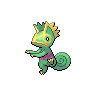

- 文件：[pokemon-id-00352-front-normal-default-static--ca76d392b7ed.png](pokemon-id-00352-front-normal-default-static--ca76d392b7ed.png)
- 用途：正面普通宝可梦图像；身份和变体来自PokeAPI路径，不作为原应用已经接入的证明。
- 尺寸：96 × 96，帧数：1
- SHA256：`ca76d392b7ed87ad4d4382714147953aa0a46d2d8cf6bf07061e4aa8f9c525fd`
- 来源：[PokeAPI/sprites](https://raw.githubusercontent.com/PokeAPI/sprites/master/sprites/pokemon/352.png)；取得版本：`1dd55c0436d2a5b6e324c0b780e1b1b416fbfb64`

### 宝可梦API ID 353 · 正面 · 普通 · 默认静态来源

- 文件：[pokemon-id-00353-front-normal-default-static--285f1412565b.png](pokemon-id-00353-front-normal-default-static--285f1412565b.png)
- 用途：正面普通宝可梦图像；身份和变体来自PokeAPI路径，不作为原应用已经接入的证明。
- 尺寸：96 × 96，帧数：1
- SHA256：`285f1412565bccc780bfca049b905c81b97883f5127dfc51978e91cb500bf565`
- 来源：[PokeAPI/sprites](https://raw.githubusercontent.com/PokeAPI/sprites/master/sprites/pokemon/353.png)；取得版本：`1dd55c0436d2a5b6e324c0b780e1b1b416fbfb64`

### 宝可梦API ID 354 · 正面 · 普通 · 默认静态来源

- 文件：[pokemon-id-00354-front-normal-default-static--b0a44403c62f.png](pokemon-id-00354-front-normal-default-static--b0a44403c62f.png)
- 用途：正面普通宝可梦图像；身份和变体来自PokeAPI路径，不作为原应用已经接入的证明。
- 尺寸：96 × 96，帧数：1
- SHA256：`b0a44403c62f0d27936b19df0e1e8e469652822da754f0f1720aaec428a4a371`
- 来源：[PokeAPI/sprites](https://raw.githubusercontent.com/PokeAPI/sprites/master/sprites/pokemon/354.png)；取得版本：`1dd55c0436d2a5b6e324c0b780e1b1b416fbfb64`

### 宝可梦API ID 355 · 正面 · 普通 · 默认静态来源

- 文件：[pokemon-id-00355-front-normal-default-static--e88da5bd5994.png](pokemon-id-00355-front-normal-default-static--e88da5bd5994.png)
- 用途：正面普通宝可梦图像；身份和变体来自PokeAPI路径，不作为原应用已经接入的证明。
- 尺寸：96 × 96，帧数：1
- SHA256：`e88da5bd59942db67e978d06203d649756f4e8255ce2fc0c45e827c430c274b2`
- 来源：[PokeAPI/sprites](https://raw.githubusercontent.com/PokeAPI/sprites/master/sprites/pokemon/355.png)；取得版本：`1dd55c0436d2a5b6e324c0b780e1b1b416fbfb64`

### 宝可梦API ID 356 · 正面 · 普通 · 默认静态来源

- 文件：[pokemon-id-00356-front-normal-default-static--a7ef10de7bea.png](pokemon-id-00356-front-normal-default-static--a7ef10de7bea.png)
- 用途：正面普通宝可梦图像；身份和变体来自PokeAPI路径，不作为原应用已经接入的证明。
- 尺寸：96 × 96，帧数：1
- SHA256：`a7ef10de7bea51e6db55551b5dec4ad335c44ebc8cac20b97a87cbe8d341fa1c`
- 来源：[PokeAPI/sprites](https://raw.githubusercontent.com/PokeAPI/sprites/master/sprites/pokemon/356.png)；取得版本：`1dd55c0436d2a5b6e324c0b780e1b1b416fbfb64`

### 宝可梦API ID 357 · 正面 · 普通 · 默认静态来源

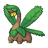

- 文件：[pokemon-id-00357-front-normal-default-static--e919ae723a8b.png](pokemon-id-00357-front-normal-default-static--e919ae723a8b.png)
- 用途：正面普通宝可梦图像；身份和变体来自PokeAPI路径，不作为原应用已经接入的证明。
- 尺寸：96 × 96，帧数：1
- SHA256：`e919ae723a8b410542b9f8d6e30ad31395629fa23afca03caf9e742435124d7e`
- 来源：[PokeAPI/sprites](https://raw.githubusercontent.com/PokeAPI/sprites/master/sprites/pokemon/357.png)；取得版本：`1dd55c0436d2a5b6e324c0b780e1b1b416fbfb64`

### 宝可梦API ID 358 · 正面 · 普通 · 默认静态来源

- 文件：[pokemon-id-00358-front-normal-default-static--2b6df8f7331d.png](pokemon-id-00358-front-normal-default-static--2b6df8f7331d.png)
- 用途：正面普通宝可梦图像；身份和变体来自PokeAPI路径，不作为原应用已经接入的证明。
- 尺寸：96 × 96，帧数：1
- SHA256：`2b6df8f7331dc11f5ded42db0b5a9a9c40523ccb9ec59844a7b80cc52822d0d7`
- 来源：[PokeAPI/sprites](https://raw.githubusercontent.com/PokeAPI/sprites/master/sprites/pokemon/358.png)；取得版本：`1dd55c0436d2a5b6e324c0b780e1b1b416fbfb64`

### 宝可梦API ID 359 · 正面 · 普通 · 默认静态来源

- 文件：[pokemon-id-00359-front-normal-default-static--e08e8fa7c90d.png](pokemon-id-00359-front-normal-default-static--e08e8fa7c90d.png)
- 用途：正面普通宝可梦图像；身份和变体来自PokeAPI路径，不作为原应用已经接入的证明。
- 尺寸：96 × 96，帧数：1
- SHA256：`e08e8fa7c90d52bbc79859342b1c88f353a80eff273a5ce7d3960a6e8374da38`
- 来源：[PokeAPI/sprites](https://raw.githubusercontent.com/PokeAPI/sprites/master/sprites/pokemon/359.png)；取得版本：`1dd55c0436d2a5b6e324c0b780e1b1b416fbfb64`

### 宝可梦API ID 360 · 正面 · 普通 · 默认静态来源

- 文件：[pokemon-id-00360-front-normal-default-static--b9b3e0b52758.png](pokemon-id-00360-front-normal-default-static--b9b3e0b52758.png)
- 用途：正面普通宝可梦图像；身份和变体来自PokeAPI路径，不作为原应用已经接入的证明。
- 尺寸：96 × 96，帧数：1
- SHA256：`b9b3e0b52758203f5679ce77c0af725e35acd3948ccbd7339316b9d404073cf7`
- 来源：[PokeAPI/sprites](https://raw.githubusercontent.com/PokeAPI/sprites/master/sprites/pokemon/360.png)；取得版本：`1dd55c0436d2a5b6e324c0b780e1b1b416fbfb64`

### 宝可梦API ID 361 · 正面 · 普通 · 默认静态来源

- 文件：[pokemon-id-00361-front-normal-default-static--9af7cc95041f.png](pokemon-id-00361-front-normal-default-static--9af7cc95041f.png)
- 用途：正面普通宝可梦图像；身份和变体来自PokeAPI路径，不作为原应用已经接入的证明。
- 尺寸：96 × 96，帧数：1
- SHA256：`9af7cc95041f6aaeb0fc44c71eec1b1105f2213a4620da9c82f4a436d619b0d1`
- 来源：[PokeAPI/sprites](https://raw.githubusercontent.com/PokeAPI/sprites/master/sprites/pokemon/361.png)；取得版本：`1dd55c0436d2a5b6e324c0b780e1b1b416fbfb64`

### 宝可梦API ID 362 · 正面 · 普通 · 默认静态来源

- 文件：[pokemon-id-00362-front-normal-default-static--5a081f303878.png](pokemon-id-00362-front-normal-default-static--5a081f303878.png)
- 用途：正面普通宝可梦图像；身份和变体来自PokeAPI路径，不作为原应用已经接入的证明。
- 尺寸：96 × 96，帧数：1
- SHA256：`5a081f3038788c6698a5a31d8653b40987fbe5ceaa5540d3b873b577fbf4a002`
- 来源：[PokeAPI/sprites](https://raw.githubusercontent.com/PokeAPI/sprites/master/sprites/pokemon/362.png)；取得版本：`1dd55c0436d2a5b6e324c0b780e1b1b416fbfb64`

### 宝可梦API ID 363 · 正面 · 普通 · 默认静态来源

- 文件：[pokemon-id-00363-front-normal-default-static--947c6a79f823.png](pokemon-id-00363-front-normal-default-static--947c6a79f823.png)
- 用途：正面普通宝可梦图像；身份和变体来自PokeAPI路径，不作为原应用已经接入的证明。
- 尺寸：96 × 96，帧数：1
- SHA256：`947c6a79f823a6b539c43d6ca249f96320fc23e54a1a8d260c77bb8cb8f9d0a2`
- 来源：[PokeAPI/sprites](https://raw.githubusercontent.com/PokeAPI/sprites/master/sprites/pokemon/363.png)；取得版本：`1dd55c0436d2a5b6e324c0b780e1b1b416fbfb64`

### 宝可梦API ID 364 · 正面 · 普通 · 默认静态来源

- 文件：[pokemon-id-00364-front-normal-default-static--99690ce6cdf9.png](pokemon-id-00364-front-normal-default-static--99690ce6cdf9.png)
- 用途：正面普通宝可梦图像；身份和变体来自PokeAPI路径，不作为原应用已经接入的证明。
- 尺寸：96 × 96，帧数：1
- SHA256：`99690ce6cdf904fbcac52e2f8a8ccb7af548ffe78cf4c1b5f8971ab0ee88a082`
- 来源：[PokeAPI/sprites](https://raw.githubusercontent.com/PokeAPI/sprites/master/sprites/pokemon/364.png)；取得版本：`1dd55c0436d2a5b6e324c0b780e1b1b416fbfb64`

### 宝可梦API ID 365 · 正面 · 普通 · 默认静态来源

- 文件：[pokemon-id-00365-front-normal-default-static--dfe2b5b9bf7c.png](pokemon-id-00365-front-normal-default-static--dfe2b5b9bf7c.png)
- 用途：正面普通宝可梦图像；身份和变体来自PokeAPI路径，不作为原应用已经接入的证明。
- 尺寸：96 × 96，帧数：1
- SHA256：`dfe2b5b9bf7cd43b23138adb95a9bcc17dc6e575f957cab1d8d62eb71547b0b6`
- 来源：[PokeAPI/sprites](https://raw.githubusercontent.com/PokeAPI/sprites/master/sprites/pokemon/365.png)；取得版本：`1dd55c0436d2a5b6e324c0b780e1b1b416fbfb64`

### 宝可梦API ID 366 · 正面 · 普通 · 默认静态来源

- 文件：[pokemon-id-00366-front-normal-default-static--5becc0f06e36.png](pokemon-id-00366-front-normal-default-static--5becc0f06e36.png)
- 用途：正面普通宝可梦图像；身份和变体来自PokeAPI路径，不作为原应用已经接入的证明。
- 尺寸：96 × 96，帧数：1
- SHA256：`5becc0f06e3650fbdb0e878ee0b5e2c4ed4654c57e19310cefcdf4d636f3767e`
- 来源：[PokeAPI/sprites](https://raw.githubusercontent.com/PokeAPI/sprites/master/sprites/pokemon/366.png)；取得版本：`1dd55c0436d2a5b6e324c0b780e1b1b416fbfb64`

### 宝可梦API ID 367 · 正面 · 普通 · 默认静态来源

- 文件：[pokemon-id-00367-front-normal-default-static--7d6ba2b55301.png](pokemon-id-00367-front-normal-default-static--7d6ba2b55301.png)
- 用途：正面普通宝可梦图像；身份和变体来自PokeAPI路径，不作为原应用已经接入的证明。
- 尺寸：96 × 96，帧数：1
- SHA256：`7d6ba2b55301ef9f43c4ab750bb79cc27ca59a5f717119e92d9f1b8ca62b6153`
- 来源：[PokeAPI/sprites](https://raw.githubusercontent.com/PokeAPI/sprites/master/sprites/pokemon/367.png)；取得版本：`1dd55c0436d2a5b6e324c0b780e1b1b416fbfb64`

### 宝可梦API ID 368 · 正面 · 普通 · 默认静态来源

- 文件：[pokemon-id-00368-front-normal-default-static--caba2dca770c.png](pokemon-id-00368-front-normal-default-static--caba2dca770c.png)
- 用途：正面普通宝可梦图像；身份和变体来自PokeAPI路径，不作为原应用已经接入的证明。
- 尺寸：96 × 96，帧数：1
- SHA256：`caba2dca770c32f1a5078bfb4b543f1b2172b23f2e6246404d0cab3c981716d7`
- 来源：[PokeAPI/sprites](https://raw.githubusercontent.com/PokeAPI/sprites/master/sprites/pokemon/368.png)；取得版本：`1dd55c0436d2a5b6e324c0b780e1b1b416fbfb64`

### 宝可梦API ID 369 · 正面 · 普通 · 默认静态来源

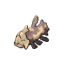

- 文件：[pokemon-id-00369-front-normal-default-static--147a425e57d7.png](pokemon-id-00369-front-normal-default-static--147a425e57d7.png)
- 用途：正面普通宝可梦图像；身份和变体来自PokeAPI路径，不作为原应用已经接入的证明。
- 尺寸：96 × 96，帧数：1
- SHA256：`147a425e57d77d8ba0a785919ee951e11e47e50c75e0d13ec682298e7c923aa5`
- 来源：[PokeAPI/sprites](https://raw.githubusercontent.com/PokeAPI/sprites/master/sprites/pokemon/369.png)；取得版本：`1dd55c0436d2a5b6e324c0b780e1b1b416fbfb64`

### 宝可梦API ID 370 · 正面 · 普通 · 默认静态来源

- 文件：[pokemon-id-00370-front-normal-default-static--3d43df925bab.png](pokemon-id-00370-front-normal-default-static--3d43df925bab.png)
- 用途：正面普通宝可梦图像；身份和变体来自PokeAPI路径，不作为原应用已经接入的证明。
- 尺寸：96 × 96，帧数：1
- SHA256：`3d43df925bab1e58dbdd09e752b790b7bfc29a49b18fd5e69d9f6e1d3cf8cf67`
- 来源：[PokeAPI/sprites](https://raw.githubusercontent.com/PokeAPI/sprites/master/sprites/pokemon/370.png)；取得版本：`1dd55c0436d2a5b6e324c0b780e1b1b416fbfb64`

### 宝可梦API ID 371 · 正面 · 普通 · 默认静态来源

- 文件：[pokemon-id-00371-front-normal-default-static--c09ab349f053.png](pokemon-id-00371-front-normal-default-static--c09ab349f053.png)
- 用途：正面普通宝可梦图像；身份和变体来自PokeAPI路径，不作为原应用已经接入的证明。
- 尺寸：96 × 96，帧数：1
- SHA256：`c09ab349f053ea8b6b816ea482995943b29560e8f976abc4264dae960bd8dff5`
- 来源：[PokeAPI/sprites](https://raw.githubusercontent.com/PokeAPI/sprites/master/sprites/pokemon/371.png)；取得版本：`1dd55c0436d2a5b6e324c0b780e1b1b416fbfb64`

### 宝可梦API ID 372 · 正面 · 普通 · 默认静态来源

- 文件：[pokemon-id-00372-front-normal-default-static--5402bf3faab7.png](pokemon-id-00372-front-normal-default-static--5402bf3faab7.png)
- 用途：正面普通宝可梦图像；身份和变体来自PokeAPI路径，不作为原应用已经接入的证明。
- 尺寸：96 × 96，帧数：1
- SHA256：`5402bf3faab7b3144e610f2f338052fe6ddf26549a9c2a61090863e692f367cd`
- 来源：[PokeAPI/sprites](https://raw.githubusercontent.com/PokeAPI/sprites/master/sprites/pokemon/372.png)；取得版本：`1dd55c0436d2a5b6e324c0b780e1b1b416fbfb64`

### 宝可梦API ID 373 · 正面 · 普通 · 默认静态来源

- 文件：[pokemon-id-00373-front-normal-default-static--f94e5ea56b3b.png](pokemon-id-00373-front-normal-default-static--f94e5ea56b3b.png)
- 用途：正面普通宝可梦图像；身份和变体来自PokeAPI路径，不作为原应用已经接入的证明。
- 尺寸：96 × 96，帧数：1
- SHA256：`f94e5ea56b3b232cec2024f5323961eecad77052c65bbf609f86d222d7ee36cb`
- 来源：[PokeAPI/sprites](https://raw.githubusercontent.com/PokeAPI/sprites/master/sprites/pokemon/373.png)；取得版本：`1dd55c0436d2a5b6e324c0b780e1b1b416fbfb64`

### 宝可梦API ID 374 · 正面 · 普通 · 默认静态来源

- 文件：[pokemon-id-00374-front-normal-default-static--d18b1a22ef56.png](pokemon-id-00374-front-normal-default-static--d18b1a22ef56.png)
- 用途：正面普通宝可梦图像；身份和变体来自PokeAPI路径，不作为原应用已经接入的证明。
- 尺寸：96 × 96，帧数：1
- SHA256：`d18b1a22ef56814ccac13fed1c756fe4372cada6ce0c930be082f862672e66fa`
- 来源：[PokeAPI/sprites](https://raw.githubusercontent.com/PokeAPI/sprites/master/sprites/pokemon/374.png)；取得版本：`1dd55c0436d2a5b6e324c0b780e1b1b416fbfb64`

### 宝可梦API ID 375 · 正面 · 普通 · 默认静态来源

- 文件：[pokemon-id-00375-front-normal-default-static--281773514f35.png](pokemon-id-00375-front-normal-default-static--281773514f35.png)
- 用途：正面普通宝可梦图像；身份和变体来自PokeAPI路径，不作为原应用已经接入的证明。
- 尺寸：96 × 96，帧数：1
- SHA256：`281773514f3576433cc3a663c3a70266450d1bd63d500ccb5e1811acdd62cf2a`
- 来源：[PokeAPI/sprites](https://raw.githubusercontent.com/PokeAPI/sprites/master/sprites/pokemon/375.png)；取得版本：`1dd55c0436d2a5b6e324c0b780e1b1b416fbfb64`

### 宝可梦API ID 376 · 正面 · 普通 · 默认静态来源

- 文件：[pokemon-id-00376-front-normal-default-static--66e37aa57015.png](pokemon-id-00376-front-normal-default-static--66e37aa57015.png)
- 用途：正面普通宝可梦图像；身份和变体来自PokeAPI路径，不作为原应用已经接入的证明。
- 尺寸：96 × 96，帧数：1
- SHA256：`66e37aa57015e3589338974aefecb917d674cf210935ce834d9e2fc37591c845`
- 来源：[PokeAPI/sprites](https://raw.githubusercontent.com/PokeAPI/sprites/master/sprites/pokemon/376.png)；取得版本：`1dd55c0436d2a5b6e324c0b780e1b1b416fbfb64`

### 宝可梦API ID 377 · 正面 · 普通 · 默认静态来源

- 文件：[pokemon-id-00377-front-normal-default-static--05d025c0e9b6.png](pokemon-id-00377-front-normal-default-static--05d025c0e9b6.png)
- 用途：正面普通宝可梦图像；身份和变体来自PokeAPI路径，不作为原应用已经接入的证明。
- 尺寸：96 × 96，帧数：1
- SHA256：`05d025c0e9b665db35c595eec8dcacbcf7daecdb7f52759394e1a92849f7b0fe`
- 来源：[PokeAPI/sprites](https://raw.githubusercontent.com/PokeAPI/sprites/master/sprites/pokemon/377.png)；取得版本：`1dd55c0436d2a5b6e324c0b780e1b1b416fbfb64`

### 宝可梦API ID 378 · 正面 · 普通 · 默认静态来源

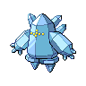

- 文件：[pokemon-id-00378-front-normal-default-static--a0485f55e07f.png](pokemon-id-00378-front-normal-default-static--a0485f55e07f.png)
- 用途：正面普通宝可梦图像；身份和变体来自PokeAPI路径，不作为原应用已经接入的证明。
- 尺寸：96 × 96，帧数：1
- SHA256：`a0485f55e07f4a0715e9296861bf860d26837ee40d7031f3fe3368e404d57cc6`
- 来源：[PokeAPI/sprites](https://raw.githubusercontent.com/PokeAPI/sprites/master/sprites/pokemon/378.png)；取得版本：`1dd55c0436d2a5b6e324c0b780e1b1b416fbfb64`

### 宝可梦API ID 379 · 正面 · 普通 · 默认静态来源

- 文件：[pokemon-id-00379-front-normal-default-static--6c3e12656755.png](pokemon-id-00379-front-normal-default-static--6c3e12656755.png)
- 用途：正面普通宝可梦图像；身份和变体来自PokeAPI路径，不作为原应用已经接入的证明。
- 尺寸：96 × 96，帧数：1
- SHA256：`6c3e126567550aa2b98a7d5b545d3d9fa0768e1c8a8d4acd9fc854f51764e5d6`
- 来源：[PokeAPI/sprites](https://raw.githubusercontent.com/PokeAPI/sprites/master/sprites/pokemon/379.png)；取得版本：`1dd55c0436d2a5b6e324c0b780e1b1b416fbfb64`

### 宝可梦API ID 380 · 正面 · 普通 · 默认静态来源

- 文件：[pokemon-id-00380-front-normal-default-static--6e33be59482b.png](pokemon-id-00380-front-normal-default-static--6e33be59482b.png)
- 用途：正面普通宝可梦图像；身份和变体来自PokeAPI路径，不作为原应用已经接入的证明。
- 尺寸：96 × 96，帧数：1
- SHA256：`6e33be59482beed60a56aaeaf742d7f64b153d50cb993d217739a6fef9202c6a`
- 来源：[PokeAPI/sprites](https://raw.githubusercontent.com/PokeAPI/sprites/master/sprites/pokemon/380.png)；取得版本：`1dd55c0436d2a5b6e324c0b780e1b1b416fbfb64`

### 宝可梦API ID 381 · 正面 · 普通 · 默认静态来源

- 文件：[pokemon-id-00381-front-normal-default-static--f1080a0f167e.png](pokemon-id-00381-front-normal-default-static--f1080a0f167e.png)
- 用途：正面普通宝可梦图像；身份和变体来自PokeAPI路径，不作为原应用已经接入的证明。
- 尺寸：96 × 96，帧数：1
- SHA256：`f1080a0f167efd28b4eca128e2d084bbe18f95171a5c41981966f58b5ca00be4`
- 来源：[PokeAPI/sprites](https://raw.githubusercontent.com/PokeAPI/sprites/master/sprites/pokemon/381.png)；取得版本：`1dd55c0436d2a5b6e324c0b780e1b1b416fbfb64`

### 宝可梦API ID 382 · 正面 · 普通 · 默认静态来源

- 文件：[pokemon-id-00382-front-normal-default-static--02c45c92e404.png](pokemon-id-00382-front-normal-default-static--02c45c92e404.png)
- 用途：正面普通宝可梦图像；身份和变体来自PokeAPI路径，不作为原应用已经接入的证明。
- 尺寸：96 × 96，帧数：1
- SHA256：`02c45c92e404ddb71260dbf6d2110acd96dd3870f618e3d006b4d47e8ee1778d`
- 来源：[PokeAPI/sprites](https://raw.githubusercontent.com/PokeAPI/sprites/master/sprites/pokemon/382.png)；取得版本：`1dd55c0436d2a5b6e324c0b780e1b1b416fbfb64`

### 宝可梦API ID 383 · 正面 · 普通 · 默认静态来源

- 文件：[pokemon-id-00383-front-normal-default-static--4a29eaa12044.png](pokemon-id-00383-front-normal-default-static--4a29eaa12044.png)
- 用途：正面普通宝可梦图像；身份和变体来自PokeAPI路径，不作为原应用已经接入的证明。
- 尺寸：96 × 96，帧数：1
- SHA256：`4a29eaa120446ce65fe424ae641ff96fad9a699f88d0057767d4983a39259243`
- 来源：[PokeAPI/sprites](https://raw.githubusercontent.com/PokeAPI/sprites/master/sprites/pokemon/383.png)；取得版本：`1dd55c0436d2a5b6e324c0b780e1b1b416fbfb64`

### 宝可梦API ID 384 · 正面 · 普通 · 默认静态来源

- 文件：[pokemon-id-00384-front-normal-default-static--2377f7a7be0f.png](pokemon-id-00384-front-normal-default-static--2377f7a7be0f.png)
- 用途：正面普通宝可梦图像；身份和变体来自PokeAPI路径，不作为原应用已经接入的证明。
- 尺寸：96 × 96，帧数：1
- SHA256：`2377f7a7be0f3fe2f164df5e24511216ab5a5bddc3bb23fd06cd7ae26a060875`
- 来源：[PokeAPI/sprites](https://raw.githubusercontent.com/PokeAPI/sprites/master/sprites/pokemon/384.png)；取得版本：`1dd55c0436d2a5b6e324c0b780e1b1b416fbfb64`

### 宝可梦API ID 385 · 正面 · 普通 · 默认静态来源

- 文件：[pokemon-id-00385-front-normal-default-static--75dd2daa393a.png](pokemon-id-00385-front-normal-default-static--75dd2daa393a.png)
- 用途：正面普通宝可梦图像；身份和变体来自PokeAPI路径，不作为原应用已经接入的证明。
- 尺寸：96 × 96，帧数：1
- SHA256：`75dd2daa393a75e1da8d861b5279332fc0e92d70fa1afadd3ddfb19a37fd1c5a`
- 来源：[PokeAPI/sprites](https://raw.githubusercontent.com/PokeAPI/sprites/master/sprites/pokemon/385.png)；取得版本：`1dd55c0436d2a5b6e324c0b780e1b1b416fbfb64`

### 宝可梦API ID 386 · 正面 · 普通 · 默认静态来源

- 文件：[pokemon-id-00386-front-normal-default-static--cd194f62c702.png](pokemon-id-00386-front-normal-default-static--cd194f62c702.png)
- 用途：正面普通宝可梦图像；身份和变体来自PokeAPI路径，不作为原应用已经接入的证明。
- 尺寸：96 × 96，帧数：1
- SHA256：`cd194f62c702a3f7914069334a1e8cd99f39235b04ea989801ff5b6aaa4468e3`
- 来源：[PokeAPI/sprites](https://raw.githubusercontent.com/PokeAPI/sprites/master/sprites/pokemon/386.png)；取得版本：`1dd55c0436d2a5b6e324c0b780e1b1b416fbfb64`

