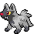

# pokemon/sprites/front/normal/gen5-black-white-animated

共 140 张，均按原来源路径识别；已备份不等于已接入游戏。编号为PokeAPI编号，不是业务数据库主键。

### 宝可梦API ID 1 · 正面 · 普通 · 第五世代黑白动画来源

- 文件：[pokemon-id-00001-front-normal-gen5-black-white-animated--354f4e74e6c3.gif](pokemon-id-00001-front-normal-gen5-black-white-animated--354f4e74e6c3.gif)
- 用途：正面普通宝可梦图像；身份和变体来自PokeAPI路径，不作为原应用已经接入的证明。
- 尺寸：37 × 38，帧数：51
- SHA256：`354f4e74e6c3dfe5acfc0758707c07d0792ef592791d05a43dfddec13f34cb93`
- 来源：[PokeAPI/sprites](https://raw.githubusercontent.com/PokeAPI/sprites/master/sprites/pokemon/versions/generation-v/black-white/animated/1.gif)；取得版本：`1dd55c0436d2a5b6e324c0b780e1b1b416fbfb64`

### 宝可梦API ID 4 · 正面 · 普通 · 第五世代黑白动画来源

- 文件：[pokemon-id-00004-front-normal-gen5-black-white-animated--d5d898807fb6.gif](pokemon-id-00004-front-normal-gen5-black-white-animated--d5d898807fb6.gif)
- 用途：正面普通宝可梦图像；身份和变体来自PokeAPI路径，不作为原应用已经接入的证明。
- 尺寸：41 × 42，帧数：55
- SHA256：`d5d898807fb61c5eadeecf71a023b543cc7740e72c833bec5491efbe1eecb0c2`
- 来源：[PokeAPI/sprites](https://raw.githubusercontent.com/PokeAPI/sprites/master/sprites/pokemon/versions/generation-v/black-white/animated/4.gif)；取得版本：`1dd55c0436d2a5b6e324c0b780e1b1b416fbfb64`

### 宝可梦API ID 7 · 正面 · 普通 · 第五世代黑白动画来源

- 文件：[pokemon-id-00007-front-normal-gen5-black-white-animated--cfb2c0799c06.gif](pokemon-id-00007-front-normal-gen5-black-white-animated--cfb2c0799c06.gif)
- 用途：正面普通宝可梦图像；身份和变体来自PokeAPI路径，不作为原应用已经接入的证明。
- 尺寸：39 × 43，帧数：30
- SHA256：`cfb2c0799c062c09baf49ca8cd946c4a53bb42147ed6cc811b8879281c79aa30`
- 来源：[PokeAPI/sprites](https://raw.githubusercontent.com/PokeAPI/sprites/master/sprites/pokemon/versions/generation-v/black-white/animated/7.gif)；取得版本：`1dd55c0436d2a5b6e324c0b780e1b1b416fbfb64`

### 宝可梦API ID 25 · 正面 · 普通 · 第五世代黑白动画来源

- 文件：[pokemon-id-00025-front-normal-gen5-black-white-animated--0ddc94c6f8cd.gif](pokemon-id-00025-front-normal-gen5-black-white-animated--0ddc94c6f8cd.gif)
- 用途：正面普通宝可梦图像；身份和变体来自PokeAPI路径，不作为原应用已经接入的证明。
- 尺寸：50 × 46，帧数：58
- SHA256：`0ddc94c6f8cd432e3fd8972b4eca2a7b72fbfaf130c1970726089feb6fdbacc0`
- 来源：[PokeAPI/sprites](https://raw.githubusercontent.com/PokeAPI/sprites/master/sprites/pokemon/versions/generation-v/black-white/animated/25.gif)；取得版本：`1dd55c0436d2a5b6e324c0b780e1b1b416fbfb64`

### 宝可梦API ID 118 · 正面 · 普通 · 第五世代黑白动画来源

- 文件：[pokemon-id-00118-front-normal-gen5-black-white-animated--93f72da829d4.gif](pokemon-id-00118-front-normal-gen5-black-white-animated--93f72da829d4.gif)
- 用途：正面普通宝可梦图像；身份和变体来自PokeAPI路径，不作为原应用已经接入的证明。
- 尺寸：75 × 57，帧数：58
- SHA256：`93f72da829d40ad86e6b74d351536efa8fbfbc79e8cba553aca7005ed061e628`
- 来源：[PokeAPI/sprites](https://raw.githubusercontent.com/PokeAPI/sprites/master/sprites/pokemon/versions/generation-v/black-white/animated/118.gif)；取得版本：`1dd55c0436d2a5b6e324c0b780e1b1b416fbfb64`

### 宝可梦API ID 252 · 正面 · 普通 · 第五世代黑白动画来源

- 文件：[pokemon-id-00252-front-normal-gen5-black-white-animated--40ed4afc1305.gif](pokemon-id-00252-front-normal-gen5-black-white-animated--40ed4afc1305.gif)
- 用途：正面普通宝可梦图像；身份和变体来自PokeAPI路径，不作为原应用已经接入的证明。
- 尺寸：43 × 63，帧数：89
- SHA256：`40ed4afc1305eb4aa566de9889ea41affb1adcafa49da32350e3df5c3f504114`
- 来源：[PokeAPI/sprites](https://raw.githubusercontent.com/PokeAPI/sprites/master/sprites/pokemon/versions/generation-v/black-white/animated/252.gif)；取得版本：`1dd55c0436d2a5b6e324c0b780e1b1b416fbfb64`

### 宝可梦API ID 253 · 正面 · 普通 · 第五世代黑白动画来源

- 文件：[pokemon-id-00253-front-normal-gen5-black-white-animated--ceac7a3eaeb1.gif](pokemon-id-00253-front-normal-gen5-black-white-animated--ceac7a3eaeb1.gif)
- 用途：正面普通宝可梦图像；身份和变体来自PokeAPI路径，不作为原应用已经接入的证明。
- 尺寸：64 × 70，帧数：114
- SHA256：`ceac7a3eaeb1df56ef5cefd757010729d693ef83d02bcccaad0f0d2b0e064049`
- 来源：[PokeAPI/sprites](https://raw.githubusercontent.com/PokeAPI/sprites/master/sprites/pokemon/versions/generation-v/black-white/animated/253.gif)；取得版本：`1dd55c0436d2a5b6e324c0b780e1b1b416fbfb64`

### 宝可梦API ID 254 · 正面 · 普通 · 第五世代黑白动画来源

- 文件：[pokemon-id-00254-front-normal-gen5-black-white-animated--3297b4de60aa.gif](pokemon-id-00254-front-normal-gen5-black-white-animated--3297b4de60aa.gif)
- 用途：正面普通宝可梦图像；身份和变体来自PokeAPI路径，不作为原应用已经接入的证明。
- 尺寸：67 × 74，帧数：94
- SHA256：`3297b4de60aaa50b82251f4e2fe3b45ffecf749e09a4025e6bf910705e030a8f`
- 来源：[PokeAPI/sprites](https://raw.githubusercontent.com/PokeAPI/sprites/master/sprites/pokemon/versions/generation-v/black-white/animated/254.gif)；取得版本：`1dd55c0436d2a5b6e324c0b780e1b1b416fbfb64`

### 宝可梦API ID 255 · 正面 · 普通 · 第五世代黑白动画来源

- 文件：[pokemon-id-00255-front-normal-gen5-black-white-animated--98421dd0d7be.gif](pokemon-id-00255-front-normal-gen5-black-white-animated--98421dd0d7be.gif)
- 用途：正面普通宝可梦图像；身份和变体来自PokeAPI路径，不作为原应用已经接入的证明。
- 尺寸：33 × 47，帧数：117
- SHA256：`98421dd0d7be7100ec6edf8f3355d8e049052e12e0b8ad0dae1368b292b4670a`
- 来源：[PokeAPI/sprites](https://raw.githubusercontent.com/PokeAPI/sprites/master/sprites/pokemon/versions/generation-v/black-white/animated/255.gif)；取得版本：`1dd55c0436d2a5b6e324c0b780e1b1b416fbfb64`

### 宝可梦API ID 256 · 正面 · 普通 · 第五世代黑白动画来源

- 文件：[pokemon-id-00256-front-normal-gen5-black-white-animated--b840afdef954.gif](pokemon-id-00256-front-normal-gen5-black-white-animated--b840afdef954.gif)
- 用途：正面普通宝可梦图像；身份和变体来自PokeAPI路径，不作为原应用已经接入的证明。
- 尺寸：71 × 63，帧数：110
- SHA256：`b840afdef954151331014911ba859f1b1fc173e0eb777ff88dd604ebbc9018e4`
- 来源：[PokeAPI/sprites](https://raw.githubusercontent.com/PokeAPI/sprites/master/sprites/pokemon/versions/generation-v/black-white/animated/256.gif)；取得版本：`1dd55c0436d2a5b6e324c0b780e1b1b416fbfb64`

### 宝可梦API ID 257 · 正面 · 普通 · 第五世代黑白动画来源

- 文件：[pokemon-id-00257-front-normal-gen5-black-white-animated--f5da3ffe0d5d.gif](pokemon-id-00257-front-normal-gen5-black-white-animated--f5da3ffe0d5d.gif)
- 用途：正面普通宝可梦图像；身份和变体来自PokeAPI路径，不作为原应用已经接入的证明。
- 尺寸：59 × 75，帧数：87
- SHA256：`f5da3ffe0d5d9d2a4ef4eee432bbf8684b6c042dd27e13b5369dc52b1d9faaae`
- 来源：[PokeAPI/sprites](https://raw.githubusercontent.com/PokeAPI/sprites/master/sprites/pokemon/versions/generation-v/black-white/animated/257.gif)；取得版本：`1dd55c0436d2a5b6e324c0b780e1b1b416fbfb64`

### 宝可梦API ID 258 · 正面 · 普通 · 第五世代黑白动画来源

- 文件：[pokemon-id-00258-front-normal-gen5-black-white-animated--9346e3b54e56.gif](pokemon-id-00258-front-normal-gen5-black-white-animated--9346e3b54e56.gif)
- 用途：正面普通宝可梦图像；身份和变体来自PokeAPI路径，不作为原应用已经接入的证明。
- 尺寸：43 × 49，帧数：82
- SHA256：`9346e3b54e5645e64a31791559846554ed69d313b58b48eff500787b97a2b161`
- 来源：[PokeAPI/sprites](https://raw.githubusercontent.com/PokeAPI/sprites/master/sprites/pokemon/versions/generation-v/black-white/animated/258.gif)；取得版本：`1dd55c0436d2a5b6e324c0b780e1b1b416fbfb64`

### 宝可梦API ID 259 · 正面 · 普通 · 第五世代黑白动画来源

- 文件：[pokemon-id-00259-front-normal-gen5-black-white-animated--55612a396694.gif](pokemon-id-00259-front-normal-gen5-black-white-animated--55612a396694.gif)
- 用途：正面普通宝可梦图像；身份和变体来自PokeAPI路径，不作为原应用已经接入的证明。
- 尺寸：54 × 58，帧数：92
- SHA256：`55612a396694834fab7d5e65a0e9cee4b187297a1ddc1864294ef31812f20ebe`
- 来源：[PokeAPI/sprites](https://raw.githubusercontent.com/PokeAPI/sprites/master/sprites/pokemon/versions/generation-v/black-white/animated/259.gif)；取得版本：`1dd55c0436d2a5b6e324c0b780e1b1b416fbfb64`

### 宝可梦API ID 260 · 正面 · 普通 · 第五世代黑白动画来源

- 文件：[pokemon-id-00260-front-normal-gen5-black-white-animated--dcff9627142d.gif](pokemon-id-00260-front-normal-gen5-black-white-animated--dcff9627142d.gif)
- 用途：正面普通宝可梦图像；身份和变体来自PokeAPI路径，不作为原应用已经接入的证明。
- 尺寸：76 × 60，帧数：80
- SHA256：`dcff9627142d50220f621ee9ca3b0dbe618d5c2498b1b052bbc046b46e174f7d`
- 来源：[PokeAPI/sprites](https://raw.githubusercontent.com/PokeAPI/sprites/master/sprites/pokemon/versions/generation-v/black-white/animated/260.gif)；取得版本：`1dd55c0436d2a5b6e324c0b780e1b1b416fbfb64`

### 宝可梦API ID 261 · 正面 · 普通 · 第五世代黑白动画来源

- 文件：[pokemon-id-00261-front-normal-gen5-black-white-animated--670e49859262.gif](pokemon-id-00261-front-normal-gen5-black-white-animated--670e49859262.gif)
- 用途：正面普通宝可梦图像；身份和变体来自PokeAPI路径，不作为原应用已经接入的证明。
- 尺寸：52 × 44，帧数：59
- SHA256：`670e49859262a1200e09dee69949aea018f50878b2307e3de867cf52c58498fd`
- 来源：[PokeAPI/sprites](https://raw.githubusercontent.com/PokeAPI/sprites/master/sprites/pokemon/versions/generation-v/black-white/animated/261.gif)；取得版本：`1dd55c0436d2a5b6e324c0b780e1b1b416fbfb64`

### 宝可梦API ID 262 · 正面 · 普通 · 第五世代黑白动画来源

- 文件：[pokemon-id-00262-front-normal-gen5-black-white-animated--ec39a54232a0.gif](pokemon-id-00262-front-normal-gen5-black-white-animated--ec39a54232a0.gif)
- 用途：正面普通宝可梦图像；身份和变体来自PokeAPI路径，不作为原应用已经接入的证明。
- 尺寸：74 × 64，帧数：73
- SHA256：`ec39a54232a03495cd4289e8abc5765dbe6a42ca391d132936f4b0b11ea546c2`
- 来源：[PokeAPI/sprites](https://raw.githubusercontent.com/PokeAPI/sprites/master/sprites/pokemon/versions/generation-v/black-white/animated/262.gif)；取得版本：`1dd55c0436d2a5b6e324c0b780e1b1b416fbfb64`

### 宝可梦API ID 263 · 正面 · 普通 · 第五世代黑白动画来源

- 文件：[pokemon-id-00263-front-normal-gen5-black-white-animated--b7c394017752.gif](pokemon-id-00263-front-normal-gen5-black-white-animated--b7c394017752.gif)
- 用途：正面普通宝可梦图像；身份和变体来自PokeAPI路径，不作为原应用已经接入的证明。
- 尺寸：58 × 43，帧数：86
- SHA256：`b7c394017752474cf51cea79d6278b375ff73e5de2704e01abc0cacecd64a295`
- 来源：[PokeAPI/sprites](https://raw.githubusercontent.com/PokeAPI/sprites/master/sprites/pokemon/versions/generation-v/black-white/animated/263.gif)；取得版本：`1dd55c0436d2a5b6e324c0b780e1b1b416fbfb64`

### 宝可梦API ID 264 · 正面 · 普通 · 第五世代黑白动画来源

- 文件：[pokemon-id-00264-front-normal-gen5-black-white-animated--67705d3ed4a3.gif](pokemon-id-00264-front-normal-gen5-black-white-animated--67705d3ed4a3.gif)
- 用途：正面普通宝可梦图像；身份和变体来自PokeAPI路径，不作为原应用已经接入的证明。
- 尺寸：81 × 41，帧数：88
- SHA256：`67705d3ed4a34939a93c51fee74ec219cf45897fd5402813b7bdd67d3606286e`
- 来源：[PokeAPI/sprites](https://raw.githubusercontent.com/PokeAPI/sprites/master/sprites/pokemon/versions/generation-v/black-white/animated/264.gif)；取得版本：`1dd55c0436d2a5b6e324c0b780e1b1b416fbfb64`

### 宝可梦API ID 265 · 正面 · 普通 · 第五世代黑白动画来源

- 文件：[pokemon-id-00265-front-normal-gen5-black-white-animated--132b94b27ffd.gif](pokemon-id-00265-front-normal-gen5-black-white-animated--132b94b27ffd.gif)
- 用途：正面普通宝可梦图像；身份和变体来自PokeAPI路径，不作为原应用已经接入的证明。
- 尺寸：37 × 46，帧数：52
- SHA256：`132b94b27ffde9bb7724df5faaf604b501a9e6169f5b6109e0434e732c8f21be`
- 来源：[PokeAPI/sprites](https://raw.githubusercontent.com/PokeAPI/sprites/master/sprites/pokemon/versions/generation-v/black-white/animated/265.gif)；取得版本：`1dd55c0436d2a5b6e324c0b780e1b1b416fbfb64`

### 宝可梦API ID 266 · 正面 · 普通 · 第五世代黑白动画来源

- 文件：[pokemon-id-00266-front-normal-gen5-black-white-animated--939394669232.gif](pokemon-id-00266-front-normal-gen5-black-white-animated--939394669232.gif)
- 用途：正面普通宝可梦图像；身份和变体来自PokeAPI路径，不作为原应用已经接入的证明。
- 尺寸：50 × 47，帧数：67
- SHA256：`939394669232640dc1ca1547833f122b2c6788c897b0749585abf7b4ef7b2f3a`
- 来源：[PokeAPI/sprites](https://raw.githubusercontent.com/PokeAPI/sprites/master/sprites/pokemon/versions/generation-v/black-white/animated/266.gif)；取得版本：`1dd55c0436d2a5b6e324c0b780e1b1b416fbfb64`

### 宝可梦API ID 267 · 正面 · 普通 · 第五世代黑白动画来源

- 文件：[pokemon-id-00267-front-normal-gen5-black-white-animated--efa4fe5ead63.gif](pokemon-id-00267-front-normal-gen5-black-white-animated--efa4fe5ead63.gif)
- 用途：正面普通宝可梦图像；身份和变体来自PokeAPI路径，不作为原应用已经接入的证明。
- 尺寸：78 × 55，帧数：96
- SHA256：`efa4fe5ead63a9546868cf005bdc5722a0805fbb7d063d331311b5f6b5d7b56f`
- 来源：[PokeAPI/sprites](https://raw.githubusercontent.com/PokeAPI/sprites/master/sprites/pokemon/versions/generation-v/black-white/animated/267.gif)；取得版本：`1dd55c0436d2a5b6e324c0b780e1b1b416fbfb64`

### 宝可梦API ID 268 · 正面 · 普通 · 第五世代黑白动画来源

- 文件：[pokemon-id-00268-front-normal-gen5-black-white-animated--3be6964cc8bc.gif](pokemon-id-00268-front-normal-gen5-black-white-animated--3be6964cc8bc.gif)
- 用途：正面普通宝可梦图像；身份和变体来自PokeAPI路径，不作为原应用已经接入的证明。
- 尺寸：55 × 40，帧数：55
- SHA256：`3be6964cc8bc2d33fbf22321155fac0be1709a553f9433ea28a2fa5fff7f3c75`
- 来源：[PokeAPI/sprites](https://raw.githubusercontent.com/PokeAPI/sprites/master/sprites/pokemon/versions/generation-v/black-white/animated/268.gif)；取得版本：`1dd55c0436d2a5b6e324c0b780e1b1b416fbfb64`

### 宝可梦API ID 269 · 正面 · 普通 · 第五世代黑白动画来源

- 文件：[pokemon-id-00269-front-normal-gen5-black-white-animated--3d319388eb52.gif](pokemon-id-00269-front-normal-gen5-black-white-animated--3d319388eb52.gif)
- 用途：正面普通宝可梦图像；身份和变体来自PokeAPI路径，不作为原应用已经接入的证明。
- 尺寸：80 × 47，帧数：96
- SHA256：`3d319388eb5222e3642c49aad0392f42a0a34a41948388d0778773f0d07a72b0`
- 来源：[PokeAPI/sprites](https://raw.githubusercontent.com/PokeAPI/sprites/master/sprites/pokemon/versions/generation-v/black-white/animated/269.gif)；取得版本：`1dd55c0436d2a5b6e324c0b780e1b1b416fbfb64`

### 宝可梦API ID 270 · 正面 · 普通 · 第五世代黑白动画来源

- 文件：[pokemon-id-00270-front-normal-gen5-black-white-animated--24a3b338b3d5.gif](pokemon-id-00270-front-normal-gen5-black-white-animated--24a3b338b3d5.gif)
- 用途：正面普通宝可梦图像；身份和变体来自PokeAPI路径，不作为原应用已经接入的证明。
- 尺寸：44 × 41，帧数：112
- SHA256：`24a3b338b3d5eaa934c1c78ad0b9749fdbdd5afbbefb07817f6195126dc78259`
- 来源：[PokeAPI/sprites](https://raw.githubusercontent.com/PokeAPI/sprites/master/sprites/pokemon/versions/generation-v/black-white/animated/270.gif)；取得版本：`1dd55c0436d2a5b6e324c0b780e1b1b416fbfb64`

### 宝可梦API ID 271 · 正面 · 普通 · 第五世代黑白动画来源

- 文件：[pokemon-id-00271-front-normal-gen5-black-white-animated--9b769e100f09.gif](pokemon-id-00271-front-normal-gen5-black-white-animated--9b769e100f09.gif)
- 用途：正面普通宝可梦图像；身份和变体来自PokeAPI路径，不作为原应用已经接入的证明。
- 尺寸：50 × 52，帧数：67
- SHA256：`9b769e100f092f2b549ea4b503cc235ac28183cb118405535d8f4eb723917594`
- 来源：[PokeAPI/sprites](https://raw.githubusercontent.com/PokeAPI/sprites/master/sprites/pokemon/versions/generation-v/black-white/animated/271.gif)；取得版本：`1dd55c0436d2a5b6e324c0b780e1b1b416fbfb64`

### 宝可梦API ID 272 · 正面 · 普通 · 第五世代黑白动画来源

- 文件：[pokemon-id-00272-front-normal-gen5-black-white-animated--325d720d905b.gif](pokemon-id-00272-front-normal-gen5-black-white-animated--325d720d905b.gif)
- 用途：正面普通宝可梦图像；身份和变体来自PokeAPI路径，不作为原应用已经接入的证明。
- 尺寸：84 × 80，帧数：75
- SHA256：`325d720d905ba09156968756deb5b832dd895322a62b6380ce100671eeaefcb9`
- 来源：[PokeAPI/sprites](https://raw.githubusercontent.com/PokeAPI/sprites/master/sprites/pokemon/versions/generation-v/black-white/animated/272.gif)；取得版本：`1dd55c0436d2a5b6e324c0b780e1b1b416fbfb64`

### 宝可梦API ID 273 · 正面 · 普通 · 第五世代黑白动画来源

- 文件：[pokemon-id-00273-front-normal-gen5-black-white-animated--83ab39f913fa.gif](pokemon-id-00273-front-normal-gen5-black-white-animated--83ab39f913fa.gif)
- 用途：正面普通宝可梦图像；身份和变体来自PokeAPI路径，不作为原应用已经接入的证明。
- 尺寸：35 × 38，帧数：194
- SHA256：`83ab39f913fa4a15584f5add2a1ed6c1cd8d94a1994534d1552d90980395f9f9`
- 来源：[PokeAPI/sprites](https://raw.githubusercontent.com/PokeAPI/sprites/master/sprites/pokemon/versions/generation-v/black-white/animated/273.gif)；取得版本：`1dd55c0436d2a5b6e324c0b780e1b1b416fbfb64`

### 宝可梦API ID 274 · 正面 · 普通 · 第五世代黑白动画来源

- 文件：[pokemon-id-00274-front-normal-gen5-black-white-animated--fc62fc1b0b85.gif](pokemon-id-00274-front-normal-gen5-black-white-animated--fc62fc1b0b85.gif)
- 用途：正面普通宝可梦图像；身份和变体来自PokeAPI路径，不作为原应用已经接入的证明。
- 尺寸：45 × 58，帧数：73
- SHA256：`fc62fc1b0b85209fb582293b6bc8c389d89a5e5cc2d0d478b1879ba3a101bae5`
- 来源：[PokeAPI/sprites](https://raw.githubusercontent.com/PokeAPI/sprites/master/sprites/pokemon/versions/generation-v/black-white/animated/274.gif)；取得版本：`1dd55c0436d2a5b6e324c0b780e1b1b416fbfb64`

### 宝可梦API ID 275 · 正面 · 普通 · 第五世代黑白动画来源

- 文件：[pokemon-id-00275-front-normal-gen5-black-white-animated--4f34b66f1b42.gif](pokemon-id-00275-front-normal-gen5-black-white-animated--4f34b66f1b42.gif)
- 用途：正面普通宝可梦图像；身份和变体来自PokeAPI路径，不作为原应用已经接入的证明。
- 尺寸：97 × 71，帧数：85
- SHA256：`4f34b66f1b42165b2fc7b0faf13da1ffbea209e6690f2616d8bfe1c5e4b82a43`
- 来源：[PokeAPI/sprites](https://raw.githubusercontent.com/PokeAPI/sprites/master/sprites/pokemon/versions/generation-v/black-white/animated/275.gif)；取得版本：`1dd55c0436d2a5b6e324c0b780e1b1b416fbfb64`

### 宝可梦API ID 276 · 正面 · 普通 · 第五世代黑白动画来源

- 文件：[pokemon-id-00276-front-normal-gen5-black-white-animated--37c69b803ae6.gif](pokemon-id-00276-front-normal-gen5-black-white-animated--37c69b803ae6.gif)
- 用途：正面普通宝可梦图像；身份和变体来自PokeAPI路径，不作为原应用已经接入的证明。
- 尺寸：43 × 36，帧数：56
- SHA256：`37c69b803ae627b7bad66f824f989ca2d33e755809c05276d60b7e371148057c`
- 来源：[PokeAPI/sprites](https://raw.githubusercontent.com/PokeAPI/sprites/master/sprites/pokemon/versions/generation-v/black-white/animated/276.gif)；取得版本：`1dd55c0436d2a5b6e324c0b780e1b1b416fbfb64`

### 宝可梦API ID 277 · 正面 · 普通 · 第五世代黑白动画来源

- 文件：[pokemon-id-00277-front-normal-gen5-black-white-animated--4e94b6994c68.gif](pokemon-id-00277-front-normal-gen5-black-white-animated--4e94b6994c68.gif)
- 用途：正面普通宝可梦图像；身份和变体来自PokeAPI路径，不作为原应用已经接入的证明。
- 尺寸：72 × 59，帧数：103
- SHA256：`4e94b6994c682a728a951649c06171e30af937b0ff1d671f471d8582c03b46a6`
- 来源：[PokeAPI/sprites](https://raw.githubusercontent.com/PokeAPI/sprites/master/sprites/pokemon/versions/generation-v/black-white/animated/277.gif)；取得版本：`1dd55c0436d2a5b6e324c0b780e1b1b416fbfb64`

### 宝可梦API ID 278 · 正面 · 普通 · 第五世代黑白动画来源

- 文件：[pokemon-id-00278-front-normal-gen5-black-white-animated--79b137d6b4bf.gif](pokemon-id-00278-front-normal-gen5-black-white-animated--79b137d6b4bf.gif)
- 用途：正面普通宝可梦图像；身份和变体来自PokeAPI路径，不作为原应用已经接入的证明。
- 尺寸：63 × 45，帧数：113
- SHA256：`79b137d6b4bfa6a17d4cd0c83b2173ab32fda12b2725d4b8be4deb76686da435`
- 来源：[PokeAPI/sprites](https://raw.githubusercontent.com/PokeAPI/sprites/master/sprites/pokemon/versions/generation-v/black-white/animated/278.gif)；取得版本：`1dd55c0436d2a5b6e324c0b780e1b1b416fbfb64`

### 宝可梦API ID 279 · 正面 · 普通 · 第五世代黑白动画来源

- 文件：[pokemon-id-00279-front-normal-gen5-black-white-animated--e017ffe3dee4.gif](pokemon-id-00279-front-normal-gen5-black-white-animated--e017ffe3dee4.gif)
- 用途：正面普通宝可梦图像；身份和变体来自PokeAPI路径，不作为原应用已经接入的证明。
- 尺寸：95 × 76，帧数：130
- SHA256：`e017ffe3dee435792aaad3e8a105d994506ca53fbc6325ceb0af31b8b71e80ce`
- 来源：[PokeAPI/sprites](https://raw.githubusercontent.com/PokeAPI/sprites/master/sprites/pokemon/versions/generation-v/black-white/animated/279.gif)；取得版本：`1dd55c0436d2a5b6e324c0b780e1b1b416fbfb64`

### 宝可梦API ID 280 · 正面 · 普通 · 第五世代黑白动画来源

- 文件：[pokemon-id-00280-front-normal-gen5-black-white-animated--335718242e86.gif](pokemon-id-00280-front-normal-gen5-black-white-animated--335718242e86.gif)
- 用途：正面普通宝可梦图像；身份和变体来自PokeAPI路径，不作为原应用已经接入的证明。
- 尺寸：23 × 39，帧数：121
- SHA256：`335718242e866d48299c73ab092b2e47694da7e2060af7270f8ad4ab9c241426`
- 来源：[PokeAPI/sprites](https://raw.githubusercontent.com/PokeAPI/sprites/master/sprites/pokemon/versions/generation-v/black-white/animated/280.gif)；取得版本：`1dd55c0436d2a5b6e324c0b780e1b1b416fbfb64`

### 宝可梦API ID 281 · 正面 · 普通 · 第五世代黑白动画来源

- 文件：[pokemon-id-00281-front-normal-gen5-black-white-animated--a91269a4f838.gif](pokemon-id-00281-front-normal-gen5-black-white-animated--a91269a4f838.gif)
- 用途：正面普通宝可梦图像；身份和变体来自PokeAPI路径，不作为原应用已经接入的证明。
- 尺寸：36 × 63，帧数：76
- SHA256：`a91269a4f838fec1d72a1e1fbc6e950327fbea21cfb7e935beef2b5ba1f02121`
- 来源：[PokeAPI/sprites](https://raw.githubusercontent.com/PokeAPI/sprites/master/sprites/pokemon/versions/generation-v/black-white/animated/281.gif)；取得版本：`1dd55c0436d2a5b6e324c0b780e1b1b416fbfb64`

### 宝可梦API ID 282 · 正面 · 普通 · 第五世代黑白动画来源

- 文件：[pokemon-id-00282-front-normal-gen5-black-white-animated--5ba2393dadab.gif](pokemon-id-00282-front-normal-gen5-black-white-animated--5ba2393dadab.gif)
- 用途：正面普通宝可梦图像；身份和变体来自PokeAPI路径，不作为原应用已经接入的证明。
- 尺寸：71 × 77，帧数：183
- SHA256：`5ba2393dadab1b65a50964af84b50f547d86a3d655d381af7246975dec060882`
- 来源：[PokeAPI/sprites](https://raw.githubusercontent.com/PokeAPI/sprites/master/sprites/pokemon/versions/generation-v/black-white/animated/282.gif)；取得版本：`1dd55c0436d2a5b6e324c0b780e1b1b416fbfb64`

### 宝可梦API ID 283 · 正面 · 普通 · 第五世代黑白动画来源

- 文件：[pokemon-id-00283-front-normal-gen5-black-white-animated--d9632d6c10c0.gif](pokemon-id-00283-front-normal-gen5-black-white-animated--d9632d6c10c0.gif)
- 用途：正面普通宝可梦图像；身份和变体来自PokeAPI路径，不作为原应用已经接入的证明。
- 尺寸：68 × 51，帧数：107
- SHA256：`d9632d6c10c05ca6ed891abe7cc678bff992dc71bda9b000f08a5bb368f41beb`
- 来源：[PokeAPI/sprites](https://raw.githubusercontent.com/PokeAPI/sprites/master/sprites/pokemon/versions/generation-v/black-white/animated/283.gif)；取得版本：`1dd55c0436d2a5b6e324c0b780e1b1b416fbfb64`

### 宝可梦API ID 284 · 正面 · 普通 · 第五世代黑白动画来源

- 文件：[pokemon-id-00284-front-normal-gen5-black-white-animated--e643652ce1f7.gif](pokemon-id-00284-front-normal-gen5-black-white-animated--e643652ce1f7.gif)
- 用途：正面普通宝可梦图像；身份和变体来自PokeAPI路径，不作为原应用已经接入的证明。
- 尺寸：73 × 65，帧数：128
- SHA256：`e643652ce1f7fbc284a6d1270da367eb5b0cb5f6e046a06f4d3b09f12a7c540b`
- 来源：[PokeAPI/sprites](https://raw.githubusercontent.com/PokeAPI/sprites/master/sprites/pokemon/versions/generation-v/black-white/animated/284.gif)；取得版本：`1dd55c0436d2a5b6e324c0b780e1b1b416fbfb64`

### 宝可梦API ID 285 · 正面 · 普通 · 第五世代黑白动画来源

- 文件：[pokemon-id-00285-front-normal-gen5-black-white-animated--cb323c5f65a7.gif](pokemon-id-00285-front-normal-gen5-black-white-animated--cb323c5f65a7.gif)
- 用途：正面普通宝可梦图像；身份和变体来自PokeAPI路径，不作为原应用已经接入的证明。
- 尺寸：44 × 48，帧数：40
- SHA256：`cb323c5f65a7d4e28ad76b5e600abaee17e05db90c237372ec3d9a7bfc2da84a`
- 来源：[PokeAPI/sprites](https://raw.githubusercontent.com/PokeAPI/sprites/master/sprites/pokemon/versions/generation-v/black-white/animated/285.gif)；取得版本：`1dd55c0436d2a5b6e324c0b780e1b1b416fbfb64`

### 宝可梦API ID 286 · 正面 · 普通 · 第五世代黑白动画来源

- 文件：[pokemon-id-00286-front-normal-gen5-black-white-animated--b4cbececa8c9.gif](pokemon-id-00286-front-normal-gen5-black-white-animated--b4cbececa8c9.gif)
- 用途：正面普通宝可梦图像；身份和变体来自PokeAPI路径，不作为原应用已经接入的证明。
- 尺寸：57 × 71，帧数：39
- SHA256：`b4cbececa8c908e64d3140497451a267a38cc2b337074af5af59deb1c3a805eb`
- 来源：[PokeAPI/sprites](https://raw.githubusercontent.com/PokeAPI/sprites/master/sprites/pokemon/versions/generation-v/black-white/animated/286.gif)；取得版本：`1dd55c0436d2a5b6e324c0b780e1b1b416fbfb64`

### 宝可梦API ID 287 · 正面 · 普通 · 第五世代黑白动画来源

- 文件：[pokemon-id-00287-front-normal-gen5-black-white-animated--e26fe260801c.gif](pokemon-id-00287-front-normal-gen5-black-white-animated--e26fe260801c.gif)
- 用途：正面普通宝可梦图像；身份和变体来自PokeAPI路径，不作为原应用已经接入的证明。
- 尺寸：52 × 31，帧数：47
- SHA256：`e26fe260801ccd2c8dfd2e2fc56d7d43a2a3a6c39527091f5afd55cac22294f1`
- 来源：[PokeAPI/sprites](https://raw.githubusercontent.com/PokeAPI/sprites/master/sprites/pokemon/versions/generation-v/black-white/animated/287.gif)；取得版本：`1dd55c0436d2a5b6e324c0b780e1b1b416fbfb64`

### 宝可梦API ID 288 · 正面 · 普通 · 第五世代黑白动画来源

- 文件：[pokemon-id-00288-front-normal-gen5-black-white-animated--4aae4e750374.gif](pokemon-id-00288-front-normal-gen5-black-white-animated--4aae4e750374.gif)
- 用途：正面普通宝可梦图像；身份和变体来自PokeAPI路径，不作为原应用已经接入的证明。
- 尺寸：67 × 65，帧数：33
- SHA256：`4aae4e75037427b875ffffaa2cb0293e1c158b3383d1dd966d2a7739accf800f`
- 来源：[PokeAPI/sprites](https://raw.githubusercontent.com/PokeAPI/sprites/master/sprites/pokemon/versions/generation-v/black-white/animated/288.gif)；取得版本：`1dd55c0436d2a5b6e324c0b780e1b1b416fbfb64`

### 宝可梦API ID 289 · 正面 · 普通 · 第五世代黑白动画来源

- 文件：[pokemon-id-00289-front-normal-gen5-black-white-animated--ba5cc3c886e8.gif](pokemon-id-00289-front-normal-gen5-black-white-animated--ba5cc3c886e8.gif)
- 用途：正面普通宝可梦图像；身份和变体来自PokeAPI路径，不作为原应用已经接入的证明。
- 尺寸：75 × 61，帧数：93
- SHA256：`ba5cc3c886e826d7a9258ec62b5c378795fd05f62d53d34e535c65eeef188a30`
- 来源：[PokeAPI/sprites](https://raw.githubusercontent.com/PokeAPI/sprites/master/sprites/pokemon/versions/generation-v/black-white/animated/289.gif)；取得版本：`1dd55c0436d2a5b6e324c0b780e1b1b416fbfb64`

### 宝可梦API ID 290 · 正面 · 普通 · 第五世代黑白动画来源

- 文件：[pokemon-id-00290-front-normal-gen5-black-white-animated--1e26540be3ab.gif](pokemon-id-00290-front-normal-gen5-black-white-animated--1e26540be3ab.gif)
- 用途：正面普通宝可梦图像；身份和变体来自PokeAPI路径，不作为原应用已经接入的证明。
- 尺寸：51 × 28，帧数：95
- SHA256：`1e26540be3ab494c89829056cccfad27c94179ab1599967e59d985ea44ad456d`
- 来源：[PokeAPI/sprites](https://raw.githubusercontent.com/PokeAPI/sprites/master/sprites/pokemon/versions/generation-v/black-white/animated/290.gif)；取得版本：`1dd55c0436d2a5b6e324c0b780e1b1b416fbfb64`

### 宝可梦API ID 291 · 正面 · 普通 · 第五世代黑白动画来源

- 文件：[pokemon-id-00291-front-normal-gen5-black-white-animated--b4e4238191b7.gif](pokemon-id-00291-front-normal-gen5-black-white-animated--b4e4238191b7.gif)
- 用途：正面普通宝可梦图像；身份和变体来自PokeAPI路径，不作为原应用已经接入的证明。
- 尺寸：57 × 51，帧数：223
- SHA256：`b4e4238191b75ddee64152b7aeae67c58bf46e57650d239a1e5b68a9369699a6`
- 来源：[PokeAPI/sprites](https://raw.githubusercontent.com/PokeAPI/sprites/master/sprites/pokemon/versions/generation-v/black-white/animated/291.gif)；取得版本：`1dd55c0436d2a5b6e324c0b780e1b1b416fbfb64`

### 宝可梦API ID 292 · 正面 · 普通 · 第五世代黑白动画来源

- 文件：[pokemon-id-00292-front-normal-gen5-black-white-animated--3bf514923f05.gif](pokemon-id-00292-front-normal-gen5-black-white-animated--3bf514923f05.gif)
- 用途：正面普通宝可梦图像；身份和变体来自PokeAPI路径，不作为原应用已经接入的证明。
- 尺寸：43 × 48，帧数：16
- SHA256：`3bf514923f057573a185f7b0c09a954a13268eb9876a6ba5971abe24783e8115`
- 来源：[PokeAPI/sprites](https://raw.githubusercontent.com/PokeAPI/sprites/master/sprites/pokemon/versions/generation-v/black-white/animated/292.gif)；取得版本：`1dd55c0436d2a5b6e324c0b780e1b1b416fbfb64`

### 宝可梦API ID 293 · 正面 · 普通 · 第五世代黑白动画来源

- 文件：[pokemon-id-00293-front-normal-gen5-black-white-animated--0a144a72485b.gif](pokemon-id-00293-front-normal-gen5-black-white-animated--0a144a72485b.gif)
- 用途：正面普通宝可梦图像；身份和变体来自PokeAPI路径，不作为原应用已经接入的证明。
- 尺寸：40 × 43，帧数：48
- SHA256：`0a144a72485be126a9cdd6f00da03cb309e9abdafc249d0a98f708ce66df9af5`
- 来源：[PokeAPI/sprites](https://raw.githubusercontent.com/PokeAPI/sprites/master/sprites/pokemon/versions/generation-v/black-white/animated/293.gif)；取得版本：`1dd55c0436d2a5b6e324c0b780e1b1b416fbfb64`

### 宝可梦API ID 294 · 正面 · 普通 · 第五世代黑白动画来源

- 文件：[pokemon-id-00294-front-normal-gen5-black-white-animated--bb003a3b3ac2.gif](pokemon-id-00294-front-normal-gen5-black-white-animated--bb003a3b3ac2.gif)
- 用途：正面普通宝可梦图像；身份和变体来自PokeAPI路径，不作为原应用已经接入的证明。
- 尺寸：63 × 62，帧数：113
- SHA256：`bb003a3b3ac2b544f95bab94825f1d90d6ccc3a482258d63e663652c1664f3ee`
- 来源：[PokeAPI/sprites](https://raw.githubusercontent.com/PokeAPI/sprites/master/sprites/pokemon/versions/generation-v/black-white/animated/294.gif)；取得版本：`1dd55c0436d2a5b6e324c0b780e1b1b416fbfb64`

### 宝可梦API ID 295 · 正面 · 普通 · 第五世代黑白动画来源

- 文件：[pokemon-id-00295-front-normal-gen5-black-white-animated--b0275b2a429d.gif](pokemon-id-00295-front-normal-gen5-black-white-animated--b0275b2a429d.gif)
- 用途：正面普通宝可梦图像；身份和变体来自PokeAPI路径，不作为原应用已经接入的证明。
- 尺寸：72 × 68，帧数：93
- SHA256：`b0275b2a429d544ca41c60f0ad263916ab221a626dca2b753ccfe916c5a0756e`
- 来源：[PokeAPI/sprites](https://raw.githubusercontent.com/PokeAPI/sprites/master/sprites/pokemon/versions/generation-v/black-white/animated/295.gif)；取得版本：`1dd55c0436d2a5b6e324c0b780e1b1b416fbfb64`

### 宝可梦API ID 296 · 正面 · 普通 · 第五世代黑白动画来源

- 文件：[pokemon-id-00296-front-normal-gen5-black-white-animated--a208b2a2033d.gif](pokemon-id-00296-front-normal-gen5-black-white-animated--a208b2a2033d.gif)
- 用途：正面普通宝可梦图像；身份和变体来自PokeAPI路径，不作为原应用已经接入的证明。
- 尺寸：63 × 63，帧数：96
- SHA256：`a208b2a2033dc908e229a373abd581cf2662d5c1ca7f93a5dd74122e23bac467`
- 来源：[PokeAPI/sprites](https://raw.githubusercontent.com/PokeAPI/sprites/master/sprites/pokemon/versions/generation-v/black-white/animated/296.gif)；取得版本：`1dd55c0436d2a5b6e324c0b780e1b1b416fbfb64`

### 宝可梦API ID 297 · 正面 · 普通 · 第五世代黑白动画来源

- 文件：[pokemon-id-00297-front-normal-gen5-black-white-animated--4e967a747a15.gif](pokemon-id-00297-front-normal-gen5-black-white-animated--4e967a747a15.gif)
- 用途：正面普通宝可梦图像；身份和变体来自PokeAPI路径，不作为原应用已经接入的证明。
- 尺寸：88 × 79，帧数：133
- SHA256：`4e967a747a154da56afed09f2030a07f55e5b664f5d359e00c341cade41065cf`
- 来源：[PokeAPI/sprites](https://raw.githubusercontent.com/PokeAPI/sprites/master/sprites/pokemon/versions/generation-v/black-white/animated/297.gif)；取得版本：`1dd55c0436d2a5b6e324c0b780e1b1b416fbfb64`

### 宝可梦API ID 298 · 正面 · 普通 · 第五世代黑白动画来源

- 文件：[pokemon-id-00298-front-normal-gen5-black-white-animated--89c641fc8d00.gif](pokemon-id-00298-front-normal-gen5-black-white-animated--89c641fc8d00.gif)
- 用途：正面普通宝可梦图像；身份和变体来自PokeAPI路径，不作为原应用已经接入的证明。
- 尺寸：44 × 64，帧数：70
- SHA256：`89c641fc8d0041ecae03b1f44c27cb6face90390fc00d9aabad5073302249ca5`
- 来源：[PokeAPI/sprites](https://raw.githubusercontent.com/PokeAPI/sprites/master/sprites/pokemon/versions/generation-v/black-white/animated/298.gif)；取得版本：`1dd55c0436d2a5b6e324c0b780e1b1b416fbfb64`

### 宝可梦API ID 299 · 正面 · 普通 · 第五世代黑白动画来源

- 文件：[pokemon-id-00299-front-normal-gen5-black-white-animated--077f727ff050.gif](pokemon-id-00299-front-normal-gen5-black-white-animated--077f727ff050.gif)
- 用途：正面普通宝可梦图像；身份和变体来自PokeAPI路径，不作为原应用已经接入的证明。
- 尺寸：42 × 46，帧数：14
- SHA256：`077f727ff05060e323dbc2112283f7c00e7d7e0745b832c624f70070065b551c`
- 来源：[PokeAPI/sprites](https://raw.githubusercontent.com/PokeAPI/sprites/master/sprites/pokemon/versions/generation-v/black-white/animated/299.gif)；取得版本：`1dd55c0436d2a5b6e324c0b780e1b1b416fbfb64`

### 宝可梦API ID 300 · 正面 · 普通 · 第五世代黑白动画来源

- 文件：[pokemon-id-00300-front-normal-gen5-black-white-animated--2568e371f34f.gif](pokemon-id-00300-front-normal-gen5-black-white-animated--2568e371f34f.gif)
- 用途：正面普通宝可梦图像；身份和变体来自PokeAPI路径，不作为原应用已经接入的证明。
- 尺寸：54 × 46，帧数：116
- SHA256：`2568e371f34f2e76cebaf32e44f22c90f341287e3b3c25903f56cbc2981b3a76`
- 来源：[PokeAPI/sprites](https://raw.githubusercontent.com/PokeAPI/sprites/master/sprites/pokemon/versions/generation-v/black-white/animated/300.gif)；取得版本：`1dd55c0436d2a5b6e324c0b780e1b1b416fbfb64`

### 宝可梦API ID 301 · 正面 · 普通 · 第五世代黑白动画来源

- 文件：[pokemon-id-00301-front-normal-gen5-black-white-animated--b937d1eeea90.gif](pokemon-id-00301-front-normal-gen5-black-white-animated--b937d1eeea90.gif)
- 用途：正面普通宝可梦图像；身份和变体来自PokeAPI路径，不作为原应用已经接入的证明。
- 尺寸：61 × 57，帧数：116
- SHA256：`b937d1eeea902ceb9ee6e5300b86e3b736148bb62cae93da9c96c0a0976848bc`
- 来源：[PokeAPI/sprites](https://raw.githubusercontent.com/PokeAPI/sprites/master/sprites/pokemon/versions/generation-v/black-white/animated/301.gif)；取得版本：`1dd55c0436d2a5b6e324c0b780e1b1b416fbfb64`

### 宝可梦API ID 302 · 正面 · 普通 · 第五世代黑白动画来源

- 文件：[pokemon-id-00302-front-normal-gen5-black-white-animated--36d2efbd7b44.gif](pokemon-id-00302-front-normal-gen5-black-white-animated--36d2efbd7b44.gif)
- 用途：正面普通宝可梦图像；身份和变体来自PokeAPI路径，不作为原应用已经接入的证明。
- 尺寸：43 × 49，帧数：69
- SHA256：`36d2efbd7b448abaf4d2657e4b1bc02f379958b52c3dcefe479b1926c90177ce`
- 来源：[PokeAPI/sprites](https://raw.githubusercontent.com/PokeAPI/sprites/master/sprites/pokemon/versions/generation-v/black-white/animated/302.gif)；取得版本：`1dd55c0436d2a5b6e324c0b780e1b1b416fbfb64`

### 宝可梦API ID 303 · 正面 · 普通 · 第五世代黑白动画来源

- 文件：[pokemon-id-00303-front-normal-gen5-black-white-animated--1db51119338a.gif](pokemon-id-00303-front-normal-gen5-black-white-animated--1db51119338a.gif)
- 用途：正面普通宝可梦图像；身份和变体来自PokeAPI路径，不作为原应用已经接入的证明。
- 尺寸：79 × 51，帧数：152
- SHA256：`1db51119338af677a86d3d710a23ca27fbd153bee16a75f555d91a1fab50b852`
- 来源：[PokeAPI/sprites](https://raw.githubusercontent.com/PokeAPI/sprites/master/sprites/pokemon/versions/generation-v/black-white/animated/303.gif)；取得版本：`1dd55c0436d2a5b6e324c0b780e1b1b416fbfb64`

### 宝可梦API ID 304 · 正面 · 普通 · 第五世代黑白动画来源

- 文件：[pokemon-id-00304-front-normal-gen5-black-white-animated--75e37d884da4.gif](pokemon-id-00304-front-normal-gen5-black-white-animated--75e37d884da4.gif)
- 用途：正面普通宝可梦图像；身份和变体来自PokeAPI路径，不作为原应用已经接入的证明。
- 尺寸：32 × 31，帧数：27
- SHA256：`75e37d884da4c198afd52fdd7c9e64af9a461318beccaf2fe4bd08b22a41fd40`
- 来源：[PokeAPI/sprites](https://raw.githubusercontent.com/PokeAPI/sprites/master/sprites/pokemon/versions/generation-v/black-white/animated/304.gif)；取得版本：`1dd55c0436d2a5b6e324c0b780e1b1b416fbfb64`

### 宝可梦API ID 305 · 正面 · 普通 · 第五世代黑白动画来源

- 文件：[pokemon-id-00305-front-normal-gen5-black-white-animated--215d80ce28ec.gif](pokemon-id-00305-front-normal-gen5-black-white-animated--215d80ce28ec.gif)
- 用途：正面普通宝可梦图像；身份和变体来自PokeAPI路径，不作为原应用已经接入的证明。
- 尺寸：63 × 50，帧数：74
- SHA256：`215d80ce28ecb9ff5923b42e6273d8a29d1a864ad4907ca407f26c9345711b63`
- 来源：[PokeAPI/sprites](https://raw.githubusercontent.com/PokeAPI/sprites/master/sprites/pokemon/versions/generation-v/black-white/animated/305.gif)；取得版本：`1dd55c0436d2a5b6e324c0b780e1b1b416fbfb64`

### 宝可梦API ID 306 · 正面 · 普通 · 第五世代黑白动画来源

- 文件：[pokemon-id-00306-front-normal-gen5-black-white-animated--d05e6db3fce1.gif](pokemon-id-00306-front-normal-gen5-black-white-animated--d05e6db3fce1.gif)
- 用途：正面普通宝可梦图像；身份和变体来自PokeAPI路径，不作为原应用已经接入的证明。
- 尺寸：77 × 76，帧数：78
- SHA256：`d05e6db3fce15a903bca2c113db6b42e349f24f0713f4ce7ae0d6166cd46d5ae`
- 来源：[PokeAPI/sprites](https://raw.githubusercontent.com/PokeAPI/sprites/master/sprites/pokemon/versions/generation-v/black-white/animated/306.gif)；取得版本：`1dd55c0436d2a5b6e324c0b780e1b1b416fbfb64`

### 宝可梦API ID 307 · 正面 · 普通 · 第五世代黑白动画来源

- 文件：[pokemon-id-00307-front-normal-gen5-black-white-animated--7e0a02e03239.gif](pokemon-id-00307-front-normal-gen5-black-white-animated--7e0a02e03239.gif)
- 用途：正面普通宝可梦图像；身份和变体来自PokeAPI路径，不作为原应用已经接入的证明。
- 尺寸：44 × 54，帧数：252
- SHA256：`7e0a02e0323933c8d40cf899f530cc5e6ae863d910167fb65d65f624a32e9185`
- 来源：[PokeAPI/sprites](https://raw.githubusercontent.com/PokeAPI/sprites/master/sprites/pokemon/versions/generation-v/black-white/animated/307.gif)；取得版本：`1dd55c0436d2a5b6e324c0b780e1b1b416fbfb64`

### 宝可梦API ID 308 · 正面 · 普通 · 第五世代黑白动画来源

- 文件：[pokemon-id-00308-front-normal-gen5-black-white-animated--633423e65e67.gif](pokemon-id-00308-front-normal-gen5-black-white-animated--633423e65e67.gif)
- 用途：正面普通宝可梦图像；身份和变体来自PokeAPI路径，不作为原应用已经接入的证明。
- 尺寸：44 × 74，帧数：69
- SHA256：`633423e65e674689e3648ec0a3141f4e609c4111c8991dbf916a813d12f1a5b4`
- 来源：[PokeAPI/sprites](https://raw.githubusercontent.com/PokeAPI/sprites/master/sprites/pokemon/versions/generation-v/black-white/animated/308.gif)；取得版本：`1dd55c0436d2a5b6e324c0b780e1b1b416fbfb64`

### 宝可梦API ID 309 · 正面 · 普通 · 第五世代黑白动画来源

- 文件：[pokemon-id-00309-front-normal-gen5-black-white-animated--bc3f0b7cc0ca.gif](pokemon-id-00309-front-normal-gen5-black-white-animated--bc3f0b7cc0ca.gif)
- 用途：正面普通宝可梦图像；身份和变体来自PokeAPI路径，不作为原应用已经接入的证明。
- 尺寸：50 × 36，帧数：70
- SHA256：`bc3f0b7cc0ca8fa6b08ad1a6a870cad2122bdc7f8249e138732115a1dd43b9ca`
- 来源：[PokeAPI/sprites](https://raw.githubusercontent.com/PokeAPI/sprites/master/sprites/pokemon/versions/generation-v/black-white/animated/309.gif)；取得版本：`1dd55c0436d2a5b6e324c0b780e1b1b416fbfb64`

### 宝可梦API ID 310 · 正面 · 普通 · 第五世代黑白动画来源

- 文件：[pokemon-id-00310-front-normal-gen5-black-white-animated--b0bd74b601d6.gif](pokemon-id-00310-front-normal-gen5-black-white-animated--b0bd74b601d6.gif)
- 用途：正面普通宝可梦图像；身份和变体来自PokeAPI路径，不作为原应用已经接入的证明。
- 尺寸：62 × 70，帧数：60
- SHA256：`b0bd74b601d6ef78f64df8a9ceb042f88eaa996ff268603c4c3a9409694c7239`
- 来源：[PokeAPI/sprites](https://raw.githubusercontent.com/PokeAPI/sprites/master/sprites/pokemon/versions/generation-v/black-white/animated/310.gif)；取得版本：`1dd55c0436d2a5b6e324c0b780e1b1b416fbfb64`

### 宝可梦API ID 311 · 正面 · 普通 · 第五世代黑白动画来源

- 文件：[pokemon-id-00311-front-normal-gen5-black-white-animated--9ad7cefc9e0b.gif](pokemon-id-00311-front-normal-gen5-black-white-animated--9ad7cefc9e0b.gif)
- 用途：正面普通宝可梦图像；身份和变体来自PokeAPI路径，不作为原应用已经接入的证明。
- 尺寸：38 × 49，帧数：117
- SHA256：`9ad7cefc9e0b22aeebc897782fd278ccfc64698b2e6f019440f71ef3f4fc378a`
- 来源：[PokeAPI/sprites](https://raw.githubusercontent.com/PokeAPI/sprites/master/sprites/pokemon/versions/generation-v/black-white/animated/311.gif)；取得版本：`1dd55c0436d2a5b6e324c0b780e1b1b416fbfb64`

### 宝可梦API ID 312 · 正面 · 普通 · 第五世代黑白动画来源

- 文件：[pokemon-id-00312-front-normal-gen5-black-white-animated--39043d82af3c.gif](pokemon-id-00312-front-normal-gen5-black-white-animated--39043d82af3c.gif)
- 用途：正面普通宝可梦图像；身份和变体来自PokeAPI路径，不作为原应用已经接入的证明。
- 尺寸：41 × 49，帧数：116
- SHA256：`39043d82af3c6dbb98fd55e81d832fd72c5ad638080a728dd255f9cf29e1b58a`
- 来源：[PokeAPI/sprites](https://raw.githubusercontent.com/PokeAPI/sprites/master/sprites/pokemon/versions/generation-v/black-white/animated/312.gif)；取得版本：`1dd55c0436d2a5b6e324c0b780e1b1b416fbfb64`

### 宝可梦API ID 313 · 正面 · 普通 · 第五世代黑白动画来源

- 文件：[pokemon-id-00313-front-normal-gen5-black-white-animated--b0fba9c1bd01.gif](pokemon-id-00313-front-normal-gen5-black-white-animated--b0fba9c1bd01.gif)
- 用途：正面普通宝可梦图像；身份和变体来自PokeAPI路径，不作为原应用已经接入的证明。
- 尺寸：64 × 54，帧数：43
- SHA256：`b0fba9c1bd01bfe3dc3d408cab5c4dbd6751a7822daba386d65c696e0196aff9`
- 来源：[PokeAPI/sprites](https://raw.githubusercontent.com/PokeAPI/sprites/master/sprites/pokemon/versions/generation-v/black-white/animated/313.gif)；取得版本：`1dd55c0436d2a5b6e324c0b780e1b1b416fbfb64`

### 宝可梦API ID 314 · 正面 · 普通 · 第五世代黑白动画来源

- 文件：[pokemon-id-00314-front-normal-gen5-black-white-animated--6dac524e2a83.gif](pokemon-id-00314-front-normal-gen5-black-white-animated--6dac524e2a83.gif)
- 用途：正面普通宝可梦图像；身份和变体来自PokeAPI路径，不作为原应用已经接入的证明。
- 尺寸：55 × 52，帧数：47
- SHA256：`6dac524e2a833da6b5d8e1de9072672b5a77e5d9b1daac479646bf1c604b7b6e`
- 来源：[PokeAPI/sprites](https://raw.githubusercontent.com/PokeAPI/sprites/master/sprites/pokemon/versions/generation-v/black-white/animated/314.gif)；取得版本：`1dd55c0436d2a5b6e324c0b780e1b1b416fbfb64`

### 宝可梦API ID 315 · 正面 · 普通 · 第五世代黑白动画来源

- 文件：[pokemon-id-00315-front-normal-gen5-black-white-animated--96acf27bb9c7.gif](pokemon-id-00315-front-normal-gen5-black-white-animated--96acf27bb9c7.gif)
- 用途：正面普通宝可梦图像；身份和变体来自PokeAPI路径，不作为原应用已经接入的证明。
- 尺寸：62 × 55，帧数：92
- SHA256：`96acf27bb9c7c5ffc8db2ea5d04a02063058134ae879e2cf2405b4d51388dd25`
- 来源：[PokeAPI/sprites](https://raw.githubusercontent.com/PokeAPI/sprites/master/sprites/pokemon/versions/generation-v/black-white/animated/315.gif)；取得版本：`1dd55c0436d2a5b6e324c0b780e1b1b416fbfb64`

### 宝可梦API ID 316 · 正面 · 普通 · 第五世代黑白动画来源

- 文件：[pokemon-id-00316-front-normal-gen5-black-white-animated--c8dc9cbc9af8.gif](pokemon-id-00316-front-normal-gen5-black-white-animated--c8dc9cbc9af8.gif)
- 用途：正面普通宝可梦图像；身份和变体来自PokeAPI路径，不作为原应用已经接入的证明。
- 尺寸：35 × 44，帧数：76
- SHA256：`c8dc9cbc9af8336c58b90426bebd9a433791d29ec0659514b848dfcb54b19403`
- 来源：[PokeAPI/sprites](https://raw.githubusercontent.com/PokeAPI/sprites/master/sprites/pokemon/versions/generation-v/black-white/animated/316.gif)；取得版本：`1dd55c0436d2a5b6e324c0b780e1b1b416fbfb64`

### 宝可梦API ID 317 · 正面 · 普通 · 第五世代黑白动画来源

- 文件：[pokemon-id-00317-front-normal-gen5-black-white-animated--f87bfa3e69c7.gif](pokemon-id-00317-front-normal-gen5-black-white-animated--f87bfa3e69c7.gif)
- 用途：正面普通宝可梦图像；身份和变体来自PokeAPI路径，不作为原应用已经接入的证明。
- 尺寸：64 × 63，帧数：75
- SHA256：`f87bfa3e69c7b8c7a2f9f9d6a8fe050ea45697d48d531bd05b9931266bb9ba07`
- 来源：[PokeAPI/sprites](https://raw.githubusercontent.com/PokeAPI/sprites/master/sprites/pokemon/versions/generation-v/black-white/animated/317.gif)；取得版本：`1dd55c0436d2a5b6e324c0b780e1b1b416fbfb64`

### 宝可梦API ID 318 · 正面 · 普通 · 第五世代黑白动画来源

- 文件：[pokemon-id-00318-front-normal-gen5-black-white-animated--fa1f3a98bdb6.gif](pokemon-id-00318-front-normal-gen5-black-white-animated--fa1f3a98bdb6.gif)
- 用途：正面普通宝可梦图像；身份和变体来自PokeAPI路径，不作为原应用已经接入的证明。
- 尺寸：58 × 54，帧数：99
- SHA256：`fa1f3a98bdb683ef0595c0606840c61b32a1ac3fa166e357046b6a49e7b4d4c6`
- 来源：[PokeAPI/sprites](https://raw.githubusercontent.com/PokeAPI/sprites/master/sprites/pokemon/versions/generation-v/black-white/animated/318.gif)；取得版本：`1dd55c0436d2a5b6e324c0b780e1b1b416fbfb64`

### 宝可梦API ID 319 · 正面 · 普通 · 第五世代黑白动画来源

- 文件：[pokemon-id-00319-front-normal-gen5-black-white-animated--fbcc58319af1.gif](pokemon-id-00319-front-normal-gen5-black-white-animated--fbcc58319af1.gif)
- 用途：正面普通宝可梦图像；身份和变体来自PokeAPI路径，不作为原应用已经接入的证明。
- 尺寸：72 × 72，帧数：97
- SHA256：`fbcc58319af1148a153df8eb0c5784e6b9c8dec02045b0587ba71d5e1089f31c`
- 来源：[PokeAPI/sprites](https://raw.githubusercontent.com/PokeAPI/sprites/master/sprites/pokemon/versions/generation-v/black-white/animated/319.gif)；取得版本：`1dd55c0436d2a5b6e324c0b780e1b1b416fbfb64`

### 宝可梦API ID 320 · 正面 · 普通 · 第五世代黑白动画来源

- 文件：[pokemon-id-00320-front-normal-gen5-black-white-animated--70e0659a9dd6.gif](pokemon-id-00320-front-normal-gen5-black-white-animated--70e0659a9dd6.gif)
- 用途：正面普通宝可梦图像；身份和变体来自PokeAPI路径，不作为原应用已经接入的证明。
- 尺寸：84 × 56，帧数：81
- SHA256：`70e0659a9dd6d732689c895cc85bb95c97dbefb5a8fa513aa609dbdd54c3fb65`
- 来源：[PokeAPI/sprites](https://raw.githubusercontent.com/PokeAPI/sprites/master/sprites/pokemon/versions/generation-v/black-white/animated/320.gif)；取得版本：`1dd55c0436d2a5b6e324c0b780e1b1b416fbfb64`

### 宝可梦API ID 321 · 正面 · 普通 · 第五世代黑白动画来源

- 文件：[pokemon-id-00321-front-normal-gen5-black-white-animated--99d082814ce4.gif](pokemon-id-00321-front-normal-gen5-black-white-animated--99d082814ce4.gif)
- 用途：正面普通宝可梦图像；身份和变体来自PokeAPI路径，不作为原应用已经接入的证明。
- 尺寸：103 × 88，帧数：85
- SHA256：`99d082814ce42142b9281ebed508747245c6b4b2bad265bd7bd6aba7d8b85ce2`
- 来源：[PokeAPI/sprites](https://raw.githubusercontent.com/PokeAPI/sprites/master/sprites/pokemon/versions/generation-v/black-white/animated/321.gif)；取得版本：`1dd55c0436d2a5b6e324c0b780e1b1b416fbfb64`

### 宝可梦API ID 322 · 正面 · 普通 · 第五世代黑白动画来源

- 文件：[pokemon-id-00322-front-normal-gen5-black-white-animated--fa0240c5ad38.gif](pokemon-id-00322-front-normal-gen5-black-white-animated--fa0240c5ad38.gif)
- 用途：正面普通宝可梦图像；身份和变体来自PokeAPI路径，不作为原应用已经接入的证明。
- 尺寸：48 × 48，帧数：51
- SHA256：`fa0240c5ad386bd893bd706d1f0c46f09af29bf57dfe5da0d620308d83bf58ba`
- 来源：[PokeAPI/sprites](https://raw.githubusercontent.com/PokeAPI/sprites/master/sprites/pokemon/versions/generation-v/black-white/animated/322.gif)；取得版本：`1dd55c0436d2a5b6e324c0b780e1b1b416fbfb64`

### 宝可梦API ID 323 · 正面 · 普通 · 第五世代黑白动画来源

- 文件：[pokemon-id-00323-front-normal-gen5-black-white-animated--10da6bea1741.gif](pokemon-id-00323-front-normal-gen5-black-white-animated--10da6bea1741.gif)
- 用途：正面普通宝可梦图像；身份和变体来自PokeAPI路径，不作为原应用已经接入的证明。
- 尺寸：79 × 61，帧数：96
- SHA256：`10da6bea17414bec31e6a681af290cab5d6a8655beeac604dfc9c7cdbe2716ee`
- 来源：[PokeAPI/sprites](https://raw.githubusercontent.com/PokeAPI/sprites/master/sprites/pokemon/versions/generation-v/black-white/animated/323.gif)；取得版本：`1dd55c0436d2a5b6e324c0b780e1b1b416fbfb64`

### 宝可梦API ID 324 · 正面 · 普通 · 第五世代黑白动画来源

- 文件：[pokemon-id-00324-front-normal-gen5-black-white-animated--ee4aa7c9a332.gif](pokemon-id-00324-front-normal-gen5-black-white-animated--ee4aa7c9a332.gif)
- 用途：正面普通宝可梦图像；身份和变体来自PokeAPI路径，不作为原应用已经接入的证明。
- 尺寸：64 × 66，帧数：91
- SHA256：`ee4aa7c9a332922e733aa5437c07e8ffd481afeee845c8286f1befa069d1520a`
- 来源：[PokeAPI/sprites](https://raw.githubusercontent.com/PokeAPI/sprites/master/sprites/pokemon/versions/generation-v/black-white/animated/324.gif)；取得版本：`1dd55c0436d2a5b6e324c0b780e1b1b416fbfb64`

### 宝可梦API ID 325 · 正面 · 普通 · 第五世代黑白动画来源

- 文件：[pokemon-id-00325-front-normal-gen5-black-white-animated--1bcbb5c09be1.gif](pokemon-id-00325-front-normal-gen5-black-white-animated--1bcbb5c09be1.gif)
- 用途：正面普通宝可梦图像；身份和变体来自PokeAPI路径，不作为原应用已经接入的证明。
- 尺寸：36 × 66，帧数：94
- SHA256：`1bcbb5c09be1604036ea12886d2b65ab6af05b23cb425cde96fdda839e99952d`
- 来源：[PokeAPI/sprites](https://raw.githubusercontent.com/PokeAPI/sprites/master/sprites/pokemon/versions/generation-v/black-white/animated/325.gif)；取得版本：`1dd55c0436d2a5b6e324c0b780e1b1b416fbfb64`

### 宝可梦API ID 326 · 正面 · 普通 · 第五世代黑白动画来源

- 文件：[pokemon-id-00326-front-normal-gen5-black-white-animated--c409d853fffa.gif](pokemon-id-00326-front-normal-gen5-black-white-animated--c409d853fffa.gif)
- 用途：正面普通宝可梦图像；身份和变体来自PokeAPI路径，不作为原应用已经接入的证明。
- 尺寸：59 × 68，帧数：21
- SHA256：`c409d853fffac4b376873da45f956cd0fba1543611ea38b4f357b68fd2a5e75e`
- 来源：[PokeAPI/sprites](https://raw.githubusercontent.com/PokeAPI/sprites/master/sprites/pokemon/versions/generation-v/black-white/animated/326.gif)；取得版本：`1dd55c0436d2a5b6e324c0b780e1b1b416fbfb64`

### 宝可梦API ID 327 · 正面 · 普通 · 第五世代黑白动画来源

- 文件：[pokemon-id-00327-front-normal-gen5-black-white-animated--d858acc27156.gif](pokemon-id-00327-front-normal-gen5-black-white-animated--d858acc27156.gif)
- 用途：正面普通宝可梦图像；身份和变体来自PokeAPI路径，不作为原应用已经接入的证明。
- 尺寸：39 × 52，帧数：81
- SHA256：`d858acc27156b2901d4242ead0b4604c6ac42cea37e3b023dbad5432dca62154`
- 来源：[PokeAPI/sprites](https://raw.githubusercontent.com/PokeAPI/sprites/master/sprites/pokemon/versions/generation-v/black-white/animated/327.gif)；取得版本：`1dd55c0436d2a5b6e324c0b780e1b1b416fbfb64`

### 宝可梦API ID 328 · 正面 · 普通 · 第五世代黑白动画来源

- 文件：[pokemon-id-00328-front-normal-gen5-black-white-animated--b0c264534594.gif](pokemon-id-00328-front-normal-gen5-black-white-animated--b0c264534594.gif)
- 用途：正面普通宝可梦图像；身份和变体来自PokeAPI路径，不作为原应用已经接入的证明。
- 尺寸：39 × 42，帧数：33
- SHA256：`b0c264534594843c352d143616c2f446b0bfa6a6447e14c7eca39468412c1e30`
- 来源：[PokeAPI/sprites](https://raw.githubusercontent.com/PokeAPI/sprites/master/sprites/pokemon/versions/generation-v/black-white/animated/328.gif)；取得版本：`1dd55c0436d2a5b6e324c0b780e1b1b416fbfb64`

### 宝可梦API ID 329 · 正面 · 普通 · 第五世代黑白动画来源

- 文件：[pokemon-id-00329-front-normal-gen5-black-white-animated--0e76a3d9be18.gif](pokemon-id-00329-front-normal-gen5-black-white-animated--0e76a3d9be18.gif)
- 用途：正面普通宝可梦图像；身份和变体来自PokeAPI路径，不作为原应用已经接入的证明。
- 尺寸：62 × 61，帧数：73
- SHA256：`0e76a3d9be18a2cdc4eebf2662e41d207b4da4623052dc9c1d26d33f6d51f1e7`
- 来源：[PokeAPI/sprites](https://raw.githubusercontent.com/PokeAPI/sprites/master/sprites/pokemon/versions/generation-v/black-white/animated/329.gif)；取得版本：`1dd55c0436d2a5b6e324c0b780e1b1b416fbfb64`

### 宝可梦API ID 330 · 正面 · 普通 · 第五世代黑白动画来源

- 文件：[pokemon-id-00330-front-normal-gen5-black-white-animated--1cdcf4212f04.gif](pokemon-id-00330-front-normal-gen5-black-white-animated--1cdcf4212f04.gif)
- 用途：正面普通宝可梦图像；身份和变体来自PokeAPI路径，不作为原应用已经接入的证明。
- 尺寸：71 × 82，帧数：95
- SHA256：`1cdcf4212f0447758467c28632fe5dad90b0a0bfe821d6ee41f3dacda59a4458`
- 来源：[PokeAPI/sprites](https://raw.githubusercontent.com/PokeAPI/sprites/master/sprites/pokemon/versions/generation-v/black-white/animated/330.gif)；取得版本：`1dd55c0436d2a5b6e324c0b780e1b1b416fbfb64`

### 宝可梦API ID 331 · 正面 · 普通 · 第五世代黑白动画来源

- 文件：[pokemon-id-00331-front-normal-gen5-black-white-animated--01f0fca6a4bb.gif](pokemon-id-00331-front-normal-gen5-black-white-animated--01f0fca6a4bb.gif)
- 用途：正面普通宝可梦图像；身份和变体来自PokeAPI路径，不作为原应用已经接入的证明。
- 尺寸：58 × 41，帧数：77
- SHA256：`01f0fca6a4bb7305cca98e41593def00a151e3200f2400d83eef829ab5b9877f`
- 来源：[PokeAPI/sprites](https://raw.githubusercontent.com/PokeAPI/sprites/master/sprites/pokemon/versions/generation-v/black-white/animated/331.gif)；取得版本：`1dd55c0436d2a5b6e324c0b780e1b1b416fbfb64`

### 宝可梦API ID 332 · 正面 · 普通 · 第五世代黑白动画来源

- 文件：[pokemon-id-00332-front-normal-gen5-black-white-animated--269337f5b794.gif](pokemon-id-00332-front-normal-gen5-black-white-animated--269337f5b794.gif)
- 用途：正面普通宝可梦图像；身份和变体来自PokeAPI路径，不作为原应用已经接入的证明。
- 尺寸：70 × 70，帧数：114
- SHA256：`269337f5b794c65b2ff0111fbc036eea75f5802c08fd5c9581febfc75710f9bf`
- 来源：[PokeAPI/sprites](https://raw.githubusercontent.com/PokeAPI/sprites/master/sprites/pokemon/versions/generation-v/black-white/animated/332.gif)；取得版本：`1dd55c0436d2a5b6e324c0b780e1b1b416fbfb64`

### 宝可梦API ID 333 · 正面 · 普通 · 第五世代黑白动画来源

- 文件：[pokemon-id-00333-front-normal-gen5-black-white-animated--7c48abdb5e0f.gif](pokemon-id-00333-front-normal-gen5-black-white-animated--7c48abdb5e0f.gif)
- 用途：正面普通宝可梦图像；身份和变体来自PokeAPI路径，不作为原应用已经接入的证明。
- 尺寸：73 × 49，帧数：22
- SHA256：`7c48abdb5e0f42d3af3cee8bd887402c7adbe49f12e314bafcd6992d93dd7157`
- 来源：[PokeAPI/sprites](https://raw.githubusercontent.com/PokeAPI/sprites/master/sprites/pokemon/versions/generation-v/black-white/animated/333.gif)；取得版本：`1dd55c0436d2a5b6e324c0b780e1b1b416fbfb64`

### 宝可梦API ID 334 · 正面 · 普通 · 第五世代黑白动画来源

- 文件：[pokemon-id-00334-front-normal-gen5-black-white-animated--fb5ad928359a.gif](pokemon-id-00334-front-normal-gen5-black-white-animated--fb5ad928359a.gif)
- 用途：正面普通宝可梦图像；身份和变体来自PokeAPI路径，不作为原应用已经接入的证明。
- 尺寸：60 × 64，帧数：81
- SHA256：`fb5ad928359a0313e837c18719dc728a1923bd63469147d629ee6b76bf0a79fa`
- 来源：[PokeAPI/sprites](https://raw.githubusercontent.com/PokeAPI/sprites/master/sprites/pokemon/versions/generation-v/black-white/animated/334.gif)；取得版本：`1dd55c0436d2a5b6e324c0b780e1b1b416fbfb64`

### 宝可梦API ID 335 · 正面 · 普通 · 第五世代黑白动画来源

- 文件：[pokemon-id-00335-front-normal-gen5-black-white-animated--4ea7c5f09426.gif](pokemon-id-00335-front-normal-gen5-black-white-animated--4ea7c5f09426.gif)
- 用途：正面普通宝可梦图像；身份和变体来自PokeAPI路径，不作为原应用已经接入的证明。
- 尺寸：72 × 67，帧数：56
- SHA256：`4ea7c5f094260414955fbf46a0196df5a18efd4572fbd0634d7dab46391de401`
- 来源：[PokeAPI/sprites](https://raw.githubusercontent.com/PokeAPI/sprites/master/sprites/pokemon/versions/generation-v/black-white/animated/335.gif)；取得版本：`1dd55c0436d2a5b6e324c0b780e1b1b416fbfb64`

### 宝可梦API ID 336 · 正面 · 普通 · 第五世代黑白动画来源

- 文件：[pokemon-id-00336-front-normal-gen5-black-white-animated--c07b4178e47d.gif](pokemon-id-00336-front-normal-gen5-black-white-animated--c07b4178e47d.gif)
- 用途：正面普通宝可梦图像；身份和变体来自PokeAPI路径，不作为原应用已经接入的证明。
- 尺寸：102 × 67，帧数：67
- SHA256：`c07b4178e47dc55b0832bab6e2f8f85fb184db291862073894acce846c3285b7`
- 来源：[PokeAPI/sprites](https://raw.githubusercontent.com/PokeAPI/sprites/master/sprites/pokemon/versions/generation-v/black-white/animated/336.gif)；取得版本：`1dd55c0436d2a5b6e324c0b780e1b1b416fbfb64`

### 宝可梦API ID 337 · 正面 · 普通 · 第五世代黑白动画来源

- 文件：[pokemon-id-00337-front-normal-gen5-black-white-animated--df775ccd2ead.gif](pokemon-id-00337-front-normal-gen5-black-white-animated--df775ccd2ead.gif)
- 用途：正面普通宝可梦图像；身份和变体来自PokeAPI路径，不作为原应用已经接入的证明。
- 尺寸：46 × 59，帧数：154
- SHA256：`df775ccd2eaddc0920a97c922bdfd2f3ab852c7d674d6427a65cd85a2300801e`
- 来源：[PokeAPI/sprites](https://raw.githubusercontent.com/PokeAPI/sprites/master/sprites/pokemon/versions/generation-v/black-white/animated/337.gif)；取得版本：`1dd55c0436d2a5b6e324c0b780e1b1b416fbfb64`

### 宝可梦API ID 338 · 正面 · 普通 · 第五世代黑白动画来源

- 文件：[pokemon-id-00338-front-normal-gen5-black-white-animated--961c22cb58bd.gif](pokemon-id-00338-front-normal-gen5-black-white-animated--961c22cb58bd.gif)
- 用途：正面普通宝可梦图像；身份和变体来自PokeAPI路径，不作为原应用已经接入的证明。
- 尺寸：87 × 66，帧数：225
- SHA256：`961c22cb58bde6025f0f79643bbbcec9d87ff2249117a3a3419edbb397afd4f1`
- 来源：[PokeAPI/sprites](https://raw.githubusercontent.com/PokeAPI/sprites/master/sprites/pokemon/versions/generation-v/black-white/animated/338.gif)；取得版本：`1dd55c0436d2a5b6e324c0b780e1b1b416fbfb64`

### 宝可梦API ID 339 · 正面 · 普通 · 第五世代黑白动画来源

- 文件：[pokemon-id-00339-front-normal-gen5-black-white-animated--ecabe59375ba.gif](pokemon-id-00339-front-normal-gen5-black-white-animated--ecabe59375ba.gif)
- 用途：正面普通宝可梦图像；身份和变体来自PokeAPI路径，不作为原应用已经接入的证明。
- 尺寸：48 × 35，帧数：111
- SHA256：`ecabe59375ba5ae0472722d9c95c9bea8d36862e9ecd2716db319cfb51e0a5f2`
- 来源：[PokeAPI/sprites](https://raw.githubusercontent.com/PokeAPI/sprites/master/sprites/pokemon/versions/generation-v/black-white/animated/339.gif)；取得版本：`1dd55c0436d2a5b6e324c0b780e1b1b416fbfb64`

### 宝可梦API ID 340 · 正面 · 普通 · 第五世代黑白动画来源

- 文件：[pokemon-id-00340-front-normal-gen5-black-white-animated--f765c5d174f2.gif](pokemon-id-00340-front-normal-gen5-black-white-animated--f765c5d174f2.gif)
- 用途：正面普通宝可梦图像；身份和变体来自PokeAPI路径，不作为原应用已经接入的证明。
- 尺寸：75 × 61，帧数：143
- SHA256：`f765c5d174f2987bc7ead11140b4046faac309b0f02c742f9359648de19635a3`
- 来源：[PokeAPI/sprites](https://raw.githubusercontent.com/PokeAPI/sprites/master/sprites/pokemon/versions/generation-v/black-white/animated/340.gif)；取得版本：`1dd55c0436d2a5b6e324c0b780e1b1b416fbfb64`

### 宝可梦API ID 341 · 正面 · 普通 · 第五世代黑白动画来源

- 文件：[pokemon-id-00341-front-normal-gen5-black-white-animated--9915e9001c53.gif](pokemon-id-00341-front-normal-gen5-black-white-animated--9915e9001c53.gif)
- 用途：正面普通宝可梦图像；身份和变体来自PokeAPI路径，不作为原应用已经接入的证明。
- 尺寸：59 × 46，帧数：138
- SHA256：`9915e9001c5388c3afde455c3ebabe3566050fe6b36a4a34d3f82add675c5610`
- 来源：[PokeAPI/sprites](https://raw.githubusercontent.com/PokeAPI/sprites/master/sprites/pokemon/versions/generation-v/black-white/animated/341.gif)；取得版本：`1dd55c0436d2a5b6e324c0b780e1b1b416fbfb64`

### 宝可梦API ID 342 · 正面 · 普通 · 第五世代黑白动画来源

- 文件：[pokemon-id-00342-front-normal-gen5-black-white-animated--ff28b6bfd9e0.gif](pokemon-id-00342-front-normal-gen5-black-white-animated--ff28b6bfd9e0.gif)
- 用途：正面普通宝可梦图像；身份和变体来自PokeAPI路径，不作为原应用已经接入的证明。
- 尺寸：70 × 64，帧数：77
- SHA256：`ff28b6bfd9e0a64a2091506235aabeb0efbb437c19d9d213fce8edeb56219743`
- 来源：[PokeAPI/sprites](https://raw.githubusercontent.com/PokeAPI/sprites/master/sprites/pokemon/versions/generation-v/black-white/animated/342.gif)；取得版本：`1dd55c0436d2a5b6e324c0b780e1b1b416fbfb64`

### 宝可梦API ID 343 · 正面 · 普通 · 第五世代黑白动画来源

- 文件：[pokemon-id-00343-front-normal-gen5-black-white-animated--df19ed094035.gif](pokemon-id-00343-front-normal-gen5-black-white-animated--df19ed094035.gif)
- 用途：正面普通宝可梦图像；身份和变体来自PokeAPI路径，不作为原应用已经接入的证明。
- 尺寸：41 × 40，帧数：81
- SHA256：`df19ed09403549a39f8b28456e4029e9a131a32d65a891836f909a53ebe9dc35`
- 来源：[PokeAPI/sprites](https://raw.githubusercontent.com/PokeAPI/sprites/master/sprites/pokemon/versions/generation-v/black-white/animated/343.gif)；取得版本：`1dd55c0436d2a5b6e324c0b780e1b1b416fbfb64`

### 宝可梦API ID 344 · 正面 · 普通 · 第五世代黑白动画来源

- 文件：[pokemon-id-00344-front-normal-gen5-black-white-animated--bebba9aebccf.gif](pokemon-id-00344-front-normal-gen5-black-white-animated--bebba9aebccf.gif)
- 用途：正面普通宝可梦图像；身份和变体来自PokeAPI路径，不作为原应用已经接入的证明。
- 尺寸：70 × 72，帧数：92
- SHA256：`bebba9aebccfc4d09c28b025b609d080e1f63d0d5063cd761cd687927611d303`
- 来源：[PokeAPI/sprites](https://raw.githubusercontent.com/PokeAPI/sprites/master/sprites/pokemon/versions/generation-v/black-white/animated/344.gif)；取得版本：`1dd55c0436d2a5b6e324c0b780e1b1b416fbfb64`

### 宝可梦API ID 345 · 正面 · 普通 · 第五世代黑白动画来源

- 文件：[pokemon-id-00345-front-normal-gen5-black-white-animated--34bca87322d6.gif](pokemon-id-00345-front-normal-gen5-black-white-animated--34bca87322d6.gif)
- 用途：正面普通宝可梦图像；身份和变体来自PokeAPI路径，不作为原应用已经接入的证明。
- 尺寸：60 × 61，帧数：106
- SHA256：`34bca87322d608a7b8ce71fe41937ef0f6cd2dc5a93c9e7ed78d76438eea95b0`
- 来源：[PokeAPI/sprites](https://raw.githubusercontent.com/PokeAPI/sprites/master/sprites/pokemon/versions/generation-v/black-white/animated/345.gif)；取得版本：`1dd55c0436d2a5b6e324c0b780e1b1b416fbfb64`

### 宝可梦API ID 346 · 正面 · 普通 · 第五世代黑白动画来源

- 文件：[pokemon-id-00346-front-normal-gen5-black-white-animated--6e1f249cdac8.gif](pokemon-id-00346-front-normal-gen5-black-white-animated--6e1f249cdac8.gif)
- 用途：正面普通宝可梦图像；身份和变体来自PokeAPI路径，不作为原应用已经接入的证明。
- 尺寸：58 × 78，帧数：97
- SHA256：`6e1f249cdac8e5d6cd8fadca014e9d18d693ddeb376b4e8b42e7cf6d9658768f`
- 来源：[PokeAPI/sprites](https://raw.githubusercontent.com/PokeAPI/sprites/master/sprites/pokemon/versions/generation-v/black-white/animated/346.gif)；取得版本：`1dd55c0436d2a5b6e324c0b780e1b1b416fbfb64`

### 宝可梦API ID 347 · 正面 · 普通 · 第五世代黑白动画来源

- 文件：[pokemon-id-00347-front-normal-gen5-black-white-animated--05ee684e9c89.gif](pokemon-id-00347-front-normal-gen5-black-white-animated--05ee684e9c89.gif)
- 用途：正面普通宝可梦图像；身份和变体来自PokeAPI路径，不作为原应用已经接入的证明。
- 尺寸：45 × 53，帧数：55
- SHA256：`05ee684e9c892fdfab03f6c4037fb5159df29657db9870d80958081752ae3250`
- 来源：[PokeAPI/sprites](https://raw.githubusercontent.com/PokeAPI/sprites/master/sprites/pokemon/versions/generation-v/black-white/animated/347.gif)；取得版本：`1dd55c0436d2a5b6e324c0b780e1b1b416fbfb64`

### 宝可梦API ID 348 · 正面 · 普通 · 第五世代黑白动画来源

- 文件：[pokemon-id-00348-front-normal-gen5-black-white-animated--21cfe02608c4.gif](pokemon-id-00348-front-normal-gen5-black-white-animated--21cfe02608c4.gif)
- 用途：正面普通宝可梦图像；身份和变体来自PokeAPI路径，不作为原应用已经接入的证明。
- 尺寸：83 × 68，帧数：115
- SHA256：`21cfe02608c4fc6f8cae156878ca4f8925f108b64fa900bee369527cb72c541f`
- 来源：[PokeAPI/sprites](https://raw.githubusercontent.com/PokeAPI/sprites/master/sprites/pokemon/versions/generation-v/black-white/animated/348.gif)；取得版本：`1dd55c0436d2a5b6e324c0b780e1b1b416fbfb64`

### 宝可梦API ID 349 · 正面 · 普通 · 第五世代黑白动画来源

- 文件：[pokemon-id-00349-front-normal-gen5-black-white-animated--bfd380c36bab.gif](pokemon-id-00349-front-normal-gen5-black-white-animated--bfd380c36bab.gif)
- 用途：正面普通宝可梦图像；身份和变体来自PokeAPI路径，不作为原应用已经接入的证明。
- 尺寸：38 × 52，帧数：63
- SHA256：`bfd380c36baba8eaf9389540d0cb3984097f292f07ae0d44f5cb582b7a9c7f22`
- 来源：[PokeAPI/sprites](https://raw.githubusercontent.com/PokeAPI/sprites/master/sprites/pokemon/versions/generation-v/black-white/animated/349.gif)；取得版本：`1dd55c0436d2a5b6e324c0b780e1b1b416fbfb64`

### 宝可梦API ID 350 · 正面 · 普通 · 第五世代黑白动画来源

- 文件：[pokemon-id-00350-front-normal-gen5-black-white-animated--da22d5856c89.gif](pokemon-id-00350-front-normal-gen5-black-white-animated--da22d5856c89.gif)
- 用途：正面普通宝可梦图像；身份和变体来自PokeAPI路径，不作为原应用已经接入的证明。
- 尺寸：86 × 78，帧数：145
- SHA256：`da22d5856c89ded159f9feb24270c4b2a83a4126519edde157c11b5247aa1dd8`
- 来源：[PokeAPI/sprites](https://raw.githubusercontent.com/PokeAPI/sprites/master/sprites/pokemon/versions/generation-v/black-white/animated/350.gif)；取得版本：`1dd55c0436d2a5b6e324c0b780e1b1b416fbfb64`

### 宝可梦API ID 351 · 正面 · 普通 · 第五世代黑白动画来源

- 文件：[pokemon-id-00351-front-normal-gen5-black-white-animated--4aef5b8e6144.gif](pokemon-id-00351-front-normal-gen5-black-white-animated--4aef5b8e6144.gif)
- 用途：正面普通宝可梦图像；身份和变体来自PokeAPI路径，不作为原应用已经接入的证明。
- 尺寸：47 × 47，帧数：58
- SHA256：`4aef5b8e6144beab06ea8e0f8ea521f36f50454130576f4d01e103a29c26b8b7`
- 来源：[PokeAPI/sprites](https://raw.githubusercontent.com/PokeAPI/sprites/master/sprites/pokemon/versions/generation-v/black-white/animated/351.gif)；取得版本：`1dd55c0436d2a5b6e324c0b780e1b1b416fbfb64`

### 宝可梦API ID 352 · 正面 · 普通 · 第五世代黑白动画来源

- 文件：[pokemon-id-00352-front-normal-gen5-black-white-animated--77d4b08174aa.gif](pokemon-id-00352-front-normal-gen5-black-white-animated--77d4b08174aa.gif)
- 用途：正面普通宝可梦图像；身份和变体来自PokeAPI路径，不作为原应用已经接入的证明。
- 尺寸：65 × 55，帧数：66
- SHA256：`77d4b08174aa20a57887a267c4d6e9b2bf5fd2bc37aff108030d1d5c01839085`
- 来源：[PokeAPI/sprites](https://raw.githubusercontent.com/PokeAPI/sprites/master/sprites/pokemon/versions/generation-v/black-white/animated/352.gif)；取得版本：`1dd55c0436d2a5b6e324c0b780e1b1b416fbfb64`

### 宝可梦API ID 353 · 正面 · 普通 · 第五世代黑白动画来源

- 文件：[pokemon-id-00353-front-normal-gen5-black-white-animated--44d6d3b2fdc4.gif](pokemon-id-00353-front-normal-gen5-black-white-animated--44d6d3b2fdc4.gif)
- 用途：正面普通宝可梦图像；身份和变体来自PokeAPI路径，不作为原应用已经接入的证明。
- 尺寸：39 × 58，帧数：65
- SHA256：`44d6d3b2fdc4f12b4d7514d76931782201460c1018a09523d659391d9374859e`
- 来源：[PokeAPI/sprites](https://raw.githubusercontent.com/PokeAPI/sprites/master/sprites/pokemon/versions/generation-v/black-white/animated/353.gif)；取得版本：`1dd55c0436d2a5b6e324c0b780e1b1b416fbfb64`

### 宝可梦API ID 354 · 正面 · 普通 · 第五世代黑白动画来源

- 文件：[pokemon-id-00354-front-normal-gen5-black-white-animated--9ec1c9731332.gif](pokemon-id-00354-front-normal-gen5-black-white-animated--9ec1c9731332.gif)
- 用途：正面普通宝可梦图像；身份和变体来自PokeAPI路径，不作为原应用已经接入的证明。
- 尺寸：55 × 51，帧数：95
- SHA256：`9ec1c9731332603b8535c72df91346ba63b3f673203624317fa31ba2597b14fc`
- 来源：[PokeAPI/sprites](https://raw.githubusercontent.com/PokeAPI/sprites/master/sprites/pokemon/versions/generation-v/black-white/animated/354.gif)；取得版本：`1dd55c0436d2a5b6e324c0b780e1b1b416fbfb64`

### 宝可梦API ID 355 · 正面 · 普通 · 第五世代黑白动画来源

- 文件：[pokemon-id-00355-front-normal-gen5-black-white-animated--3e70e981ba95.gif](pokemon-id-00355-front-normal-gen5-black-white-animated--3e70e981ba95.gif)
- 用途：正面普通宝可梦图像；身份和变体来自PokeAPI路径，不作为原应用已经接入的证明。
- 尺寸：51 × 45，帧数：68
- SHA256：`3e70e981ba95f2f66b12a42facdecc4cdd9a5ae173ff420dce1a5b80deecbea4`
- 来源：[PokeAPI/sprites](https://raw.githubusercontent.com/PokeAPI/sprites/master/sprites/pokemon/versions/generation-v/black-white/animated/355.gif)；取得版本：`1dd55c0436d2a5b6e324c0b780e1b1b416fbfb64`

### 宝可梦API ID 356 · 正面 · 普通 · 第五世代黑白动画来源

- 文件：[pokemon-id-00356-front-normal-gen5-black-white-animated--b01406bbe6fe.gif](pokemon-id-00356-front-normal-gen5-black-white-animated--b01406bbe6fe.gif)
- 用途：正面普通宝可梦图像；身份和变体来自PokeAPI路径，不作为原应用已经接入的证明。
- 尺寸：84 × 70，帧数：89
- SHA256：`b01406bbe6fe4ac8ec6ae433fdb930eae8d9bd5e1c2782ee74baa8294ec47e99`
- 来源：[PokeAPI/sprites](https://raw.githubusercontent.com/PokeAPI/sprites/master/sprites/pokemon/versions/generation-v/black-white/animated/356.gif)；取得版本：`1dd55c0436d2a5b6e324c0b780e1b1b416fbfb64`

### 宝可梦API ID 357 · 正面 · 普通 · 第五世代黑白动画来源

- 文件：[pokemon-id-00357-front-normal-gen5-black-white-animated--09fb362b9fa9.gif](pokemon-id-00357-front-normal-gen5-black-white-animated--09fb362b9fa9.gif)
- 用途：正面普通宝可梦图像；身份和变体来自PokeAPI路径，不作为原应用已经接入的证明。
- 尺寸：94 × 80，帧数：68
- SHA256：`09fb362b9fa90215530bad3f765e724c32617b485705569ca5f2d0b655c35017`
- 来源：[PokeAPI/sprites](https://raw.githubusercontent.com/PokeAPI/sprites/master/sprites/pokemon/versions/generation-v/black-white/animated/357.gif)；取得版本：`1dd55c0436d2a5b6e324c0b780e1b1b416fbfb64`

### 宝可梦API ID 358 · 正面 · 普通 · 第五世代黑白动画来源

- 文件：[pokemon-id-00358-front-normal-gen5-black-white-animated--2d650442864c.gif](pokemon-id-00358-front-normal-gen5-black-white-animated--2d650442864c.gif)
- 用途：正面普通宝可梦图像；身份和变体来自PokeAPI路径，不作为原应用已经接入的证明。
- 尺寸：35 × 65，帧数：83
- SHA256：`2d650442864ccd935e35455b4b598d89a8b23593194e5bbc36c3da6ed6106b63`
- 来源：[PokeAPI/sprites](https://raw.githubusercontent.com/PokeAPI/sprites/master/sprites/pokemon/versions/generation-v/black-white/animated/358.gif)；取得版本：`1dd55c0436d2a5b6e324c0b780e1b1b416fbfb64`

### 宝可梦API ID 359 · 正面 · 普通 · 第五世代黑白动画来源

- 文件：[pokemon-id-00359-front-normal-gen5-black-white-animated--1e2c7984b0c8.gif](pokemon-id-00359-front-normal-gen5-black-white-animated--1e2c7984b0c8.gif)
- 用途：正面普通宝可梦图像；身份和变体来自PokeAPI路径，不作为原应用已经接入的证明。
- 尺寸：65 × 64，帧数：108
- SHA256：`1e2c7984b0c88382b347fd769f0810c73b727bb63c8aa98201da7de0c359814d`
- 来源：[PokeAPI/sprites](https://raw.githubusercontent.com/PokeAPI/sprites/master/sprites/pokemon/versions/generation-v/black-white/animated/359.gif)；取得版本：`1dd55c0436d2a5b6e324c0b780e1b1b416fbfb64`

### 宝可梦API ID 360 · 正面 · 普通 · 第五世代黑白动画来源

- 文件：[pokemon-id-00360-front-normal-gen5-black-white-animated--66fca1a90612.gif](pokemon-id-00360-front-normal-gen5-black-white-animated--66fca1a90612.gif)
- 用途：正面普通宝可梦图像；身份和变体来自PokeAPI路径，不作为原应用已经接入的证明。
- 尺寸：50 × 56，帧数：83
- SHA256：`66fca1a90612dcf1f4863bcc020bbb025ffcf80ed07aa0553506891b43f83696`
- 来源：[PokeAPI/sprites](https://raw.githubusercontent.com/PokeAPI/sprites/master/sprites/pokemon/versions/generation-v/black-white/animated/360.gif)；取得版本：`1dd55c0436d2a5b6e324c0b780e1b1b416fbfb64`

### 宝可梦API ID 361 · 正面 · 普通 · 第五世代黑白动画来源

- 文件：[pokemon-id-00361-front-normal-gen5-black-white-animated--085b22787b55.gif](pokemon-id-00361-front-normal-gen5-black-white-animated--085b22787b55.gif)
- 用途：正面普通宝可梦图像；身份和变体来自PokeAPI路径，不作为原应用已经接入的证明。
- 尺寸：32 × 39，帧数：50
- SHA256：`085b22787b556fb687da6333317af64151dc906feffcaf44cb319beea9c54e3a`
- 来源：[PokeAPI/sprites](https://raw.githubusercontent.com/PokeAPI/sprites/master/sprites/pokemon/versions/generation-v/black-white/animated/361.gif)；取得版本：`1dd55c0436d2a5b6e324c0b780e1b1b416fbfb64`

### 宝可梦API ID 362 · 正面 · 普通 · 第五世代黑白动画来源

- 文件：[pokemon-id-00362-front-normal-gen5-black-white-animated--410a890589bb.gif](pokemon-id-00362-front-normal-gen5-black-white-animated--410a890589bb.gif)
- 用途：正面普通宝可梦图像；身份和变体来自PokeAPI路径，不作为原应用已经接入的证明。
- 尺寸：59 × 62，帧数：80
- SHA256：`410a890589bbacd06d2ef4bb995e435c3b172b601531b68964081477fbd021a3`
- 来源：[PokeAPI/sprites](https://raw.githubusercontent.com/PokeAPI/sprites/master/sprites/pokemon/versions/generation-v/black-white/animated/362.gif)；取得版本：`1dd55c0436d2a5b6e324c0b780e1b1b416fbfb64`

### 宝可梦API ID 363 · 正面 · 普通 · 第五世代黑白动画来源

- 文件：[pokemon-id-00363-front-normal-gen5-black-white-animated--53f0b9f4ef47.gif](pokemon-id-00363-front-normal-gen5-black-white-animated--53f0b9f4ef47.gif)
- 用途：正面普通宝可梦图像；身份和变体来自PokeAPI路径，不作为原应用已经接入的证明。
- 尺寸：43 × 38，帧数：66
- SHA256：`53f0b9f4ef47527ede68b04c3aa83161b2a9bf691a7f30667515effb71dbd1aa`
- 来源：[PokeAPI/sprites](https://raw.githubusercontent.com/PokeAPI/sprites/master/sprites/pokemon/versions/generation-v/black-white/animated/363.gif)；取得版本：`1dd55c0436d2a5b6e324c0b780e1b1b416fbfb64`

### 宝可梦API ID 364 · 正面 · 普通 · 第五世代黑白动画来源

- 文件：[pokemon-id-00364-front-normal-gen5-black-white-animated--3ac2f7a368de.gif](pokemon-id-00364-front-normal-gen5-black-white-animated--3ac2f7a368de.gif)
- 用途：正面普通宝可梦图像；身份和变体来自PokeAPI路径，不作为原应用已经接入的证明。
- 尺寸：67 × 49，帧数：84
- SHA256：`3ac2f7a368debc1ee5825112fa63a88a3bcc573f1b1445b3b1330ccee6cccd75`
- 来源：[PokeAPI/sprites](https://raw.githubusercontent.com/PokeAPI/sprites/master/sprites/pokemon/versions/generation-v/black-white/animated/364.gif)；取得版本：`1dd55c0436d2a5b6e324c0b780e1b1b416fbfb64`

### 宝可梦API ID 365 · 正面 · 普通 · 第五世代黑白动画来源

- 文件：[pokemon-id-00365-front-normal-gen5-black-white-animated--aa37b7b4b099.gif](pokemon-id-00365-front-normal-gen5-black-white-animated--aa37b7b4b099.gif)
- 用途：正面普通宝可梦图像；身份和变体来自PokeAPI路径，不作为原应用已经接入的证明。
- 尺寸：77 × 70，帧数：84
- SHA256：`aa37b7b4b099b87b972eb9ffb1902a4866db4ace7891d9b2916e9a16e3c8eaca`
- 来源：[PokeAPI/sprites](https://raw.githubusercontent.com/PokeAPI/sprites/master/sprites/pokemon/versions/generation-v/black-white/animated/365.gif)；取得版本：`1dd55c0436d2a5b6e324c0b780e1b1b416fbfb64`

### 宝可梦API ID 366 · 正面 · 普通 · 第五世代黑白动画来源

- 文件：[pokemon-id-00366-front-normal-gen5-black-white-animated--d17a95fc31b8.gif](pokemon-id-00366-front-normal-gen5-black-white-animated--d17a95fc31b8.gif)
- 用途：正面普通宝可梦图像；身份和变体来自PokeAPI路径，不作为原应用已经接入的证明。
- 尺寸：45 × 42，帧数：66
- SHA256：`d17a95fc31b895c305ff43ff3b85637f08637d86c5b7c8b6dd55153170a6beb0`
- 来源：[PokeAPI/sprites](https://raw.githubusercontent.com/PokeAPI/sprites/master/sprites/pokemon/versions/generation-v/black-white/animated/366.gif)；取得版本：`1dd55c0436d2a5b6e324c0b780e1b1b416fbfb64`

### 宝可梦API ID 367 · 正面 · 普通 · 第五世代黑白动画来源

- 文件：[pokemon-id-00367-front-normal-gen5-black-white-animated--e9b19a116519.gif](pokemon-id-00367-front-normal-gen5-black-white-animated--e9b19a116519.gif)
- 用途：正面普通宝可梦图像；身份和变体来自PokeAPI路径，不作为原应用已经接入的证明。
- 尺寸：81 × 74，帧数：87
- SHA256：`e9b19a11651949e089638c90416795cf50e6b824859d50da5005c5b827bce713`
- 来源：[PokeAPI/sprites](https://raw.githubusercontent.com/PokeAPI/sprites/master/sprites/pokemon/versions/generation-v/black-white/animated/367.gif)；取得版本：`1dd55c0436d2a5b6e324c0b780e1b1b416fbfb64`

### 宝可梦API ID 368 · 正面 · 普通 · 第五世代黑白动画来源

- 文件：[pokemon-id-00368-front-normal-gen5-black-white-animated--56d5768f7a2b.gif](pokemon-id-00368-front-normal-gen5-black-white-animated--56d5768f7a2b.gif)
- 用途：正面普通宝可梦图像；身份和变体来自PokeAPI路径，不作为原应用已经接入的证明。
- 尺寸：97 × 50，帧数：83
- SHA256：`56d5768f7a2b3475a76d8528d222e2c888c542d524267947fa18781aaf686f88`
- 来源：[PokeAPI/sprites](https://raw.githubusercontent.com/PokeAPI/sprites/master/sprites/pokemon/versions/generation-v/black-white/animated/368.gif)；取得版本：`1dd55c0436d2a5b6e324c0b780e1b1b416fbfb64`

### 宝可梦API ID 369 · 正面 · 普通 · 第五世代黑白动画来源

- 文件：[pokemon-id-00369-front-normal-gen5-black-white-animated--75561d310f4a.gif](pokemon-id-00369-front-normal-gen5-black-white-animated--75561d310f4a.gif)
- 用途：正面普通宝可梦图像；身份和变体来自PokeAPI路径，不作为原应用已经接入的证明。
- 尺寸：59 × 51，帧数：87
- SHA256：`75561d310f4aefa13839e76f4d24c7d38199836338708a7a85d21efa21d41d67`
- 来源：[PokeAPI/sprites](https://raw.githubusercontent.com/PokeAPI/sprites/master/sprites/pokemon/versions/generation-v/black-white/animated/369.gif)；取得版本：`1dd55c0436d2a5b6e324c0b780e1b1b416fbfb64`

### 宝可梦API ID 370 · 正面 · 普通 · 第五世代黑白动画来源

- 文件：[pokemon-id-00370-front-normal-gen5-black-white-animated--1f6ddc37b04e.gif](pokemon-id-00370-front-normal-gen5-black-white-animated--1f6ddc37b04e.gif)
- 用途：正面普通宝可梦图像；身份和变体来自PokeAPI路径，不作为原应用已经接入的证明。
- 尺寸：30 × 37，帧数：76
- SHA256：`1f6ddc37b04e8521a169b45c32c2cd500c38f204ea1737975416df2366ed0768`
- 来源：[PokeAPI/sprites](https://raw.githubusercontent.com/PokeAPI/sprites/master/sprites/pokemon/versions/generation-v/black-white/animated/370.gif)；取得版本：`1dd55c0436d2a5b6e324c0b780e1b1b416fbfb64`

### 宝可梦API ID 371 · 正面 · 普通 · 第五世代黑白动画来源

- 文件：[pokemon-id-00371-front-normal-gen5-black-white-animated--92baf8fe928f.gif](pokemon-id-00371-front-normal-gen5-black-white-animated--92baf8fe928f.gif)
- 用途：正面普通宝可梦图像；身份和变体来自PokeAPI路径，不作为原应用已经接入的证明。
- 尺寸：43 × 51，帧数：42
- SHA256：`92baf8fe928f6f389f19301a3a737a515c548c7bde0bdc74b714e89b1aea7de7`
- 来源：[PokeAPI/sprites](https://raw.githubusercontent.com/PokeAPI/sprites/master/sprites/pokemon/versions/generation-v/black-white/animated/371.gif)；取得版本：`1dd55c0436d2a5b6e324c0b780e1b1b416fbfb64`

### 宝可梦API ID 372 · 正面 · 普通 · 第五世代黑白动画来源

- 文件：[pokemon-id-00372-front-normal-gen5-black-white-animated--0f5c79c797e5.gif](pokemon-id-00372-front-normal-gen5-black-white-animated--0f5c79c797e5.gif)
- 用途：正面普通宝可梦图像；身份和变体来自PokeAPI路径，不作为原应用已经接入的证明。
- 尺寸：46 × 49，帧数：82
- SHA256：`0f5c79c797e5868456862bb6bfade73262a8783d21fdcc73c380bca3ebb33f6b`
- 来源：[PokeAPI/sprites](https://raw.githubusercontent.com/PokeAPI/sprites/master/sprites/pokemon/versions/generation-v/black-white/animated/372.gif)；取得版本：`1dd55c0436d2a5b6e324c0b780e1b1b416fbfb64`

### 宝可梦API ID 373 · 正面 · 普通 · 第五世代黑白动画来源

- 文件：[pokemon-id-00373-front-normal-gen5-black-white-animated--ad7047f85e53.gif](pokemon-id-00373-front-normal-gen5-black-white-animated--ad7047f85e53.gif)
- 用途：正面普通宝可梦图像；身份和变体来自PokeAPI路径，不作为原应用已经接入的证明。
- 尺寸：85 × 72，帧数：110
- SHA256：`ad7047f85e53f786c273fa4ddc21bb72f6e74a62ccd6bad56bec4c8dc72c1115`
- 来源：[PokeAPI/sprites](https://raw.githubusercontent.com/PokeAPI/sprites/master/sprites/pokemon/versions/generation-v/black-white/animated/373.gif)；取得版本：`1dd55c0436d2a5b6e324c0b780e1b1b416fbfb64`

### 宝可梦API ID 374 · 正面 · 普通 · 第五世代黑白动画来源

- 文件：[pokemon-id-00374-front-normal-gen5-black-white-animated--67847c3625b2.gif](pokemon-id-00374-front-normal-gen5-black-white-animated--67847c3625b2.gif)
- 用途：正面普通宝可梦图像；身份和变体来自PokeAPI路径，不作为原应用已经接入的证明。
- 尺寸：47 × 44，帧数：70
- SHA256：`67847c3625b2227b5c2d30e334d6ba570b86489a533d85f70eff647e3fe637db`
- 来源：[PokeAPI/sprites](https://raw.githubusercontent.com/PokeAPI/sprites/master/sprites/pokemon/versions/generation-v/black-white/animated/374.gif)；取得版本：`1dd55c0436d2a5b6e324c0b780e1b1b416fbfb64`

### 宝可梦API ID 375 · 正面 · 普通 · 第五世代黑白动画来源

- 文件：[pokemon-id-00375-front-normal-gen5-black-white-animated--8a7f20992c17.gif](pokemon-id-00375-front-normal-gen5-black-white-animated--8a7f20992c17.gif)
- 用途：正面普通宝可梦图像；身份和变体来自PokeAPI路径，不作为原应用已经接入的证明。
- 尺寸：83 × 64，帧数：129
- SHA256：`8a7f20992c17c5d600cb47a5a293944779cf5f84b4a4af9443c367165e4594fb`
- 来源：[PokeAPI/sprites](https://raw.githubusercontent.com/PokeAPI/sprites/master/sprites/pokemon/versions/generation-v/black-white/animated/375.gif)；取得版本：`1dd55c0436d2a5b6e324c0b780e1b1b416fbfb64`

### 宝可梦API ID 376 · 正面 · 普通 · 第五世代黑白动画来源

- 文件：[pokemon-id-00376-front-normal-gen5-black-white-animated--0581514bdf75.gif](pokemon-id-00376-front-normal-gen5-black-white-animated--0581514bdf75.gif)
- 用途：正面普通宝可梦图像；身份和变体来自PokeAPI路径，不作为原应用已经接入的证明。
- 尺寸：83 × 58，帧数：88
- SHA256：`0581514bdf756872921fec51378e4d61cc59fba20efe011732037afd2f247256`
- 来源：[PokeAPI/sprites](https://raw.githubusercontent.com/PokeAPI/sprites/master/sprites/pokemon/versions/generation-v/black-white/animated/376.gif)；取得版本：`1dd55c0436d2a5b6e324c0b780e1b1b416fbfb64`

### 宝可梦API ID 377 · 正面 · 普通 · 第五世代黑白动画来源

- 文件：[pokemon-id-00377-front-normal-gen5-black-white-animated--b3bd27544dac.gif](pokemon-id-00377-front-normal-gen5-black-white-animated--b3bd27544dac.gif)
- 用途：正面普通宝可梦图像；身份和变体来自PokeAPI路径，不作为原应用已经接入的证明。
- 尺寸：78 × 71，帧数：89
- SHA256：`b3bd27544dacc0eca73cac52b7a9e20b2bc49827788562f260e77c5870fe0176`
- 来源：[PokeAPI/sprites](https://raw.githubusercontent.com/PokeAPI/sprites/master/sprites/pokemon/versions/generation-v/black-white/animated/377.gif)；取得版本：`1dd55c0436d2a5b6e324c0b780e1b1b416fbfb64`

### 宝可梦API ID 378 · 正面 · 普通 · 第五世代黑白动画来源

- 文件：[pokemon-id-00378-front-normal-gen5-black-white-animated--1cb32519529f.gif](pokemon-id-00378-front-normal-gen5-black-white-animated--1cb32519529f.gif)
- 用途：正面普通宝可梦图像；身份和变体来自PokeAPI路径，不作为原应用已经接入的证明。
- 尺寸：87 × 69，帧数：64
- SHA256：`1cb32519529f8980e167fb0a183a78eb31f30b3b395c6afe8362f27691f2fc54`
- 来源：[PokeAPI/sprites](https://raw.githubusercontent.com/PokeAPI/sprites/master/sprites/pokemon/versions/generation-v/black-white/animated/378.gif)；取得版本：`1dd55c0436d2a5b6e324c0b780e1b1b416fbfb64`

### 宝可梦API ID 379 · 正面 · 普通 · 第五世代黑白动画来源

- 文件：[pokemon-id-00379-front-normal-gen5-black-white-animated--3473c12f7da4.gif](pokemon-id-00379-front-normal-gen5-black-white-animated--3473c12f7da4.gif)
- 用途：正面普通宝可梦图像；身份和变体来自PokeAPI路径，不作为原应用已经接入的证明。
- 尺寸：71 × 62，帧数：80
- SHA256：`3473c12f7da4ee085cfdd8877d7f8912888d8f7b406ad117bbdacc80c252eb25`
- 来源：[PokeAPI/sprites](https://raw.githubusercontent.com/PokeAPI/sprites/master/sprites/pokemon/versions/generation-v/black-white/animated/379.gif)；取得版本：`1dd55c0436d2a5b6e324c0b780e1b1b416fbfb64`

### 宝可梦API ID 380 · 正面 · 普通 · 第五世代黑白动画来源

- 文件：[pokemon-id-00380-front-normal-gen5-black-white-animated--d0c0447088fe.gif](pokemon-id-00380-front-normal-gen5-black-white-animated--d0c0447088fe.gif)
- 用途：正面普通宝可梦图像；身份和变体来自PokeAPI路径，不作为原应用已经接入的证明。
- 尺寸：93 × 66，帧数：93
- SHA256：`d0c0447088fe58f36dfeb3802b2cfa9b2fb88c23e24077477b0b86140be1bc8d`
- 来源：[PokeAPI/sprites](https://raw.githubusercontent.com/PokeAPI/sprites/master/sprites/pokemon/versions/generation-v/black-white/animated/380.gif)；取得版本：`1dd55c0436d2a5b6e324c0b780e1b1b416fbfb64`

### 宝可梦API ID 381 · 正面 · 普通 · 第五世代黑白动画来源

- 文件：[pokemon-id-00381-front-normal-gen5-black-white-animated--cf552318a719.gif](pokemon-id-00381-front-normal-gen5-black-white-animated--cf552318a719.gif)
- 用途：正面普通宝可梦图像；身份和变体来自PokeAPI路径，不作为原应用已经接入的证明。
- 尺寸：94 × 85，帧数：65
- SHA256：`cf552318a719b6b525c15340c3bd8ae8b38d3fffdea0dcedee77776d8f09663d`
- 来源：[PokeAPI/sprites](https://raw.githubusercontent.com/PokeAPI/sprites/master/sprites/pokemon/versions/generation-v/black-white/animated/381.gif)；取得版本：`1dd55c0436d2a5b6e324c0b780e1b1b416fbfb64`

### 宝可梦API ID 382 · 正面 · 普通 · 第五世代黑白动画来源

- 文件：[pokemon-id-00382-front-normal-gen5-black-white-animated--afc2c736643a.gif](pokemon-id-00382-front-normal-gen5-black-white-animated--afc2c736643a.gif)
- 用途：正面普通宝可梦图像；身份和变体来自PokeAPI路径，不作为原应用已经接入的证明。
- 尺寸：107 × 83，帧数：219
- SHA256：`afc2c736643a2f904782fdd403fd683269b679db7fc57851f4e00cbbe493f72a`
- 来源：[PokeAPI/sprites](https://raw.githubusercontent.com/PokeAPI/sprites/master/sprites/pokemon/versions/generation-v/black-white/animated/382.gif)；取得版本：`1dd55c0436d2a5b6e324c0b780e1b1b416fbfb64`

### 宝可梦API ID 383 · 正面 · 普通 · 第五世代黑白动画来源

- 文件：[pokemon-id-00383-front-normal-gen5-black-white-animated--30af1fa22928.gif](pokemon-id-00383-front-normal-gen5-black-white-animated--30af1fa22928.gif)
- 用途：正面普通宝可梦图像；身份和变体来自PokeAPI路径，不作为原应用已经接入的证明。
- 尺寸：90 × 75，帧数：89
- SHA256：`30af1fa229286904209fa276e5b4c4921b7ca606befedbc0ba218abd35adefff`
- 来源：[PokeAPI/sprites](https://raw.githubusercontent.com/PokeAPI/sprites/master/sprites/pokemon/versions/generation-v/black-white/animated/383.gif)；取得版本：`1dd55c0436d2a5b6e324c0b780e1b1b416fbfb64`

### 宝可梦API ID 384 · 正面 · 普通 · 第五世代黑白动画来源

- 文件：[pokemon-id-00384-front-normal-gen5-black-white-animated--ecdd9c1958b8.gif](pokemon-id-00384-front-normal-gen5-black-white-animated--ecdd9c1958b8.gif)
- 用途：正面普通宝可梦图像；身份和变体来自PokeAPI路径，不作为原应用已经接入的证明。
- 尺寸：110 × 98，帧数：74
- SHA256：`ecdd9c1958b86a4b549ac9e39b517d50ac3c02568a3a5d5144d872bfb8042724`
- 来源：[PokeAPI/sprites](https://raw.githubusercontent.com/PokeAPI/sprites/master/sprites/pokemon/versions/generation-v/black-white/animated/384.gif)；取得版本：`1dd55c0436d2a5b6e324c0b780e1b1b416fbfb64`

### 宝可梦API ID 385 · 正面 · 普通 · 第五世代黑白动画来源

- 文件：[pokemon-id-00385-front-normal-gen5-black-white-animated--4d68e2455fbf.gif](pokemon-id-00385-front-normal-gen5-black-white-animated--4d68e2455fbf.gif)
- 用途：正面普通宝可梦图像；身份和变体来自PokeAPI路径，不作为原应用已经接入的证明。
- 尺寸：55 × 47，帧数：111
- SHA256：`4d68e2455fbfc57c812c897aca13b6cdfdb6a35a12c8e9e2e05eb85182e9bf0b`
- 来源：[PokeAPI/sprites](https://raw.githubusercontent.com/PokeAPI/sprites/master/sprites/pokemon/versions/generation-v/black-white/animated/385.gif)；取得版本：`1dd55c0436d2a5b6e324c0b780e1b1b416fbfb64`

### 宝可梦API ID 386 · 正面 · 普通 · 第五世代黑白动画来源

- 文件：[pokemon-id-00386-front-normal-gen5-black-white-animated--9bcdd68c652b.gif](pokemon-id-00386-front-normal-gen5-black-white-animated--9bcdd68c652b.gif)
- 用途：正面普通宝可梦图像；身份和变体来自PokeAPI路径，不作为原应用已经接入的证明。
- 尺寸：68 × 77，帧数：75
- SHA256：`9bcdd68c652bba0991c4cab36df3ce299a7bcbc139b8829b2c0d64fb13b87327`
- 来源：[PokeAPI/sprites](https://raw.githubusercontent.com/PokeAPI/sprites/master/sprites/pokemon/versions/generation-v/black-white/animated/386.gif)；取得版本：`1dd55c0436d2a5b6e324c0b780e1b1b416fbfb64`

