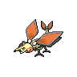

# pokemon/sprites/front/shiny/default-static

共 234 张，均按原来源路径识别；已备份不等于已接入游戏。编号为PokeAPI编号，不是业务数据库主键。

### 宝可梦API ID 152 · 正面 · 闪光 · 默认静态来源

- 文件：[pokemon-id-00152-front-shiny-default-static--a091379f151b.png](pokemon-id-00152-front-shiny-default-static--a091379f151b.png)
- 用途：正面闪光宝可梦图像；身份和变体来自PokeAPI路径，不作为原应用已经接入的证明。
- 尺寸：96 × 96，帧数：1
- SHA256：`a091379f151b32fa26286ec4d8ad78a5d44d297c4f27cf2383806619d8b603d3`
- 来源：[PokeAPI/sprites](https://raw.githubusercontent.com/PokeAPI/sprites/master/sprites/pokemon/shiny/152.png)；取得版本：`1dd55c0436d2a5b6e324c0b780e1b1b416fbfb64`

### 宝可梦API ID 153 · 正面 · 闪光 · 默认静态来源

- 文件：[pokemon-id-00153-front-shiny-default-static--942a553e94b6.png](pokemon-id-00153-front-shiny-default-static--942a553e94b6.png)
- 用途：正面闪光宝可梦图像；身份和变体来自PokeAPI路径，不作为原应用已经接入的证明。
- 尺寸：96 × 96，帧数：1
- SHA256：`942a553e94b6a480f7c2ec874ef1601a044b3b8ca60d8a80448f2224cc39ce6d`
- 来源：[PokeAPI/sprites](https://raw.githubusercontent.com/PokeAPI/sprites/master/sprites/pokemon/shiny/153.png)；取得版本：`1dd55c0436d2a5b6e324c0b780e1b1b416fbfb64`

### 宝可梦API ID 154 · 正面 · 闪光 · 默认静态来源

- 文件：[pokemon-id-00154-front-shiny-default-static--160d2aee205a.png](pokemon-id-00154-front-shiny-default-static--160d2aee205a.png)
- 用途：正面闪光宝可梦图像；身份和变体来自PokeAPI路径，不作为原应用已经接入的证明。
- 尺寸：96 × 96，帧数：1
- SHA256：`160d2aee205a8c7216a20a606f31d445d145ad3ebb77017607ccf5d9bb5018bc`
- 来源：[PokeAPI/sprites](https://raw.githubusercontent.com/PokeAPI/sprites/master/sprites/pokemon/shiny/154.png)；取得版本：`1dd55c0436d2a5b6e324c0b780e1b1b416fbfb64`

### 宝可梦API ID 155 · 正面 · 闪光 · 默认静态来源

- 文件：[pokemon-id-00155-front-shiny-default-static--d1a8eff398f0.png](pokemon-id-00155-front-shiny-default-static--d1a8eff398f0.png)
- 用途：正面闪光宝可梦图像；身份和变体来自PokeAPI路径，不作为原应用已经接入的证明。
- 尺寸：96 × 96，帧数：1
- SHA256：`d1a8eff398f0345622f0a8c364f813bbcaf93d6de6cb354e1c944a4adf7ab622`
- 来源：[PokeAPI/sprites](https://raw.githubusercontent.com/PokeAPI/sprites/master/sprites/pokemon/shiny/155.png)；取得版本：`1dd55c0436d2a5b6e324c0b780e1b1b416fbfb64`

### 宝可梦API ID 156 · 正面 · 闪光 · 默认静态来源

- 文件：[pokemon-id-00156-front-shiny-default-static--2a3bafdbd4ba.png](pokemon-id-00156-front-shiny-default-static--2a3bafdbd4ba.png)
- 用途：正面闪光宝可梦图像；身份和变体来自PokeAPI路径，不作为原应用已经接入的证明。
- 尺寸：96 × 96，帧数：1
- SHA256：`2a3bafdbd4ba3f1ab9d963fac017043b8aa4bc0a84dda2551b58dfd181ede4fb`
- 来源：[PokeAPI/sprites](https://raw.githubusercontent.com/PokeAPI/sprites/master/sprites/pokemon/shiny/156.png)；取得版本：`1dd55c0436d2a5b6e324c0b780e1b1b416fbfb64`

### 宝可梦API ID 157 · 正面 · 闪光 · 默认静态来源

- 文件：[pokemon-id-00157-front-shiny-default-static--a650f28890fa.png](pokemon-id-00157-front-shiny-default-static--a650f28890fa.png)
- 用途：正面闪光宝可梦图像；身份和变体来自PokeAPI路径，不作为原应用已经接入的证明。
- 尺寸：96 × 96，帧数：1
- SHA256：`a650f28890fa7651ae01a6e18034b84e300d65f198d6fe061a2f0084e1a520d5`
- 来源：[PokeAPI/sprites](https://raw.githubusercontent.com/PokeAPI/sprites/master/sprites/pokemon/shiny/157.png)；取得版本：`1dd55c0436d2a5b6e324c0b780e1b1b416fbfb64`

### 宝可梦API ID 158 · 正面 · 闪光 · 默认静态来源

- 文件：[pokemon-id-00158-front-shiny-default-static--53004a157e46.png](pokemon-id-00158-front-shiny-default-static--53004a157e46.png)
- 用途：正面闪光宝可梦图像；身份和变体来自PokeAPI路径，不作为原应用已经接入的证明。
- 尺寸：96 × 96，帧数：1
- SHA256：`53004a157e467e91cf5fbd5273112a85a3e19b6a56bf554c505ffaa6892807a7`
- 来源：[PokeAPI/sprites](https://raw.githubusercontent.com/PokeAPI/sprites/master/sprites/pokemon/shiny/158.png)；取得版本：`1dd55c0436d2a5b6e324c0b780e1b1b416fbfb64`

### 宝可梦API ID 159 · 正面 · 闪光 · 默认静态来源

- 文件：[pokemon-id-00159-front-shiny-default-static--9e2b1a8b49dd.png](pokemon-id-00159-front-shiny-default-static--9e2b1a8b49dd.png)
- 用途：正面闪光宝可梦图像；身份和变体来自PokeAPI路径，不作为原应用已经接入的证明。
- 尺寸：96 × 96，帧数：1
- SHA256：`9e2b1a8b49dd0acf15d2e4f8b15d4143e4e11f830fdf26923f9b8c6b397b751f`
- 来源：[PokeAPI/sprites](https://raw.githubusercontent.com/PokeAPI/sprites/master/sprites/pokemon/shiny/159.png)；取得版本：`1dd55c0436d2a5b6e324c0b780e1b1b416fbfb64`

### 宝可梦API ID 160 · 正面 · 闪光 · 默认静态来源

- 文件：[pokemon-id-00160-front-shiny-default-static--815775493373.png](pokemon-id-00160-front-shiny-default-static--815775493373.png)
- 用途：正面闪光宝可梦图像；身份和变体来自PokeAPI路径，不作为原应用已经接入的证明。
- 尺寸：96 × 96，帧数：1
- SHA256：`815775493373a7889b5bb216337e05efbd9b1f6cf3c2bfd0d4b8174263819e88`
- 来源：[PokeAPI/sprites](https://raw.githubusercontent.com/PokeAPI/sprites/master/sprites/pokemon/shiny/160.png)；取得版本：`1dd55c0436d2a5b6e324c0b780e1b1b416fbfb64`

### 宝可梦API ID 161 · 正面 · 闪光 · 默认静态来源

- 文件：[pokemon-id-00161-front-shiny-default-static--8a8f48bb3f34.png](pokemon-id-00161-front-shiny-default-static--8a8f48bb3f34.png)
- 用途：正面闪光宝可梦图像；身份和变体来自PokeAPI路径，不作为原应用已经接入的证明。
- 尺寸：96 × 96，帧数：1
- SHA256：`8a8f48bb3f34356c96dd09d082bfcbf7ccb961b6408ec01495fecd4a56a063b6`
- 来源：[PokeAPI/sprites](https://raw.githubusercontent.com/PokeAPI/sprites/master/sprites/pokemon/shiny/161.png)；取得版本：`1dd55c0436d2a5b6e324c0b780e1b1b416fbfb64`

### 宝可梦API ID 162 · 正面 · 闪光 · 默认静态来源

- 文件：[pokemon-id-00162-front-shiny-default-static--f284ec748166.png](pokemon-id-00162-front-shiny-default-static--f284ec748166.png)
- 用途：正面闪光宝可梦图像；身份和变体来自PokeAPI路径，不作为原应用已经接入的证明。
- 尺寸：96 × 96，帧数：1
- SHA256：`f284ec748166a72370afc470915a2b5984c29da3e3003def923b753c97e47ce9`
- 来源：[PokeAPI/sprites](https://raw.githubusercontent.com/PokeAPI/sprites/master/sprites/pokemon/shiny/162.png)；取得版本：`1dd55c0436d2a5b6e324c0b780e1b1b416fbfb64`

### 宝可梦API ID 163 · 正面 · 闪光 · 默认静态来源

- 文件：[pokemon-id-00163-front-shiny-default-static--1396ade2ad39.png](pokemon-id-00163-front-shiny-default-static--1396ade2ad39.png)
- 用途：正面闪光宝可梦图像；身份和变体来自PokeAPI路径，不作为原应用已经接入的证明。
- 尺寸：96 × 96，帧数：1
- SHA256：`1396ade2ad39a6b15d5f531a23949d464a8ce5618bb95ebe66830131c75837c4`
- 来源：[PokeAPI/sprites](https://raw.githubusercontent.com/PokeAPI/sprites/master/sprites/pokemon/shiny/163.png)；取得版本：`1dd55c0436d2a5b6e324c0b780e1b1b416fbfb64`

### 宝可梦API ID 164 · 正面 · 闪光 · 默认静态来源

- 文件：[pokemon-id-00164-front-shiny-default-static--3e2ac67f914d.png](pokemon-id-00164-front-shiny-default-static--3e2ac67f914d.png)
- 用途：正面闪光宝可梦图像；身份和变体来自PokeAPI路径，不作为原应用已经接入的证明。
- 尺寸：96 × 96，帧数：1
- SHA256：`3e2ac67f914d5dcf3a0df3e6e8ec6df3611cb4fff989dcf4033c16b3157bb3b4`
- 来源：[PokeAPI/sprites](https://raw.githubusercontent.com/PokeAPI/sprites/master/sprites/pokemon/shiny/164.png)；取得版本：`1dd55c0436d2a5b6e324c0b780e1b1b416fbfb64`

### 宝可梦API ID 165 · 正面 · 闪光 · 默认静态来源

- 文件：[pokemon-id-00165-front-shiny-default-static--30466aab66af.png](pokemon-id-00165-front-shiny-default-static--30466aab66af.png)
- 用途：正面闪光宝可梦图像；身份和变体来自PokeAPI路径，不作为原应用已经接入的证明。
- 尺寸：96 × 96，帧数：1
- SHA256：`30466aab66af37bcf81bf21c9233566d5fcf3064fb1cf69598676396261dc394`
- 来源：[PokeAPI/sprites](https://raw.githubusercontent.com/PokeAPI/sprites/master/sprites/pokemon/shiny/165.png)；取得版本：`1dd55c0436d2a5b6e324c0b780e1b1b416fbfb64`

### 宝可梦API ID 166 · 正面 · 闪光 · 默认静态来源

- 文件：[pokemon-id-00166-front-shiny-default-static--c3d7b75dac10.png](pokemon-id-00166-front-shiny-default-static--c3d7b75dac10.png)
- 用途：正面闪光宝可梦图像；身份和变体来自PokeAPI路径，不作为原应用已经接入的证明。
- 尺寸：96 × 96，帧数：1
- SHA256：`c3d7b75dac10442d9a28a32620d4a4a237949ef3a9c0f3d4764ec054e21ae51d`
- 来源：[PokeAPI/sprites](https://raw.githubusercontent.com/PokeAPI/sprites/master/sprites/pokemon/shiny/166.png)；取得版本：`1dd55c0436d2a5b6e324c0b780e1b1b416fbfb64`

### 宝可梦API ID 167 · 正面 · 闪光 · 默认静态来源

- 文件：[pokemon-id-00167-front-shiny-default-static--d51081fad8fc.png](pokemon-id-00167-front-shiny-default-static--d51081fad8fc.png)
- 用途：正面闪光宝可梦图像；身份和变体来自PokeAPI路径，不作为原应用已经接入的证明。
- 尺寸：96 × 96，帧数：1
- SHA256：`d51081fad8fc677fea1d6869e65c5c7b82af036e5d7fdd801566502685033ecb`
- 来源：[PokeAPI/sprites](https://raw.githubusercontent.com/PokeAPI/sprites/master/sprites/pokemon/shiny/167.png)；取得版本：`1dd55c0436d2a5b6e324c0b780e1b1b416fbfb64`

### 宝可梦API ID 168 · 正面 · 闪光 · 默认静态来源

- 文件：[pokemon-id-00168-front-shiny-default-static--20feb44afa94.png](pokemon-id-00168-front-shiny-default-static--20feb44afa94.png)
- 用途：正面闪光宝可梦图像；身份和变体来自PokeAPI路径，不作为原应用已经接入的证明。
- 尺寸：96 × 96，帧数：1
- SHA256：`20feb44afa945d35643e894757562f5eee12c6c4534c99dfe88ff575c0f0e7ee`
- 来源：[PokeAPI/sprites](https://raw.githubusercontent.com/PokeAPI/sprites/master/sprites/pokemon/shiny/168.png)；取得版本：`1dd55c0436d2a5b6e324c0b780e1b1b416fbfb64`

### 宝可梦API ID 169 · 正面 · 闪光 · 默认静态来源

- 文件：[pokemon-id-00169-front-shiny-default-static--8e77d993cb6f.png](pokemon-id-00169-front-shiny-default-static--8e77d993cb6f.png)
- 用途：正面闪光宝可梦图像；身份和变体来自PokeAPI路径，不作为原应用已经接入的证明。
- 尺寸：96 × 96，帧数：1
- SHA256：`8e77d993cb6f1f9d2c005a62764836d61a7e46d18df161a52bd1f328920fcf9d`
- 来源：[PokeAPI/sprites](https://raw.githubusercontent.com/PokeAPI/sprites/master/sprites/pokemon/shiny/169.png)；取得版本：`1dd55c0436d2a5b6e324c0b780e1b1b416fbfb64`

### 宝可梦API ID 170 · 正面 · 闪光 · 默认静态来源

- 文件：[pokemon-id-00170-front-shiny-default-static--8c2cc1e651db.png](pokemon-id-00170-front-shiny-default-static--8c2cc1e651db.png)
- 用途：正面闪光宝可梦图像；身份和变体来自PokeAPI路径，不作为原应用已经接入的证明。
- 尺寸：96 × 96，帧数：1
- SHA256：`8c2cc1e651db78cbb4c88bc41eeed6f02b85a712b017218373c4da76dcc07f86`
- 来源：[PokeAPI/sprites](https://raw.githubusercontent.com/PokeAPI/sprites/master/sprites/pokemon/shiny/170.png)；取得版本：`1dd55c0436d2a5b6e324c0b780e1b1b416fbfb64`

### 宝可梦API ID 171 · 正面 · 闪光 · 默认静态来源

- 文件：[pokemon-id-00171-front-shiny-default-static--2224e269bd68.png](pokemon-id-00171-front-shiny-default-static--2224e269bd68.png)
- 用途：正面闪光宝可梦图像；身份和变体来自PokeAPI路径，不作为原应用已经接入的证明。
- 尺寸：96 × 96，帧数：1
- SHA256：`2224e269bd6897b73abb4041eaf00275871e419f29da4353fa3e9e0b586a6a88`
- 来源：[PokeAPI/sprites](https://raw.githubusercontent.com/PokeAPI/sprites/master/sprites/pokemon/shiny/171.png)；取得版本：`1dd55c0436d2a5b6e324c0b780e1b1b416fbfb64`

### 宝可梦API ID 172 · 正面 · 闪光 · 默认静态来源

- 文件：[pokemon-id-00172-front-shiny-default-static--b839ab0a1ec5.png](pokemon-id-00172-front-shiny-default-static--b839ab0a1ec5.png)
- 用途：正面闪光宝可梦图像；身份和变体来自PokeAPI路径，不作为原应用已经接入的证明。
- 尺寸：96 × 96，帧数：1
- SHA256：`b839ab0a1ec568a59e69344f937c995600d3bb3711723763523f8c361c0aa4ad`
- 来源：[PokeAPI/sprites](https://raw.githubusercontent.com/PokeAPI/sprites/master/sprites/pokemon/shiny/172.png)；取得版本：`1dd55c0436d2a5b6e324c0b780e1b1b416fbfb64`

### 宝可梦API ID 173 · 正面 · 闪光 · 默认静态来源

- 文件：[pokemon-id-00173-front-shiny-default-static--c774737c48d5.png](pokemon-id-00173-front-shiny-default-static--c774737c48d5.png)
- 用途：正面闪光宝可梦图像；身份和变体来自PokeAPI路径，不作为原应用已经接入的证明。
- 尺寸：96 × 96，帧数：1
- SHA256：`c774737c48d593b1dbc503fddaa39e3702fd41b88c0239eee393d56227405e91`
- 来源：[PokeAPI/sprites](https://raw.githubusercontent.com/PokeAPI/sprites/master/sprites/pokemon/shiny/173.png)；取得版本：`1dd55c0436d2a5b6e324c0b780e1b1b416fbfb64`

### 宝可梦API ID 174 · 正面 · 闪光 · 默认静态来源

- 文件：[pokemon-id-00174-front-shiny-default-static--fb61b35e9eb9.png](pokemon-id-00174-front-shiny-default-static--fb61b35e9eb9.png)
- 用途：正面闪光宝可梦图像；身份和变体来自PokeAPI路径，不作为原应用已经接入的证明。
- 尺寸：96 × 96，帧数：1
- SHA256：`fb61b35e9eb9d437175cd94ecefe72470c199fabdd3133582edfe7fd847ac680`
- 来源：[PokeAPI/sprites](https://raw.githubusercontent.com/PokeAPI/sprites/master/sprites/pokemon/shiny/174.png)；取得版本：`1dd55c0436d2a5b6e324c0b780e1b1b416fbfb64`

### 宝可梦API ID 175 · 正面 · 闪光 · 默认静态来源

- 文件：[pokemon-id-00175-front-shiny-default-static--a5f6d83fc278.png](pokemon-id-00175-front-shiny-default-static--a5f6d83fc278.png)
- 用途：正面闪光宝可梦图像；身份和变体来自PokeAPI路径，不作为原应用已经接入的证明。
- 尺寸：96 × 96，帧数：1
- SHA256：`a5f6d83fc27854d5004c9b44f9b8f4f9e16bb80814645259dd3c54f0039a4840`
- 来源：[PokeAPI/sprites](https://raw.githubusercontent.com/PokeAPI/sprites/master/sprites/pokemon/shiny/175.png)；取得版本：`1dd55c0436d2a5b6e324c0b780e1b1b416fbfb64`

### 宝可梦API ID 176 · 正面 · 闪光 · 默认静态来源

- 文件：[pokemon-id-00176-front-shiny-default-static--b0051b198784.png](pokemon-id-00176-front-shiny-default-static--b0051b198784.png)
- 用途：正面闪光宝可梦图像；身份和变体来自PokeAPI路径，不作为原应用已经接入的证明。
- 尺寸：96 × 96，帧数：1
- SHA256：`b0051b1987841aa1fde67b49e3ebcff58797149935621cada94bc5c7bf688b7c`
- 来源：[PokeAPI/sprites](https://raw.githubusercontent.com/PokeAPI/sprites/master/sprites/pokemon/shiny/176.png)；取得版本：`1dd55c0436d2a5b6e324c0b780e1b1b416fbfb64`

### 宝可梦API ID 177 · 正面 · 闪光 · 默认静态来源

- 文件：[pokemon-id-00177-front-shiny-default-static--c4c2ea2cc7e6.png](pokemon-id-00177-front-shiny-default-static--c4c2ea2cc7e6.png)
- 用途：正面闪光宝可梦图像；身份和变体来自PokeAPI路径，不作为原应用已经接入的证明。
- 尺寸：96 × 96，帧数：1
- SHA256：`c4c2ea2cc7e6b0c85ab336b5bd9a7da1d8a33dea47d777b3a627bf5be9383b73`
- 来源：[PokeAPI/sprites](https://raw.githubusercontent.com/PokeAPI/sprites/master/sprites/pokemon/shiny/177.png)；取得版本：`1dd55c0436d2a5b6e324c0b780e1b1b416fbfb64`

### 宝可梦API ID 178 · 正面 · 闪光 · 默认静态来源

- 文件：[pokemon-id-00178-front-shiny-default-static--3448fcc427b8.png](pokemon-id-00178-front-shiny-default-static--3448fcc427b8.png)
- 用途：正面闪光宝可梦图像；身份和变体来自PokeAPI路径，不作为原应用已经接入的证明。
- 尺寸：96 × 96，帧数：1
- SHA256：`3448fcc427b877aaa8fff6a5d8c798b5942cfee627842d9e8c3843bf316b3c26`
- 来源：[PokeAPI/sprites](https://raw.githubusercontent.com/PokeAPI/sprites/master/sprites/pokemon/shiny/178.png)；取得版本：`1dd55c0436d2a5b6e324c0b780e1b1b416fbfb64`

### 宝可梦API ID 179 · 正面 · 闪光 · 默认静态来源

- 文件：[pokemon-id-00179-front-shiny-default-static--a8d81eae0369.png](pokemon-id-00179-front-shiny-default-static--a8d81eae0369.png)
- 用途：正面闪光宝可梦图像；身份和变体来自PokeAPI路径，不作为原应用已经接入的证明。
- 尺寸：96 × 96，帧数：1
- SHA256：`a8d81eae03693caa2a5c7950c28713f02b1b7a8d282ead7c5c103d5ca65aa56a`
- 来源：[PokeAPI/sprites](https://raw.githubusercontent.com/PokeAPI/sprites/master/sprites/pokemon/shiny/179.png)；取得版本：`1dd55c0436d2a5b6e324c0b780e1b1b416fbfb64`

### 宝可梦API ID 180 · 正面 · 闪光 · 默认静态来源

- 文件：[pokemon-id-00180-front-shiny-default-static--e770e192ba9f.png](pokemon-id-00180-front-shiny-default-static--e770e192ba9f.png)
- 用途：正面闪光宝可梦图像；身份和变体来自PokeAPI路径，不作为原应用已经接入的证明。
- 尺寸：96 × 96，帧数：1
- SHA256：`e770e192ba9fb062b36ff52bd85328e15e5304270a54670e647af34d13d4540a`
- 来源：[PokeAPI/sprites](https://raw.githubusercontent.com/PokeAPI/sprites/master/sprites/pokemon/shiny/180.png)；取得版本：`1dd55c0436d2a5b6e324c0b780e1b1b416fbfb64`

### 宝可梦API ID 181 · 正面 · 闪光 · 默认静态来源

- 文件：[pokemon-id-00181-front-shiny-default-static--f61b5eb6d9cb.png](pokemon-id-00181-front-shiny-default-static--f61b5eb6d9cb.png)
- 用途：正面闪光宝可梦图像；身份和变体来自PokeAPI路径，不作为原应用已经接入的证明。
- 尺寸：96 × 96，帧数：1
- SHA256：`f61b5eb6d9cbaec888f26e554f658ef8aa4ab73a72a83f2af257b653c13bb4c4`
- 来源：[PokeAPI/sprites](https://raw.githubusercontent.com/PokeAPI/sprites/master/sprites/pokemon/shiny/181.png)；取得版本：`1dd55c0436d2a5b6e324c0b780e1b1b416fbfb64`

### 宝可梦API ID 182 · 正面 · 闪光 · 默认静态来源

- 文件：[pokemon-id-00182-front-shiny-default-static--aa439cec4ce2.png](pokemon-id-00182-front-shiny-default-static--aa439cec4ce2.png)
- 用途：正面闪光宝可梦图像；身份和变体来自PokeAPI路径，不作为原应用已经接入的证明。
- 尺寸：96 × 96，帧数：1
- SHA256：`aa439cec4ce2ad2c3c47d56f9050da38ce752b3eddd91a409170e563e935d977`
- 来源：[PokeAPI/sprites](https://raw.githubusercontent.com/PokeAPI/sprites/master/sprites/pokemon/shiny/182.png)；取得版本：`1dd55c0436d2a5b6e324c0b780e1b1b416fbfb64`

### 宝可梦API ID 183 · 正面 · 闪光 · 默认静态来源

- 文件：[pokemon-id-00183-front-shiny-default-static--46b83e189f11.png](pokemon-id-00183-front-shiny-default-static--46b83e189f11.png)
- 用途：正面闪光宝可梦图像；身份和变体来自PokeAPI路径，不作为原应用已经接入的证明。
- 尺寸：96 × 96，帧数：1
- SHA256：`46b83e189f1110a6896e927524d3bcdd42f5fee7ba170c70de1694cf79550d02`
- 来源：[PokeAPI/sprites](https://raw.githubusercontent.com/PokeAPI/sprites/master/sprites/pokemon/shiny/183.png)；取得版本：`1dd55c0436d2a5b6e324c0b780e1b1b416fbfb64`

### 宝可梦API ID 184 · 正面 · 闪光 · 默认静态来源

- 文件：[pokemon-id-00184-front-shiny-default-static--2cb19dfcf209.png](pokemon-id-00184-front-shiny-default-static--2cb19dfcf209.png)
- 用途：正面闪光宝可梦图像；身份和变体来自PokeAPI路径，不作为原应用已经接入的证明。
- 尺寸：96 × 96，帧数：1
- SHA256：`2cb19dfcf20975bb5fa3ccd5c7ed1e4d625a369e1590d0c208bd8f5d63352afc`
- 来源：[PokeAPI/sprites](https://raw.githubusercontent.com/PokeAPI/sprites/master/sprites/pokemon/shiny/184.png)；取得版本：`1dd55c0436d2a5b6e324c0b780e1b1b416fbfb64`

### 宝可梦API ID 185 · 正面 · 闪光 · 默认静态来源

- 文件：[pokemon-id-00185-front-shiny-default-static--067aa5aa0826.png](pokemon-id-00185-front-shiny-default-static--067aa5aa0826.png)
- 用途：正面闪光宝可梦图像；身份和变体来自PokeAPI路径，不作为原应用已经接入的证明。
- 尺寸：96 × 96，帧数：1
- SHA256：`067aa5aa08267cf6e606f95f875af678c55d767a9e3255f8917470e8570bf00d`
- 来源：[PokeAPI/sprites](https://raw.githubusercontent.com/PokeAPI/sprites/master/sprites/pokemon/shiny/185.png)；取得版本：`1dd55c0436d2a5b6e324c0b780e1b1b416fbfb64`

### 宝可梦API ID 186 · 正面 · 闪光 · 默认静态来源

- 文件：[pokemon-id-00186-front-shiny-default-static--c65a8a84686a.png](pokemon-id-00186-front-shiny-default-static--c65a8a84686a.png)
- 用途：正面闪光宝可梦图像；身份和变体来自PokeAPI路径，不作为原应用已经接入的证明。
- 尺寸：96 × 96，帧数：1
- SHA256：`c65a8a84686ae0aea5c431f065a2bcc41f64dc751126de2171b34aa098382381`
- 来源：[PokeAPI/sprites](https://raw.githubusercontent.com/PokeAPI/sprites/master/sprites/pokemon/shiny/186.png)；取得版本：`1dd55c0436d2a5b6e324c0b780e1b1b416fbfb64`

### 宝可梦API ID 187 · 正面 · 闪光 · 默认静态来源

- 文件：[pokemon-id-00187-front-shiny-default-static--95817ac7c028.png](pokemon-id-00187-front-shiny-default-static--95817ac7c028.png)
- 用途：正面闪光宝可梦图像；身份和变体来自PokeAPI路径，不作为原应用已经接入的证明。
- 尺寸：96 × 96，帧数：1
- SHA256：`95817ac7c028c4cf9ca3e471a0611b981c4245e51647c72df579c7f3e3bf8e7b`
- 来源：[PokeAPI/sprites](https://raw.githubusercontent.com/PokeAPI/sprites/master/sprites/pokemon/shiny/187.png)；取得版本：`1dd55c0436d2a5b6e324c0b780e1b1b416fbfb64`

### 宝可梦API ID 188 · 正面 · 闪光 · 默认静态来源

- 文件：[pokemon-id-00188-front-shiny-default-static--416518712c97.png](pokemon-id-00188-front-shiny-default-static--416518712c97.png)
- 用途：正面闪光宝可梦图像；身份和变体来自PokeAPI路径，不作为原应用已经接入的证明。
- 尺寸：96 × 96，帧数：1
- SHA256：`416518712c97c14aa7efadc1608def9f5afeaf709037b0605344527ec038ca7a`
- 来源：[PokeAPI/sprites](https://raw.githubusercontent.com/PokeAPI/sprites/master/sprites/pokemon/shiny/188.png)；取得版本：`1dd55c0436d2a5b6e324c0b780e1b1b416fbfb64`

### 宝可梦API ID 189 · 正面 · 闪光 · 默认静态来源

- 文件：[pokemon-id-00189-front-shiny-default-static--9cebdcbec586.png](pokemon-id-00189-front-shiny-default-static--9cebdcbec586.png)
- 用途：正面闪光宝可梦图像；身份和变体来自PokeAPI路径，不作为原应用已经接入的证明。
- 尺寸：96 × 96，帧数：1
- SHA256：`9cebdcbec5864ee2b819cd45e09d24969897ba6a3652fb11f70b3297160d8759`
- 来源：[PokeAPI/sprites](https://raw.githubusercontent.com/PokeAPI/sprites/master/sprites/pokemon/shiny/189.png)；取得版本：`1dd55c0436d2a5b6e324c0b780e1b1b416fbfb64`

### 宝可梦API ID 190 · 正面 · 闪光 · 默认静态来源

- 文件：[pokemon-id-00190-front-shiny-default-static--f98d2ebbad11.png](pokemon-id-00190-front-shiny-default-static--f98d2ebbad11.png)
- 用途：正面闪光宝可梦图像；身份和变体来自PokeAPI路径，不作为原应用已经接入的证明。
- 尺寸：96 × 96，帧数：1
- SHA256：`f98d2ebbad11b66f94efae09cd0e5c178f7855087a4f517c9fe09a2639668aaa`
- 来源：[PokeAPI/sprites](https://raw.githubusercontent.com/PokeAPI/sprites/master/sprites/pokemon/shiny/190.png)；取得版本：`1dd55c0436d2a5b6e324c0b780e1b1b416fbfb64`

### 宝可梦API ID 191 · 正面 · 闪光 · 默认静态来源

- 文件：[pokemon-id-00191-front-shiny-default-static--a47488ae4a2c.png](pokemon-id-00191-front-shiny-default-static--a47488ae4a2c.png)
- 用途：正面闪光宝可梦图像；身份和变体来自PokeAPI路径，不作为原应用已经接入的证明。
- 尺寸：96 × 96，帧数：1
- SHA256：`a47488ae4a2c2cab8c5f5f76d84abd1785be878a3bd7c6a7c35a0d9a53a79084`
- 来源：[PokeAPI/sprites](https://raw.githubusercontent.com/PokeAPI/sprites/master/sprites/pokemon/shiny/191.png)；取得版本：`1dd55c0436d2a5b6e324c0b780e1b1b416fbfb64`

### 宝可梦API ID 192 · 正面 · 闪光 · 默认静态来源

- 文件：[pokemon-id-00192-front-shiny-default-static--e8062cd6b7ab.png](pokemon-id-00192-front-shiny-default-static--e8062cd6b7ab.png)
- 用途：正面闪光宝可梦图像；身份和变体来自PokeAPI路径，不作为原应用已经接入的证明。
- 尺寸：96 × 96，帧数：1
- SHA256：`e8062cd6b7ab0bf754851350f5ebd8886892039e6ee32dc33964ee4308ec0999`
- 来源：[PokeAPI/sprites](https://raw.githubusercontent.com/PokeAPI/sprites/master/sprites/pokemon/shiny/192.png)；取得版本：`1dd55c0436d2a5b6e324c0b780e1b1b416fbfb64`

### 宝可梦API ID 193 · 正面 · 闪光 · 默认静态来源

- 文件：[pokemon-id-00193-front-shiny-default-static--e5001012945c.png](pokemon-id-00193-front-shiny-default-static--e5001012945c.png)
- 用途：正面闪光宝可梦图像；身份和变体来自PokeAPI路径，不作为原应用已经接入的证明。
- 尺寸：96 × 96，帧数：1
- SHA256：`e5001012945ce482c85ea795e93e13607742ed7db76b0567592e96cdc7221509`
- 来源：[PokeAPI/sprites](https://raw.githubusercontent.com/PokeAPI/sprites/master/sprites/pokemon/shiny/193.png)；取得版本：`1dd55c0436d2a5b6e324c0b780e1b1b416fbfb64`

### 宝可梦API ID 194 · 正面 · 闪光 · 默认静态来源

- 文件：[pokemon-id-00194-front-shiny-default-static--416bf8a4a536.png](pokemon-id-00194-front-shiny-default-static--416bf8a4a536.png)
- 用途：正面闪光宝可梦图像；身份和变体来自PokeAPI路径，不作为原应用已经接入的证明。
- 尺寸：96 × 96，帧数：1
- SHA256：`416bf8a4a536629ceaa905558d62d7c9a1f89b4ebeadda29aa5b68a4288ac1c2`
- 来源：[PokeAPI/sprites](https://raw.githubusercontent.com/PokeAPI/sprites/master/sprites/pokemon/shiny/194.png)；取得版本：`1dd55c0436d2a5b6e324c0b780e1b1b416fbfb64`

### 宝可梦API ID 195 · 正面 · 闪光 · 默认静态来源

- 文件：[pokemon-id-00195-front-shiny-default-static--7d4cb2793422.png](pokemon-id-00195-front-shiny-default-static--7d4cb2793422.png)
- 用途：正面闪光宝可梦图像；身份和变体来自PokeAPI路径，不作为原应用已经接入的证明。
- 尺寸：96 × 96，帧数：1
- SHA256：`7d4cb2793422b6f85e9f39c5f97858b57e814318396410d72d7c1b8c5a8ed1bf`
- 来源：[PokeAPI/sprites](https://raw.githubusercontent.com/PokeAPI/sprites/master/sprites/pokemon/shiny/195.png)；取得版本：`1dd55c0436d2a5b6e324c0b780e1b1b416fbfb64`

### 宝可梦API ID 196 · 正面 · 闪光 · 默认静态来源

- 文件：[pokemon-id-00196-front-shiny-default-static--daa4371bd0af.png](pokemon-id-00196-front-shiny-default-static--daa4371bd0af.png)
- 用途：正面闪光宝可梦图像；身份和变体来自PokeAPI路径，不作为原应用已经接入的证明。
- 尺寸：96 × 96，帧数：1
- SHA256：`daa4371bd0af42d2be93be8ab44b7a6933f72934ab8eb430bd9f909129064992`
- 来源：[PokeAPI/sprites](https://raw.githubusercontent.com/PokeAPI/sprites/master/sprites/pokemon/shiny/196.png)；取得版本：`1dd55c0436d2a5b6e324c0b780e1b1b416fbfb64`

### 宝可梦API ID 197 · 正面 · 闪光 · 默认静态来源

- 文件：[pokemon-id-00197-front-shiny-default-static--e1ea1bf54c67.png](pokemon-id-00197-front-shiny-default-static--e1ea1bf54c67.png)
- 用途：正面闪光宝可梦图像；身份和变体来自PokeAPI路径，不作为原应用已经接入的证明。
- 尺寸：96 × 96，帧数：1
- SHA256：`e1ea1bf54c67f223313db188c88ffdcfcc91770435b61805e5ef45cf3358db20`
- 来源：[PokeAPI/sprites](https://raw.githubusercontent.com/PokeAPI/sprites/master/sprites/pokemon/shiny/197.png)；取得版本：`1dd55c0436d2a5b6e324c0b780e1b1b416fbfb64`

### 宝可梦API ID 198 · 正面 · 闪光 · 默认静态来源

- 文件：[pokemon-id-00198-front-shiny-default-static--dfc99b0bfbff.png](pokemon-id-00198-front-shiny-default-static--dfc99b0bfbff.png)
- 用途：正面闪光宝可梦图像；身份和变体来自PokeAPI路径，不作为原应用已经接入的证明。
- 尺寸：96 × 96，帧数：1
- SHA256：`dfc99b0bfbff0dccb816441677720c567abf2c1dcb43870a6f1d8833415a6bd0`
- 来源：[PokeAPI/sprites](https://raw.githubusercontent.com/PokeAPI/sprites/master/sprites/pokemon/shiny/198.png)；取得版本：`1dd55c0436d2a5b6e324c0b780e1b1b416fbfb64`

### 宝可梦API ID 199 · 正面 · 闪光 · 默认静态来源

- 文件：[pokemon-id-00199-front-shiny-default-static--119c52259d21.png](pokemon-id-00199-front-shiny-default-static--119c52259d21.png)
- 用途：正面闪光宝可梦图像；身份和变体来自PokeAPI路径，不作为原应用已经接入的证明。
- 尺寸：96 × 96，帧数：1
- SHA256：`119c52259d21b72441811fc6e2e2b16596a3a4659e6e58eebe368b3a10946875`
- 来源：[PokeAPI/sprites](https://raw.githubusercontent.com/PokeAPI/sprites/master/sprites/pokemon/shiny/199.png)；取得版本：`1dd55c0436d2a5b6e324c0b780e1b1b416fbfb64`

### 宝可梦API ID 201 · 正面 · 闪光 · 默认静态来源

- 文件：[pokemon-id-00201-front-shiny-default-static--42608a88b9f5.png](pokemon-id-00201-front-shiny-default-static--42608a88b9f5.png)
- 用途：正面闪光宝可梦图像；身份和变体来自PokeAPI路径，不作为原应用已经接入的证明。
- 尺寸：96 × 96，帧数：1
- SHA256：`42608a88b9f55f801a5a7d43e273171cc0c2e3b1ecb45d8e182eb6274f8b1d24`
- 来源：[PokeAPI/sprites](https://raw.githubusercontent.com/PokeAPI/sprites/master/sprites/pokemon/shiny/201.png)；取得版本：`1dd55c0436d2a5b6e324c0b780e1b1b416fbfb64`

### 宝可梦API ID 202 · 正面 · 闪光 · 默认静态来源

- 文件：[pokemon-id-00202-front-shiny-default-static--93b54ba18ae1.png](pokemon-id-00202-front-shiny-default-static--93b54ba18ae1.png)
- 用途：正面闪光宝可梦图像；身份和变体来自PokeAPI路径，不作为原应用已经接入的证明。
- 尺寸：96 × 96，帧数：1
- SHA256：`93b54ba18ae1b7ed620fe2f679003fd9ecfee784d7590d17f57730c176c487ba`
- 来源：[PokeAPI/sprites](https://raw.githubusercontent.com/PokeAPI/sprites/master/sprites/pokemon/shiny/202.png)；取得版本：`1dd55c0436d2a5b6e324c0b780e1b1b416fbfb64`

### 宝可梦API ID 203 · 正面 · 闪光 · 默认静态来源

- 文件：[pokemon-id-00203-front-shiny-default-static--61cc41fd49bf.png](pokemon-id-00203-front-shiny-default-static--61cc41fd49bf.png)
- 用途：正面闪光宝可梦图像；身份和变体来自PokeAPI路径，不作为原应用已经接入的证明。
- 尺寸：96 × 96，帧数：1
- SHA256：`61cc41fd49bf199075adf174114c056e01f18a2e9e126b00bc6c8b2d5297975a`
- 来源：[PokeAPI/sprites](https://raw.githubusercontent.com/PokeAPI/sprites/master/sprites/pokemon/shiny/203.png)；取得版本：`1dd55c0436d2a5b6e324c0b780e1b1b416fbfb64`

### 宝可梦API ID 204 · 正面 · 闪光 · 默认静态来源

- 文件：[pokemon-id-00204-front-shiny-default-static--cceada4d27eb.png](pokemon-id-00204-front-shiny-default-static--cceada4d27eb.png)
- 用途：正面闪光宝可梦图像；身份和变体来自PokeAPI路径，不作为原应用已经接入的证明。
- 尺寸：96 × 96，帧数：1
- SHA256：`cceada4d27ebe24bfad72f8f9d10f01df8b4087a75612f0e202c50204d0eff94`
- 来源：[PokeAPI/sprites](https://raw.githubusercontent.com/PokeAPI/sprites/master/sprites/pokemon/shiny/204.png)；取得版本：`1dd55c0436d2a5b6e324c0b780e1b1b416fbfb64`

### 宝可梦API ID 205 · 正面 · 闪光 · 默认静态来源

- 文件：[pokemon-id-00205-front-shiny-default-static--fccb9c9e16ea.png](pokemon-id-00205-front-shiny-default-static--fccb9c9e16ea.png)
- 用途：正面闪光宝可梦图像；身份和变体来自PokeAPI路径，不作为原应用已经接入的证明。
- 尺寸：96 × 96，帧数：1
- SHA256：`fccb9c9e16ea2c682155c245de385c06acdfb0f04ac1224d6767c1eabbcfcfa9`
- 来源：[PokeAPI/sprites](https://raw.githubusercontent.com/PokeAPI/sprites/master/sprites/pokemon/shiny/205.png)；取得版本：`1dd55c0436d2a5b6e324c0b780e1b1b416fbfb64`

### 宝可梦API ID 206 · 正面 · 闪光 · 默认静态来源

- 文件：[pokemon-id-00206-front-shiny-default-static--fc2409707c13.png](pokemon-id-00206-front-shiny-default-static--fc2409707c13.png)
- 用途：正面闪光宝可梦图像；身份和变体来自PokeAPI路径，不作为原应用已经接入的证明。
- 尺寸：96 × 96，帧数：1
- SHA256：`fc2409707c13cd7abfe84a9d6a9cac1a2f48d6106478de8b5d0a08f6af07643b`
- 来源：[PokeAPI/sprites](https://raw.githubusercontent.com/PokeAPI/sprites/master/sprites/pokemon/shiny/206.png)；取得版本：`1dd55c0436d2a5b6e324c0b780e1b1b416fbfb64`

### 宝可梦API ID 207 · 正面 · 闪光 · 默认静态来源

- 文件：[pokemon-id-00207-front-shiny-default-static--99f48c8ffd5d.png](pokemon-id-00207-front-shiny-default-static--99f48c8ffd5d.png)
- 用途：正面闪光宝可梦图像；身份和变体来自PokeAPI路径，不作为原应用已经接入的证明。
- 尺寸：96 × 96，帧数：1
- SHA256：`99f48c8ffd5d9e3a0cf561030a8effa37b87defc6652a5e5b79cfb30e2f502ef`
- 来源：[PokeAPI/sprites](https://raw.githubusercontent.com/PokeAPI/sprites/master/sprites/pokemon/shiny/207.png)；取得版本：`1dd55c0436d2a5b6e324c0b780e1b1b416fbfb64`

### 宝可梦API ID 208 · 正面 · 闪光 · 默认静态来源

- 文件：[pokemon-id-00208-front-shiny-default-static--beef903b5c4e.png](pokemon-id-00208-front-shiny-default-static--beef903b5c4e.png)
- 用途：正面闪光宝可梦图像；身份和变体来自PokeAPI路径，不作为原应用已经接入的证明。
- 尺寸：96 × 96，帧数：1
- SHA256：`beef903b5c4e71645fa949cc777a6b70b9efb5f7ba0a9c3af2d3137b57a18867`
- 来源：[PokeAPI/sprites](https://raw.githubusercontent.com/PokeAPI/sprites/master/sprites/pokemon/shiny/208.png)；取得版本：`1dd55c0436d2a5b6e324c0b780e1b1b416fbfb64`

### 宝可梦API ID 209 · 正面 · 闪光 · 默认静态来源

- 文件：[pokemon-id-00209-front-shiny-default-static--ae1f3c3a7971.png](pokemon-id-00209-front-shiny-default-static--ae1f3c3a7971.png)
- 用途：正面闪光宝可梦图像；身份和变体来自PokeAPI路径，不作为原应用已经接入的证明。
- 尺寸：96 × 96，帧数：1
- SHA256：`ae1f3c3a7971b5bed2e45cea9aae6cdf176a8dece1a75bf2e4cfe33125fdfcd2`
- 来源：[PokeAPI/sprites](https://raw.githubusercontent.com/PokeAPI/sprites/master/sprites/pokemon/shiny/209.png)；取得版本：`1dd55c0436d2a5b6e324c0b780e1b1b416fbfb64`

### 宝可梦API ID 210 · 正面 · 闪光 · 默认静态来源

- 文件：[pokemon-id-00210-front-shiny-default-static--dd19f77a1f69.png](pokemon-id-00210-front-shiny-default-static--dd19f77a1f69.png)
- 用途：正面闪光宝可梦图像；身份和变体来自PokeAPI路径，不作为原应用已经接入的证明。
- 尺寸：96 × 96，帧数：1
- SHA256：`dd19f77a1f69549729be825dddd367018cd3cc40793b5d8683a77206dd271449`
- 来源：[PokeAPI/sprites](https://raw.githubusercontent.com/PokeAPI/sprites/master/sprites/pokemon/shiny/210.png)；取得版本：`1dd55c0436d2a5b6e324c0b780e1b1b416fbfb64`

### 宝可梦API ID 211 · 正面 · 闪光 · 默认静态来源

- 文件：[pokemon-id-00211-front-shiny-default-static--e5b4f929023c.png](pokemon-id-00211-front-shiny-default-static--e5b4f929023c.png)
- 用途：正面闪光宝可梦图像；身份和变体来自PokeAPI路径，不作为原应用已经接入的证明。
- 尺寸：96 × 96，帧数：1
- SHA256：`e5b4f929023ce443b42d2389325418d0e9905daccd01149677f9bd578eabaa78`
- 来源：[PokeAPI/sprites](https://raw.githubusercontent.com/PokeAPI/sprites/master/sprites/pokemon/shiny/211.png)；取得版本：`1dd55c0436d2a5b6e324c0b780e1b1b416fbfb64`

### 宝可梦API ID 212 · 正面 · 闪光 · 默认静态来源

- 文件：[pokemon-id-00212-front-shiny-default-static--36f96ad82bb5.png](pokemon-id-00212-front-shiny-default-static--36f96ad82bb5.png)
- 用途：正面闪光宝可梦图像；身份和变体来自PokeAPI路径，不作为原应用已经接入的证明。
- 尺寸：96 × 96，帧数：1
- SHA256：`36f96ad82bb5e0e988502de96f84eb59e3e2e71bde15c223585755cb07888cf6`
- 来源：[PokeAPI/sprites](https://raw.githubusercontent.com/PokeAPI/sprites/master/sprites/pokemon/shiny/212.png)；取得版本：`1dd55c0436d2a5b6e324c0b780e1b1b416fbfb64`

### 宝可梦API ID 213 · 正面 · 闪光 · 默认静态来源

- 文件：[pokemon-id-00213-front-shiny-default-static--801bbb854697.png](pokemon-id-00213-front-shiny-default-static--801bbb854697.png)
- 用途：正面闪光宝可梦图像；身份和变体来自PokeAPI路径，不作为原应用已经接入的证明。
- 尺寸：96 × 96，帧数：1
- SHA256：`801bbb854697fdeb04bdfabf7005b8781ad0ee3e6f1ef7cd3c3b5477325d163c`
- 来源：[PokeAPI/sprites](https://raw.githubusercontent.com/PokeAPI/sprites/master/sprites/pokemon/shiny/213.png)；取得版本：`1dd55c0436d2a5b6e324c0b780e1b1b416fbfb64`

### 宝可梦API ID 214 · 正面 · 闪光 · 默认静态来源

- 文件：[pokemon-id-00214-front-shiny-default-static--a19836d2320e.png](pokemon-id-00214-front-shiny-default-static--a19836d2320e.png)
- 用途：正面闪光宝可梦图像；身份和变体来自PokeAPI路径，不作为原应用已经接入的证明。
- 尺寸：96 × 96，帧数：1
- SHA256：`a19836d2320e48cc7e5013dbfdebf4b0dba8fdc69a6f147c255a01bbaf9c7c85`
- 来源：[PokeAPI/sprites](https://raw.githubusercontent.com/PokeAPI/sprites/master/sprites/pokemon/shiny/214.png)；取得版本：`1dd55c0436d2a5b6e324c0b780e1b1b416fbfb64`

### 宝可梦API ID 215 · 正面 · 闪光 · 默认静态来源

- 文件：[pokemon-id-00215-front-shiny-default-static--971c3258598e.png](pokemon-id-00215-front-shiny-default-static--971c3258598e.png)
- 用途：正面闪光宝可梦图像；身份和变体来自PokeAPI路径，不作为原应用已经接入的证明。
- 尺寸：96 × 96，帧数：1
- SHA256：`971c3258598e0ebb0deeaa6d87bfc809858049dca029afc90861d589bdbfc32b`
- 来源：[PokeAPI/sprites](https://raw.githubusercontent.com/PokeAPI/sprites/master/sprites/pokemon/shiny/215.png)；取得版本：`1dd55c0436d2a5b6e324c0b780e1b1b416fbfb64`

### 宝可梦API ID 216 · 正面 · 闪光 · 默认静态来源

- 文件：[pokemon-id-00216-front-shiny-default-static--f6ef50b8dff6.png](pokemon-id-00216-front-shiny-default-static--f6ef50b8dff6.png)
- 用途：正面闪光宝可梦图像；身份和变体来自PokeAPI路径，不作为原应用已经接入的证明。
- 尺寸：96 × 96，帧数：1
- SHA256：`f6ef50b8dff641da1234523524c3fc68f3f515a13a8294b6b256d89117570a63`
- 来源：[PokeAPI/sprites](https://raw.githubusercontent.com/PokeAPI/sprites/master/sprites/pokemon/shiny/216.png)；取得版本：`1dd55c0436d2a5b6e324c0b780e1b1b416fbfb64`

### 宝可梦API ID 217 · 正面 · 闪光 · 默认静态来源

- 文件：[pokemon-id-00217-front-shiny-default-static--93c63be230f2.png](pokemon-id-00217-front-shiny-default-static--93c63be230f2.png)
- 用途：正面闪光宝可梦图像；身份和变体来自PokeAPI路径，不作为原应用已经接入的证明。
- 尺寸：96 × 96，帧数：1
- SHA256：`93c63be230f2bbdbf0d1e09331aff151c64c1f667f38d54adda4541f83302291`
- 来源：[PokeAPI/sprites](https://raw.githubusercontent.com/PokeAPI/sprites/master/sprites/pokemon/shiny/217.png)；取得版本：`1dd55c0436d2a5b6e324c0b780e1b1b416fbfb64`

### 宝可梦API ID 218 · 正面 · 闪光 · 默认静态来源

- 文件：[pokemon-id-00218-front-shiny-default-static--2ff1a84030d4.png](pokemon-id-00218-front-shiny-default-static--2ff1a84030d4.png)
- 用途：正面闪光宝可梦图像；身份和变体来自PokeAPI路径，不作为原应用已经接入的证明。
- 尺寸：96 × 96，帧数：1
- SHA256：`2ff1a84030d44df85e07e037e14a833b827484f725b7c970805bda9277c8de82`
- 来源：[PokeAPI/sprites](https://raw.githubusercontent.com/PokeAPI/sprites/master/sprites/pokemon/shiny/218.png)；取得版本：`1dd55c0436d2a5b6e324c0b780e1b1b416fbfb64`

### 宝可梦API ID 219 · 正面 · 闪光 · 默认静态来源

- 文件：[pokemon-id-00219-front-shiny-default-static--4f2f4f0e62d7.png](pokemon-id-00219-front-shiny-default-static--4f2f4f0e62d7.png)
- 用途：正面闪光宝可梦图像；身份和变体来自PokeAPI路径，不作为原应用已经接入的证明。
- 尺寸：96 × 96，帧数：1
- SHA256：`4f2f4f0e62d75f3d04f081ef3af31147734c452463ee61513d4a16a91bf02d63`
- 来源：[PokeAPI/sprites](https://raw.githubusercontent.com/PokeAPI/sprites/master/sprites/pokemon/shiny/219.png)；取得版本：`1dd55c0436d2a5b6e324c0b780e1b1b416fbfb64`

### 宝可梦API ID 220 · 正面 · 闪光 · 默认静态来源

- 文件：[pokemon-id-00220-front-shiny-default-static--e03dafbf8ff5.png](pokemon-id-00220-front-shiny-default-static--e03dafbf8ff5.png)
- 用途：正面闪光宝可梦图像；身份和变体来自PokeAPI路径，不作为原应用已经接入的证明。
- 尺寸：96 × 96，帧数：1
- SHA256：`e03dafbf8ff50bc6c89f236367071b7d1a95a5e062b6692a368e4a2dab1c3e32`
- 来源：[PokeAPI/sprites](https://raw.githubusercontent.com/PokeAPI/sprites/master/sprites/pokemon/shiny/220.png)；取得版本：`1dd55c0436d2a5b6e324c0b780e1b1b416fbfb64`

### 宝可梦API ID 221 · 正面 · 闪光 · 默认静态来源

- 文件：[pokemon-id-00221-front-shiny-default-static--d2b096c30ca8.png](pokemon-id-00221-front-shiny-default-static--d2b096c30ca8.png)
- 用途：正面闪光宝可梦图像；身份和变体来自PokeAPI路径，不作为原应用已经接入的证明。
- 尺寸：96 × 96，帧数：1
- SHA256：`d2b096c30ca88c2630fe71187825b2ee6ab69bddb84a7d5c60ab27de3ccb04c5`
- 来源：[PokeAPI/sprites](https://raw.githubusercontent.com/PokeAPI/sprites/master/sprites/pokemon/shiny/221.png)；取得版本：`1dd55c0436d2a5b6e324c0b780e1b1b416fbfb64`

### 宝可梦API ID 222 · 正面 · 闪光 · 默认静态来源

- 文件：[pokemon-id-00222-front-shiny-default-static--1bce101b323d.png](pokemon-id-00222-front-shiny-default-static--1bce101b323d.png)
- 用途：正面闪光宝可梦图像；身份和变体来自PokeAPI路径，不作为原应用已经接入的证明。
- 尺寸：96 × 96，帧数：1
- SHA256：`1bce101b323d8b75719110a4aff26b3cfaaafb035f69316d2179f7b8f7c449c9`
- 来源：[PokeAPI/sprites](https://raw.githubusercontent.com/PokeAPI/sprites/master/sprites/pokemon/shiny/222.png)；取得版本：`1dd55c0436d2a5b6e324c0b780e1b1b416fbfb64`

### 宝可梦API ID 223 · 正面 · 闪光 · 默认静态来源

- 文件：[pokemon-id-00223-front-shiny-default-static--d8381345b736.png](pokemon-id-00223-front-shiny-default-static--d8381345b736.png)
- 用途：正面闪光宝可梦图像；身份和变体来自PokeAPI路径，不作为原应用已经接入的证明。
- 尺寸：96 × 96，帧数：1
- SHA256：`d8381345b73601b1960ce74b4c68bb0af7be2c8dfc18ed136f17fdacfba5168b`
- 来源：[PokeAPI/sprites](https://raw.githubusercontent.com/PokeAPI/sprites/master/sprites/pokemon/shiny/223.png)；取得版本：`1dd55c0436d2a5b6e324c0b780e1b1b416fbfb64`

### 宝可梦API ID 224 · 正面 · 闪光 · 默认静态来源

- 文件：[pokemon-id-00224-front-shiny-default-static--729a12255247.png](pokemon-id-00224-front-shiny-default-static--729a12255247.png)
- 用途：正面闪光宝可梦图像；身份和变体来自PokeAPI路径，不作为原应用已经接入的证明。
- 尺寸：96 × 96，帧数：1
- SHA256：`729a1225524709896277aa32fb1143f8445926349020fd5fa734b7a97390e828`
- 来源：[PokeAPI/sprites](https://raw.githubusercontent.com/PokeAPI/sprites/master/sprites/pokemon/shiny/224.png)；取得版本：`1dd55c0436d2a5b6e324c0b780e1b1b416fbfb64`

### 宝可梦API ID 225 · 正面 · 闪光 · 默认静态来源

- 文件：[pokemon-id-00225-front-shiny-default-static--822da1270b16.png](pokemon-id-00225-front-shiny-default-static--822da1270b16.png)
- 用途：正面闪光宝可梦图像；身份和变体来自PokeAPI路径，不作为原应用已经接入的证明。
- 尺寸：96 × 96，帧数：1
- SHA256：`822da1270b16e276388b3d41ab894f986a99aa0d4d19ae4f1fc04d61a2741cc3`
- 来源：[PokeAPI/sprites](https://raw.githubusercontent.com/PokeAPI/sprites/master/sprites/pokemon/shiny/225.png)；取得版本：`1dd55c0436d2a5b6e324c0b780e1b1b416fbfb64`

### 宝可梦API ID 226 · 正面 · 闪光 · 默认静态来源

- 文件：[pokemon-id-00226-front-shiny-default-static--7a750bca9acc.png](pokemon-id-00226-front-shiny-default-static--7a750bca9acc.png)
- 用途：正面闪光宝可梦图像；身份和变体来自PokeAPI路径，不作为原应用已经接入的证明。
- 尺寸：96 × 96，帧数：1
- SHA256：`7a750bca9acc4eebbce78a14699c19484e4e456acf905fc3d1f259d2a3c34251`
- 来源：[PokeAPI/sprites](https://raw.githubusercontent.com/PokeAPI/sprites/master/sprites/pokemon/shiny/226.png)；取得版本：`1dd55c0436d2a5b6e324c0b780e1b1b416fbfb64`

### 宝可梦API ID 227 · 正面 · 闪光 · 默认静态来源

- 文件：[pokemon-id-00227-front-shiny-default-static--f60642412496.png](pokemon-id-00227-front-shiny-default-static--f60642412496.png)
- 用途：正面闪光宝可梦图像；身份和变体来自PokeAPI路径，不作为原应用已经接入的证明。
- 尺寸：96 × 96，帧数：1
- SHA256：`f60642412496bfc343191a905267e240e8620ac88f75c09a8949dbc040affec9`
- 来源：[PokeAPI/sprites](https://raw.githubusercontent.com/PokeAPI/sprites/master/sprites/pokemon/shiny/227.png)；取得版本：`1dd55c0436d2a5b6e324c0b780e1b1b416fbfb64`

### 宝可梦API ID 228 · 正面 · 闪光 · 默认静态来源

- 文件：[pokemon-id-00228-front-shiny-default-static--a5613bb4ae04.png](pokemon-id-00228-front-shiny-default-static--a5613bb4ae04.png)
- 用途：正面闪光宝可梦图像；身份和变体来自PokeAPI路径，不作为原应用已经接入的证明。
- 尺寸：96 × 96，帧数：1
- SHA256：`a5613bb4ae045fb625620e22bf6afaa3fd21641792e0c718fa711d3678d06f0f`
- 来源：[PokeAPI/sprites](https://raw.githubusercontent.com/PokeAPI/sprites/master/sprites/pokemon/shiny/228.png)；取得版本：`1dd55c0436d2a5b6e324c0b780e1b1b416fbfb64`

### 宝可梦API ID 229 · 正面 · 闪光 · 默认静态来源

- 文件：[pokemon-id-00229-front-shiny-default-static--6b07b0078952.png](pokemon-id-00229-front-shiny-default-static--6b07b0078952.png)
- 用途：正面闪光宝可梦图像；身份和变体来自PokeAPI路径，不作为原应用已经接入的证明。
- 尺寸：96 × 96，帧数：1
- SHA256：`6b07b0078952da485d99cd43198ad47e5d3967a6f9f2a3bf400f20c402746fa9`
- 来源：[PokeAPI/sprites](https://raw.githubusercontent.com/PokeAPI/sprites/master/sprites/pokemon/shiny/229.png)；取得版本：`1dd55c0436d2a5b6e324c0b780e1b1b416fbfb64`

### 宝可梦API ID 230 · 正面 · 闪光 · 默认静态来源

- 文件：[pokemon-id-00230-front-shiny-default-static--47fec2d05306.png](pokemon-id-00230-front-shiny-default-static--47fec2d05306.png)
- 用途：正面闪光宝可梦图像；身份和变体来自PokeAPI路径，不作为原应用已经接入的证明。
- 尺寸：96 × 96，帧数：1
- SHA256：`47fec2d05306d4ff9b3e70c2611a1114160684acc83c65a85179a67db5db6b6a`
- 来源：[PokeAPI/sprites](https://raw.githubusercontent.com/PokeAPI/sprites/master/sprites/pokemon/shiny/230.png)；取得版本：`1dd55c0436d2a5b6e324c0b780e1b1b416fbfb64`

### 宝可梦API ID 231 · 正面 · 闪光 · 默认静态来源

- 文件：[pokemon-id-00231-front-shiny-default-static--7bd3ad30266e.png](pokemon-id-00231-front-shiny-default-static--7bd3ad30266e.png)
- 用途：正面闪光宝可梦图像；身份和变体来自PokeAPI路径，不作为原应用已经接入的证明。
- 尺寸：96 × 96，帧数：1
- SHA256：`7bd3ad30266e2964e119b9e5c758d1f5004e07ad823bb41a46e3cb314be485f2`
- 来源：[PokeAPI/sprites](https://raw.githubusercontent.com/PokeAPI/sprites/master/sprites/pokemon/shiny/231.png)；取得版本：`1dd55c0436d2a5b6e324c0b780e1b1b416fbfb64`

### 宝可梦API ID 232 · 正面 · 闪光 · 默认静态来源

- 文件：[pokemon-id-00232-front-shiny-default-static--fe71bc134085.png](pokemon-id-00232-front-shiny-default-static--fe71bc134085.png)
- 用途：正面闪光宝可梦图像；身份和变体来自PokeAPI路径，不作为原应用已经接入的证明。
- 尺寸：96 × 96，帧数：1
- SHA256：`fe71bc134085bf4d7dfa45b947059dee6d861f2e678352c9bb239ca62ee61930`
- 来源：[PokeAPI/sprites](https://raw.githubusercontent.com/PokeAPI/sprites/master/sprites/pokemon/shiny/232.png)；取得版本：`1dd55c0436d2a5b6e324c0b780e1b1b416fbfb64`

### 宝可梦API ID 233 · 正面 · 闪光 · 默认静态来源

- 文件：[pokemon-id-00233-front-shiny-default-static--a0e91199aa47.png](pokemon-id-00233-front-shiny-default-static--a0e91199aa47.png)
- 用途：正面闪光宝可梦图像；身份和变体来自PokeAPI路径，不作为原应用已经接入的证明。
- 尺寸：96 × 96，帧数：1
- SHA256：`a0e91199aa47c2c90fe355f7683d0b59a30ad5334de86f63bd5dad13b90b0886`
- 来源：[PokeAPI/sprites](https://raw.githubusercontent.com/PokeAPI/sprites/master/sprites/pokemon/shiny/233.png)；取得版本：`1dd55c0436d2a5b6e324c0b780e1b1b416fbfb64`

### 宝可梦API ID 234 · 正面 · 闪光 · 默认静态来源

- 文件：[pokemon-id-00234-front-shiny-default-static--9174ea2da562.png](pokemon-id-00234-front-shiny-default-static--9174ea2da562.png)
- 用途：正面闪光宝可梦图像；身份和变体来自PokeAPI路径，不作为原应用已经接入的证明。
- 尺寸：96 × 96，帧数：1
- SHA256：`9174ea2da562aedc4e86193e69a06db119922d5e36e827f18f94554dc4a99af7`
- 来源：[PokeAPI/sprites](https://raw.githubusercontent.com/PokeAPI/sprites/master/sprites/pokemon/shiny/234.png)；取得版本：`1dd55c0436d2a5b6e324c0b780e1b1b416fbfb64`

### 宝可梦API ID 235 · 正面 · 闪光 · 默认静态来源

- 文件：[pokemon-id-00235-front-shiny-default-static--b7fd62ec1b44.png](pokemon-id-00235-front-shiny-default-static--b7fd62ec1b44.png)
- 用途：正面闪光宝可梦图像；身份和变体来自PokeAPI路径，不作为原应用已经接入的证明。
- 尺寸：96 × 96，帧数：1
- SHA256：`b7fd62ec1b443d6e604cb0648a1e9175ccd378440213e2a3d71dd0148055cda8`
- 来源：[PokeAPI/sprites](https://raw.githubusercontent.com/PokeAPI/sprites/master/sprites/pokemon/shiny/235.png)；取得版本：`1dd55c0436d2a5b6e324c0b780e1b1b416fbfb64`

### 宝可梦API ID 236 · 正面 · 闪光 · 默认静态来源

- 文件：[pokemon-id-00236-front-shiny-default-static--fc0bf943166f.png](pokemon-id-00236-front-shiny-default-static--fc0bf943166f.png)
- 用途：正面闪光宝可梦图像；身份和变体来自PokeAPI路径，不作为原应用已经接入的证明。
- 尺寸：96 × 96，帧数：1
- SHA256：`fc0bf943166f64762082b5b6f01842427ebfe796b41d54a2a1bad9c75775a2e3`
- 来源：[PokeAPI/sprites](https://raw.githubusercontent.com/PokeAPI/sprites/master/sprites/pokemon/shiny/236.png)；取得版本：`1dd55c0436d2a5b6e324c0b780e1b1b416fbfb64`

### 宝可梦API ID 237 · 正面 · 闪光 · 默认静态来源

- 文件：[pokemon-id-00237-front-shiny-default-static--b670cc3dfbca.png](pokemon-id-00237-front-shiny-default-static--b670cc3dfbca.png)
- 用途：正面闪光宝可梦图像；身份和变体来自PokeAPI路径，不作为原应用已经接入的证明。
- 尺寸：96 × 96，帧数：1
- SHA256：`b670cc3dfbca6da878031db06366f2477121ce81439e3ed9a54f504f77926384`
- 来源：[PokeAPI/sprites](https://raw.githubusercontent.com/PokeAPI/sprites/master/sprites/pokemon/shiny/237.png)；取得版本：`1dd55c0436d2a5b6e324c0b780e1b1b416fbfb64`

### 宝可梦API ID 238 · 正面 · 闪光 · 默认静态来源

- 文件：[pokemon-id-00238-front-shiny-default-static--018760ed0652.png](pokemon-id-00238-front-shiny-default-static--018760ed0652.png)
- 用途：正面闪光宝可梦图像；身份和变体来自PokeAPI路径，不作为原应用已经接入的证明。
- 尺寸：96 × 96，帧数：1
- SHA256：`018760ed065296d2007d736c1943ea44b3282266bdb3e44e114b3d2fab586b9e`
- 来源：[PokeAPI/sprites](https://raw.githubusercontent.com/PokeAPI/sprites/master/sprites/pokemon/shiny/238.png)；取得版本：`1dd55c0436d2a5b6e324c0b780e1b1b416fbfb64`

### 宝可梦API ID 239 · 正面 · 闪光 · 默认静态来源

- 文件：[pokemon-id-00239-front-shiny-default-static--2fcda8ec7408.png](pokemon-id-00239-front-shiny-default-static--2fcda8ec7408.png)
- 用途：正面闪光宝可梦图像；身份和变体来自PokeAPI路径，不作为原应用已经接入的证明。
- 尺寸：96 × 96，帧数：1
- SHA256：`2fcda8ec7408b4e7e90725da16d21eebf8627565ed6b31948ba3f1cacff83db5`
- 来源：[PokeAPI/sprites](https://raw.githubusercontent.com/PokeAPI/sprites/master/sprites/pokemon/shiny/239.png)；取得版本：`1dd55c0436d2a5b6e324c0b780e1b1b416fbfb64`

### 宝可梦API ID 240 · 正面 · 闪光 · 默认静态来源

- 文件：[pokemon-id-00240-front-shiny-default-static--8117c2420e3c.png](pokemon-id-00240-front-shiny-default-static--8117c2420e3c.png)
- 用途：正面闪光宝可梦图像；身份和变体来自PokeAPI路径，不作为原应用已经接入的证明。
- 尺寸：96 × 96，帧数：1
- SHA256：`8117c2420e3c3a4b752dda65311f1b99f9fb99e5b5843bb018925263eeb25b58`
- 来源：[PokeAPI/sprites](https://raw.githubusercontent.com/PokeAPI/sprites/master/sprites/pokemon/shiny/240.png)；取得版本：`1dd55c0436d2a5b6e324c0b780e1b1b416fbfb64`

### 宝可梦API ID 241 · 正面 · 闪光 · 默认静态来源

- 文件：[pokemon-id-00241-front-shiny-default-static--0890b8e59745.png](pokemon-id-00241-front-shiny-default-static--0890b8e59745.png)
- 用途：正面闪光宝可梦图像；身份和变体来自PokeAPI路径，不作为原应用已经接入的证明。
- 尺寸：96 × 96，帧数：1
- SHA256：`0890b8e597459d5da03770d6220ac21252ca36dcbdf81a3152de8ce993f8d803`
- 来源：[PokeAPI/sprites](https://raw.githubusercontent.com/PokeAPI/sprites/master/sprites/pokemon/shiny/241.png)；取得版本：`1dd55c0436d2a5b6e324c0b780e1b1b416fbfb64`

### 宝可梦API ID 242 · 正面 · 闪光 · 默认静态来源

- 文件：[pokemon-id-00242-front-shiny-default-static--b0f3bfea324b.png](pokemon-id-00242-front-shiny-default-static--b0f3bfea324b.png)
- 用途：正面闪光宝可梦图像；身份和变体来自PokeAPI路径，不作为原应用已经接入的证明。
- 尺寸：96 × 96，帧数：1
- SHA256：`b0f3bfea324becc22be4647e2de453123a7016fadb009e0658695b1290332980`
- 来源：[PokeAPI/sprites](https://raw.githubusercontent.com/PokeAPI/sprites/master/sprites/pokemon/shiny/242.png)；取得版本：`1dd55c0436d2a5b6e324c0b780e1b1b416fbfb64`

### 宝可梦API ID 243 · 正面 · 闪光 · 默认静态来源

- 文件：[pokemon-id-00243-front-shiny-default-static--10d18ede870d.png](pokemon-id-00243-front-shiny-default-static--10d18ede870d.png)
- 用途：正面闪光宝可梦图像；身份和变体来自PokeAPI路径，不作为原应用已经接入的证明。
- 尺寸：96 × 96，帧数：1
- SHA256：`10d18ede870d2bcf225cfe65f04254303e46838cd11c9682eda3ad5bc0095cee`
- 来源：[PokeAPI/sprites](https://raw.githubusercontent.com/PokeAPI/sprites/master/sprites/pokemon/shiny/243.png)；取得版本：`1dd55c0436d2a5b6e324c0b780e1b1b416fbfb64`

### 宝可梦API ID 244 · 正面 · 闪光 · 默认静态来源

- 文件：[pokemon-id-00244-front-shiny-default-static--ddaf82520d60.png](pokemon-id-00244-front-shiny-default-static--ddaf82520d60.png)
- 用途：正面闪光宝可梦图像；身份和变体来自PokeAPI路径，不作为原应用已经接入的证明。
- 尺寸：96 × 96，帧数：1
- SHA256：`ddaf82520d60a08f58e8ebf97aff20024ac1469b5dcc84da0747c172bd25b207`
- 来源：[PokeAPI/sprites](https://raw.githubusercontent.com/PokeAPI/sprites/master/sprites/pokemon/shiny/244.png)；取得版本：`1dd55c0436d2a5b6e324c0b780e1b1b416fbfb64`

### 宝可梦API ID 245 · 正面 · 闪光 · 默认静态来源

- 文件：[pokemon-id-00245-front-shiny-default-static--7b03e380ab4f.png](pokemon-id-00245-front-shiny-default-static--7b03e380ab4f.png)
- 用途：正面闪光宝可梦图像；身份和变体来自PokeAPI路径，不作为原应用已经接入的证明。
- 尺寸：96 × 96，帧数：1
- SHA256：`7b03e380ab4f32ae2be4e5662d5cf1a42e38b5d55cbd12bdf589d9dfe2cee19d`
- 来源：[PokeAPI/sprites](https://raw.githubusercontent.com/PokeAPI/sprites/master/sprites/pokemon/shiny/245.png)；取得版本：`1dd55c0436d2a5b6e324c0b780e1b1b416fbfb64`

### 宝可梦API ID 246 · 正面 · 闪光 · 默认静态来源

- 文件：[pokemon-id-00246-front-shiny-default-static--7034360e0521.png](pokemon-id-00246-front-shiny-default-static--7034360e0521.png)
- 用途：正面闪光宝可梦图像；身份和变体来自PokeAPI路径，不作为原应用已经接入的证明。
- 尺寸：96 × 96，帧数：1
- SHA256：`7034360e0521f6415f2ccc893634ee267361e8334ec41fb33105229d79b6ff87`
- 来源：[PokeAPI/sprites](https://raw.githubusercontent.com/PokeAPI/sprites/master/sprites/pokemon/shiny/246.png)；取得版本：`1dd55c0436d2a5b6e324c0b780e1b1b416fbfb64`

### 宝可梦API ID 247 · 正面 · 闪光 · 默认静态来源

- 文件：[pokemon-id-00247-front-shiny-default-static--d1aa214d423f.png](pokemon-id-00247-front-shiny-default-static--d1aa214d423f.png)
- 用途：正面闪光宝可梦图像；身份和变体来自PokeAPI路径，不作为原应用已经接入的证明。
- 尺寸：96 × 96，帧数：1
- SHA256：`d1aa214d423fb1a38dd576662b5ee4d7e5bba4fc78ec7f2a0f370aad979b995d`
- 来源：[PokeAPI/sprites](https://raw.githubusercontent.com/PokeAPI/sprites/master/sprites/pokemon/shiny/247.png)；取得版本：`1dd55c0436d2a5b6e324c0b780e1b1b416fbfb64`

### 宝可梦API ID 248 · 正面 · 闪光 · 默认静态来源

- 文件：[pokemon-id-00248-front-shiny-default-static--de7fcbb94ca0.png](pokemon-id-00248-front-shiny-default-static--de7fcbb94ca0.png)
- 用途：正面闪光宝可梦图像；身份和变体来自PokeAPI路径，不作为原应用已经接入的证明。
- 尺寸：96 × 96，帧数：1
- SHA256：`de7fcbb94ca03f2a5164bd91a6c8e078991a0ee25577cd56f7655ddaea3b30e5`
- 来源：[PokeAPI/sprites](https://raw.githubusercontent.com/PokeAPI/sprites/master/sprites/pokemon/shiny/248.png)；取得版本：`1dd55c0436d2a5b6e324c0b780e1b1b416fbfb64`

### 宝可梦API ID 249 · 正面 · 闪光 · 默认静态来源

- 文件：[pokemon-id-00249-front-shiny-default-static--84c58c030183.png](pokemon-id-00249-front-shiny-default-static--84c58c030183.png)
- 用途：正面闪光宝可梦图像；身份和变体来自PokeAPI路径，不作为原应用已经接入的证明。
- 尺寸：96 × 96，帧数：1
- SHA256：`84c58c030183794a0c5b26cb6cd4127dc8b58afb7e1361573347ebee04c10228`
- 来源：[PokeAPI/sprites](https://raw.githubusercontent.com/PokeAPI/sprites/master/sprites/pokemon/shiny/249.png)；取得版本：`1dd55c0436d2a5b6e324c0b780e1b1b416fbfb64`

### 宝可梦API ID 250 · 正面 · 闪光 · 默认静态来源

- 文件：[pokemon-id-00250-front-shiny-default-static--54988297c8a7.png](pokemon-id-00250-front-shiny-default-static--54988297c8a7.png)
- 用途：正面闪光宝可梦图像；身份和变体来自PokeAPI路径，不作为原应用已经接入的证明。
- 尺寸：96 × 96，帧数：1
- SHA256：`54988297c8a7c7812d9ae8cbd7950d62f393a8ae4e41d6123e653ea1e558ec8f`
- 来源：[PokeAPI/sprites](https://raw.githubusercontent.com/PokeAPI/sprites/master/sprites/pokemon/shiny/250.png)；取得版本：`1dd55c0436d2a5b6e324c0b780e1b1b416fbfb64`

### 宝可梦API ID 251 · 正面 · 闪光 · 默认静态来源

- 文件：[pokemon-id-00251-front-shiny-default-static--bb8a89ae1f9a.png](pokemon-id-00251-front-shiny-default-static--bb8a89ae1f9a.png)
- 用途：正面闪光宝可梦图像；身份和变体来自PokeAPI路径，不作为原应用已经接入的证明。
- 尺寸：96 × 96，帧数：1
- SHA256：`bb8a89ae1f9a795c246fb8afe9fb0c4149ed73df103a221b9c166b79fcf8b9e4`
- 来源：[PokeAPI/sprites](https://raw.githubusercontent.com/PokeAPI/sprites/master/sprites/pokemon/shiny/251.png)；取得版本：`1dd55c0436d2a5b6e324c0b780e1b1b416fbfb64`

### 宝可梦API ID 252 · 正面 · 闪光 · 默认静态来源

- 文件：[pokemon-id-00252-front-shiny-default-static--22928d2462f5.png](pokemon-id-00252-front-shiny-default-static--22928d2462f5.png)
- 用途：正面闪光宝可梦图像；身份和变体来自PokeAPI路径，不作为原应用已经接入的证明。
- 尺寸：96 × 96，帧数：1
- SHA256：`22928d2462f538987ec7cbbda13a2595155b1476a1159e783ab66e19e22b8adb`
- 来源：[PokeAPI/sprites](https://raw.githubusercontent.com/PokeAPI/sprites/master/sprites/pokemon/shiny/252.png)；取得版本：`1dd55c0436d2a5b6e324c0b780e1b1b416fbfb64`

### 宝可梦API ID 253 · 正面 · 闪光 · 默认静态来源

- 文件：[pokemon-id-00253-front-shiny-default-static--ad5dc1b115dc.png](pokemon-id-00253-front-shiny-default-static--ad5dc1b115dc.png)
- 用途：正面闪光宝可梦图像；身份和变体来自PokeAPI路径，不作为原应用已经接入的证明。
- 尺寸：96 × 96，帧数：1
- SHA256：`ad5dc1b115dcd33f038e72782b858466e8025b5988256817fb4fa7d43441f0d5`
- 来源：[PokeAPI/sprites](https://raw.githubusercontent.com/PokeAPI/sprites/master/sprites/pokemon/shiny/253.png)；取得版本：`1dd55c0436d2a5b6e324c0b780e1b1b416fbfb64`

### 宝可梦API ID 254 · 正面 · 闪光 · 默认静态来源

- 文件：[pokemon-id-00254-front-shiny-default-static--199d944c0186.png](pokemon-id-00254-front-shiny-default-static--199d944c0186.png)
- 用途：正面闪光宝可梦图像；身份和变体来自PokeAPI路径，不作为原应用已经接入的证明。
- 尺寸：96 × 96，帧数：1
- SHA256：`199d944c018695e1d8b63a535ccf6e240a4abad36ef7b609d8bcae2da52b05f2`
- 来源：[PokeAPI/sprites](https://raw.githubusercontent.com/PokeAPI/sprites/master/sprites/pokemon/shiny/254.png)；取得版本：`1dd55c0436d2a5b6e324c0b780e1b1b416fbfb64`

### 宝可梦API ID 255 · 正面 · 闪光 · 默认静态来源

- 文件：[pokemon-id-00255-front-shiny-default-static--6424f9a3e8e3.png](pokemon-id-00255-front-shiny-default-static--6424f9a3e8e3.png)
- 用途：正面闪光宝可梦图像；身份和变体来自PokeAPI路径，不作为原应用已经接入的证明。
- 尺寸：96 × 96，帧数：1
- SHA256：`6424f9a3e8e3f0d12ff7130ce6e34457879c0d6b7e5a981557643fe998a52544`
- 来源：[PokeAPI/sprites](https://raw.githubusercontent.com/PokeAPI/sprites/master/sprites/pokemon/shiny/255.png)；取得版本：`1dd55c0436d2a5b6e324c0b780e1b1b416fbfb64`

### 宝可梦API ID 256 · 正面 · 闪光 · 默认静态来源

- 文件：[pokemon-id-00256-front-shiny-default-static--b708069ea036.png](pokemon-id-00256-front-shiny-default-static--b708069ea036.png)
- 用途：正面闪光宝可梦图像；身份和变体来自PokeAPI路径，不作为原应用已经接入的证明。
- 尺寸：96 × 96，帧数：1
- SHA256：`b708069ea036fa24aca96b0857efab2d00a3e6c6400bcd4d5a26d9d4790f8a4e`
- 来源：[PokeAPI/sprites](https://raw.githubusercontent.com/PokeAPI/sprites/master/sprites/pokemon/shiny/256.png)；取得版本：`1dd55c0436d2a5b6e324c0b780e1b1b416fbfb64`

### 宝可梦API ID 257 · 正面 · 闪光 · 默认静态来源

- 文件：[pokemon-id-00257-front-shiny-default-static--f59ba0f1a291.png](pokemon-id-00257-front-shiny-default-static--f59ba0f1a291.png)
- 用途：正面闪光宝可梦图像；身份和变体来自PokeAPI路径，不作为原应用已经接入的证明。
- 尺寸：96 × 96，帧数：1
- SHA256：`f59ba0f1a29126ef4807a9171d434a671831d0bb85d461a70380607c59a223f5`
- 来源：[PokeAPI/sprites](https://raw.githubusercontent.com/PokeAPI/sprites/master/sprites/pokemon/shiny/257.png)；取得版本：`1dd55c0436d2a5b6e324c0b780e1b1b416fbfb64`

### 宝可梦API ID 258 · 正面 · 闪光 · 默认静态来源

- 文件：[pokemon-id-00258-front-shiny-default-static--abf89d6d0d7e.png](pokemon-id-00258-front-shiny-default-static--abf89d6d0d7e.png)
- 用途：正面闪光宝可梦图像；身份和变体来自PokeAPI路径，不作为原应用已经接入的证明。
- 尺寸：96 × 96，帧数：1
- SHA256：`abf89d6d0d7e5522a9c6a00c602113be2abfce36c8d5aed2539dc1e386424ae6`
- 来源：[PokeAPI/sprites](https://raw.githubusercontent.com/PokeAPI/sprites/master/sprites/pokemon/shiny/258.png)；取得版本：`1dd55c0436d2a5b6e324c0b780e1b1b416fbfb64`

### 宝可梦API ID 259 · 正面 · 闪光 · 默认静态来源

- 文件：[pokemon-id-00259-front-shiny-default-static--dcacd9fb4e6e.png](pokemon-id-00259-front-shiny-default-static--dcacd9fb4e6e.png)
- 用途：正面闪光宝可梦图像；身份和变体来自PokeAPI路径，不作为原应用已经接入的证明。
- 尺寸：96 × 96，帧数：1
- SHA256：`dcacd9fb4e6ecedbe6c86106848e7d6cff60af13880ad58bd9750e2463607dde`
- 来源：[PokeAPI/sprites](https://raw.githubusercontent.com/PokeAPI/sprites/master/sprites/pokemon/shiny/259.png)；取得版本：`1dd55c0436d2a5b6e324c0b780e1b1b416fbfb64`

### 宝可梦API ID 260 · 正面 · 闪光 · 默认静态来源

- 文件：[pokemon-id-00260-front-shiny-default-static--fd4fb5a1ccf0.png](pokemon-id-00260-front-shiny-default-static--fd4fb5a1ccf0.png)
- 用途：正面闪光宝可梦图像；身份和变体来自PokeAPI路径，不作为原应用已经接入的证明。
- 尺寸：96 × 96，帧数：1
- SHA256：`fd4fb5a1ccf066250c3319bfb9e83ae45da15513fb737b2b506391011e94e3dc`
- 来源：[PokeAPI/sprites](https://raw.githubusercontent.com/PokeAPI/sprites/master/sprites/pokemon/shiny/260.png)；取得版本：`1dd55c0436d2a5b6e324c0b780e1b1b416fbfb64`

### 宝可梦API ID 261 · 正面 · 闪光 · 默认静态来源

- 文件：[pokemon-id-00261-front-shiny-default-static--606790022587.png](pokemon-id-00261-front-shiny-default-static--606790022587.png)
- 用途：正面闪光宝可梦图像；身份和变体来自PokeAPI路径，不作为原应用已经接入的证明。
- 尺寸：96 × 96，帧数：1
- SHA256：`6067900225874f50f835f38aa596d0b3beb7798303241e59f8c0bf2704ee3fb1`
- 来源：[PokeAPI/sprites](https://raw.githubusercontent.com/PokeAPI/sprites/master/sprites/pokemon/shiny/261.png)；取得版本：`1dd55c0436d2a5b6e324c0b780e1b1b416fbfb64`

### 宝可梦API ID 262 · 正面 · 闪光 · 默认静态来源

- 文件：[pokemon-id-00262-front-shiny-default-static--ee23b055f5fe.png](pokemon-id-00262-front-shiny-default-static--ee23b055f5fe.png)
- 用途：正面闪光宝可梦图像；身份和变体来自PokeAPI路径，不作为原应用已经接入的证明。
- 尺寸：96 × 96，帧数：1
- SHA256：`ee23b055f5feb98cec13583e07417cfc2018ceed50cf81126ce0471ed382dd59`
- 来源：[PokeAPI/sprites](https://raw.githubusercontent.com/PokeAPI/sprites/master/sprites/pokemon/shiny/262.png)；取得版本：`1dd55c0436d2a5b6e324c0b780e1b1b416fbfb64`

### 宝可梦API ID 263 · 正面 · 闪光 · 默认静态来源

- 文件：[pokemon-id-00263-front-shiny-default-static--897c4c51a8ad.png](pokemon-id-00263-front-shiny-default-static--897c4c51a8ad.png)
- 用途：正面闪光宝可梦图像；身份和变体来自PokeAPI路径，不作为原应用已经接入的证明。
- 尺寸：96 × 96，帧数：1
- SHA256：`897c4c51a8ad79ce01f8bcd879dbe878a70f1444f4d780e8ba0f57d7d31079bd`
- 来源：[PokeAPI/sprites](https://raw.githubusercontent.com/PokeAPI/sprites/master/sprites/pokemon/shiny/263.png)；取得版本：`1dd55c0436d2a5b6e324c0b780e1b1b416fbfb64`

### 宝可梦API ID 264 · 正面 · 闪光 · 默认静态来源

- 文件：[pokemon-id-00264-front-shiny-default-static--f977cee66726.png](pokemon-id-00264-front-shiny-default-static--f977cee66726.png)
- 用途：正面闪光宝可梦图像；身份和变体来自PokeAPI路径，不作为原应用已经接入的证明。
- 尺寸：96 × 96，帧数：1
- SHA256：`f977cee66726506a9c9843952bd1cbd825ae514e8a6608da57862aa3e02a30e5`
- 来源：[PokeAPI/sprites](https://raw.githubusercontent.com/PokeAPI/sprites/master/sprites/pokemon/shiny/264.png)；取得版本：`1dd55c0436d2a5b6e324c0b780e1b1b416fbfb64`

### 宝可梦API ID 265 · 正面 · 闪光 · 默认静态来源

- 文件：[pokemon-id-00265-front-shiny-default-static--557aa60dfd74.png](pokemon-id-00265-front-shiny-default-static--557aa60dfd74.png)
- 用途：正面闪光宝可梦图像；身份和变体来自PokeAPI路径，不作为原应用已经接入的证明。
- 尺寸：96 × 96，帧数：1
- SHA256：`557aa60dfd74b7abcd3770ddba29d23cf2f3e6d19519872321dfa0f63ab6969d`
- 来源：[PokeAPI/sprites](https://raw.githubusercontent.com/PokeAPI/sprites/master/sprites/pokemon/shiny/265.png)；取得版本：`1dd55c0436d2a5b6e324c0b780e1b1b416fbfb64`

### 宝可梦API ID 266 · 正面 · 闪光 · 默认静态来源

- 文件：[pokemon-id-00266-front-shiny-default-static--b0763932b6fe.png](pokemon-id-00266-front-shiny-default-static--b0763932b6fe.png)
- 用途：正面闪光宝可梦图像；身份和变体来自PokeAPI路径，不作为原应用已经接入的证明。
- 尺寸：96 × 96，帧数：1
- SHA256：`b0763932b6fe67ad45b63e70d3524b6a0a0f000b6013bfb14b08d484f3b8ed9a`
- 来源：[PokeAPI/sprites](https://raw.githubusercontent.com/PokeAPI/sprites/master/sprites/pokemon/shiny/266.png)；取得版本：`1dd55c0436d2a5b6e324c0b780e1b1b416fbfb64`

### 宝可梦API ID 267 · 正面 · 闪光 · 默认静态来源

- 文件：[pokemon-id-00267-front-shiny-default-static--040fb90b71a4.png](pokemon-id-00267-front-shiny-default-static--040fb90b71a4.png)
- 用途：正面闪光宝可梦图像；身份和变体来自PokeAPI路径，不作为原应用已经接入的证明。
- 尺寸：96 × 96，帧数：1
- SHA256：`040fb90b71a4b089d6274aca83dc0ff2034a277a792bf278b4525964eefb2740`
- 来源：[PokeAPI/sprites](https://raw.githubusercontent.com/PokeAPI/sprites/master/sprites/pokemon/shiny/267.png)；取得版本：`1dd55c0436d2a5b6e324c0b780e1b1b416fbfb64`

### 宝可梦API ID 268 · 正面 · 闪光 · 默认静态来源

- 文件：[pokemon-id-00268-front-shiny-default-static--14b86a0dbc16.png](pokemon-id-00268-front-shiny-default-static--14b86a0dbc16.png)
- 用途：正面闪光宝可梦图像；身份和变体来自PokeAPI路径，不作为原应用已经接入的证明。
- 尺寸：96 × 96，帧数：1
- SHA256：`14b86a0dbc16405009814914229beb0f97bfcbaebcc82f307335a458146b562f`
- 来源：[PokeAPI/sprites](https://raw.githubusercontent.com/PokeAPI/sprites/master/sprites/pokemon/shiny/268.png)；取得版本：`1dd55c0436d2a5b6e324c0b780e1b1b416fbfb64`

### 宝可梦API ID 269 · 正面 · 闪光 · 默认静态来源

- 文件：[pokemon-id-00269-front-shiny-default-static--2e33453f468f.png](pokemon-id-00269-front-shiny-default-static--2e33453f468f.png)
- 用途：正面闪光宝可梦图像；身份和变体来自PokeAPI路径，不作为原应用已经接入的证明。
- 尺寸：96 × 96，帧数：1
- SHA256：`2e33453f468fb63844d841278407ad33366e480838c33cbf6d6f52eb9fb4b4cb`
- 来源：[PokeAPI/sprites](https://raw.githubusercontent.com/PokeAPI/sprites/master/sprites/pokemon/shiny/269.png)；取得版本：`1dd55c0436d2a5b6e324c0b780e1b1b416fbfb64`

### 宝可梦API ID 270 · 正面 · 闪光 · 默认静态来源

- 文件：[pokemon-id-00270-front-shiny-default-static--8f5efcbe90c4.png](pokemon-id-00270-front-shiny-default-static--8f5efcbe90c4.png)
- 用途：正面闪光宝可梦图像；身份和变体来自PokeAPI路径，不作为原应用已经接入的证明。
- 尺寸：96 × 96，帧数：1
- SHA256：`8f5efcbe90c4d9995c9e6c5084ad79d3b1c3f1209821cdeb430ca5626cd461f1`
- 来源：[PokeAPI/sprites](https://raw.githubusercontent.com/PokeAPI/sprites/master/sprites/pokemon/shiny/270.png)；取得版本：`1dd55c0436d2a5b6e324c0b780e1b1b416fbfb64`

### 宝可梦API ID 271 · 正面 · 闪光 · 默认静态来源

- 文件：[pokemon-id-00271-front-shiny-default-static--20a49ae4e8b2.png](pokemon-id-00271-front-shiny-default-static--20a49ae4e8b2.png)
- 用途：正面闪光宝可梦图像；身份和变体来自PokeAPI路径，不作为原应用已经接入的证明。
- 尺寸：96 × 96，帧数：1
- SHA256：`20a49ae4e8b286d3e1fb6c6e932c647107dacd0f4ff674b448cdaaff3076d555`
- 来源：[PokeAPI/sprites](https://raw.githubusercontent.com/PokeAPI/sprites/master/sprites/pokemon/shiny/271.png)；取得版本：`1dd55c0436d2a5b6e324c0b780e1b1b416fbfb64`

### 宝可梦API ID 272 · 正面 · 闪光 · 默认静态来源

- 文件：[pokemon-id-00272-front-shiny-default-static--c44b9ec67554.png](pokemon-id-00272-front-shiny-default-static--c44b9ec67554.png)
- 用途：正面闪光宝可梦图像；身份和变体来自PokeAPI路径，不作为原应用已经接入的证明。
- 尺寸：96 × 96，帧数：1
- SHA256：`c44b9ec6755491b38217f7683777a0592f0901507be9a427f553953d34208634`
- 来源：[PokeAPI/sprites](https://raw.githubusercontent.com/PokeAPI/sprites/master/sprites/pokemon/shiny/272.png)；取得版本：`1dd55c0436d2a5b6e324c0b780e1b1b416fbfb64`

### 宝可梦API ID 273 · 正面 · 闪光 · 默认静态来源

- 文件：[pokemon-id-00273-front-shiny-default-static--8f623641a080.png](pokemon-id-00273-front-shiny-default-static--8f623641a080.png)
- 用途：正面闪光宝可梦图像；身份和变体来自PokeAPI路径，不作为原应用已经接入的证明。
- 尺寸：96 × 96，帧数：1
- SHA256：`8f623641a0804d9dcedc3a31dc8a310b88d3eab6fa0fa8ac7c6c9832a58982b7`
- 来源：[PokeAPI/sprites](https://raw.githubusercontent.com/PokeAPI/sprites/master/sprites/pokemon/shiny/273.png)；取得版本：`1dd55c0436d2a5b6e324c0b780e1b1b416fbfb64`

### 宝可梦API ID 274 · 正面 · 闪光 · 默认静态来源

- 文件：[pokemon-id-00274-front-shiny-default-static--5dd8e7661d6a.png](pokemon-id-00274-front-shiny-default-static--5dd8e7661d6a.png)
- 用途：正面闪光宝可梦图像；身份和变体来自PokeAPI路径，不作为原应用已经接入的证明。
- 尺寸：96 × 96，帧数：1
- SHA256：`5dd8e7661d6a017cbddbafb0c544703c81ba1735a884690c10874f7735fa0405`
- 来源：[PokeAPI/sprites](https://raw.githubusercontent.com/PokeAPI/sprites/master/sprites/pokemon/shiny/274.png)；取得版本：`1dd55c0436d2a5b6e324c0b780e1b1b416fbfb64`

### 宝可梦API ID 275 · 正面 · 闪光 · 默认静态来源

- 文件：[pokemon-id-00275-front-shiny-default-static--4e8f93e468a8.png](pokemon-id-00275-front-shiny-default-static--4e8f93e468a8.png)
- 用途：正面闪光宝可梦图像；身份和变体来自PokeAPI路径，不作为原应用已经接入的证明。
- 尺寸：96 × 96，帧数：1
- SHA256：`4e8f93e468a8acde406d0c420268a7a7ec72590c4b8c5b73cc9cd3232fc71296`
- 来源：[PokeAPI/sprites](https://raw.githubusercontent.com/PokeAPI/sprites/master/sprites/pokemon/shiny/275.png)；取得版本：`1dd55c0436d2a5b6e324c0b780e1b1b416fbfb64`

### 宝可梦API ID 276 · 正面 · 闪光 · 默认静态来源

- 文件：[pokemon-id-00276-front-shiny-default-static--be5f2992ee55.png](pokemon-id-00276-front-shiny-default-static--be5f2992ee55.png)
- 用途：正面闪光宝可梦图像；身份和变体来自PokeAPI路径，不作为原应用已经接入的证明。
- 尺寸：96 × 96，帧数：1
- SHA256：`be5f2992ee55ac3669f1695641a533ecbf813b261dc3a07018e36428d4b43f73`
- 来源：[PokeAPI/sprites](https://raw.githubusercontent.com/PokeAPI/sprites/master/sprites/pokemon/shiny/276.png)；取得版本：`1dd55c0436d2a5b6e324c0b780e1b1b416fbfb64`

### 宝可梦API ID 277 · 正面 · 闪光 · 默认静态来源

- 文件：[pokemon-id-00277-front-shiny-default-static--444a18939327.png](pokemon-id-00277-front-shiny-default-static--444a18939327.png)
- 用途：正面闪光宝可梦图像；身份和变体来自PokeAPI路径，不作为原应用已经接入的证明。
- 尺寸：96 × 96，帧数：1
- SHA256：`444a18939327bd6f66e72cb3e07485b95d634b86b708f18820f6536d7d06f880`
- 来源：[PokeAPI/sprites](https://raw.githubusercontent.com/PokeAPI/sprites/master/sprites/pokemon/shiny/277.png)；取得版本：`1dd55c0436d2a5b6e324c0b780e1b1b416fbfb64`

### 宝可梦API ID 278 · 正面 · 闪光 · 默认静态来源

- 文件：[pokemon-id-00278-front-shiny-default-static--40ee962f220b.png](pokemon-id-00278-front-shiny-default-static--40ee962f220b.png)
- 用途：正面闪光宝可梦图像；身份和变体来自PokeAPI路径，不作为原应用已经接入的证明。
- 尺寸：96 × 96，帧数：1
- SHA256：`40ee962f220bbcbe56d6991a01d66d640218a54fe49e41ff677e7f290cc20f95`
- 来源：[PokeAPI/sprites](https://raw.githubusercontent.com/PokeAPI/sprites/master/sprites/pokemon/shiny/278.png)；取得版本：`1dd55c0436d2a5b6e324c0b780e1b1b416fbfb64`

### 宝可梦API ID 279 · 正面 · 闪光 · 默认静态来源

- 文件：[pokemon-id-00279-front-shiny-default-static--232874cdf162.png](pokemon-id-00279-front-shiny-default-static--232874cdf162.png)
- 用途：正面闪光宝可梦图像；身份和变体来自PokeAPI路径，不作为原应用已经接入的证明。
- 尺寸：96 × 96，帧数：1
- SHA256：`232874cdf16298d46f409ae85ea931f8dc95cb9f0e2f0ce44e29fabe513fbe55`
- 来源：[PokeAPI/sprites](https://raw.githubusercontent.com/PokeAPI/sprites/master/sprites/pokemon/shiny/279.png)；取得版本：`1dd55c0436d2a5b6e324c0b780e1b1b416fbfb64`

### 宝可梦API ID 280 · 正面 · 闪光 · 默认静态来源

- 文件：[pokemon-id-00280-front-shiny-default-static--6a3a4b1ac9e4.png](pokemon-id-00280-front-shiny-default-static--6a3a4b1ac9e4.png)
- 用途：正面闪光宝可梦图像；身份和变体来自PokeAPI路径，不作为原应用已经接入的证明。
- 尺寸：96 × 96，帧数：1
- SHA256：`6a3a4b1ac9e4e92feabf3d1a77a2568687636d8336e702f450410cdc2acc0fcc`
- 来源：[PokeAPI/sprites](https://raw.githubusercontent.com/PokeAPI/sprites/master/sprites/pokemon/shiny/280.png)；取得版本：`1dd55c0436d2a5b6e324c0b780e1b1b416fbfb64`

### 宝可梦API ID 281 · 正面 · 闪光 · 默认静态来源

- 文件：[pokemon-id-00281-front-shiny-default-static--69d4c067acb1.png](pokemon-id-00281-front-shiny-default-static--69d4c067acb1.png)
- 用途：正面闪光宝可梦图像；身份和变体来自PokeAPI路径，不作为原应用已经接入的证明。
- 尺寸：96 × 96，帧数：1
- SHA256：`69d4c067acb1229fa05bec31ed19383765f7282fe4381280682bbd158cfa5de2`
- 来源：[PokeAPI/sprites](https://raw.githubusercontent.com/PokeAPI/sprites/master/sprites/pokemon/shiny/281.png)；取得版本：`1dd55c0436d2a5b6e324c0b780e1b1b416fbfb64`

### 宝可梦API ID 282 · 正面 · 闪光 · 默认静态来源

- 文件：[pokemon-id-00282-front-shiny-default-static--ea2317eebc3a.png](pokemon-id-00282-front-shiny-default-static--ea2317eebc3a.png)
- 用途：正面闪光宝可梦图像；身份和变体来自PokeAPI路径，不作为原应用已经接入的证明。
- 尺寸：96 × 96，帧数：1
- SHA256：`ea2317eebc3ab359627509112125bcde7550200ef32b6d3b4de7b8231a79535b`
- 来源：[PokeAPI/sprites](https://raw.githubusercontent.com/PokeAPI/sprites/master/sprites/pokemon/shiny/282.png)；取得版本：`1dd55c0436d2a5b6e324c0b780e1b1b416fbfb64`

### 宝可梦API ID 283 · 正面 · 闪光 · 默认静态来源

- 文件：[pokemon-id-00283-front-shiny-default-static--789597ea404b.png](pokemon-id-00283-front-shiny-default-static--789597ea404b.png)
- 用途：正面闪光宝可梦图像；身份和变体来自PokeAPI路径，不作为原应用已经接入的证明。
- 尺寸：96 × 96，帧数：1
- SHA256：`789597ea404b3b7ace0d1c6088d58c70fe0aaaafd00e3324ab5bf1dcc46c8b12`
- 来源：[PokeAPI/sprites](https://raw.githubusercontent.com/PokeAPI/sprites/master/sprites/pokemon/shiny/283.png)；取得版本：`1dd55c0436d2a5b6e324c0b780e1b1b416fbfb64`

### 宝可梦API ID 284 · 正面 · 闪光 · 默认静态来源

- 文件：[pokemon-id-00284-front-shiny-default-static--ba1e6465f72e.png](pokemon-id-00284-front-shiny-default-static--ba1e6465f72e.png)
- 用途：正面闪光宝可梦图像；身份和变体来自PokeAPI路径，不作为原应用已经接入的证明。
- 尺寸：96 × 96，帧数：1
- SHA256：`ba1e6465f72e6ebd003f67498164cc472939874b4268903a97b85d1f5ed2a990`
- 来源：[PokeAPI/sprites](https://raw.githubusercontent.com/PokeAPI/sprites/master/sprites/pokemon/shiny/284.png)；取得版本：`1dd55c0436d2a5b6e324c0b780e1b1b416fbfb64`

### 宝可梦API ID 285 · 正面 · 闪光 · 默认静态来源

- 文件：[pokemon-id-00285-front-shiny-default-static--8e5679c4d871.png](pokemon-id-00285-front-shiny-default-static--8e5679c4d871.png)
- 用途：正面闪光宝可梦图像；身份和变体来自PokeAPI路径，不作为原应用已经接入的证明。
- 尺寸：96 × 96，帧数：1
- SHA256：`8e5679c4d87156126280ccdfb858de9f743b7e8b6854f319479c55d44de76820`
- 来源：[PokeAPI/sprites](https://raw.githubusercontent.com/PokeAPI/sprites/master/sprites/pokemon/shiny/285.png)；取得版本：`1dd55c0436d2a5b6e324c0b780e1b1b416fbfb64`

### 宝可梦API ID 286 · 正面 · 闪光 · 默认静态来源

- 文件：[pokemon-id-00286-front-shiny-default-static--fd49f50b1adf.png](pokemon-id-00286-front-shiny-default-static--fd49f50b1adf.png)
- 用途：正面闪光宝可梦图像；身份和变体来自PokeAPI路径，不作为原应用已经接入的证明。
- 尺寸：96 × 96，帧数：1
- SHA256：`fd49f50b1adf699224ffe3d30a8807e112155db6392f950ed08cf16d3b1db259`
- 来源：[PokeAPI/sprites](https://raw.githubusercontent.com/PokeAPI/sprites/master/sprites/pokemon/shiny/286.png)；取得版本：`1dd55c0436d2a5b6e324c0b780e1b1b416fbfb64`

### 宝可梦API ID 287 · 正面 · 闪光 · 默认静态来源

- 文件：[pokemon-id-00287-front-shiny-default-static--6fa6c2ebe971.png](pokemon-id-00287-front-shiny-default-static--6fa6c2ebe971.png)
- 用途：正面闪光宝可梦图像；身份和变体来自PokeAPI路径，不作为原应用已经接入的证明。
- 尺寸：96 × 96，帧数：1
- SHA256：`6fa6c2ebe971a8e16e10d1560a3277da50308c956f66e8dcd3694f4149562d29`
- 来源：[PokeAPI/sprites](https://raw.githubusercontent.com/PokeAPI/sprites/master/sprites/pokemon/shiny/287.png)；取得版本：`1dd55c0436d2a5b6e324c0b780e1b1b416fbfb64`

### 宝可梦API ID 288 · 正面 · 闪光 · 默认静态来源

- 文件：[pokemon-id-00288-front-shiny-default-static--db3cf3150df9.png](pokemon-id-00288-front-shiny-default-static--db3cf3150df9.png)
- 用途：正面闪光宝可梦图像；身份和变体来自PokeAPI路径，不作为原应用已经接入的证明。
- 尺寸：96 × 96，帧数：1
- SHA256：`db3cf3150df9ff563463fe59a7f8f6465dc4d5c641be8e50b72be5303eb5a283`
- 来源：[PokeAPI/sprites](https://raw.githubusercontent.com/PokeAPI/sprites/master/sprites/pokemon/shiny/288.png)；取得版本：`1dd55c0436d2a5b6e324c0b780e1b1b416fbfb64`

### 宝可梦API ID 289 · 正面 · 闪光 · 默认静态来源

- 文件：[pokemon-id-00289-front-shiny-default-static--3f11da151bae.png](pokemon-id-00289-front-shiny-default-static--3f11da151bae.png)
- 用途：正面闪光宝可梦图像；身份和变体来自PokeAPI路径，不作为原应用已经接入的证明。
- 尺寸：96 × 96，帧数：1
- SHA256：`3f11da151baed35fd504ff747dae468470289d80af7c875a87a39c288b56c44a`
- 来源：[PokeAPI/sprites](https://raw.githubusercontent.com/PokeAPI/sprites/master/sprites/pokemon/shiny/289.png)；取得版本：`1dd55c0436d2a5b6e324c0b780e1b1b416fbfb64`

### 宝可梦API ID 290 · 正面 · 闪光 · 默认静态来源

- 文件：[pokemon-id-00290-front-shiny-default-static--b50c5b6dc5ba.png](pokemon-id-00290-front-shiny-default-static--b50c5b6dc5ba.png)
- 用途：正面闪光宝可梦图像；身份和变体来自PokeAPI路径，不作为原应用已经接入的证明。
- 尺寸：96 × 96，帧数：1
- SHA256：`b50c5b6dc5ba6e01781824f2a3777897584b13140c57dd0a1c9a312cdf9659aa`
- 来源：[PokeAPI/sprites](https://raw.githubusercontent.com/PokeAPI/sprites/master/sprites/pokemon/shiny/290.png)；取得版本：`1dd55c0436d2a5b6e324c0b780e1b1b416fbfb64`

### 宝可梦API ID 291 · 正面 · 闪光 · 默认静态来源

- 文件：[pokemon-id-00291-front-shiny-default-static--c6693df5ebc4.png](pokemon-id-00291-front-shiny-default-static--c6693df5ebc4.png)
- 用途：正面闪光宝可梦图像；身份和变体来自PokeAPI路径，不作为原应用已经接入的证明。
- 尺寸：96 × 96，帧数：1
- SHA256：`c6693df5ebc436f69e0115511615c79dd50ff01624f0110f661e286ea9d8712f`
- 来源：[PokeAPI/sprites](https://raw.githubusercontent.com/PokeAPI/sprites/master/sprites/pokemon/shiny/291.png)；取得版本：`1dd55c0436d2a5b6e324c0b780e1b1b416fbfb64`

### 宝可梦API ID 292 · 正面 · 闪光 · 默认静态来源

- 文件：[pokemon-id-00292-front-shiny-default-static--fdedc349f6f4.png](pokemon-id-00292-front-shiny-default-static--fdedc349f6f4.png)
- 用途：正面闪光宝可梦图像；身份和变体来自PokeAPI路径，不作为原应用已经接入的证明。
- 尺寸：96 × 96，帧数：1
- SHA256：`fdedc349f6f4e6e6002843945fc65b3a3fee3a6ccdde3b6199a909e19474b098`
- 来源：[PokeAPI/sprites](https://raw.githubusercontent.com/PokeAPI/sprites/master/sprites/pokemon/shiny/292.png)；取得版本：`1dd55c0436d2a5b6e324c0b780e1b1b416fbfb64`

### 宝可梦API ID 293 · 正面 · 闪光 · 默认静态来源

- 文件：[pokemon-id-00293-front-shiny-default-static--9d487282f679.png](pokemon-id-00293-front-shiny-default-static--9d487282f679.png)
- 用途：正面闪光宝可梦图像；身份和变体来自PokeAPI路径，不作为原应用已经接入的证明。
- 尺寸：96 × 96，帧数：1
- SHA256：`9d487282f679261366eb68dd6cac0eb61117ad3e57b7e0458c7a5f441f980a27`
- 来源：[PokeAPI/sprites](https://raw.githubusercontent.com/PokeAPI/sprites/master/sprites/pokemon/shiny/293.png)；取得版本：`1dd55c0436d2a5b6e324c0b780e1b1b416fbfb64`

### 宝可梦API ID 294 · 正面 · 闪光 · 默认静态来源

- 文件：[pokemon-id-00294-front-shiny-default-static--00225ab34cfe.png](pokemon-id-00294-front-shiny-default-static--00225ab34cfe.png)
- 用途：正面闪光宝可梦图像；身份和变体来自PokeAPI路径，不作为原应用已经接入的证明。
- 尺寸：96 × 96，帧数：1
- SHA256：`00225ab34cfed9dd0f06fd93aec0d47daa25c036d2551455be7f7addf6ad6bf4`
- 来源：[PokeAPI/sprites](https://raw.githubusercontent.com/PokeAPI/sprites/master/sprites/pokemon/shiny/294.png)；取得版本：`1dd55c0436d2a5b6e324c0b780e1b1b416fbfb64`

### 宝可梦API ID 295 · 正面 · 闪光 · 默认静态来源

- 文件：[pokemon-id-00295-front-shiny-default-static--7f902c5d0b3a.png](pokemon-id-00295-front-shiny-default-static--7f902c5d0b3a.png)
- 用途：正面闪光宝可梦图像；身份和变体来自PokeAPI路径，不作为原应用已经接入的证明。
- 尺寸：96 × 96，帧数：1
- SHA256：`7f902c5d0b3ae85f1c353a5128a337d833849d298e4d3e0d7598591e085773a9`
- 来源：[PokeAPI/sprites](https://raw.githubusercontent.com/PokeAPI/sprites/master/sprites/pokemon/shiny/295.png)；取得版本：`1dd55c0436d2a5b6e324c0b780e1b1b416fbfb64`

### 宝可梦API ID 296 · 正面 · 闪光 · 默认静态来源

- 文件：[pokemon-id-00296-front-shiny-default-static--76258efc41db.png](pokemon-id-00296-front-shiny-default-static--76258efc41db.png)
- 用途：正面闪光宝可梦图像；身份和变体来自PokeAPI路径，不作为原应用已经接入的证明。
- 尺寸：96 × 96，帧数：1
- SHA256：`76258efc41db318eb53b383211867df6be6f57db06e73ef06ee478cd9ce76a02`
- 来源：[PokeAPI/sprites](https://raw.githubusercontent.com/PokeAPI/sprites/master/sprites/pokemon/shiny/296.png)；取得版本：`1dd55c0436d2a5b6e324c0b780e1b1b416fbfb64`

### 宝可梦API ID 297 · 正面 · 闪光 · 默认静态来源

- 文件：[pokemon-id-00297-front-shiny-default-static--53d2e1d1156b.png](pokemon-id-00297-front-shiny-default-static--53d2e1d1156b.png)
- 用途：正面闪光宝可梦图像；身份和变体来自PokeAPI路径，不作为原应用已经接入的证明。
- 尺寸：96 × 96，帧数：1
- SHA256：`53d2e1d1156b96bec24b4f59d70393dfc8339704f7c47e3387c4cac496f64f57`
- 来源：[PokeAPI/sprites](https://raw.githubusercontent.com/PokeAPI/sprites/master/sprites/pokemon/shiny/297.png)；取得版本：`1dd55c0436d2a5b6e324c0b780e1b1b416fbfb64`

### 宝可梦API ID 298 · 正面 · 闪光 · 默认静态来源

- 文件：[pokemon-id-00298-front-shiny-default-static--2cb373a3695b.png](pokemon-id-00298-front-shiny-default-static--2cb373a3695b.png)
- 用途：正面闪光宝可梦图像；身份和变体来自PokeAPI路径，不作为原应用已经接入的证明。
- 尺寸：96 × 96，帧数：1
- SHA256：`2cb373a3695b8878df2cbbb2c14e100c0c050e818ab8724f0bd81399ed521331`
- 来源：[PokeAPI/sprites](https://raw.githubusercontent.com/PokeAPI/sprites/master/sprites/pokemon/shiny/298.png)；取得版本：`1dd55c0436d2a5b6e324c0b780e1b1b416fbfb64`

### 宝可梦API ID 299 · 正面 · 闪光 · 默认静态来源

- 文件：[pokemon-id-00299-front-shiny-default-static--100b66becf3c.png](pokemon-id-00299-front-shiny-default-static--100b66becf3c.png)
- 用途：正面闪光宝可梦图像；身份和变体来自PokeAPI路径，不作为原应用已经接入的证明。
- 尺寸：96 × 96，帧数：1
- SHA256：`100b66becf3c3f513f94ea5666a02d8164a2b96017e801367cee7a79602ed88f`
- 来源：[PokeAPI/sprites](https://raw.githubusercontent.com/PokeAPI/sprites/master/sprites/pokemon/shiny/299.png)；取得版本：`1dd55c0436d2a5b6e324c0b780e1b1b416fbfb64`

### 宝可梦API ID 300 · 正面 · 闪光 · 默认静态来源

- 文件：[pokemon-id-00300-front-shiny-default-static--6cc82259b378.png](pokemon-id-00300-front-shiny-default-static--6cc82259b378.png)
- 用途：正面闪光宝可梦图像；身份和变体来自PokeAPI路径，不作为原应用已经接入的证明。
- 尺寸：96 × 96，帧数：1
- SHA256：`6cc82259b378bd449945cd239e691c083f2b2182c654f95265b559dcb4997ac8`
- 来源：[PokeAPI/sprites](https://raw.githubusercontent.com/PokeAPI/sprites/master/sprites/pokemon/shiny/300.png)；取得版本：`1dd55c0436d2a5b6e324c0b780e1b1b416fbfb64`

### 宝可梦API ID 301 · 正面 · 闪光 · 默认静态来源

- 文件：[pokemon-id-00301-front-shiny-default-static--b879a771d750.png](pokemon-id-00301-front-shiny-default-static--b879a771d750.png)
- 用途：正面闪光宝可梦图像；身份和变体来自PokeAPI路径，不作为原应用已经接入的证明。
- 尺寸：96 × 96，帧数：1
- SHA256：`b879a771d750db8b78238f2085e218fefff12a6e29db8a324a32d1c77be2e564`
- 来源：[PokeAPI/sprites](https://raw.githubusercontent.com/PokeAPI/sprites/master/sprites/pokemon/shiny/301.png)；取得版本：`1dd55c0436d2a5b6e324c0b780e1b1b416fbfb64`

### 宝可梦API ID 302 · 正面 · 闪光 · 默认静态来源

- 文件：[pokemon-id-00302-front-shiny-default-static--f32a38f06a07.png](pokemon-id-00302-front-shiny-default-static--f32a38f06a07.png)
- 用途：正面闪光宝可梦图像；身份和变体来自PokeAPI路径，不作为原应用已经接入的证明。
- 尺寸：96 × 96，帧数：1
- SHA256：`f32a38f06a071c6a6b66d6cb5735d366fa4d0ccce23fd7dc6c1614631769c67a`
- 来源：[PokeAPI/sprites](https://raw.githubusercontent.com/PokeAPI/sprites/master/sprites/pokemon/shiny/302.png)；取得版本：`1dd55c0436d2a5b6e324c0b780e1b1b416fbfb64`

### 宝可梦API ID 303 · 正面 · 闪光 · 默认静态来源

- 文件：[pokemon-id-00303-front-shiny-default-static--ffcc2f789482.png](pokemon-id-00303-front-shiny-default-static--ffcc2f789482.png)
- 用途：正面闪光宝可梦图像；身份和变体来自PokeAPI路径，不作为原应用已经接入的证明。
- 尺寸：96 × 96，帧数：1
- SHA256：`ffcc2f7894827d64828829dd9e3968ff4f0f8314cfb9e0fe8dc136e2fe68af40`
- 来源：[PokeAPI/sprites](https://raw.githubusercontent.com/PokeAPI/sprites/master/sprites/pokemon/shiny/303.png)；取得版本：`1dd55c0436d2a5b6e324c0b780e1b1b416fbfb64`

### 宝可梦API ID 304 · 正面 · 闪光 · 默认静态来源

- 文件：[pokemon-id-00304-front-shiny-default-static--5dac462c4ada.png](pokemon-id-00304-front-shiny-default-static--5dac462c4ada.png)
- 用途：正面闪光宝可梦图像；身份和变体来自PokeAPI路径，不作为原应用已经接入的证明。
- 尺寸：96 × 96，帧数：1
- SHA256：`5dac462c4adafc332b3f62c0451de2a4ad1868ff63efae090841f91295209b23`
- 来源：[PokeAPI/sprites](https://raw.githubusercontent.com/PokeAPI/sprites/master/sprites/pokemon/shiny/304.png)；取得版本：`1dd55c0436d2a5b6e324c0b780e1b1b416fbfb64`

### 宝可梦API ID 305 · 正面 · 闪光 · 默认静态来源

- 文件：[pokemon-id-00305-front-shiny-default-static--098360bed996.png](pokemon-id-00305-front-shiny-default-static--098360bed996.png)
- 用途：正面闪光宝可梦图像；身份和变体来自PokeAPI路径，不作为原应用已经接入的证明。
- 尺寸：96 × 96，帧数：1
- SHA256：`098360bed996ca1f7b27133f0a01ad1f4b3bb3e0ec1df58da9b241ae9e97ba38`
- 来源：[PokeAPI/sprites](https://raw.githubusercontent.com/PokeAPI/sprites/master/sprites/pokemon/shiny/305.png)；取得版本：`1dd55c0436d2a5b6e324c0b780e1b1b416fbfb64`

### 宝可梦API ID 306 · 正面 · 闪光 · 默认静态来源

- 文件：[pokemon-id-00306-front-shiny-default-static--a6b1363107e3.png](pokemon-id-00306-front-shiny-default-static--a6b1363107e3.png)
- 用途：正面闪光宝可梦图像；身份和变体来自PokeAPI路径，不作为原应用已经接入的证明。
- 尺寸：96 × 96，帧数：1
- SHA256：`a6b1363107e3ce95000c96724a50e9bfa42d90c6cb3f63009c467fea5c955250`
- 来源：[PokeAPI/sprites](https://raw.githubusercontent.com/PokeAPI/sprites/master/sprites/pokemon/shiny/306.png)；取得版本：`1dd55c0436d2a5b6e324c0b780e1b1b416fbfb64`

### 宝可梦API ID 307 · 正面 · 闪光 · 默认静态来源

- 文件：[pokemon-id-00307-front-shiny-default-static--abb21f0198d6.png](pokemon-id-00307-front-shiny-default-static--abb21f0198d6.png)
- 用途：正面闪光宝可梦图像；身份和变体来自PokeAPI路径，不作为原应用已经接入的证明。
- 尺寸：96 × 96，帧数：1
- SHA256：`abb21f0198d6e32944ba7182f320e3a5002521b5ba1f6af540445f614e02f783`
- 来源：[PokeAPI/sprites](https://raw.githubusercontent.com/PokeAPI/sprites/master/sprites/pokemon/shiny/307.png)；取得版本：`1dd55c0436d2a5b6e324c0b780e1b1b416fbfb64`

### 宝可梦API ID 308 · 正面 · 闪光 · 默认静态来源

- 文件：[pokemon-id-00308-front-shiny-default-static--0b4581f804b0.png](pokemon-id-00308-front-shiny-default-static--0b4581f804b0.png)
- 用途：正面闪光宝可梦图像；身份和变体来自PokeAPI路径，不作为原应用已经接入的证明。
- 尺寸：96 × 96，帧数：1
- SHA256：`0b4581f804b0f89070b5a0771c50c7ee5fa382f20e6537714cd1f10519230774`
- 来源：[PokeAPI/sprites](https://raw.githubusercontent.com/PokeAPI/sprites/master/sprites/pokemon/shiny/308.png)；取得版本：`1dd55c0436d2a5b6e324c0b780e1b1b416fbfb64`

### 宝可梦API ID 309 · 正面 · 闪光 · 默认静态来源

- 文件：[pokemon-id-00309-front-shiny-default-static--efce3b36c75a.png](pokemon-id-00309-front-shiny-default-static--efce3b36c75a.png)
- 用途：正面闪光宝可梦图像；身份和变体来自PokeAPI路径，不作为原应用已经接入的证明。
- 尺寸：96 × 96，帧数：1
- SHA256：`efce3b36c75a7ec774ccc3ba7a7b6d0cfe402284097ae89ca2a91e6c6c61b810`
- 来源：[PokeAPI/sprites](https://raw.githubusercontent.com/PokeAPI/sprites/master/sprites/pokemon/shiny/309.png)；取得版本：`1dd55c0436d2a5b6e324c0b780e1b1b416fbfb64`

### 宝可梦API ID 310 · 正面 · 闪光 · 默认静态来源

- 文件：[pokemon-id-00310-front-shiny-default-static--3a1ff4e4c674.png](pokemon-id-00310-front-shiny-default-static--3a1ff4e4c674.png)
- 用途：正面闪光宝可梦图像；身份和变体来自PokeAPI路径，不作为原应用已经接入的证明。
- 尺寸：96 × 96，帧数：1
- SHA256：`3a1ff4e4c67406c55303051b84059a11e7a2240a5c33992ae8f866917e5077ae`
- 来源：[PokeAPI/sprites](https://raw.githubusercontent.com/PokeAPI/sprites/master/sprites/pokemon/shiny/310.png)；取得版本：`1dd55c0436d2a5b6e324c0b780e1b1b416fbfb64`

### 宝可梦API ID 311 · 正面 · 闪光 · 默认静态来源

- 文件：[pokemon-id-00311-front-shiny-default-static--1df3a9d6972b.png](pokemon-id-00311-front-shiny-default-static--1df3a9d6972b.png)
- 用途：正面闪光宝可梦图像；身份和变体来自PokeAPI路径，不作为原应用已经接入的证明。
- 尺寸：96 × 96，帧数：1
- SHA256：`1df3a9d6972b63fa95f250f37848c97ec717a42ea50ff4125c0b1dcf1dd66e97`
- 来源：[PokeAPI/sprites](https://raw.githubusercontent.com/PokeAPI/sprites/master/sprites/pokemon/shiny/311.png)；取得版本：`1dd55c0436d2a5b6e324c0b780e1b1b416fbfb64`

### 宝可梦API ID 312 · 正面 · 闪光 · 默认静态来源

- 文件：[pokemon-id-00312-front-shiny-default-static--8b16812c34e6.png](pokemon-id-00312-front-shiny-default-static--8b16812c34e6.png)
- 用途：正面闪光宝可梦图像；身份和变体来自PokeAPI路径，不作为原应用已经接入的证明。
- 尺寸：96 × 96，帧数：1
- SHA256：`8b16812c34e65b9a0c62e45543e57ac122d4aa59fc9a055305feba76158137f1`
- 来源：[PokeAPI/sprites](https://raw.githubusercontent.com/PokeAPI/sprites/master/sprites/pokemon/shiny/312.png)；取得版本：`1dd55c0436d2a5b6e324c0b780e1b1b416fbfb64`

### 宝可梦API ID 313 · 正面 · 闪光 · 默认静态来源

- 文件：[pokemon-id-00313-front-shiny-default-static--1d46c8e4fd22.png](pokemon-id-00313-front-shiny-default-static--1d46c8e4fd22.png)
- 用途：正面闪光宝可梦图像；身份和变体来自PokeAPI路径，不作为原应用已经接入的证明。
- 尺寸：96 × 96，帧数：1
- SHA256：`1d46c8e4fd2240b670592aeed8c4fb9fa58fed309b60d54b90fe4270cb6c6981`
- 来源：[PokeAPI/sprites](https://raw.githubusercontent.com/PokeAPI/sprites/master/sprites/pokemon/shiny/313.png)；取得版本：`1dd55c0436d2a5b6e324c0b780e1b1b416fbfb64`

### 宝可梦API ID 314 · 正面 · 闪光 · 默认静态来源

- 文件：[pokemon-id-00314-front-shiny-default-static--6c0b94d499c3.png](pokemon-id-00314-front-shiny-default-static--6c0b94d499c3.png)
- 用途：正面闪光宝可梦图像；身份和变体来自PokeAPI路径，不作为原应用已经接入的证明。
- 尺寸：96 × 96，帧数：1
- SHA256：`6c0b94d499c36e847d8c0de14adac31ecab2526b82043b30c701104480d5a908`
- 来源：[PokeAPI/sprites](https://raw.githubusercontent.com/PokeAPI/sprites/master/sprites/pokemon/shiny/314.png)；取得版本：`1dd55c0436d2a5b6e324c0b780e1b1b416fbfb64`

### 宝可梦API ID 315 · 正面 · 闪光 · 默认静态来源

- 文件：[pokemon-id-00315-front-shiny-default-static--d17e997d778c.png](pokemon-id-00315-front-shiny-default-static--d17e997d778c.png)
- 用途：正面闪光宝可梦图像；身份和变体来自PokeAPI路径，不作为原应用已经接入的证明。
- 尺寸：96 × 96，帧数：1
- SHA256：`d17e997d778ca6d1c44468a289e6ffcb46ed09e7bd4517c5343f9a4be0b10bc4`
- 来源：[PokeAPI/sprites](https://raw.githubusercontent.com/PokeAPI/sprites/master/sprites/pokemon/shiny/315.png)；取得版本：`1dd55c0436d2a5b6e324c0b780e1b1b416fbfb64`

### 宝可梦API ID 316 · 正面 · 闪光 · 默认静态来源

- 文件：[pokemon-id-00316-front-shiny-default-static--0fc2b93d012b.png](pokemon-id-00316-front-shiny-default-static--0fc2b93d012b.png)
- 用途：正面闪光宝可梦图像；身份和变体来自PokeAPI路径，不作为原应用已经接入的证明。
- 尺寸：96 × 96，帧数：1
- SHA256：`0fc2b93d012b41b30bc31eecbe06c258b63cfe4ef63a72043ba887f6281f9a7f`
- 来源：[PokeAPI/sprites](https://raw.githubusercontent.com/PokeAPI/sprites/master/sprites/pokemon/shiny/316.png)；取得版本：`1dd55c0436d2a5b6e324c0b780e1b1b416fbfb64`

### 宝可梦API ID 317 · 正面 · 闪光 · 默认静态来源

- 文件：[pokemon-id-00317-front-shiny-default-static--86c5ffbdbcb2.png](pokemon-id-00317-front-shiny-default-static--86c5ffbdbcb2.png)
- 用途：正面闪光宝可梦图像；身份和变体来自PokeAPI路径，不作为原应用已经接入的证明。
- 尺寸：96 × 96，帧数：1
- SHA256：`86c5ffbdbcb214bc3603a14eaba0c1a88324a0dc2cc2be1830c9295efb0bc0f1`
- 来源：[PokeAPI/sprites](https://raw.githubusercontent.com/PokeAPI/sprites/master/sprites/pokemon/shiny/317.png)；取得版本：`1dd55c0436d2a5b6e324c0b780e1b1b416fbfb64`

### 宝可梦API ID 318 · 正面 · 闪光 · 默认静态来源

- 文件：[pokemon-id-00318-front-shiny-default-static--392687e77f6f.png](pokemon-id-00318-front-shiny-default-static--392687e77f6f.png)
- 用途：正面闪光宝可梦图像；身份和变体来自PokeAPI路径，不作为原应用已经接入的证明。
- 尺寸：96 × 96，帧数：1
- SHA256：`392687e77f6ff616dafe085ffc807782d5dd6ef1a0776014fc099e165a980680`
- 来源：[PokeAPI/sprites](https://raw.githubusercontent.com/PokeAPI/sprites/master/sprites/pokemon/shiny/318.png)；取得版本：`1dd55c0436d2a5b6e324c0b780e1b1b416fbfb64`

### 宝可梦API ID 319 · 正面 · 闪光 · 默认静态来源

- 文件：[pokemon-id-00319-front-shiny-default-static--e0cb1d94e564.png](pokemon-id-00319-front-shiny-default-static--e0cb1d94e564.png)
- 用途：正面闪光宝可梦图像；身份和变体来自PokeAPI路径，不作为原应用已经接入的证明。
- 尺寸：96 × 96，帧数：1
- SHA256：`e0cb1d94e564b9a7289e8a6423d09d9a2d435d18d2bda68bcb32a3fa25762bfa`
- 来源：[PokeAPI/sprites](https://raw.githubusercontent.com/PokeAPI/sprites/master/sprites/pokemon/shiny/319.png)；取得版本：`1dd55c0436d2a5b6e324c0b780e1b1b416fbfb64`

### 宝可梦API ID 320 · 正面 · 闪光 · 默认静态来源

- 文件：[pokemon-id-00320-front-shiny-default-static--529d489e9d43.png](pokemon-id-00320-front-shiny-default-static--529d489e9d43.png)
- 用途：正面闪光宝可梦图像；身份和变体来自PokeAPI路径，不作为原应用已经接入的证明。
- 尺寸：96 × 96，帧数：1
- SHA256：`529d489e9d43b61c7a1a1762d6c1363fbca76efdde9970960bcc76faa56da4ef`
- 来源：[PokeAPI/sprites](https://raw.githubusercontent.com/PokeAPI/sprites/master/sprites/pokemon/shiny/320.png)；取得版本：`1dd55c0436d2a5b6e324c0b780e1b1b416fbfb64`

### 宝可梦API ID 321 · 正面 · 闪光 · 默认静态来源

- 文件：[pokemon-id-00321-front-shiny-default-static--9c9089e4f380.png](pokemon-id-00321-front-shiny-default-static--9c9089e4f380.png)
- 用途：正面闪光宝可梦图像；身份和变体来自PokeAPI路径，不作为原应用已经接入的证明。
- 尺寸：96 × 96，帧数：1
- SHA256：`9c9089e4f380b51ab606706d551671098854b8a46a313e618964650da236bf49`
- 来源：[PokeAPI/sprites](https://raw.githubusercontent.com/PokeAPI/sprites/master/sprites/pokemon/shiny/321.png)；取得版本：`1dd55c0436d2a5b6e324c0b780e1b1b416fbfb64`

### 宝可梦API ID 322 · 正面 · 闪光 · 默认静态来源

- 文件：[pokemon-id-00322-front-shiny-default-static--d2dacf9abcfd.png](pokemon-id-00322-front-shiny-default-static--d2dacf9abcfd.png)
- 用途：正面闪光宝可梦图像；身份和变体来自PokeAPI路径，不作为原应用已经接入的证明。
- 尺寸：96 × 96，帧数：1
- SHA256：`d2dacf9abcfd02315a662e81e872a7f874b59a41de0bc2d39d573fab1e1bdd70`
- 来源：[PokeAPI/sprites](https://raw.githubusercontent.com/PokeAPI/sprites/master/sprites/pokemon/shiny/322.png)；取得版本：`1dd55c0436d2a5b6e324c0b780e1b1b416fbfb64`

### 宝可梦API ID 323 · 正面 · 闪光 · 默认静态来源

- 文件：[pokemon-id-00323-front-shiny-default-static--d4d53effc84b.png](pokemon-id-00323-front-shiny-default-static--d4d53effc84b.png)
- 用途：正面闪光宝可梦图像；身份和变体来自PokeAPI路径，不作为原应用已经接入的证明。
- 尺寸：96 × 96，帧数：1
- SHA256：`d4d53effc84b2930059fc08f435206891c4cb8afd1b90728009004c305a68161`
- 来源：[PokeAPI/sprites](https://raw.githubusercontent.com/PokeAPI/sprites/master/sprites/pokemon/shiny/323.png)；取得版本：`1dd55c0436d2a5b6e324c0b780e1b1b416fbfb64`

### 宝可梦API ID 324 · 正面 · 闪光 · 默认静态来源

- 文件：[pokemon-id-00324-front-shiny-default-static--c26a0fd27304.png](pokemon-id-00324-front-shiny-default-static--c26a0fd27304.png)
- 用途：正面闪光宝可梦图像；身份和变体来自PokeAPI路径，不作为原应用已经接入的证明。
- 尺寸：96 × 96，帧数：1
- SHA256：`c26a0fd27304688863df1d8392d6101e2c951e0864e0c43862358904c1990343`
- 来源：[PokeAPI/sprites](https://raw.githubusercontent.com/PokeAPI/sprites/master/sprites/pokemon/shiny/324.png)；取得版本：`1dd55c0436d2a5b6e324c0b780e1b1b416fbfb64`

### 宝可梦API ID 325 · 正面 · 闪光 · 默认静态来源

- 文件：[pokemon-id-00325-front-shiny-default-static--b02458053984.png](pokemon-id-00325-front-shiny-default-static--b02458053984.png)
- 用途：正面闪光宝可梦图像；身份和变体来自PokeAPI路径，不作为原应用已经接入的证明。
- 尺寸：96 × 96，帧数：1
- SHA256：`b024580539848f890af262f1c4e6e67a12b6866d52d9585d168922fc280a002a`
- 来源：[PokeAPI/sprites](https://raw.githubusercontent.com/PokeAPI/sprites/master/sprites/pokemon/shiny/325.png)；取得版本：`1dd55c0436d2a5b6e324c0b780e1b1b416fbfb64`

### 宝可梦API ID 326 · 正面 · 闪光 · 默认静态来源

- 文件：[pokemon-id-00326-front-shiny-default-static--559c8486e251.png](pokemon-id-00326-front-shiny-default-static--559c8486e251.png)
- 用途：正面闪光宝可梦图像；身份和变体来自PokeAPI路径，不作为原应用已经接入的证明。
- 尺寸：96 × 96，帧数：1
- SHA256：`559c8486e251ae1ea21d84f750d626104c1ed9596ce6277930c24f7acd0c5b99`
- 来源：[PokeAPI/sprites](https://raw.githubusercontent.com/PokeAPI/sprites/master/sprites/pokemon/shiny/326.png)；取得版本：`1dd55c0436d2a5b6e324c0b780e1b1b416fbfb64`

### 宝可梦API ID 327 · 正面 · 闪光 · 默认静态来源

- 文件：[pokemon-id-00327-front-shiny-default-static--6ab8ab6dad93.png](pokemon-id-00327-front-shiny-default-static--6ab8ab6dad93.png)
- 用途：正面闪光宝可梦图像；身份和变体来自PokeAPI路径，不作为原应用已经接入的证明。
- 尺寸：96 × 96，帧数：1
- SHA256：`6ab8ab6dad93023914d9d2bd47a842077b58a277258f5c15cbdb2cd5e4ecf4a4`
- 来源：[PokeAPI/sprites](https://raw.githubusercontent.com/PokeAPI/sprites/master/sprites/pokemon/shiny/327.png)；取得版本：`1dd55c0436d2a5b6e324c0b780e1b1b416fbfb64`

### 宝可梦API ID 328 · 正面 · 闪光 · 默认静态来源

- 文件：[pokemon-id-00328-front-shiny-default-static--1a85f5c004be.png](pokemon-id-00328-front-shiny-default-static--1a85f5c004be.png)
- 用途：正面闪光宝可梦图像；身份和变体来自PokeAPI路径，不作为原应用已经接入的证明。
- 尺寸：96 × 96，帧数：1
- SHA256：`1a85f5c004bef1e38019e238a78572d1ebd9438389f8e25768b142782e041f52`
- 来源：[PokeAPI/sprites](https://raw.githubusercontent.com/PokeAPI/sprites/master/sprites/pokemon/shiny/328.png)；取得版本：`1dd55c0436d2a5b6e324c0b780e1b1b416fbfb64`

### 宝可梦API ID 329 · 正面 · 闪光 · 默认静态来源

- 文件：[pokemon-id-00329-front-shiny-default-static--4d97de64ea0d.png](pokemon-id-00329-front-shiny-default-static--4d97de64ea0d.png)
- 用途：正面闪光宝可梦图像；身份和变体来自PokeAPI路径，不作为原应用已经接入的证明。
- 尺寸：96 × 96，帧数：1
- SHA256：`4d97de64ea0dbef1b9b9cc366aa94de5496702f8f65b52ff4e7377b132d5e606`
- 来源：[PokeAPI/sprites](https://raw.githubusercontent.com/PokeAPI/sprites/master/sprites/pokemon/shiny/329.png)；取得版本：`1dd55c0436d2a5b6e324c0b780e1b1b416fbfb64`

### 宝可梦API ID 330 · 正面 · 闪光 · 默认静态来源

- 文件：[pokemon-id-00330-front-shiny-default-static--b7501de728b0.png](pokemon-id-00330-front-shiny-default-static--b7501de728b0.png)
- 用途：正面闪光宝可梦图像；身份和变体来自PokeAPI路径，不作为原应用已经接入的证明。
- 尺寸：96 × 96，帧数：1
- SHA256：`b7501de728b0522f37d6347368a449cb7e1f8ce010afcc236a574a1cfb19fedd`
- 来源：[PokeAPI/sprites](https://raw.githubusercontent.com/PokeAPI/sprites/master/sprites/pokemon/shiny/330.png)；取得版本：`1dd55c0436d2a5b6e324c0b780e1b1b416fbfb64`

### 宝可梦API ID 331 · 正面 · 闪光 · 默认静态来源

- 文件：[pokemon-id-00331-front-shiny-default-static--321fffc5ff63.png](pokemon-id-00331-front-shiny-default-static--321fffc5ff63.png)
- 用途：正面闪光宝可梦图像；身份和变体来自PokeAPI路径，不作为原应用已经接入的证明。
- 尺寸：96 × 96，帧数：1
- SHA256：`321fffc5ff63949a757ccf637e06be18cf948773aa404b8ffcc687f1491a4ac0`
- 来源：[PokeAPI/sprites](https://raw.githubusercontent.com/PokeAPI/sprites/master/sprites/pokemon/shiny/331.png)；取得版本：`1dd55c0436d2a5b6e324c0b780e1b1b416fbfb64`

### 宝可梦API ID 332 · 正面 · 闪光 · 默认静态来源

- 文件：[pokemon-id-00332-front-shiny-default-static--ec2593fcd90d.png](pokemon-id-00332-front-shiny-default-static--ec2593fcd90d.png)
- 用途：正面闪光宝可梦图像；身份和变体来自PokeAPI路径，不作为原应用已经接入的证明。
- 尺寸：96 × 96，帧数：1
- SHA256：`ec2593fcd90db6415b83f275f49578799dc45574bcf9be2dd11478567baee347`
- 来源：[PokeAPI/sprites](https://raw.githubusercontent.com/PokeAPI/sprites/master/sprites/pokemon/shiny/332.png)；取得版本：`1dd55c0436d2a5b6e324c0b780e1b1b416fbfb64`

### 宝可梦API ID 333 · 正面 · 闪光 · 默认静态来源

- 文件：[pokemon-id-00333-front-shiny-default-static--1f81b4bd9d01.png](pokemon-id-00333-front-shiny-default-static--1f81b4bd9d01.png)
- 用途：正面闪光宝可梦图像；身份和变体来自PokeAPI路径，不作为原应用已经接入的证明。
- 尺寸：96 × 96，帧数：1
- SHA256：`1f81b4bd9d01db5808e47df60142a6e420e604998bef8649844af714008f291d`
- 来源：[PokeAPI/sprites](https://raw.githubusercontent.com/PokeAPI/sprites/master/sprites/pokemon/shiny/333.png)；取得版本：`1dd55c0436d2a5b6e324c0b780e1b1b416fbfb64`

### 宝可梦API ID 334 · 正面 · 闪光 · 默认静态来源

- 文件：[pokemon-id-00334-front-shiny-default-static--4af4f03dbec4.png](pokemon-id-00334-front-shiny-default-static--4af4f03dbec4.png)
- 用途：正面闪光宝可梦图像；身份和变体来自PokeAPI路径，不作为原应用已经接入的证明。
- 尺寸：96 × 96，帧数：1
- SHA256：`4af4f03dbec4fcde9cbedf45b92e7f6017a0f821ed9886aadf1b16b126426040`
- 来源：[PokeAPI/sprites](https://raw.githubusercontent.com/PokeAPI/sprites/master/sprites/pokemon/shiny/334.png)；取得版本：`1dd55c0436d2a5b6e324c0b780e1b1b416fbfb64`

### 宝可梦API ID 335 · 正面 · 闪光 · 默认静态来源

- 文件：[pokemon-id-00335-front-shiny-default-static--a49d89db8195.png](pokemon-id-00335-front-shiny-default-static--a49d89db8195.png)
- 用途：正面闪光宝可梦图像；身份和变体来自PokeAPI路径，不作为原应用已经接入的证明。
- 尺寸：96 × 96，帧数：1
- SHA256：`a49d89db8195ff65ddc019f008d9e89e930a7e5a44bb41328cefb9095323c3f2`
- 来源：[PokeAPI/sprites](https://raw.githubusercontent.com/PokeAPI/sprites/master/sprites/pokemon/shiny/335.png)；取得版本：`1dd55c0436d2a5b6e324c0b780e1b1b416fbfb64`

### 宝可梦API ID 336 · 正面 · 闪光 · 默认静态来源

- 文件：[pokemon-id-00336-front-shiny-default-static--4ba8b499513e.png](pokemon-id-00336-front-shiny-default-static--4ba8b499513e.png)
- 用途：正面闪光宝可梦图像；身份和变体来自PokeAPI路径，不作为原应用已经接入的证明。
- 尺寸：96 × 96，帧数：1
- SHA256：`4ba8b499513eadc37ce110fa6f24b24af4975dbf153cd820d771cac7d70e277d`
- 来源：[PokeAPI/sprites](https://raw.githubusercontent.com/PokeAPI/sprites/master/sprites/pokemon/shiny/336.png)；取得版本：`1dd55c0436d2a5b6e324c0b780e1b1b416fbfb64`

### 宝可梦API ID 337 · 正面 · 闪光 · 默认静态来源

- 文件：[pokemon-id-00337-front-shiny-default-static--2a7d17d56afd.png](pokemon-id-00337-front-shiny-default-static--2a7d17d56afd.png)
- 用途：正面闪光宝可梦图像；身份和变体来自PokeAPI路径，不作为原应用已经接入的证明。
- 尺寸：96 × 96，帧数：1
- SHA256：`2a7d17d56afd431a87380aaff0e81e47237a318cff697260eddfdc1c86a10c0a`
- 来源：[PokeAPI/sprites](https://raw.githubusercontent.com/PokeAPI/sprites/master/sprites/pokemon/shiny/337.png)；取得版本：`1dd55c0436d2a5b6e324c0b780e1b1b416fbfb64`

### 宝可梦API ID 338 · 正面 · 闪光 · 默认静态来源

- 文件：[pokemon-id-00338-front-shiny-default-static--5aa20b9139b7.png](pokemon-id-00338-front-shiny-default-static--5aa20b9139b7.png)
- 用途：正面闪光宝可梦图像；身份和变体来自PokeAPI路径，不作为原应用已经接入的证明。
- 尺寸：96 × 96，帧数：1
- SHA256：`5aa20b9139b7977395f58cd6a7fe485dfacf30b27a8a50bd73b7e878e190d19b`
- 来源：[PokeAPI/sprites](https://raw.githubusercontent.com/PokeAPI/sprites/master/sprites/pokemon/shiny/338.png)；取得版本：`1dd55c0436d2a5b6e324c0b780e1b1b416fbfb64`

### 宝可梦API ID 339 · 正面 · 闪光 · 默认静态来源

- 文件：[pokemon-id-00339-front-shiny-default-static--1bb159475839.png](pokemon-id-00339-front-shiny-default-static--1bb159475839.png)
- 用途：正面闪光宝可梦图像；身份和变体来自PokeAPI路径，不作为原应用已经接入的证明。
- 尺寸：96 × 96，帧数：1
- SHA256：`1bb159475839770ffc40a4839e0d7cdf4ea61314ea824f1986009d01534911a8`
- 来源：[PokeAPI/sprites](https://raw.githubusercontent.com/PokeAPI/sprites/master/sprites/pokemon/shiny/339.png)；取得版本：`1dd55c0436d2a5b6e324c0b780e1b1b416fbfb64`

### 宝可梦API ID 340 · 正面 · 闪光 · 默认静态来源

- 文件：[pokemon-id-00340-front-shiny-default-static--03be18e81692.png](pokemon-id-00340-front-shiny-default-static--03be18e81692.png)
- 用途：正面闪光宝可梦图像；身份和变体来自PokeAPI路径，不作为原应用已经接入的证明。
- 尺寸：96 × 96，帧数：1
- SHA256：`03be18e81692acfd4de27d08abbebde0bd19b318b2a03d919e5943ce883d12da`
- 来源：[PokeAPI/sprites](https://raw.githubusercontent.com/PokeAPI/sprites/master/sprites/pokemon/shiny/340.png)；取得版本：`1dd55c0436d2a5b6e324c0b780e1b1b416fbfb64`

### 宝可梦API ID 341 · 正面 · 闪光 · 默认静态来源

- 文件：[pokemon-id-00341-front-shiny-default-static--bcb9da36ec78.png](pokemon-id-00341-front-shiny-default-static--bcb9da36ec78.png)
- 用途：正面闪光宝可梦图像；身份和变体来自PokeAPI路径，不作为原应用已经接入的证明。
- 尺寸：96 × 96，帧数：1
- SHA256：`bcb9da36ec780c024e81662a4fcd4f4109aa89dde0f80cd20710842ec5b9e55a`
- 来源：[PokeAPI/sprites](https://raw.githubusercontent.com/PokeAPI/sprites/master/sprites/pokemon/shiny/341.png)；取得版本：`1dd55c0436d2a5b6e324c0b780e1b1b416fbfb64`

### 宝可梦API ID 342 · 正面 · 闪光 · 默认静态来源

- 文件：[pokemon-id-00342-front-shiny-default-static--285314f44009.png](pokemon-id-00342-front-shiny-default-static--285314f44009.png)
- 用途：正面闪光宝可梦图像；身份和变体来自PokeAPI路径，不作为原应用已经接入的证明。
- 尺寸：96 × 96，帧数：1
- SHA256：`285314f440099ba4d2032b6b1bec2b65d35e240f98cc16a4a8d8f044892ae400`
- 来源：[PokeAPI/sprites](https://raw.githubusercontent.com/PokeAPI/sprites/master/sprites/pokemon/shiny/342.png)；取得版本：`1dd55c0436d2a5b6e324c0b780e1b1b416fbfb64`

### 宝可梦API ID 343 · 正面 · 闪光 · 默认静态来源

- 文件：[pokemon-id-00343-front-shiny-default-static--5237739cdb46.png](pokemon-id-00343-front-shiny-default-static--5237739cdb46.png)
- 用途：正面闪光宝可梦图像；身份和变体来自PokeAPI路径，不作为原应用已经接入的证明。
- 尺寸：96 × 96，帧数：1
- SHA256：`5237739cdb46ef38562df525ba5177a88064bb0f566bdfd10b83adbc34064756`
- 来源：[PokeAPI/sprites](https://raw.githubusercontent.com/PokeAPI/sprites/master/sprites/pokemon/shiny/343.png)；取得版本：`1dd55c0436d2a5b6e324c0b780e1b1b416fbfb64`

### 宝可梦API ID 344 · 正面 · 闪光 · 默认静态来源

- 文件：[pokemon-id-00344-front-shiny-default-static--f10a9587bc9d.png](pokemon-id-00344-front-shiny-default-static--f10a9587bc9d.png)
- 用途：正面闪光宝可梦图像；身份和变体来自PokeAPI路径，不作为原应用已经接入的证明。
- 尺寸：96 × 96，帧数：1
- SHA256：`f10a9587bc9d0bd533e582e4907f47a644170e402b5bd31eff9b4acd887ea8cd`
- 来源：[PokeAPI/sprites](https://raw.githubusercontent.com/PokeAPI/sprites/master/sprites/pokemon/shiny/344.png)；取得版本：`1dd55c0436d2a5b6e324c0b780e1b1b416fbfb64`

### 宝可梦API ID 345 · 正面 · 闪光 · 默认静态来源

- 文件：[pokemon-id-00345-front-shiny-default-static--5b52e91dadab.png](pokemon-id-00345-front-shiny-default-static--5b52e91dadab.png)
- 用途：正面闪光宝可梦图像；身份和变体来自PokeAPI路径，不作为原应用已经接入的证明。
- 尺寸：96 × 96，帧数：1
- SHA256：`5b52e91dadab068330eab835fe72fb7da3a217fc8b6c664ed368a1cfbee68e99`
- 来源：[PokeAPI/sprites](https://raw.githubusercontent.com/PokeAPI/sprites/master/sprites/pokemon/shiny/345.png)；取得版本：`1dd55c0436d2a5b6e324c0b780e1b1b416fbfb64`

### 宝可梦API ID 346 · 正面 · 闪光 · 默认静态来源

- 文件：[pokemon-id-00346-front-shiny-default-static--b59d397acd8d.png](pokemon-id-00346-front-shiny-default-static--b59d397acd8d.png)
- 用途：正面闪光宝可梦图像；身份和变体来自PokeAPI路径，不作为原应用已经接入的证明。
- 尺寸：96 × 96，帧数：1
- SHA256：`b59d397acd8d4fe277c2ed152e1c039339208f746ebfa4f4d09636e159a741ba`
- 来源：[PokeAPI/sprites](https://raw.githubusercontent.com/PokeAPI/sprites/master/sprites/pokemon/shiny/346.png)；取得版本：`1dd55c0436d2a5b6e324c0b780e1b1b416fbfb64`

### 宝可梦API ID 347 · 正面 · 闪光 · 默认静态来源

- 文件：[pokemon-id-00347-front-shiny-default-static--a0a8ea5e21da.png](pokemon-id-00347-front-shiny-default-static--a0a8ea5e21da.png)
- 用途：正面闪光宝可梦图像；身份和变体来自PokeAPI路径，不作为原应用已经接入的证明。
- 尺寸：96 × 96，帧数：1
- SHA256：`a0a8ea5e21dacefd661e7d7b169546876c3aff17225f7c74c231c08170861107`
- 来源：[PokeAPI/sprites](https://raw.githubusercontent.com/PokeAPI/sprites/master/sprites/pokemon/shiny/347.png)；取得版本：`1dd55c0436d2a5b6e324c0b780e1b1b416fbfb64`

### 宝可梦API ID 348 · 正面 · 闪光 · 默认静态来源

- 文件：[pokemon-id-00348-front-shiny-default-static--a858fda3b8a4.png](pokemon-id-00348-front-shiny-default-static--a858fda3b8a4.png)
- 用途：正面闪光宝可梦图像；身份和变体来自PokeAPI路径，不作为原应用已经接入的证明。
- 尺寸：96 × 96，帧数：1
- SHA256：`a858fda3b8a46429624295f76a9747571e77e1e5da973c913f588db7eb8629f7`
- 来源：[PokeAPI/sprites](https://raw.githubusercontent.com/PokeAPI/sprites/master/sprites/pokemon/shiny/348.png)；取得版本：`1dd55c0436d2a5b6e324c0b780e1b1b416fbfb64`

### 宝可梦API ID 349 · 正面 · 闪光 · 默认静态来源

- 文件：[pokemon-id-00349-front-shiny-default-static--21c15815ee91.png](pokemon-id-00349-front-shiny-default-static--21c15815ee91.png)
- 用途：正面闪光宝可梦图像；身份和变体来自PokeAPI路径，不作为原应用已经接入的证明。
- 尺寸：96 × 96，帧数：1
- SHA256：`21c15815ee91046b1bd11e4132b2fd86220d5283e00cb4bc99507dda7e40a112`
- 来源：[PokeAPI/sprites](https://raw.githubusercontent.com/PokeAPI/sprites/master/sprites/pokemon/shiny/349.png)；取得版本：`1dd55c0436d2a5b6e324c0b780e1b1b416fbfb64`

### 宝可梦API ID 350 · 正面 · 闪光 · 默认静态来源

- 文件：[pokemon-id-00350-front-shiny-default-static--877dffda30a0.png](pokemon-id-00350-front-shiny-default-static--877dffda30a0.png)
- 用途：正面闪光宝可梦图像；身份和变体来自PokeAPI路径，不作为原应用已经接入的证明。
- 尺寸：96 × 96，帧数：1
- SHA256：`877dffda30a07410fafe1c0479fd2497763cc7d57f359d4d18665c1fc87a3f8d`
- 来源：[PokeAPI/sprites](https://raw.githubusercontent.com/PokeAPI/sprites/master/sprites/pokemon/shiny/350.png)；取得版本：`1dd55c0436d2a5b6e324c0b780e1b1b416fbfb64`

### 宝可梦API ID 351 · 正面 · 闪光 · 默认静态来源

- 文件：[pokemon-id-00351-front-shiny-default-static--5b7f21b49bd5.png](pokemon-id-00351-front-shiny-default-static--5b7f21b49bd5.png)
- 用途：正面闪光宝可梦图像；身份和变体来自PokeAPI路径，不作为原应用已经接入的证明。
- 尺寸：96 × 96，帧数：1
- SHA256：`5b7f21b49bd57dcca59afe4ad0826b4a18573892999a9461923a530ab8a812b2`
- 来源：[PokeAPI/sprites](https://raw.githubusercontent.com/PokeAPI/sprites/master/sprites/pokemon/shiny/351.png)；取得版本：`1dd55c0436d2a5b6e324c0b780e1b1b416fbfb64`

### 宝可梦API ID 352 · 正面 · 闪光 · 默认静态来源

- 文件：[pokemon-id-00352-front-shiny-default-static--2e95f72f6fff.png](pokemon-id-00352-front-shiny-default-static--2e95f72f6fff.png)
- 用途：正面闪光宝可梦图像；身份和变体来自PokeAPI路径，不作为原应用已经接入的证明。
- 尺寸：96 × 96，帧数：1
- SHA256：`2e95f72f6fffdb21f2806ea2af699b5c52e7ac82b0f587de6d45f74a6126efcd`
- 来源：[PokeAPI/sprites](https://raw.githubusercontent.com/PokeAPI/sprites/master/sprites/pokemon/shiny/352.png)；取得版本：`1dd55c0436d2a5b6e324c0b780e1b1b416fbfb64`

### 宝可梦API ID 353 · 正面 · 闪光 · 默认静态来源

- 文件：[pokemon-id-00353-front-shiny-default-static--31d018af290c.png](pokemon-id-00353-front-shiny-default-static--31d018af290c.png)
- 用途：正面闪光宝可梦图像；身份和变体来自PokeAPI路径，不作为原应用已经接入的证明。
- 尺寸：96 × 96，帧数：1
- SHA256：`31d018af290c47f64b9a49e78c0ea487aec5e91065fe7f2aaf558537b6d6d9ea`
- 来源：[PokeAPI/sprites](https://raw.githubusercontent.com/PokeAPI/sprites/master/sprites/pokemon/shiny/353.png)；取得版本：`1dd55c0436d2a5b6e324c0b780e1b1b416fbfb64`

### 宝可梦API ID 354 · 正面 · 闪光 · 默认静态来源

- 文件：[pokemon-id-00354-front-shiny-default-static--4224d8794cd4.png](pokemon-id-00354-front-shiny-default-static--4224d8794cd4.png)
- 用途：正面闪光宝可梦图像；身份和变体来自PokeAPI路径，不作为原应用已经接入的证明。
- 尺寸：96 × 96，帧数：1
- SHA256：`4224d8794cd435a3b3bc3b07b7a31f561a0d4a373e3238152256f04f07a91f1c`
- 来源：[PokeAPI/sprites](https://raw.githubusercontent.com/PokeAPI/sprites/master/sprites/pokemon/shiny/354.png)；取得版本：`1dd55c0436d2a5b6e324c0b780e1b1b416fbfb64`

### 宝可梦API ID 355 · 正面 · 闪光 · 默认静态来源

- 文件：[pokemon-id-00355-front-shiny-default-static--0a86d07753ff.png](pokemon-id-00355-front-shiny-default-static--0a86d07753ff.png)
- 用途：正面闪光宝可梦图像；身份和变体来自PokeAPI路径，不作为原应用已经接入的证明。
- 尺寸：96 × 96，帧数：1
- SHA256：`0a86d07753ffdabe15873a59beadecf5225da1257c1e182aef08ddf9992cdaf7`
- 来源：[PokeAPI/sprites](https://raw.githubusercontent.com/PokeAPI/sprites/master/sprites/pokemon/shiny/355.png)；取得版本：`1dd55c0436d2a5b6e324c0b780e1b1b416fbfb64`

### 宝可梦API ID 356 · 正面 · 闪光 · 默认静态来源

- 文件：[pokemon-id-00356-front-shiny-default-static--ee78194d1506.png](pokemon-id-00356-front-shiny-default-static--ee78194d1506.png)
- 用途：正面闪光宝可梦图像；身份和变体来自PokeAPI路径，不作为原应用已经接入的证明。
- 尺寸：96 × 96，帧数：1
- SHA256：`ee78194d1506b9415d1cbde2204feb0c25cf4154f319dba5d44d467466d00e44`
- 来源：[PokeAPI/sprites](https://raw.githubusercontent.com/PokeAPI/sprites/master/sprites/pokemon/shiny/356.png)；取得版本：`1dd55c0436d2a5b6e324c0b780e1b1b416fbfb64`

### 宝可梦API ID 357 · 正面 · 闪光 · 默认静态来源

- 文件：[pokemon-id-00357-front-shiny-default-static--0579b0b749b2.png](pokemon-id-00357-front-shiny-default-static--0579b0b749b2.png)
- 用途：正面闪光宝可梦图像；身份和变体来自PokeAPI路径，不作为原应用已经接入的证明。
- 尺寸：96 × 96，帧数：1
- SHA256：`0579b0b749b28bcd5350bdf58f7e595cb480a4195875414a5bd84a89db6b6355`
- 来源：[PokeAPI/sprites](https://raw.githubusercontent.com/PokeAPI/sprites/master/sprites/pokemon/shiny/357.png)；取得版本：`1dd55c0436d2a5b6e324c0b780e1b1b416fbfb64`

### 宝可梦API ID 358 · 正面 · 闪光 · 默认静态来源

- 文件：[pokemon-id-00358-front-shiny-default-static--051617feccdf.png](pokemon-id-00358-front-shiny-default-static--051617feccdf.png)
- 用途：正面闪光宝可梦图像；身份和变体来自PokeAPI路径，不作为原应用已经接入的证明。
- 尺寸：96 × 96，帧数：1
- SHA256：`051617feccdf1a0bf5ea0d29ce7e5e4d0f70c6915438c7e440d6b6ed422efd07`
- 来源：[PokeAPI/sprites](https://raw.githubusercontent.com/PokeAPI/sprites/master/sprites/pokemon/shiny/358.png)；取得版本：`1dd55c0436d2a5b6e324c0b780e1b1b416fbfb64`

### 宝可梦API ID 359 · 正面 · 闪光 · 默认静态来源

- 文件：[pokemon-id-00359-front-shiny-default-static--4dc53ee79b82.png](pokemon-id-00359-front-shiny-default-static--4dc53ee79b82.png)
- 用途：正面闪光宝可梦图像；身份和变体来自PokeAPI路径，不作为原应用已经接入的证明。
- 尺寸：96 × 96，帧数：1
- SHA256：`4dc53ee79b8241c8d390e5645281284a9d830a498fd99b8ebecdcea5ba350d70`
- 来源：[PokeAPI/sprites](https://raw.githubusercontent.com/PokeAPI/sprites/master/sprites/pokemon/shiny/359.png)；取得版本：`1dd55c0436d2a5b6e324c0b780e1b1b416fbfb64`

### 宝可梦API ID 360 · 正面 · 闪光 · 默认静态来源

- 文件：[pokemon-id-00360-front-shiny-default-static--518e9b7715ee.png](pokemon-id-00360-front-shiny-default-static--518e9b7715ee.png)
- 用途：正面闪光宝可梦图像；身份和变体来自PokeAPI路径，不作为原应用已经接入的证明。
- 尺寸：96 × 96，帧数：1
- SHA256：`518e9b7715eedc425f124dd3190df05c4b570a646893726268af778980fe4f5b`
- 来源：[PokeAPI/sprites](https://raw.githubusercontent.com/PokeAPI/sprites/master/sprites/pokemon/shiny/360.png)；取得版本：`1dd55c0436d2a5b6e324c0b780e1b1b416fbfb64`

### 宝可梦API ID 361 · 正面 · 闪光 · 默认静态来源

- 文件：[pokemon-id-00361-front-shiny-default-static--2cb96b08992c.png](pokemon-id-00361-front-shiny-default-static--2cb96b08992c.png)
- 用途：正面闪光宝可梦图像；身份和变体来自PokeAPI路径，不作为原应用已经接入的证明。
- 尺寸：96 × 96，帧数：1
- SHA256：`2cb96b08992c05bd1167c950df5fd81b38419748225db8df313315a27aff3731`
- 来源：[PokeAPI/sprites](https://raw.githubusercontent.com/PokeAPI/sprites/master/sprites/pokemon/shiny/361.png)；取得版本：`1dd55c0436d2a5b6e324c0b780e1b1b416fbfb64`

### 宝可梦API ID 362 · 正面 · 闪光 · 默认静态来源

- 文件：[pokemon-id-00362-front-shiny-default-static--ccf8c0fb08a2.png](pokemon-id-00362-front-shiny-default-static--ccf8c0fb08a2.png)
- 用途：正面闪光宝可梦图像；身份和变体来自PokeAPI路径，不作为原应用已经接入的证明。
- 尺寸：96 × 96，帧数：1
- SHA256：`ccf8c0fb08a24d3cabfb587b86e0c0889af82eb51c1afbec98e460b5844c6b3b`
- 来源：[PokeAPI/sprites](https://raw.githubusercontent.com/PokeAPI/sprites/master/sprites/pokemon/shiny/362.png)；取得版本：`1dd55c0436d2a5b6e324c0b780e1b1b416fbfb64`

### 宝可梦API ID 363 · 正面 · 闪光 · 默认静态来源

- 文件：[pokemon-id-00363-front-shiny-default-static--9319c5ce2f8b.png](pokemon-id-00363-front-shiny-default-static--9319c5ce2f8b.png)
- 用途：正面闪光宝可梦图像；身份和变体来自PokeAPI路径，不作为原应用已经接入的证明。
- 尺寸：96 × 96，帧数：1
- SHA256：`9319c5ce2f8b31f6926e1733a634fe4f4aebc0899929f30a5634ac99a56d131a`
- 来源：[PokeAPI/sprites](https://raw.githubusercontent.com/PokeAPI/sprites/master/sprites/pokemon/shiny/363.png)；取得版本：`1dd55c0436d2a5b6e324c0b780e1b1b416fbfb64`

### 宝可梦API ID 364 · 正面 · 闪光 · 默认静态来源

- 文件：[pokemon-id-00364-front-shiny-default-static--807a7bb467c9.png](pokemon-id-00364-front-shiny-default-static--807a7bb467c9.png)
- 用途：正面闪光宝可梦图像；身份和变体来自PokeAPI路径，不作为原应用已经接入的证明。
- 尺寸：96 × 96，帧数：1
- SHA256：`807a7bb467c9d497c9914100a14e2b8ad497c236921922021eae7764cce821c6`
- 来源：[PokeAPI/sprites](https://raw.githubusercontent.com/PokeAPI/sprites/master/sprites/pokemon/shiny/364.png)；取得版本：`1dd55c0436d2a5b6e324c0b780e1b1b416fbfb64`

### 宝可梦API ID 365 · 正面 · 闪光 · 默认静态来源

- 文件：[pokemon-id-00365-front-shiny-default-static--4656aaeb18e8.png](pokemon-id-00365-front-shiny-default-static--4656aaeb18e8.png)
- 用途：正面闪光宝可梦图像；身份和变体来自PokeAPI路径，不作为原应用已经接入的证明。
- 尺寸：96 × 96，帧数：1
- SHA256：`4656aaeb18e8da0b0f905459d07f424b5766f7d48af446af6a1a664b78c83481`
- 来源：[PokeAPI/sprites](https://raw.githubusercontent.com/PokeAPI/sprites/master/sprites/pokemon/shiny/365.png)；取得版本：`1dd55c0436d2a5b6e324c0b780e1b1b416fbfb64`

### 宝可梦API ID 366 · 正面 · 闪光 · 默认静态来源

- 文件：[pokemon-id-00366-front-shiny-default-static--bcc8822b444d.png](pokemon-id-00366-front-shiny-default-static--bcc8822b444d.png)
- 用途：正面闪光宝可梦图像；身份和变体来自PokeAPI路径，不作为原应用已经接入的证明。
- 尺寸：96 × 96，帧数：1
- SHA256：`bcc8822b444d25789bb75342c5769c43dbf7e0adeab2dc34fec388fc290e01bc`
- 来源：[PokeAPI/sprites](https://raw.githubusercontent.com/PokeAPI/sprites/master/sprites/pokemon/shiny/366.png)；取得版本：`1dd55c0436d2a5b6e324c0b780e1b1b416fbfb64`

### 宝可梦API ID 367 · 正面 · 闪光 · 默认静态来源

- 文件：[pokemon-id-00367-front-shiny-default-static--98e50951d931.png](pokemon-id-00367-front-shiny-default-static--98e50951d931.png)
- 用途：正面闪光宝可梦图像；身份和变体来自PokeAPI路径，不作为原应用已经接入的证明。
- 尺寸：96 × 96，帧数：1
- SHA256：`98e50951d9310c463747b61ef2c1a5fc398657829405e38d04f2e45e0151aa1b`
- 来源：[PokeAPI/sprites](https://raw.githubusercontent.com/PokeAPI/sprites/master/sprites/pokemon/shiny/367.png)；取得版本：`1dd55c0436d2a5b6e324c0b780e1b1b416fbfb64`

### 宝可梦API ID 368 · 正面 · 闪光 · 默认静态来源

- 文件：[pokemon-id-00368-front-shiny-default-static--8e8a2c87404b.png](pokemon-id-00368-front-shiny-default-static--8e8a2c87404b.png)
- 用途：正面闪光宝可梦图像；身份和变体来自PokeAPI路径，不作为原应用已经接入的证明。
- 尺寸：96 × 96，帧数：1
- SHA256：`8e8a2c87404b9d7e24bc0e53df7383fd9b16ef154b18954ec4d82852c53e5346`
- 来源：[PokeAPI/sprites](https://raw.githubusercontent.com/PokeAPI/sprites/master/sprites/pokemon/shiny/368.png)；取得版本：`1dd55c0436d2a5b6e324c0b780e1b1b416fbfb64`

### 宝可梦API ID 369 · 正面 · 闪光 · 默认静态来源

- 文件：[pokemon-id-00369-front-shiny-default-static--2cc6e6d54f3c.png](pokemon-id-00369-front-shiny-default-static--2cc6e6d54f3c.png)
- 用途：正面闪光宝可梦图像；身份和变体来自PokeAPI路径，不作为原应用已经接入的证明。
- 尺寸：96 × 96，帧数：1
- SHA256：`2cc6e6d54f3c27cbf4ad356618cf3d27638c016fa521203f7e20a6c7167c5a8f`
- 来源：[PokeAPI/sprites](https://raw.githubusercontent.com/PokeAPI/sprites/master/sprites/pokemon/shiny/369.png)；取得版本：`1dd55c0436d2a5b6e324c0b780e1b1b416fbfb64`

### 宝可梦API ID 370 · 正面 · 闪光 · 默认静态来源

- 文件：[pokemon-id-00370-front-shiny-default-static--6d92d12b4ac2.png](pokemon-id-00370-front-shiny-default-static--6d92d12b4ac2.png)
- 用途：正面闪光宝可梦图像；身份和变体来自PokeAPI路径，不作为原应用已经接入的证明。
- 尺寸：96 × 96，帧数：1
- SHA256：`6d92d12b4ac2a0b91c83c512d742472507cf33fb66cb14621b518a7b7d5acc63`
- 来源：[PokeAPI/sprites](https://raw.githubusercontent.com/PokeAPI/sprites/master/sprites/pokemon/shiny/370.png)；取得版本：`1dd55c0436d2a5b6e324c0b780e1b1b416fbfb64`

### 宝可梦API ID 371 · 正面 · 闪光 · 默认静态来源

- 文件：[pokemon-id-00371-front-shiny-default-static--f0c5695e39c4.png](pokemon-id-00371-front-shiny-default-static--f0c5695e39c4.png)
- 用途：正面闪光宝可梦图像；身份和变体来自PokeAPI路径，不作为原应用已经接入的证明。
- 尺寸：96 × 96，帧数：1
- SHA256：`f0c5695e39c4058cb937b4c4e3f3c0d9823cb9e20383a3502ea001d01929c69d`
- 来源：[PokeAPI/sprites](https://raw.githubusercontent.com/PokeAPI/sprites/master/sprites/pokemon/shiny/371.png)；取得版本：`1dd55c0436d2a5b6e324c0b780e1b1b416fbfb64`

### 宝可梦API ID 372 · 正面 · 闪光 · 默认静态来源

- 文件：[pokemon-id-00372-front-shiny-default-static--3611b4065f70.png](pokemon-id-00372-front-shiny-default-static--3611b4065f70.png)
- 用途：正面闪光宝可梦图像；身份和变体来自PokeAPI路径，不作为原应用已经接入的证明。
- 尺寸：96 × 96，帧数：1
- SHA256：`3611b4065f70fe8be9c23ccabb895061d147d3e32ea5a6fe0eb3294daf0e281a`
- 来源：[PokeAPI/sprites](https://raw.githubusercontent.com/PokeAPI/sprites/master/sprites/pokemon/shiny/372.png)；取得版本：`1dd55c0436d2a5b6e324c0b780e1b1b416fbfb64`

### 宝可梦API ID 373 · 正面 · 闪光 · 默认静态来源

- 文件：[pokemon-id-00373-front-shiny-default-static--d6ea33f14c80.png](pokemon-id-00373-front-shiny-default-static--d6ea33f14c80.png)
- 用途：正面闪光宝可梦图像；身份和变体来自PokeAPI路径，不作为原应用已经接入的证明。
- 尺寸：96 × 96，帧数：1
- SHA256：`d6ea33f14c806b8f74bde06c5b9fdb41e36a3e4832e38a47762b1d981ccb89c7`
- 来源：[PokeAPI/sprites](https://raw.githubusercontent.com/PokeAPI/sprites/master/sprites/pokemon/shiny/373.png)；取得版本：`1dd55c0436d2a5b6e324c0b780e1b1b416fbfb64`

### 宝可梦API ID 374 · 正面 · 闪光 · 默认静态来源

- 文件：[pokemon-id-00374-front-shiny-default-static--2eaaa92ca03c.png](pokemon-id-00374-front-shiny-default-static--2eaaa92ca03c.png)
- 用途：正面闪光宝可梦图像；身份和变体来自PokeAPI路径，不作为原应用已经接入的证明。
- 尺寸：96 × 96，帧数：1
- SHA256：`2eaaa92ca03cfd46e59fdf341337fdfd6a5b76f9d984dd3d77d25ed01e98646b`
- 来源：[PokeAPI/sprites](https://raw.githubusercontent.com/PokeAPI/sprites/master/sprites/pokemon/shiny/374.png)；取得版本：`1dd55c0436d2a5b6e324c0b780e1b1b416fbfb64`

### 宝可梦API ID 375 · 正面 · 闪光 · 默认静态来源

- 文件：[pokemon-id-00375-front-shiny-default-static--20b90addeafe.png](pokemon-id-00375-front-shiny-default-static--20b90addeafe.png)
- 用途：正面闪光宝可梦图像；身份和变体来自PokeAPI路径，不作为原应用已经接入的证明。
- 尺寸：96 × 96，帧数：1
- SHA256：`20b90addeafed575c9053df2b73770f833578b752f9008402b7df4a5150ceef2`
- 来源：[PokeAPI/sprites](https://raw.githubusercontent.com/PokeAPI/sprites/master/sprites/pokemon/shiny/375.png)；取得版本：`1dd55c0436d2a5b6e324c0b780e1b1b416fbfb64`

### 宝可梦API ID 376 · 正面 · 闪光 · 默认静态来源

- 文件：[pokemon-id-00376-front-shiny-default-static--81d611e7f8fd.png](pokemon-id-00376-front-shiny-default-static--81d611e7f8fd.png)
- 用途：正面闪光宝可梦图像；身份和变体来自PokeAPI路径，不作为原应用已经接入的证明。
- 尺寸：96 × 96，帧数：1
- SHA256：`81d611e7f8fdbefa3b5d7e503de8e5abf993a44d727801191ea843591a0ffd4f`
- 来源：[PokeAPI/sprites](https://raw.githubusercontent.com/PokeAPI/sprites/master/sprites/pokemon/shiny/376.png)；取得版本：`1dd55c0436d2a5b6e324c0b780e1b1b416fbfb64`

### 宝可梦API ID 377 · 正面 · 闪光 · 默认静态来源

- 文件：[pokemon-id-00377-front-shiny-default-static--b9aace4417e1.png](pokemon-id-00377-front-shiny-default-static--b9aace4417e1.png)
- 用途：正面闪光宝可梦图像；身份和变体来自PokeAPI路径，不作为原应用已经接入的证明。
- 尺寸：96 × 96，帧数：1
- SHA256：`b9aace4417e1d44a8cc16be2ad3f28300f7c89e0133423568693d81715892967`
- 来源：[PokeAPI/sprites](https://raw.githubusercontent.com/PokeAPI/sprites/master/sprites/pokemon/shiny/377.png)；取得版本：`1dd55c0436d2a5b6e324c0b780e1b1b416fbfb64`

### 宝可梦API ID 378 · 正面 · 闪光 · 默认静态来源

- 文件：[pokemon-id-00378-front-shiny-default-static--dc2193d0918a.png](pokemon-id-00378-front-shiny-default-static--dc2193d0918a.png)
- 用途：正面闪光宝可梦图像；身份和变体来自PokeAPI路径，不作为原应用已经接入的证明。
- 尺寸：96 × 96，帧数：1
- SHA256：`dc2193d0918a3dac73aa86d97cbc8189b3cc864cdbc21dbd90cc3ea8598b6753`
- 来源：[PokeAPI/sprites](https://raw.githubusercontent.com/PokeAPI/sprites/master/sprites/pokemon/shiny/378.png)；取得版本：`1dd55c0436d2a5b6e324c0b780e1b1b416fbfb64`

### 宝可梦API ID 379 · 正面 · 闪光 · 默认静态来源

- 文件：[pokemon-id-00379-front-shiny-default-static--5b8c6b01fa8a.png](pokemon-id-00379-front-shiny-default-static--5b8c6b01fa8a.png)
- 用途：正面闪光宝可梦图像；身份和变体来自PokeAPI路径，不作为原应用已经接入的证明。
- 尺寸：96 × 96，帧数：1
- SHA256：`5b8c6b01fa8a0f8d461dbc536c85065a0c04d81e9c50cb614a41ea2286249319`
- 来源：[PokeAPI/sprites](https://raw.githubusercontent.com/PokeAPI/sprites/master/sprites/pokemon/shiny/379.png)；取得版本：`1dd55c0436d2a5b6e324c0b780e1b1b416fbfb64`

### 宝可梦API ID 380 · 正面 · 闪光 · 默认静态来源

- 文件：[pokemon-id-00380-front-shiny-default-static--cf9bcdd71971.png](pokemon-id-00380-front-shiny-default-static--cf9bcdd71971.png)
- 用途：正面闪光宝可梦图像；身份和变体来自PokeAPI路径，不作为原应用已经接入的证明。
- 尺寸：96 × 96，帧数：1
- SHA256：`cf9bcdd719719ad27708c79df016122dc93e1703b978c288cbdb446f5fdac2dc`
- 来源：[PokeAPI/sprites](https://raw.githubusercontent.com/PokeAPI/sprites/master/sprites/pokemon/shiny/380.png)；取得版本：`1dd55c0436d2a5b6e324c0b780e1b1b416fbfb64`

### 宝可梦API ID 381 · 正面 · 闪光 · 默认静态来源

- 文件：[pokemon-id-00381-front-shiny-default-static--a8cd7cd77b47.png](pokemon-id-00381-front-shiny-default-static--a8cd7cd77b47.png)
- 用途：正面闪光宝可梦图像；身份和变体来自PokeAPI路径，不作为原应用已经接入的证明。
- 尺寸：96 × 96，帧数：1
- SHA256：`a8cd7cd77b479af6587dc3c5da8f69e63f1ed451a483bf890daefc7d23243881`
- 来源：[PokeAPI/sprites](https://raw.githubusercontent.com/PokeAPI/sprites/master/sprites/pokemon/shiny/381.png)；取得版本：`1dd55c0436d2a5b6e324c0b780e1b1b416fbfb64`

### 宝可梦API ID 382 · 正面 · 闪光 · 默认静态来源

- 文件：[pokemon-id-00382-front-shiny-default-static--e69ed053928f.png](pokemon-id-00382-front-shiny-default-static--e69ed053928f.png)
- 用途：正面闪光宝可梦图像；身份和变体来自PokeAPI路径，不作为原应用已经接入的证明。
- 尺寸：96 × 96，帧数：1
- SHA256：`e69ed053928f773134e992ee6eb3ae3f73d5af8d9f2666298a61403c95c59148`
- 来源：[PokeAPI/sprites](https://raw.githubusercontent.com/PokeAPI/sprites/master/sprites/pokemon/shiny/382.png)；取得版本：`1dd55c0436d2a5b6e324c0b780e1b1b416fbfb64`

### 宝可梦API ID 383 · 正面 · 闪光 · 默认静态来源

- 文件：[pokemon-id-00383-front-shiny-default-static--423708c861b5.png](pokemon-id-00383-front-shiny-default-static--423708c861b5.png)
- 用途：正面闪光宝可梦图像；身份和变体来自PokeAPI路径，不作为原应用已经接入的证明。
- 尺寸：96 × 96，帧数：1
- SHA256：`423708c861b5c07a505ed980cf0db7150bfaf139380274e4663cf3921a024220`
- 来源：[PokeAPI/sprites](https://raw.githubusercontent.com/PokeAPI/sprites/master/sprites/pokemon/shiny/383.png)；取得版本：`1dd55c0436d2a5b6e324c0b780e1b1b416fbfb64`

### 宝可梦API ID 384 · 正面 · 闪光 · 默认静态来源

- 文件：[pokemon-id-00384-front-shiny-default-static--ddb03890714a.png](pokemon-id-00384-front-shiny-default-static--ddb03890714a.png)
- 用途：正面闪光宝可梦图像；身份和变体来自PokeAPI路径，不作为原应用已经接入的证明。
- 尺寸：96 × 96，帧数：1
- SHA256：`ddb03890714a8a3e774f66e2faccca279b300118a6b68df2e031b386cf65be10`
- 来源：[PokeAPI/sprites](https://raw.githubusercontent.com/PokeAPI/sprites/master/sprites/pokemon/shiny/384.png)；取得版本：`1dd55c0436d2a5b6e324c0b780e1b1b416fbfb64`

### 宝可梦API ID 385 · 正面 · 闪光 · 默认静态来源

- 文件：[pokemon-id-00385-front-shiny-default-static--d3e07b541df2.png](pokemon-id-00385-front-shiny-default-static--d3e07b541df2.png)
- 用途：正面闪光宝可梦图像；身份和变体来自PokeAPI路径，不作为原应用已经接入的证明。
- 尺寸：96 × 96，帧数：1
- SHA256：`d3e07b541df2620bc0c3971622d337e50f2409332fe6318c3c4879729faa252b`
- 来源：[PokeAPI/sprites](https://raw.githubusercontent.com/PokeAPI/sprites/master/sprites/pokemon/shiny/385.png)；取得版本：`1dd55c0436d2a5b6e324c0b780e1b1b416fbfb64`

### 宝可梦API ID 386 · 正面 · 闪光 · 默认静态来源

- 文件：[pokemon-id-00386-front-shiny-default-static--a1b10b438e22.png](pokemon-id-00386-front-shiny-default-static--a1b10b438e22.png)
- 用途：正面闪光宝可梦图像；身份和变体来自PokeAPI路径，不作为原应用已经接入的证明。
- 尺寸：96 × 96，帧数：1
- SHA256：`a1b10b438e222cc8fb5a252abddff86b1534cc77f48ef8f96e5e523ee31b2fec`
- 来源：[PokeAPI/sprites](https://raw.githubusercontent.com/PokeAPI/sprites/master/sprites/pokemon/shiny/386.png)；取得版本：`1dd55c0436d2a5b6e324c0b780e1b1b416fbfb64`

