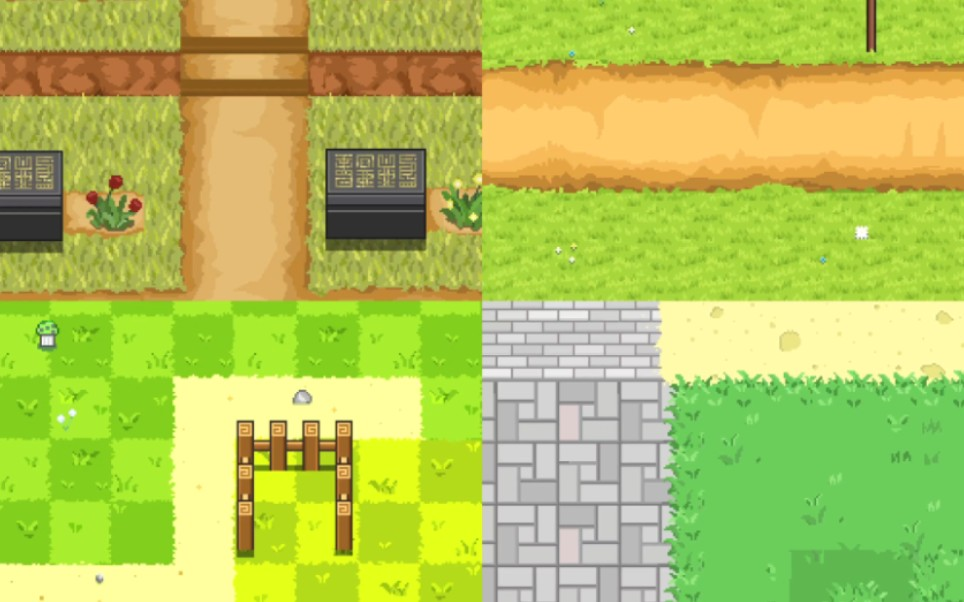
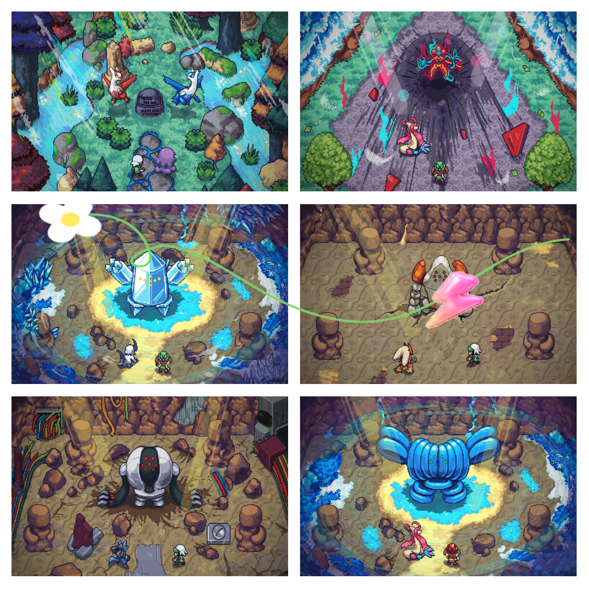
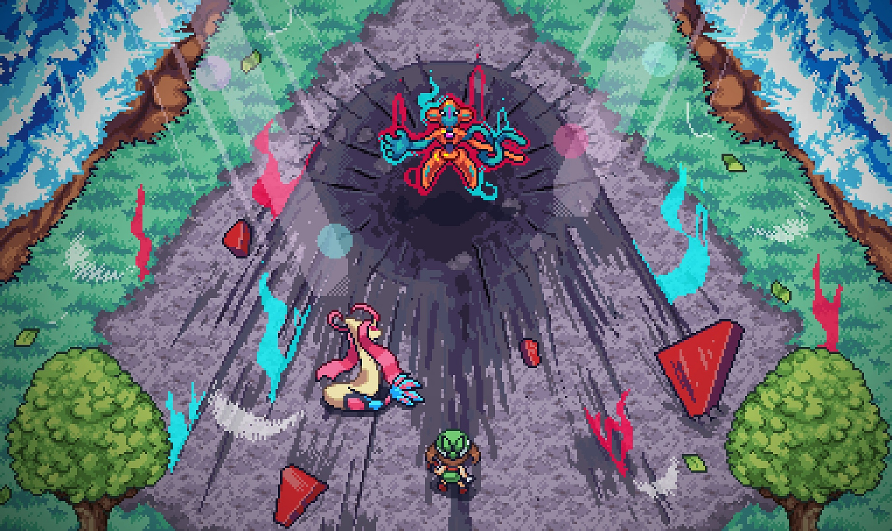

# 历史素材：references/game-scenes

这是已核源文件的归档，不表示当前游戏接入或组合方式已经验收。

## 四格地形拼贴；原源码作草地白天回退引用，保留作地形参考图，不列为战斗底图

- 文件：[grass-day-four-panel-terrain-collage--bd39dbd31611.jpg](grass-day-four-panel-terrain-collage--bd39dbd31611.jpg)
- 尺寸：964×602；帧数：1
- SHA256：`bd39dbd3161138d321a9622ecce232e4ead794ddcfb6e95f40e6ba10798d487f`
- 来源：历史项目素材；去敏来源记录见根目录 historical-assets.json。
- 状态：历史文件已核，运行接入未验证；参考拼图不冒充可直接运行战斗底图。

## 六格游戏场景拼贴；原源码作草地夜晚回退引用，保留作参考图，不列为战斗底图

- 文件：[grass-night-six-panel-collage--0171b69ef05d.png](grass-night-six-panel-collage--0171b69ef05d.png)
- 尺寸：1382×1382；帧数：1
- SHA256：`0171b69ef05d7595e07b5228d5f97411ce8f03d8bee084ae725990036735ed6b`
- 来源：历史项目素材；去敏来源记录见根目录 historical-assets.json。
- 状态：历史文件已核，运行接入未验证；参考拼图不冒充可直接运行战斗底图。

## 含角色与特效的像素场景；道路昼夜两条回退引用同一SHA，合并归档为一张参考图

- 文件：[road-day-night-shared-pixel-scene--ec8eebaeb485.jpg](road-day-night-shared-pixel-scene--ec8eebaeb485.jpg)
- 尺寸：2145×1280；帧数：1
- SHA256：`ec8eebaeb485d17475db2d325037ddac47490579302eea99186ef0f53f160604`
- 来源：历史项目素材；去敏来源记录见根目录 historical-assets.json。
- 状态：历史文件已核，运行接入未验证；参考拼图不冒充可直接运行战斗底图。

